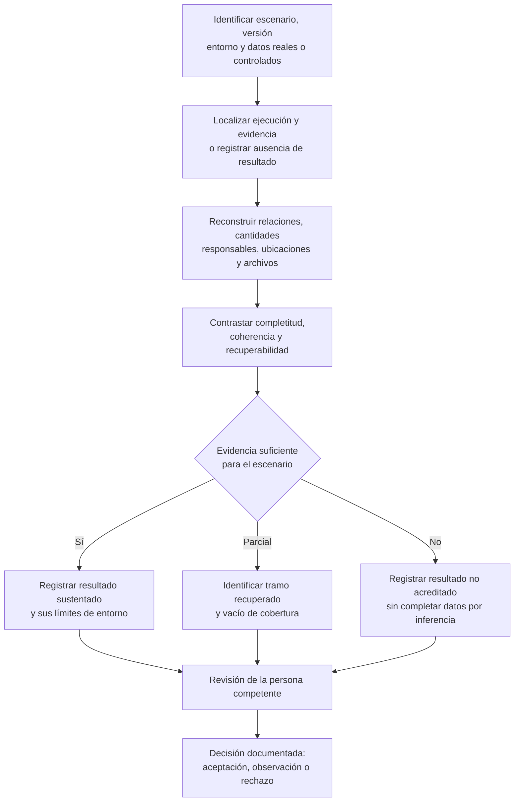

## 3.5. Fase de Transición: evaluación de la reconstrucción y entrega

> Parte del [Capítulo III](../../../documentacion-grado/06_entregables/proyecto_grado/03_capitulo_marco_aplicativo.md). Edición retrospectiva del 4 de noviembre de 2026. La evaluación distingue los resultados recuperados de informes técnicos de la validación operativa y la aceptación institucional.

### 3.5.1. Propósito y alcance de la evaluación

La fase de Transición abordó el quinto objetivo específico: **evaluar, mediante escenarios operativos representativos, en qué medida el sistema permite reconstruir, a partir de sus registros y evidencias, el recorrido del material vegetal**. La exposición se organizó en TR-1 y relacionó el producto construido con los resultados de verificación, los escenarios de reconstrucción y las condiciones de entrega.

La evaluación documental reunió los ensayos descritos en la sección 3.4.9 y el caso de guardado confirmado del 26 de octubre. Se examinó qué relaciones, cantidades y evidencias pudieron recuperarse en esos resultados y qué partes del recorrido conservaron cobertura incompleta. Cada resultado mantuvo el tipo de datos, la versión y el entorno de su fuente. Los ensayos controlados se distinguieron del caso realizado mediante el backend local.

Esta organización permitió presentar el funcionamiento del sistema desarrollado sin transformar una revisión de informes en una nueva prueba de campo. La validación con las personas responsables de R3Foresta y la aceptación de una liberación completa conservaron su registro propio en el tablero académico.

### 3.5.2. Escenarios y resultados de reconstrucción

Se conservaron EVA-01–EVA-09 para relacionar la ruta principal, las transferencias parciales, los resultados observados en Vivero, la devolución y la reconstrucción desde el destino. Las variantes externas permanecieron visibles porque formaron parte del alcance, aunque sus resultados no estuvieran acreditados por las pruebas de propagación y Plantación disponibles.

**Tabla 3.24**

*Escenarios de reconstrucción y balance de la evidencia examinada*

| Escenario | Recorrido examinado | Resultado recuperado de las fuentes | Alcance de la conclusión |
|---|---|---|---|
| EVA-01 · ruta propia completa | recolección → lote → asignación → plantación | el modelo y los contratos conservaron las relaciones; los ensayos PA cotejaron registro, asignación y consumo | cobertura parcial: no se acreditó una ejecución única con todos los antecedentes y archivos M1→M2→M3 |
| EVA-02 · consumo parcial del origen | una recolección abasteció varios lotes | el contrato M1→M2 explicó movimientos, cantidad, unidad y saldo restante | respaldo de diseño e implementación; no se recuperó una ficha completa de ejecución del escenario |
| EVA-03 · transformación observada y pérdida | material en proceso → plantas vivas → merma o descarte | eventos y reglas distinguieron INICIO, EMBOLSADO, MERMA y DESCARTE_PRE_EMBOLSADO | evidencia técnica histórica, sin atribuir cantidades observadas ni una ejecución nueva |
| EVA-04 · entrega y plantación parcial | lote → asignación → consumo inicial | INT04 cotejó tres comandos confirmados, cada uno con registro, detalle de consumo y fotografía; el intento con respuesta perdida consumió dos plantas una sola vez | respaldo técnico local de la relación entrega–consumo y ausencia de segundo débito de Vivero |
| EVA-05 · devolución física | remanente de asignación → lote de origen | INT02-D comprobó retorno único, saldos, rollback y ausencia de consumo indebido en las carreras descritas | respaldo en clúster sintético; no se atribuyó una devolución física observada en campo |
| EVA-06 · ingreso externo en Vivero | recepción o conteo de plantas vivas → lote | Elaboración distinguió procedencia declarada, etapa actual y comienzo del historial | sin resultado integrado acreditado; no se completó el origen mediante una recolección ficticia |
| EVA-07 · ingreso externo directo en Plantación | recepción directa → entrega y plantación | el diseño identificó custodia, consumo y remanentes como parte de la variante | sin implementación y ejecución integradas acreditadas en las fuentes revisadas |
| EVA-08 · reconstrucción inversa | plantación → detalles → asignaciones → antecedentes | el detalle propio, los snapshots y las proyecciones de INT05 recuperaron información del registro según audiencia | respaldo parcial: la consulta pública no acreditó una navegación universal hasta todos los antecedentes privados M1/M2 |
| EVA-09 · intento de inconsistencia | competencia por saldo, evidencia ajena o respuesta perdida | INT03-A/D/INT04 registraron rechazos, ausencia de efectos parciales y recuperación del mismo resultado en los casos cubiertos | respaldo técnico controlado de integridad y recuperación; sin extenderlo a toda operación del sistema |

*Nota.* Elaboración propia a partir de los contratos M1→M2 y M2→M3, los modelos de Elaboración y los informes [INT02-D](../../../../Backend-r3foresta/docs/pa-int02d-entrega-local.md), [INT03-A](../../../../Backend-r3foresta/docs/pa-int03a-entrega-local.md), [INT04](../../../../pwa-r3foresta/docs/QA_REGISTRO_PARTICIPANTE_INT04.md) e [INT05](../../../../pwa-r3foresta/docs/QA_IMPACTO_INT05.md), con sus fechas de octubre de 2026. La tabla presenta correspondencia de evidencia; no informa nueve escenarios nuevos ejecutados ni nueve aceptaciones.

La reconstrucción se interpretó dentro de la unidad de cada etapa. La cantidad de semillas recibida y el número de plantas observadas no se sumaron ni se compararon como si fueran una misma magnitud. La entrega física explicó la salida de Vivero; el detalle de plantación explicó qué parte de lo entregado se consumió. La presencia de varias personas participantes no multiplicó el total de plantas registrado.

### 3.5.3. Instrumento y criterios de interpretación

La ficha de evaluación reunió el escenario, tipo de datos real o controlado, fecha, versión, participantes, precondiciones, operaciones, resultado esperado, resultado observado, identificadores recuperados, evidencia, incidencias y decisión. En la revisión se utilizaron los campos que las fuentes aportaron. La ausencia de mediciones de tiempo o de una decisión de aceptación se conservó como ausencia, sin sustituirla por una estimación.

Se utilizaron tres criterios de lectura:

1. **Completitud:** presencia de procedencia, especie, cantidades y unidades, eventos, responsables, ubicaciones, evidencia y destino cuando correspondieron al escenario. La recuperación de una parte de la ruta se distinguió de la reconstrucción completa.
2. **Coherencia:** correspondencia entre movimientos, saldos y relaciones. Los resultados se contrastaron buscando dobles consumos, efectos parciales, cambios de unidad no explicados y asociaciones incorrectas de evidencia.
3. **Recuperabilidad:** posibilidad de obtener la información desde el origen, el destino o el identificador del intento, respetando la audiencia autorizada. La recuperación funcional se distinguió de una medición de rapidez o facilidad de uso.

La Figura 3.24 muestra la relación entre el escenario, la evidencia y la conclusión. La decisión de aceptación ocupó un paso propio porque el resultado técnico y la conformidad operativa respondieron a comprobaciones diferentes.

**Figura 3.24. Evaluación de una traza y registro de la decisión**

*Nota.* Elaboración propia a partir de los criterios de reconstrucción de la sección 2.6, los escenarios EVA-01–EVA-09 y la separación entre verificación, validación y aceptación adoptada en RUP. El diagrama describe el procedimiento; no acredita decisiones de aceptación que no consten en las fuentes.

### 3.5.4. Estabilización, documentación y condiciones de entrega

La estabilización abordó problemas concretos del recorrido. INT02-D documentó una inversión en el orden de bloqueos entre operaciones físicas y desactivación de campaña. El ajuste estableció campaña antes de subcampaña y se contrastó con claves foráneas y carreras adicionales. INT04 comprobó la recuperación de respuestas perdidas y el tratamiento de fotografías de otros intentos. INT05 examinó la navegación por audiencias y la regresión de los recorridos de registro y acceso. Estas correcciones relacionaron el defecto con el cambio y la comprobación de su efecto.

El caso del 26 de octubre aportó evidencia operativa acotada. La escritura inicial permanecía pausada por configuración; tras la autorización del responsable se habilitó el backend local y se reinició. El usuario confirmó el reintento y una consulta posterior identificó el comando CONFIRMADO asociado con el registro de plantación 13. El caso mostró el guardado de ese intento y la distinción entre consultar una preparación y reenviar la operación, conservando su clave.

La documentación de entrega se apoyó en las guías de [Recolección](../../../01-recoleccion-module/README.md), [Vivero](../../../02-vivero-module/README.md) y [Plantación](../../../03-plantacion-module/README.md), los contratos y los informes de QA con sus instrucciones de reproducción. Las fichas de implementación relacionaron las tareas con backend, frontend y SQL, y ESTADO.md conservó las confirmaciones de entorno. Estos materiales proporcionaron soporte técnico y operativo; no se presentaron como manuales finales aprobados por la institución.

La revisión de liberación distinguió versión de código, migraciones aplicadas, configuración, almacenamiento de evidencia, permisos y comprobación de recorridos en el destino. El despliegue coordinado de julio y las confirmaciones posteriores de desarrollo conservaron sus fechas y alcances. La habilitación del backend local del 26 de octubre tampoco se convirtió en un despliegue remoto de todo el producto.

PR, liberación del producto, se vinculó con una versión identificada, resultados finales, documentación y decisión de aceptación. La revisión documental no aportó una nueva acta PR ni sustituyó la revisión humana de uso móvil, la ceremonia WebAuthn real o la comprobación completa del entorno destino. Sus registros se conservaron en las [actividades de Transición del tablero académico](../../../documentacion-grado/02_planificacion/TODO_PROYECTO_GRADO.md#6-fase-de-transición--iteración-tr-1--2-al-15-de-noviembre).

### 3.5.5. Resultados de la evaluación y límites

La evaluación encontró respaldo técnico para la relación entre entrega y consumo, la devolución en los ensayos compartidos y el rechazo o recuperación de operaciones cubiertas por los informes. Las lecturas propia y pública de Plantación conservaron cantidades, especies, participantes históricos y evidencia autorizada. El caso de guardado local complementó los ensayos controlados con un resultado confirmado sobre un intento concreto.

La evidencia fue desigual para la reconstrucción del recorrido completo. Los contratos y el modelo relacionaron Recolección, Vivero y Plantación, pero las fuentes examinadas no aportaron una ejecución única de EVA-01 o EVA-08 con todos los antecedentes y archivos. Las incorporaciones externas conservaron su diseño y sus límites de implementación. Este resultado delimitó el alcance demostrado y evitó completar un origen o una pérdida mediante supuestos.

Los conteos de pruebas describieron ejecuciones técnicas y no una muestra de personas usuarias ni una cantidad de recorridos completos aceptados. No se calcularon porcentajes de completitud, reducción de tiempo, mejora de exactitud o aceptación de usuarios porque los informes no aportaron mediciones comparables para esos indicadores. Tampoco se atribuyó a la evidencia fotográfica una certificación de la realidad física.

En relación con OBJ-05, el capítulo dejó una evaluación sustentada de las capacidades observadas y de los vacíos de cobertura. La aceptación operativa integral conservó un alcance distinto de esta evaluación documental. La supervivencia, el mantenimiento posterior y los resultados de carbono quedaron fuera de la conclusión académica.

### 3.5.6. Síntesis de resultados del Marco aplicativo

**Tabla 3.25**

*Correspondencia entre objetivos, productos del capítulo y alcance demostrado*

| Objetivo | Producto desarrollado | Aporte sustentado | Límite de la conclusión |
|---|---|---|---|
| OBJ-01 · Analizar | diagnóstico, actores, necesidades, visión y alcance en Inicio | relación HAL→NEC→RF/CU y definición del recorrido; cierre de Inicio confirmado por el autor el 4 de noviembre | la decisión del autor conservó su fecha y no sustituyó una aprobación institucional independiente |
| OBJ-02 · Diseñar | casos de uso, procesos, modelos, arquitectura, contratos e invariantes en Elaboración | organización de procedencia, transformación observada, custodia, stock y evidencia; modelo físico contrastado de 51 tablas y 564 columnas | las variantes y riesgos RDI conservaron su estado técnico; conclusión del texto de diseño no equivalió a cierre formal LCA |
| OBJ-03 · Implementar | módulos General, Recolección, Vivero y Plantación; integraciones y registro recuperable | ruta implementada desde la recolección hasta el consumo de asignaciones en Plantación | incorporaciones externas, acceso específico por vivero y consulta transversal completa conservaron sus límites acreditados |
| OBJ-04 · Verificar | resultados por versión y entorno y matriz TC-01–TC-15 | pruebas unitarias, SQL/PostGIS, concurrencia, HTTP y navegador respaldaron las propiedades cubiertas | ejecuciones parciales y sucesivas no constituyeron una regresión final única ni el cierre de IOC |
| OBJ-05 · Evaluar | escenarios EVA-01–EVA-09 y valoración de completitud, coherencia y recuperabilidad | reconstrucción documentada de los tramos respaldados y distinción entre resultado técnico y aceptación | sin medición comparativa de tiempos ni validación operativa integral o acta PR acreditadas |

*Nota.* Elaboración propia a partir de las secciones 3.2–3.5, INV/RNF/RDI, los casos TC/EVA y las fuentes de las Tablas 3.22–3.24. La instrucción del autor del 4 de noviembre dio por terminado el texto de Elaboración y pidió concluir el Capítulo III con redacción de sistema desarrollado; las aceptaciones y los cierres técnicos mantuvieron sus registros separados.

El Marco aplicativo presentó el desarrollo de R3Foresta como una secuencia de decisiones y productos de RUP adaptado. Inicio relacionó la práctica de la organización con sus necesidades; Elaboración definió el recorrido y sus reglas; Construcción materializó los módulos y examinó su coherencia; Transición relacionó los resultados con los escenarios de reconstrucción y las condiciones de entrega.

El resultado central fue una representación informática que vinculó origen, manejo en vivero, entrega y plantación mediante identificadores, eventos, cantidades, responsables, ubicaciones y evidencia. Las conclusiones del Proyecto de Grado pudieron apoyarse en los aportes y límites de la Tabla 3.25, conservando la diferencia entre la información registrada, la consistencia comprobada y la aceptación del producto en operación.
