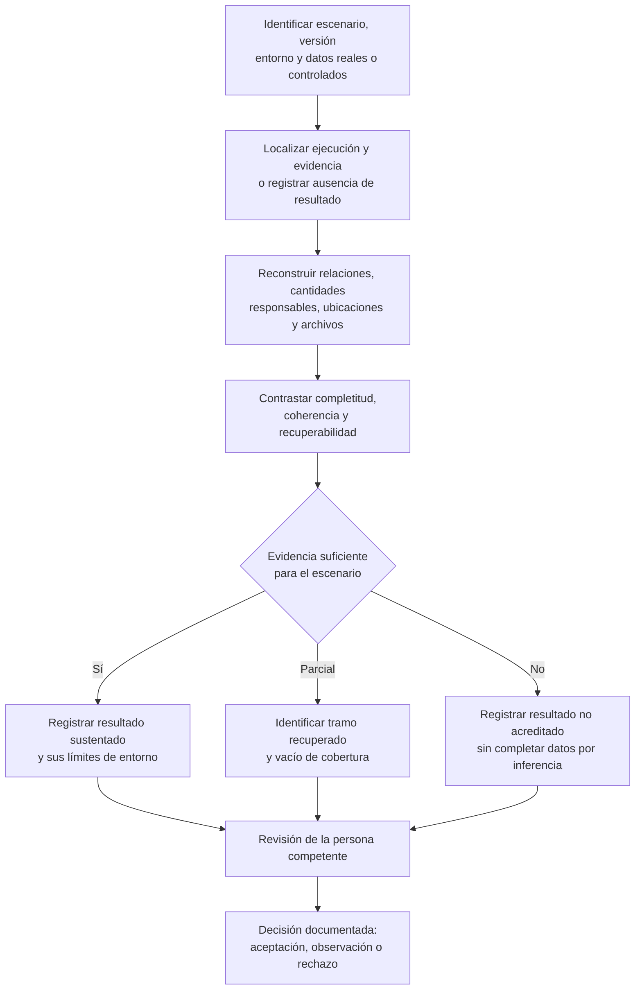

## 3.5. Validación y aceptación

Para maquetar las figuras en hojas carta verticales, usar las [láminas por figura](../../../../documentacion-grado/06_entregables/proyecto_grado/figuras/paginas/README.md). Los bloques Mermaid conservan la fuente completa; los diagramas extensos continúan en paneles legibles.

> Parte del [Capítulo III](03_capitulo_marco_aplicativo.md). Corte documental actualizado al 16 de noviembre de 2026. Evaluación de la evidencia disponible y criterios para la validación y liberación en TR-1.

### 3.5.1. Propósito y alcance de la evaluación

La fase de Transición abordó el quinto objetivo específico de **evaluar, mediante escenarios operativos representativos, en qué medida el sistema permite reconstruir, a partir de sus registros y evidencias, el recorrido del material vegetal**. La iteración TR-1, prevista del 2 al 15 de noviembre de 2026, organizó la evaluación, la estabilización y la preparación de la entrega bajo RUP adaptado. El periodo corresponde al cronograma académico. Los ensayos y las comprobaciones de octubre conservan sus fechas como antecedentes de la evaluación.

La evaluación documental reunió los contratos y el modelo de Elaboración, los resultados TC-01–TC-15 de la sección de Verificación y pruebas, el caso de guardado confirmado del 26 de octubre y los resultados posteriores de recepción e incorporación hasta el 16 de noviembre. La disciplina de pruebas aportó comprobaciones de integridad y recuperación. Gestión de configuración permitió identificar las bases de prueba, las versiones de entrega y los entornos. Despliegue reunió las condiciones de preparación y entrega. La evaluación operativa y la decisión de liberación requieren evidencia de la versión integrada; los avances posteriores al periodo previsto no prueban por sí solos el cierre de TR-1. [Elaboración](03_2_fase_elaboracion.md) · [Verificación y balance de IOC](03_verificacion_pruebas.md) · [Cronograma y actividades de TR-1](../../../../documentacion-grado/02_planificacion/TODO_PROYECTO_GRADO.md#6-fase-de-transición--iteración-tr-1--2-al-15-de-noviembre).

La verificación técnica respondió si las operaciones cubiertas respetaron sus reglas. La evaluación documental utilizó esos resultados para establecer qué partes de la traza pudieron reconstruirse. La validación operativa comprobará si las personas responsables pueden realizar el recorrido y recuperar sus antecedentes en condiciones representativas. La aceptación corresponderá a la persona autorizada, sobre la versión y los resultados revisados.

### 3.5.2. Escenarios y resultados de reconstrucción

Los escenarios EVA-01–EVA-09 se derivaron de la ruta propia, las operaciones que alteran o explican el saldo, las incorporaciones externas y la recuperación de antecedentes. La Tabla 3.24 compara el resultado esperado con la evidencia existente. Cuando el respaldo se limita al diseño o a una parte del recorrido, se identifica el vínculo o la comprobación que falta.

**Tabla 3.24**

*Escenarios de reconstrucción y balance de la evidencia examinada*

| Escenario | Criterio observable del recorrido | Evidencia disponible | Cobertura y comprobación pendiente |
|---|---|---|---|
| EVA-01 · ruta propia completa | Vincular recolección validada, lote, asignación y plantación. Recuperar especie, cantidades y unidades, fechas, responsables, ubicaciones y evidencia exigible en cada etapa. | Los contratos definen ambos enlaces. Los ensayos de Plantación cotejaron el registro, sus asignaciones y el consumo. | Parcial. Falta seguir un mismo recorrido M1→M2→M3 con sus antecedentes y archivos en una versión identificada. |
| EVA-02 · consumo parcial del origen | Seguir una recolección hacia más de un lote. Conciliar cada movimiento con la cantidad y unidad del inicio del lote y calcular el saldo restante. | El contrato M1→M2 y la implementación descrita en 3.3.4 respaldan el vínculo. | Falta una ficha de ejecución con los lotes y movimientos recuperados y los saldos antes y después. |
| EVA-03 · transformación observada y pérdida | Distinguir la entrada del material en proceso, el conteo observado de plantas embolsadas y los efectos de la merma o el descarte según la etapa. | Las reglas y los eventos INICIO, EMBOLSADO, MERMA y DESCARTE_PRE_EMBOLSADO distinguen los hechos. La sección 3.3.4 conserva el antecedente técnico. | Falta registrar en un escenario las cantidades, unidades, motivo y saldo observados. |
| EVA-04 · entrega y plantación parcial | Vincular la entrega con el detalle del consumo inicial y conciliar la cantidad entregada, la consumida y el saldo de la asignación. El saldo del lote permanece igual al registrar la plantación. | INT04 cotejó tres comandos confirmados con registro, detalle de consumo y fotografía. El intento con respuesta perdida consumió dos plantas una sola vez. | Verificación técnica local del consumo y de la ausencia de segundo débito de Vivero. Pendiente de comprobar el recorrido operativo con su entrega y remanente identificados. |
| EVA-05 · devolución física | Vincular la devolución al remanente de la asignación y al lote de origen. Cotejar el motivo, la cantidad retornada, la reducción del remanente y la restitución al saldo del lote. | INT02-D comprobó retorno único, saldos, reversión de la transacción y ausencia de consumo indebido en los ensayos descritos. | Verificación técnica en clúster sintético. Falta una ejecución representativa de la operación de devolución. |
| EVA-06 · ingreso externo en Vivero | Recuperar procedencia declarada, especie, cantidad y unidad, fecha, responsable y respaldo disponible desde la recepción o conteo, con inicio de historial en Vivero. | El 14 de noviembre se ensayó mediante API un saldo inicial por donación de tres plantas con fotografía sintética, recuperación y repetición, en el Supabase de pruebas y backend local. El 16 se observó en Chrome local un registro de plantación vinculado a un lote de saldo inicial de producción propia, con consulta de historial y fotografía. | Cobertura parcial de incorporación y recuperación por tramos; los dos ensayos tienen datos y alcances distintos. Faltan evaluación operativa representativa del ingreso externo y su recorrido integrado, otros roles, teléfono físico y entorno destino. Conservar RDI-01 y TC-15. |
| EVA-07 · ingreso externo directo en Plantación | Relacionar la recepción directa con su procedencia disponible, custodia, ubicación, cantidades recibidas y plantadas, remanente y respaldo. | Elaboración identifica la variante y sus límites de contrato. | Variante de diseño pendiente de implementación y evaluación integradas. Conservar RDI-01 y TC-15. |
| EVA-08 · reconstrucción inversa | Partir del identificador de plantación y recuperar por cada detalle la asignación, el lote, su origen, eventos y archivos que la persona esté autorizada a consultar. | INT05 recuperó datos y evidencias de Plantación mediante lecturas propias y públicas según audiencia. | Parcial. Falta reconstruir toda la cadena hasta M1 con una cuenta autorizada. La consulta pública se evalúa con los campos y fotografías habilitados para esa audiencia. |
| EVA-09 · intento de inconsistencia | Rechazar un consumo que excede el saldo o evidencia de otro intento. Ante concurrencia o pérdida de respuesta, cotejar que cada intento deje un resultado coherente y sin efectos duplicados o parciales. | INT03-A, INT02-D e INT04 documentaron carreras, rechazos y recuperación del mismo resultado en los casos cubiertos. El caso del 26 de octubre confirmó el reintento de un guardado en una instancia local. | Respaldo técnico acotado a las rutas ensayadas. Falta registrar el resultado de los casos críticos que se seleccionen sobre la versión candidata. |

*Nota.* Elaboración propia. Los criterios se derivan de los contratos y de los escenarios previstos. Las comprobaciones corresponden a las versiones y entornos consignados en las Tablas 3.22 y 3.23 y en los informes enlazados; no se extrapolan entre ensayos. [Contrato M1→M2](../../../../90-contratos-integracion/01_contrato_recoleccion_a_vivero.md) · [Contrato M2→M3](../../../../90-contratos-integracion/02_contrato_vivero_a_plantacion.md) · [INT02-D](../../../../../Backend-r3foresta/docs/pa-int02d-entrega-local.md) · [INT03-A](../../../../../Backend-r3foresta/docs/pa-int03a-entrega-local.md) · [INT04](../../../../../pwa-r3foresta/docs/QA_REGISTRO_PARTICIPANTE_INT04.md) · [INT05](../../../../../pwa-r3foresta/docs/QA_IMPACTO_INT05.md) · [Guardado del 26 de octubre](../../../../../pwa-r3foresta/docs/QA_REGISTRO_GUARDADO_51.md) · [Ensayo T5 del 14 de noviembre](../../../../../Backend-r3foresta/docs/t5-correcciones-pruebas-2026-11-14.md) · [QA T5 del 16 de noviembre](../../../../../pwa-r3foresta/docs/QA_T5_ITERACION_3.md).

La reconstrucción conservó la unidad de cada etapa. Las semillas recibidas y las plantas observadas se registraron como magnitudes distintas. La entrega física explicó la salida de Vivero y el detalle de plantación mostró qué parte de lo entregado se consumió. El total plantado se obtuvo de los detalles de consumo con independencia del número de participantes.

### 3.5.3. Instrumento y criterios de interpretación

La evaluación utilizó los datos que pudieron recuperarse de los informes. Para una nueva ejecución se definió una ficha por escenario con fecha, versión y entorno, tipo de datos, rol de la persona, dispositivo y conectividad cuando influyan en la tarea, precondiciones, pasos, resultado esperado y observado, identificadores recuperados, evidencia, tiempo cuando se mida, incidencias y decisión. Los campos sin respaldo quedan identificados como pendientes de observación.

1. **Completitud.** Contrastar los datos, enlaces y archivos recuperados con los esperados para el escenario. Una traza completa reúne todos los elementos exigibles desde su origen registrado hasta el destino evaluado. Cuando falte un dato o vínculo, se identifica la etapa afectada.
2. **Coherencia.** Conciliar las cantidades con sus unidades, eventos y saldos. En M1→M2 se compara el consumo del origen con el inicio del lote. En M2→M3 se verifica el débito al entregar, el consumo de la asignación al plantar y, si corresponde, la restitución al devolver. Los cambios entre material en proceso y plantas vivas se explican mediante el conteo observado en Vivero.
3. **Recuperabilidad.** Registrar el punto de partida, el perfil autorizado, los pasos realizados y si los antecedentes y archivos pudieron abrirse. Si se mide el tiempo, registrar el intervalo desde que se entrega el identificador de partida hasta que la persona reúne los elementos requeridos o se detiene por un impedimento. La observación de carga operativa registra pasos, dificultades y ayuda requerida. [Criterios del marco teórico](../../../../documentacion-grado/06_entregables/proyecto_grado/02_capitulo_marco_teorico_conceptual.md#26-reconstrucción-y-comprobación-de-la-trazabilidad).

La Figura 3.24 muestra la relación entre el escenario, la evidencia y la conclusión. La decisión de aceptación ocupó un paso propio porque el resultado técnico y la conformidad operativa respondieron a comprobaciones diferentes.

**Figura 3.24. Evaluación de una traza y registro de la decisión**

<!-- diagrama: 03_4_fase_transicion-01 -->

*Nota.* Elaboración propia a partir de los criterios de reconstrucción de la sección 2.6, los escenarios EVA-01–EVA-09 y la distinción entre verificación, validación y aceptación adoptada en RUP. La decisión corresponde a la persona autorizada que revisa el resultado y la evidencia del escenario.

#### 3.5.3.1. Demostración operativa de la traza integrada

Para la primera demostración se propuso combinar EVA-01 y EVA-08 con un mismo recorrido, porque ambos evalúan los enlaces entre las tres etapas desde puntos de partida distintos. EVA-04 puede observarse durante ese recorrido si queda un remanente de la entrega. Se utilizará una operación real autorizada o un conjunto de datos controlados, con cuentas habilitadas para cada acción y una versión identificada de la PWA, la API y la base de datos.

1. **Desde el origen (EVA-01).** Registrar o seleccionar una recolección validada con su evidencia, seguir la entrada a Vivero y recuperar los eventos que explican el saldo vivo. Identificar la asignación física a la subcampaña y vincularla con el registro de plantación. La persona que realiza cada tarea contrasta los identificadores, la especie, las cantidades, las fechas y la evidencia exigible.
2. **Desde la plantación (EVA-08).** Entregar solo el identificador de la plantación a la persona autorizada para consultar. Registrar si puede recorrer el detalle hasta cada asignación, lote y recolección, abrir los archivos permitidos y explicar las cantidades. Si necesita apoyo o una consulta técnica para completar la ruta, se consigna qué vínculo pudo recuperar por cada medio.
3. **Conciliación del saldo (EVA-04).** Comparar el saldo del lote antes y después de la entrega y comprobar que la plantación consume únicamente la cantidad registrada de la asignación. Contrastar el total plantado con la suma de sus detalles y explicar el remanente según los movimientos observados.

La sesión debe involucrar a personas que representen las tareas de Recolección, Vivero y Plantación, de acuerdo con los perfiles disponibles en la versión evaluada. Sus observaciones se registrarán junto al resultado de la reconstrucción y servirán para revisar la suficiencia operativa del recorrido. Las variantes de ingreso externo permanecen en EVA-06 y EVA-07 y requieren sus propias precondiciones y resultados. [Actores de Inicio](03_1_fase_inicio.md#314-actores-y-distribución-funcional-de-responsabilidades) · [Riesgos de Elaboración](03_2_fase_elaboracion.md#3211-riesgos-y-vacíos-que-condicionan-el-cierre-del-diseño).

### 3.5.4. Estabilización, documentación y condiciones de entrega

#### 3.5.4.1. Ajustes comprobados y antecedentes de entorno

INT02-D corrigió una inversión en el orden de bloqueos entre operaciones físicas y la desactivación de campaña. El ajuste estableció campaña antes de subcampaña y se contrastó con claves foráneas y carreras adicionales. INT04 comprobó la recuperación de respuestas perdidas y el tratamiento de fotografías de otros intentos. INT05 examinó la navegación por audiencias y la regresión de registro y acceso. Los resultados corresponden a las bases y entornos de la Tabla 3.22. [Resultados técnicos de verificación](03_verificacion_pruebas.md#342-resultados-técnicos-documentados).

El 26 de octubre, una solicitud de guardado inicial recibió HTTP 503 con la escritura pausada por configuración. Tras habilitarla en el backend local, el usuario confirmó el reintento. Una consulta posterior identificó el comando en estado CONFIRMADO, vinculado al registro de plantación 13. Otra preparación seguía en estado PREPARADO. El resultado observado acreditó el guardado de un intento en la instancia local. El informe distingue la consulta del estado de una preparación del reenvío que conserva la clave original. [Informe de guardado](../../../../../pwa-r3foresta/docs/QA_REGISTRO_GUARDADO_51.md).

El 23 de julio se confirmó el despliegue coordinado de la integración física M2↔M3 y la aplicación de las migraciones 056 y 057 en producción. El 21 de octubre se registraron la actualización informada de Render y backend local en `fbf2529` y el cotejo de desarrollo en el alcance documentado para 083, 081 y 082. Estos registros identifican entregas y comprobaciones de entorno concretas. La versión candidata integral y su verificación conjunta permanecen pendientes en CO-4. [Registro histórico de julio](../../../estado-2026-10-17-antes-consolidacion.md#base-existente-y-pendientes-conservados) · [Estado por versión y entorno](../../../../ESTADO.md).

El 12 de noviembre Pablo reportó la ejecución y las pruebas funcionales de la recepción única 100, que sustituyó los cortes 096–099. El 14 se ensayó la incorporación T5 con backend local y Supabase de pruebas mediante un fixture de donación y una fotografía sintética. El 16 se documentó otro recorrido en Chrome de escritorio con sesión ADMIN: registro de plantación 20, asignación 53 y lote 125 de saldo inicial de producción propia, con acceso a su historial y fotografía. La PWA identificada para T5 fue `c6bdec9` y el backend de integración `3cb82e4` está incluido en `b57192c`; Pablo confirmó la aplicación de 109 y 110. Estos resultados no equivalen a la evaluación integral ni a la aceptación en teléfono físico. Otros roles, recorridos, entorno externo y despliegue conservan sus comprobaciones pendientes. [Estado y límites](../../../../ESTADO.md#actualización-documental-aprobada-del-16-de-noviembre) · [Recepción única](../../../../../Backend-r3foresta/docs/t4-recepcion-semillas.md) · [Ensayo T5](../../../../../Backend-r3foresta/docs/t5-correcciones-pruebas-2026-11-14.md) · [QA T5](../../../../../pwa-r3foresta/docs/QA_T5_ITERACION_3.md).

#### 3.5.4.2. Productos y decisión de liberación

La revisión de PR (liberación del producto) requiere asociar la decisión con los siguientes productos de TR-1. Las actividades y su estado se controlan en el [tablero académico](../../../../documentacion-grado/02_planificacion/TODO_PROYECTO_GRADO.md#6-fase-de-transición--iteración-tr-1--2-al-15-de-noviembre).

- **Versión y entorno.** Identificar código de backend y PWA, migraciones, configuración y datos iniciales. Comprobar permisos, almacenamiento de evidencia y funcionamiento de los recorridos seleccionados en el entorno autorizado. El estado del sistema conserva confirmaciones parciales por capa. [Estado de implementación](../../../../ESTADO.md).
- **Resultados e incidencias.** Reunir fichas de los escenarios seleccionados, resultados de regresión y defectos con su tratamiento. Repetir los casos afectados por cada corrección y registrar las limitaciones de alcance, incluidas las variantes externas y los riesgos asociados. Para el recorrido de Participación aliada se mantienen las comprobaciones pendientes de uso móvil, WebAuthn real y entorno destino según su tablero. [Riesgos de Elaboración](03_2_fase_elaboracion.md#3211-riesgos-y-vacíos-que-condicionan-el-cierre-del-diseño) · [Tablero PA-F01](../../../../specs/plantacion/participacion-aliada/implementacion/README.md).
- **Documentación de entrega.** Consolidar el manual técnico, el manual de usuario y la guía de operación para la versión evaluada. Las guías por módulo, contratos e informes de QA aportan las instrucciones y referencias de partida. [Recolección](../../../../01-recoleccion-module/README.md) · [Vivero](../../../../02-vivero-module/README.md) · [Plantación](../../../../03-plantacion-module/README.md).
- **Registro de aceptación.** Identificar quién revisó la versión, cuándo, qué resultados y defectos examinó y qué decisión tomó. Si la decisión queda sujeta a condiciones, consignar su alcance, responsables y verificación pendiente. El registro de decisión PR permanece pendiente.

### 3.5.5. Resultados de la evaluación y límites

**Completitud.** En Plantación se recuperaron el registro, los detalles por asignación y la evidencia vinculada en los ensayos cubiertos. La comprobación conjunta de los antecedentes y archivos de Recolección, Vivero y Plantación permanece parcial en EVA-01 y EVA-08. EVA-06 cuenta con ensayos parciales de incorporación y recuperación; EVA-07 conserva cobertura de diseño, sin implementación ni evaluación integrada acreditadas.

**Coherencia.** Los ensayos respaldaron la separación entre entrega y consumo, la restitución de saldo en los casos de devolución y la ausencia de duplicados o efectos parciales en las operaciones ensayadas. Estos resultados corresponden a los movimientos y escenarios observados.

**Recuperabilidad.** El caso de guardado local acreditó la identificación de un intento confirmado y su vínculo con el registro. Las consultas ensayadas recuperaron datos y fotografías de Plantación según audiencia; el recorrido T5 del 16 permitió además consultar historial y fotografía del lote desde el registro observado. Los tiempos de reconstrucción y la carga operativa con personas usuarias quedan pendientes de medición.

El resultado de OBJ-05 es una evaluación documental con cobertura demostrada por tramos. La demostración integrada y la revisión operativa permitirán determinar qué antecedentes puede recuperar la organización a lo largo de toda la ruta. El alcance de la evaluación termina en el registro de plantación. Las fotografías se interpretan como evidencia asociada al hecho registrado.

### 3.5.6. Síntesis de resultados del Marco aplicativo

**Tabla 3.25**

*Correspondencia entre objetivos, productos del capítulo y alcance demostrado*

| Objetivo | Producto desarrollado | Aporte sustentado | Límite de la conclusión |
|---|---|---|---|
| OBJ-01 · Analizar | diagnóstico, actores, necesidades, visión y alcance en Inicio | relación HAL→NEC→RF/CU y definición del recorrido, con cierre de Inicio confirmado por el autor el 4 de noviembre | la decisión corresponde a la revisión del autor sobre los productos de Inicio |
| OBJ-02 · Diseñar | casos de uso, procesos, modelos, arquitectura, contratos e invariantes en Elaboración | organización de procedencia, transformación observada, custodia, stock y evidencia; el extracto físico aportado contiene 57 tablas y 622 columnas | el proyecto y la fecha de exportación del extracto no están identificados; las variantes y riesgos RDI conservan su seguimiento y la decisión formal LCA permanece pendiente |
| OBJ-03 · Implementar | módulos General, Recolección, Vivero y Plantación con integraciones y registro recuperable | funciones de la ruta propia y avances locales en acceso por vivero, recepción e incorporación T5, con evidencia acotada por entorno | recepción externa directa en Plantación y consulta transversal completa conservan sus pendientes; los avances parciales requieren sus verificaciones externas y aceptación |
| OBJ-04 · Verificar | resultados por versión y entorno y matriz TC-01–TC-15 | pruebas unitarias, SQL/PostGIS, concurrencia, HTTP y navegador respaldaron las propiedades cubiertas | la regresión final sobre una versión integrada y el cierre de IOC permanecen pendientes |
| OBJ-05 · Evaluar | escenarios EVA-01–EVA-09 y valoración de completitud, coherencia y recuperabilidad | reconstrucción documentada de los tramos respaldados | faltan la demostración integrada, la observación de uso y tiempos y el registro de la decisión PR |

*Nota.* Elaboración propia a partir de las secciones 3.2–3.5, INV/RNF/RDI, los casos TC/EVA y las fuentes de las Tablas 3.22–3.24. El cierre de redacción del 4 de noviembre corresponde a la decisión del autor. Los hitos técnicos y las aceptaciones conservan sus registros propios.

El Marco aplicativo presentó el desarrollo de R3Foresta como una secuencia de decisiones y productos de RUP adaptado. Inicio relacionó la práctica de la organización con sus necesidades; Elaboración definió el recorrido y sus reglas; Construcción materializó los módulos y examinó su coherencia; Transición relacionó los resultados con los escenarios de reconstrucción y las condiciones de entrega.

El resultado central fue una representación informática que vinculó origen, manejo en vivero, entrega y plantación mediante identificadores, eventos, cantidades, responsables, ubicaciones y evidencia. Las conclusiones del Proyecto de Grado pudieron apoyarse en los aportes y límites de la Tabla 3.25, conservando la diferencia entre la información registrada, la consistencia comprobada y la aceptación del producto en operación.
