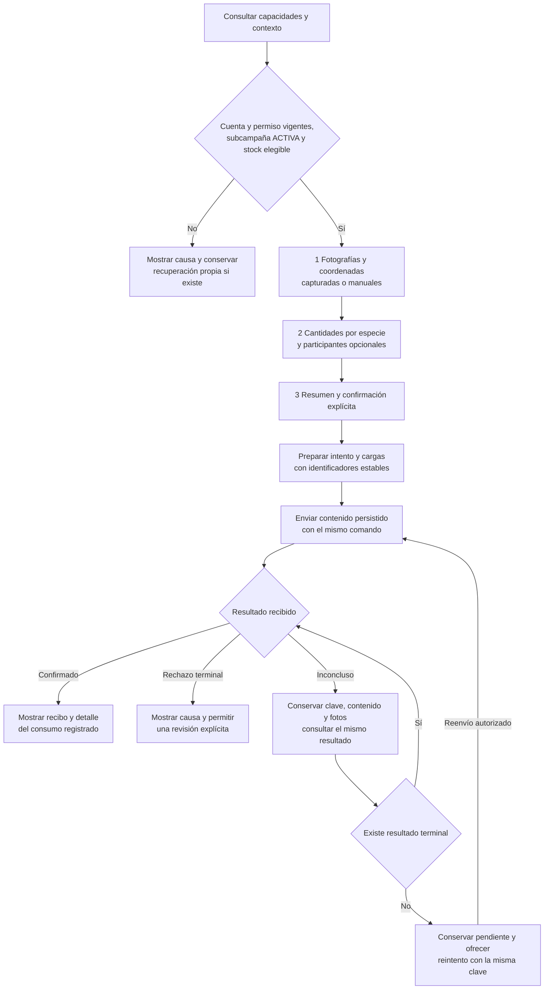
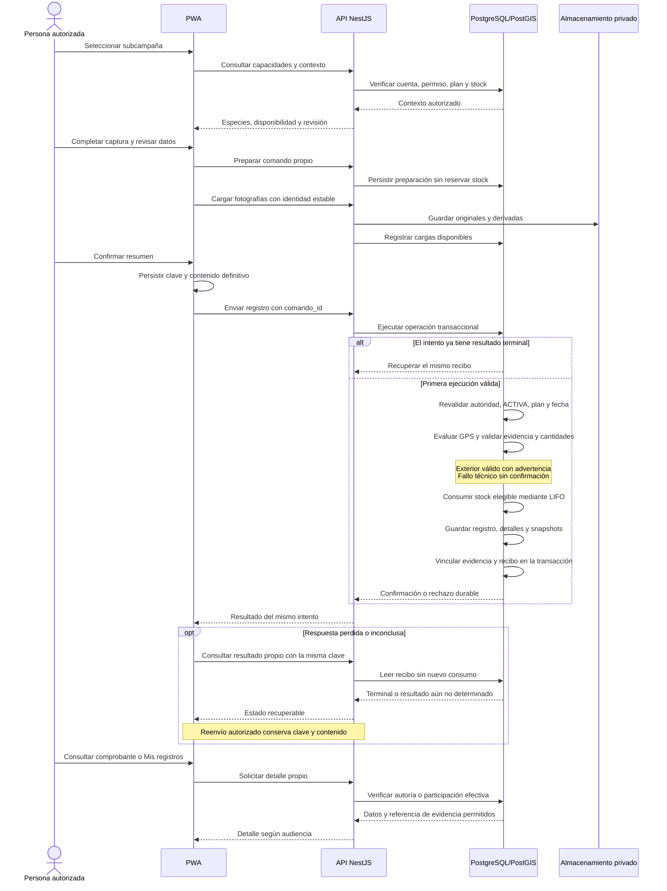

## 3.4. Fase de Construcción: implementación e integración de los módulos

Para maquetar las figuras en hojas carta verticales, usar las [láminas por figura](../../../../documentacion-grado/06_entregables/proyecto_grado/figuras/paginas/README.md). Los bloques Mermaid conservan la fuente completa; los diagramas extensos continúan en paneles legibles.

> Parte del [Capítulo III](03_capitulo_marco_aplicativo.md). Edición retrospectiva del 4 de noviembre de 2026, actualizada con evidencia disponible hasta el 16 de noviembre. Las versiones y los resultados técnicos conservan las fechas y los entornos de sus fuentes.

### 3.4.1. Propósito y organización de la construcción

La fase de Construcción materializó el tercer objetivo específico: **implementar en el sistema las funciones de Recolección, Vivero y Plantación necesarias para mantener vinculada la información del material vegetal durante su recorrido**. A partir de los requisitos, modelos y contratos de Elaboración, se desarrollaron las pantallas, los servicios y las operaciones de persistencia que relacionaron el origen registrado con el destino plantado.

El trabajo se organizó mediante CO-1, CO-2, CO-3 y CO-4. Estas etiquetas conservaron la distribución académica del proyecto; las fechas reales de los cambios y las pruebas se mantuvieron en sus informes. Los componentes construidos antes del periodo planificado se incorporaron como antecedentes técnicos. Las entregas INT de Participación aliada aportaron refinamientos de autorización, captura, recuperación y consulta, sin convertirse en nuevas fases de RUP.

**Tabla 3.21**

*Organización de los incrementos y sus aportes al producto integrado*

| Iteración | Capacidad desarrollada | Riesgo principal tratado | Artefactos y evidencia relacionados |
|---|---|---|---|
| CO-1 | captura, revisión e historial de Recolección | origen incompleto, unidad incorrecta o pérdida del historial | RF-REC, reglas de Recolección, checklist de validación y contrato M1→M2 |
| CO-2 | manejo del lote de Vivero e integración M1→M2 | confundir material en proceso con plantas vivas o consumir dos veces el origen | RF-VIV, eventos del lote, descarte pre-embolsado y contrato de transferencia |
| CO-3 | planificación, entrega física y registro de Plantación | doble descuento, consumo excesivo o actuación sin permiso | RF-PLA, contrato M2→M3, migraciones 051–057 y refinamientos PA-S00/01/03 |
| CO-4 | integración de consultas, recuperación y regresión | duplicar un registro tras una respuesta perdida o exponer datos de otra audiencia | comandos y recibos, INT02-D, INT04, INT05, informes de QA y versiones de entrega |

*Nota.* Elaboración propia a partir del cronograma de la sección 3.1.4, los requisitos de los módulos, los [contratos de integración](../../../../90-contratos-integracion/README.md) y el [tablero PA-F01](../../../../specs/plantacion/participacion-aliada/implementacion/README.md). La tabla relaciona aportes técnicos con la organización de RUP; los cierres de IOC y PR se distinguen de las entregas locales.

En cada incremento se relacionaron requisitos y reglas con decisiones de implementación y comprobaciones. Las disciplinas de análisis y diseño continuaron durante la construcción cuando se refinaron el reparto del stock, los permisos y el tratamiento de respuestas inconclusas. Las pruebas acompañaron estos cambios y proporcionaron la evidencia examinada en la sección 3.4.9.

### 3.4.2. Implementación de la arquitectura

La solución se implementó mediante una PWA en React y TypeScript, una API REST en NestJS y una base PostgreSQL con PostGIS y almacenamiento de archivos en Supabase. La interfaz organizó la captura y la consulta por funcionalidades; la API verificó identidad y autoridad y coordinó los casos de uso; la base de datos conservó relaciones, movimientos y saldos. El [modelo físico presentado en Elaboración](03_2_fase_elaboracion.md#3383-modelo-físico-y-contraste-con-la-base-de-datos-documentada) documenta el extracto aportado el 16 de noviembre: 57 tablas, 622 columnas y 175 relaciones; el proyecto y la fecha de exportación no están identificados. El contraste del 4 de noviembre, de 51 tablas y 564 columnas, permanece como antecedente histórico.

Las operaciones críticas de transferencia, asignación, devolución y registro inicial se concentraron en funciones transaccionales. Esta decisión permitió confirmar conjuntamente los registros y los movimientos relacionados o revertir sus efectos ante un fallo. En las operaciones con competencia por el mismo saldo se utilizaron bloqueos y una nueva comprobación de disponibilidad antes de confirmar. Las garantías correspondieron a las rutas que aplicaron ese protocolo; el SQL privilegiado que lo omitiera quedó fuera de esa protección cooperativa.

Los archivos conservaron un ciclo separado de la transacción de datos. En el registro participante, la carga preparó los originales privados y sus versiones derivadas; la confirmación vinculó únicamente la evidencia disponible y perteneciente al intento. La recuperación y la limpieza distinguieron archivos provisionales de archivos ya asociados con un hecho confirmado. De esta manera, un error de red no justificó borrar fotografías confirmadas ni repetir el consumo.

La autenticación privada utilizó un token JWT verificado y la consulta de la cuenta activa. En los controladores internos inspeccionados, `InternalActorGuard` derivó la identidad y el rol desde esas comprobaciones. El encabezado legado `x-auth-id` se trató como compatibilidad con la identidad verificada y se rechazó cuando no coincidió con el token. Esta implementación actualizó la observación de seguridad de julio. Los permisos por subcampaña se comprobaron además en la operación correspondiente; el acceso específico por vivero contó con implementación y pruebas locales T1–T3, con los límites de entorno y corte señalados en RDI-02.

*Fuentes de implementación:* [arquitectura observada y su corte histórico](../../../../ARCHITECTURE.md), [control de identidad](../../../../../Backend-r3foresta/src/auth/verified-actor.guard.ts), [adaptación de controladores internos](../../../../../Backend-r3foresta/src/auth/internal-actor.guard.ts) y [estado por versión y entorno](../../../../ESTADO.md).

### 3.4.3. Módulo General y Recolección

El Módulo General proporcionó las referencias compartidas de usuarios, especies, viveros, organizaciones, territorios y ubicaciones. Se mantuvo el catálogo cerrado de roles ADMIN, GENERAL, VALIDADOR y VOLUNTARIO. La afiliación declarada a una organización se conservó separada de la autoridad para operar, y los registros históricos utilizaron copias de los datos relevantes, denominadas snapshots, para conservar su interpretación ante cambios posteriores de los catálogos.

La administración de roles globales se incorporó mediante una pantalla exclusiva de ADMIN. La operación conservó el motivo, la confirmación explícita, la comprobación de autoridad vigente y la protección del último administrador. Su [verificación local del 3 de noviembre](../../../../../pwa-r3foresta/docs/QA_USUARIOS_ADMINISTRACION.md) identificó las versiones backend `5fb723b` y PWA `37cec4d`.

Recolección implementó el registro de procedencia, especie, tipo de material, cantidad, unidad, fecha, responsable, vivero, ubicación y evidencia. El flujo distinguió borrador, solicitud de validación y decisión de aprobación o rechazo. La solicitud de validación exigió la ubicación y la evidencia fotográfica establecidas en RF-REC-04. Las semillas conservaron su cantidad en gramos o unidades, mientras que los esquejes utilizaron unidades enteras.

La aprobación fijó la información histórica del origen. Los consumos destinados a Vivero y los desechos se representaron mediante movimientos que explicaron el saldo restante, sin sustituir la cantidad original. Las consultas de detalle e historial permitieron relacionar la recolección con sus movimientos y destinos. Las reglas y las comprobaciones de este incremento se conservaron en el [módulo Recolección](../../../../01-recoleccion-module/README.md) y su [checklist de validación](../../../../01-recoleccion-module/03_checklist_validacion_recoleccion.md).

La recepción única de semillas vinculó el hecho físico y la validación en una misma operación, con receptor distinto del recolector y autorización para el vivero de almacenamiento. La versión 100 quedó identificada en backend `6e5e756` y PWA `a30c54f`; Pablo reportó su ejecución y pruebas funcionales el 12 de noviembre. El informe conserva los límites de entorno y aceptación. [Contrato de recepción](../../../../../Backend-r3foresta/docs/t4-recepcion-semillas.md) · [QA y AUD-036](../../../../../pwa-r3foresta/docs/QA_RECEPCION_UNICA.md).

El expediente de CO-1 mantuvo un alcance distinto del de los ensayos de Participación aliada: las pruebas de M3 no acreditaron por extensión todas las operaciones de M1. La consolidación de sus resultados completos se conservó como RDI-07, sin alterar la descripción funcional del módulo desarrollado.

### 3.4.4. Módulo Vivero e integración M1→M2

Vivero implementó el lote como unidad de seguimiento del material recibido desde una recolección. El inicio conservó la cantidad y la unidad del material de origen, registró su consumo y creó el evento INICIO. La relación permitió que una misma recolección abasteciera varios lotes mediante consumos diferenciados, conservando un único origen por lote.

El sistema distinguió el material en proceso de las plantas vivas observadas. Antes de EMBOLSADO, el saldo vivo permaneció nulo. El embolsado registró el número de plantas efectivamente obtenido en UNIDAD, sin convertir automáticamente gramos de semillas en plantas ni interpretar la diferencia entre ambas magnitudes como una pérdida.

Cuando el proceso terminó sin producir plantas vivas, DESCARTE_PRE_EMBOLSADO registró causa, cantidad afectada y evidencia y cerró el lote. La interfaz habilitó esa acción únicamente en un lote activo con INICIO y sin EMBOLSADO. Después del embolsado, las pérdidas se registraron como MERMA y afectaron las plantas que permanecían físicamente en el vivero.

Los movimientos de salida se diferenciaron según su destino. El despacho manual atendió DONACION, VENTA y OTRO; la asignación física utilizó un formulario específico para campaña, subcampaña, propósito, cantidad, fecha y evidencia. La separación de ambos recorridos quedó registrada en el cambio frontend `562a97e` y sus comprobaciones del 23 de julio de 2026.

El [contrato M1→M2](../../../../90-contratos-integracion/01_contrato_recoleccion_a_vivero.md) relacionó el movimiento de origen, el lote y el evento inicial. El historial del lote conservó los hechos de manejo y las salidas posteriores. La incorporación T5 creó un lote de plantas vivas desde una recepción o conteo, con procedencia declarada, foto privada y una base viva alternativa a EMBOLSADO. El QA del 16 de noviembre documentó la reconstrucción inversa, con sesión ADMIN en Chrome local, desde el registro de plantación 20 hasta la asignación 53 y el lote 125, con consulta de historial y foto. Identificó PWA `c6bdec9` y backend de integración `3cb82e4` incluido en `b57192c`; la aplicación de 109/110 fue confirmada por Pablo. Teléfono físico, otros roles y recorridos, despliegue externo y diferencias de etapa y variedad permanecen pendientes. La recepción externa directa en Plantación conserva su diseño y evaluación pendientes. [QA T5](../../../../../pwa-r3foresta/docs/QA_T5_ITERACION_3.md) · [Estado](../../../../ESTADO.md).

### 3.4.5. Módulo Plantación e integración M2→M3

Plantación implementó campañas y subcampañas con zona, fechas, plan por especie, polígono y equipo. La campaña obtuvo su estado y su meta agregada mediante sus subcampañas. La coordinación se representó como responsabilidad del equipo y se mantuvo separada del rol global y de los permisos de participación.

La planificación habilitó la activación con cobertura de stock parcial o nula. El plan por especie orientó el avance; el saldo físico elegible limitó las cantidades registrables. Alcanzar o superar la meta no cerró automáticamente la subcampaña. El cierre se trató como una operación explícita, conservando la regla aceptada de ausencia de reapertura y la devolución del remanente como hecho separado.

La integración M2→M3 distinguió entrega y plantación. Al crear una asignación, la transacción descontó las plantas del lote, generó el movimiento de salida y creó stock disponible en la subcampaña. El registro de plantación consumió esa asignación y conservó su procedencia, sin generar un segundo despacho ni disminuir otra vez el saldo del vivero. La devolución incrementó la cantidad devuelta y repuso físicamente el saldo del lote de origen. La cantidad asignada original permaneció inmutable.

El saldo de la asignación se explicó mediante la relación:

`saldo_asignado_disponible = cantidad_asignada − cantidad_consumida − cantidad_devuelta − cantidad_mermada`.

Las migraciones 051–057 materializaron la base de esta integración y los refinamientos posteriores de Participación aliada incorporaron autorización, recuperación y reparto en servidor. La aplicación productiva de 056/057 y el despliegue coordinado del 23 de julio conservaron su condición de antecedente confirmado; no se utilizaron para atribuir despliegue a los cambios posteriores.

#### 3.4.5.1. Registro inicial participante y recuperación del intento

El registro inicial se implementó en tres pasos: fotografías y ubicación; cantidades y participantes; resumen y confirmación. La persona autenticada seleccionó una subcampaña ACTIVA para la que dispuso de permiso vigente. ADMIN global pudo registrar directamente con las mismas validaciones de negocio. La afiliación a una organización y la inclusión histórica como participante no concedieron autoridad operativa.

El contexto entregó especies, revisión del plan y disponibilidad autorizada. La persona indicó cantidades por especie y el servidor resolvió su distribución sobre las asignaciones elegibles mediante LIFO: fecha de asignación e identificador descendentes. La selección excluyó otros ámbitos, propósitos y entregas posteriores a la fecha operativa. El orden de consumo se mantuvo separado del orden de bloqueo utilizado para controlar la concurrencia.

La Figura 3.23 reúne el recorrido de captura y la confirmación transaccional. El GPS pudo capturarse automáticamente o señalarse manualmente. PostGIS evaluó la relación con el polígono: un punto exterior válido generó advertencia y permitió continuar; un fallo técnico de evaluación no se interpretó como ubicación exterior ni confirmó el registro.

**Figura 3.23. Flujo y secuencia del registro inicial de plantación**

*a) Captura, confirmación y recuperación desde la interfaz*

*b) Autoridad, consumo y evidencia en la confirmación*

*Nota.* Elaboración propia a partir de PA-S01, D01–D12, la [entrega INT03-A](../../../../../Backend-r3foresta/docs/pa-int03a-entrega-local.md), el [informe INT04](../../../../../pwa-r3foresta/docs/QA_REGISTRO_PARTICIPANTE_INT04.md) y el [caso de guardado del 26 de octubre](../../../../../pwa-r3foresta/docs/QA_REGISTRO_GUARDADO_51.md). Los dos paneles describen el mismo recorrido y sustituyen la secuencia histórica de reparto en el cliente. La lectura propia se actualiza conforme a RF-PLA-14 y al contrato de participantes efectivos; el estado de su verificación se distingue a continuación.

La recuperación distinguió confirmación, rechazo terminal e incertidumbre. Ante una respuesta perdida, la PWA conservó la clave, el contenido y las fotografías y consultó el resultado propio. El reenvío del mismo intento recuperó el recibo o ejecutó la operación una sola vez. Un contenido distinto con la misma clave entró en conflicto; una nueva revisión después de un rechazo terminal exigió confirmación explícita. Los borradores permanecieron asociados con la cuenta y el dispositivo, sin constituir una sincronización autónoma de trabajo sin conexión.

### 3.4.6. Artefactos, configuración y asistencia de IA

La construcción utilizó los requisitos y las reglas de los módulos, los contratos de integración, las decisiones ADR y las especificaciones PA-S00–PA-S04 como artefactos de RUP. Su selección respondió al riesgo tratado: saldos y transferencias requirieron contratos y pruebas transaccionales; autorización y recuperación requirieron matrices de rutas, comandos y ensayos de concurrencia; la experiencia móvil requirió capturas y comprobaciones de navegador.

Las fichas INT relacionaron las tareas existentes con los cambios backend, frontend y SQL y con sus resultados. Los informes conservaron tanto la base usada para probar como el commit posterior de entrega. Esta separación permitió distinguir código probado, versionado local, publicación Git, aplicación SQL y despliegue. Los resultados de diferentes fechas no se sumaron como una única ejecución del producto.

La IA apoyó el contraste documental, el análisis, la implementación y la redacción. La selección del comportamiento y la responsabilidad académica permanecieron bajo control humano. Los informes técnicos conservaron las comprobaciones de los cambios; las decisiones funcionales aceptadas mantuvieron su procedencia y fecha. Esta edición utilizó RUP adaptado como único proceso y conservó los identificadores existentes, sin imponer nuevas familias de artefactos.

### 3.4.7. Control del alcance implementado

El producto académico se delimitó a procedencia, cantidades, unidades, responsables, ubicaciones, evidencia, movimientos y destino registrado. Los módulos de soporte y las consultas pública, propia e interna se utilizaron según su aporte a ese recorrido. La consulta pública de Plantación mostró únicamente la proyección autorizada y las fotografías elegibles; los datos operativos y los originales privados conservaron su tratamiento diferenciado.

Las estructuras de mantenimiento, mortandad, reposición y correcciones excepcionales se identificaron con su alcance particular. La evidencia de regresión de esas funciones aportó información sobre compatibilidad, pero no amplió el objetivo académico más allá del registro de plantación. Carbono, MRV, certificación, blockchain y comercialización quedaron fuera de los resultados evaluados. PA-S04 conservó sus decisiones aceptadas y sus límites de implementación, sin presentarse como capacidad concluida por el cierre de otras entregas.

### 3.4.8. Resultado de la implementación

La construcción produjo una aplicación que vinculó la recolección con el lote de vivero, la entrega física con la subcampaña y el registro de plantación con las asignaciones consumidas. La separación entre cantidad de origen, resultado vivo observado, salida física y consumo plantado permitió explicar cada etapa en su propia unidad. Los eventos, los detalles y los snapshots conservaron las relaciones necesarias para interpretar el recorrido registrado.

El aporte a OBJ-03 se concretó en esa ruta implementada y en los refinamientos de autorización, evidencia y recuperación. La incorporación externa en Vivero contó con evidencia local acotada; la recepción directa en Plantación y la evaluación integrada de ambas variantes conservaron pendientes. La consulta pública de Plantación tampoco se equiparó con una consulta universal de todos los antecedentes de M1 y M2. Estos límites se mantuvieron en RDI-01, RDI-02, RDI-03 y RDI-07 y en el tablero académico.

La revisión de IOC, capacidad operativa inicial, se sustentó conceptualmente en la integración, la regresión, la configuración de la versión y los defectos conocidos. El expediente reunió los aportes disponibles para esa revisión; los cierres técnicos locales conservaron sus condiciones de entorno. La conclusión del texto de Construcción no se registró como una liberación de software ni como una decisión institucional de IOC.

### 3.4.9. Verificación de requerimientos e invariantes

#### 3.4.9.1. Propósito y enfoque

La verificación atendió el cuarto objetivo específico: **verificar que las funciones implementadas cumplan los requerimientos definidos y que los registros mantengan coherencia entre las cantidades y los movimientos del material vegetal**. Se examinaron pruebas de reglas y servicios, operaciones transaccionales, concurrencia, transporte HTTP, archivos e interacción desde el navegador.

La propiedad comprobada se distinguió del mecanismo utilizado. Por ejemplo, la existencia de una transacción no se tomó como prueba suficiente de integridad: se examinaron fallos y operaciones competidoras y se contrastaron los saldos y los registros resultantes. Las pruebas con servicios simulados se distinguieron de las ejecutadas contra PostgreSQL/PostGIS y de las confirmaciones aportadas por el usuario.

#### 3.4.9.2. Resultados técnicos documentados

**Tabla 3.22**

*Resultados de verificación por entrega, versión y entorno*

| Entrega y fecha | Versión o base identificada | Resultado registrado | Entorno y alcance |
|---|---|---|---|
| INT02-D, 16–17 de octubre | base backend a045d9d más árbol D; entrega 75a57eb | 64 suites y 787 pruebas unitarias; 33 grupos SQL, 28 carreras y 25 pruebas HTTP/Storage aprobados | PostgreSQL/PostGIS y archivos sintéticos aislados; permisos, rutas equivalentes, locks y regresión compartida |
| INT04, 17 de octubre | base PWA 20157dc más árbol; entrega 94f62a9; backend D | 39 suites y 553 pruebas; lint/build y 60 comprobaciones integradas aprobados | navegador, API, PostgreSQL/PostGIS y archivos privados locales; captura, fotos, recuperación y compatibilidad |
| INT05 backend, 17 de octubre; consolidación del 19 | base 10e5dc5 más árbol; entrega 8dc8efc | 65 suites y 816 pruebas unitarias; 16 casos HTTP/SQL/Storage aprobados | entorno sintético; proyecciones públicas, agregados y consulta propia |
| INT05 frontend, 18–19 de octubre | base 6a2c955 más árbol; entrega a3a4b28 | 48 suites y 691 pruebas; lint/build y 111 comprobaciones integradas/SQL aprobados | navegación pública y propia, con regresiones de registro y acceso en entornos locales |
| guardado de plantación, 26 de octubre | backend local en puerto 3000 y PWA en 5173, identificados por el informe | 87 pruebas focales aprobadas; confirmación humana y lectura posterior de un comando CONFIRMADO vinculado al registro 13 | caso real de reintento mediante backend local; sin identificador de liberación remota en esta evidencia |
| administración de roles, 3 de noviembre | bases backend f26cbfa y PWA c684ad9 más árbol; entregas 5fb723b y 37cec4d | 1.190 unitarios backend, 1.129 pruebas frontend, 26 grupos SQL, ocho carreras, 15 HTTP y 27 comprobaciones de navegador aprobados | entorno sintético aislado; administración global y protección del último ADMIN |
| T5, 16 de noviembre | PWA c6bdec9; backend 3cb82e4 incluido en b57192c | reconstrucción inversa ADMIN del registro 20 a la asignación 53 y lote 125; historial y foto consultados | Chrome local; teléfono físico, otros recorridos y despliegue externo pendientes |

*Nota.* Elaboración propia a partir de los informes [INT02-D](../../../../../Backend-r3foresta/docs/pa-int02d-entrega-local.md), [INT04](../../../../../pwa-r3foresta/docs/QA_REGISTRO_PARTICIPANTE_INT04.md), [INT05 backend](../../../../../Backend-r3foresta/docs/pa-int05-entrega-local.md), [INT05 frontend](../../../../../pwa-r3foresta/docs/QA_IMPACTO_INT05.md), [guardado del 26 de octubre](../../../../../pwa-r3foresta/docs/QA_REGISTRO_GUARDADO_51.md) y [roles globales](../../../../../pwa-r3foresta/docs/QA_USUARIOS_ADMINISTRACION.md) y [QA T5](../../../../../pwa-r3foresta/docs/QA_T5_ITERACION_3.md), contrastados con ESTADO.md. Los conteos pertenecen a ejecuciones distintas y se solapan; no se agregaron como un total de pruebas únicas. La consolidación documental no constituyó una nueva ejecución.

INT04 comprobó, entre otros casos, una respuesta perdida después de confirmar la transacción. La consulta SQL identificó tres comandos confirmados con un registro, detalle de consumo y vínculo de fotografía por cada uno, y dos rechazos sin efectos parciales. El intento cuya respuesta se perdió consumió dos plantas una sola vez. Los ensayos conservaron los saldos del vivero, lo que respaldó la separación entre entrega física y consumo de Plantación.

INT05 comprobó en su corte de octubre la navegación sin cuenta, la lista propia por autoría o participación histórica y la separación de fotografías y datos por audiencia. Los ensayos utilizaron identidad sintética de arranque y no acreditaron una ceremonia WebAuthn real. La aplicación SQL, el catálogo del entorno destino y el despliegue conservaron sus evidencias específicas.

La regla refinada el 16 de noviembre exige autoría o participación efectiva para la consulta propia: retirar una participación mediante corrección extingue ese acceso, salvo otra relación efectiva o autoría. El original y su auditoría se conservan. Participantes085 está implementado en backend `41026ae`, pero su [evidencia HTTP](../../../../../Backend-r3foresta/docs/evidencia/pa-int07-participantes-local.json) registra `FALLIDO`. BE03/BE07 siguen parciales y la interfaz de correcciones y la aceptación integral de PA-S04 permanecen pendientes. El [contrato](../../../../../Backend-r3foresta/docs/pa-int07-participantes.md) y [ESTADO.md](../../../../ESTADO.md) conservan estos límites; INT05 no acredita por sí solo el comportamiento posterior a las correcciones.

La recepción única conserva también AUD-036: la PWA bloquea ciertas correcciones de fichas mayores de 45 días aunque mantengan su fecha original. El [QA de recepción](../../../../../pwa-r3foresta/docs/QA_RECEPCION_UNICA.md) registra la advertencia pendiente; no se declara resuelta por actualizar el requisito.

#### 3.4.9.3. Correspondencia con los casos prioritarios

**Tabla 3.23**

*Casos de verificación y alcance de la evidencia examinada*

| Caso | Referencia | Propiedad y operación | Resultado o cobertura documentada |
|---|---|---|---|
| TC-01 | RF-REC-04 | solicitar validación sin fotografías o ubicación completas | criterio definido en el checklist M1; el expediente revisado no aportó un resultado completo para este caso |
| TC-02 | INV-01 | consumir o desechar más del saldo de Recolección | regla y contrato conservados; sin cierre individual acreditado en la matriz de CO-1 |
| TC-03 | INV-02 e INV-04 | interrumpir la transferencia M1→M2 y contrastar cantidad y unidad | contrato transaccional identificado; sin ejecución integral de fallo acreditada aquí |
| TC-04 | INV-03 | iniciar propagación con semillas en gramos | diseño y operación distinguieron entrada y saldo vivo observado; no se atribuyó una conversión entre magnitudes |
| TC-05 | RF-VIV-02A | descartar antes y después de EMBOLSADO | implementación y pruebas técnicas históricas referidas; el descarte previo y la merma conservaron tratamientos distintos |
| TC-06 | INV-05 | entregar stock y registrar una plantación parcial | INT04 cotejó consumos confirmados sin nuevo débito de Vivero; el ejemplo 100 entregadas y 60 plantadas quedó como dato de prueba ilustrativo |
| TC-07 | INV-06 | competir por el mismo saldo elegible | INT03-A/D registraron carreras SQL y comprobaciones de saldos y rollback en sus fixtures |
| TC-08 | INV-07 | contrastar total plantado y detalles por asignación | INT03-A/INT04 cotejaron registro y detalle de consumo por comando confirmado; sin atribuir ejecución a toda variante negativa |
| TC-09 | INV-08 | devolver el remanente y rechazar exceso | contrato físico y ensayos compartidos D respaldaron retorno único, saldos y ausencia de consumo indebido en los casos documentados |
| TC-10 | INV-09 | conservar interpretación histórica ante cambios de catálogo | snapshots y lecturas históricas comprobados en el alcance PA; cobertura completa de M1/M2 no acreditada por esos ensayos |
| TC-11 | INV-10 | vincular fotografías propias y rechazar las de otro intento | INT04 rechazó fotografía de otra preparación sin consumo y cotejó vínculos de confirmados; recorrido fotográfico M1→M3 no acreditado íntegramente |
| TC-12 | INV-11 | evaluar coordenadas y fallo del evaluador | INT03-A/INT04 cubrieron PostGIS y rechazo del evaluador; exterior válido con advertencia conservó la decisión PA-S01-CA10 |
| TC-13 | RDI-02 y RNF-INI-01 | actuar sin JWT, con identidad discordante o sin autoridad | guards y ensayos HTTP D y T1–T3 respaldaron rechazos en rutas cubiertas; cotejo, corte y comprobación del entorno destino permanecen pendientes |
| TC-14 | RDI-03 | reconstruir la base desde cero | fixtures y migraciones de entrega reproducidos en su alcance; replay integral y restauración de datos/archivos no acreditados |
| TC-15 | RDI-01 | iniciar el recorrido mediante incorporaciones externas | T5 acredita un recorrido ADMIN local con historial y foto; falta la evaluación integrada y de otros recorridos. La recepción directa en Plantación continúa pendiente |

*Nota.* Elaboración propia a partir de INV-01–INV-11 y RNF-INI de la Tabla 3.19, RDI-01–RDI-08, el checklist de Recolección y los informes de la Tabla 3.22. TC-01–TC-15 conservan sus identificadores. La cobertura se atribuyó al ensayo y a la propiedad efectivamente descritos, sin convertir pruebas parciales en aprobación de todos los casos.

#### 3.4.9.4. Interpretación de los resultados

Los resultados respaldaron la consistencia de las operaciones de Plantación cubiertas: autoridad vigente, consumo de stock elegible, confirmación sin efectos parciales, vínculo de evidencia y recuperación del mismo intento. También respaldaron la separación de las consultas pública, propia e interna. La presencia de pruebas automatizadas de la PWA sustituyó la afirmación histórica de septiembre que indicaba su ausencia.

La revisión diferenció dos riesgos que ya habían cambiado de situación: la identidad de los controladores inspeccionados utilizó JWT verificado y la regla de GPS exterior contó con decisión funcional aceptada. La evaluación mantuvo los límites de entorno y del corte de autorización específica por vivero, en lugar de repetir aquellos hallazgos históricos como si continuaran sin tratamiento.

OBJ-04 contó con resultados técnicos positivos para los casos documentados y con cobertura desigual del recorrido completo. Los informes no aportaron una regresión única de todas las variantes sobre una misma versión final. La reproducibilidad integral, la recuperación conjunta de datos y archivos de RNF-INI-05 y la evaluación humana de uso de RNF-INI-06 conservaron su tratamiento residual.

#### 3.4.9.5. Balance de salida y enlace con Transición

La construcción entregó módulos relacionados, operaciones de saldo y evidencia técnica de su integración. La revisión organizó esa evidencia por propiedad, caso, versión y entorno y dejó identificadas las diferencias entre implementación, verificación y aceptación. Ese balance constituyó la entrada documental de Transición.

El expediente de salida de IOC comprendió código y migraciones identificados, configuración, resultados de regresión, defectos conocidos y demostración del recorrido. La documentación revisada aportó cierres locales y confirmaciones parciales de entorno; la decisión global de IOC se mantuvo en el [tablero académico](../../../../documentacion-grado/02_planificacion/TODO_PROYECTO_GRADO.md#54-iteración-co-4-e-incremento-4--trazabilidad-transversal-y-versión-candidata--19-de-octubre-al-1-de-noviembre). La [sección 3.5](03_4_fase_transicion.md) presentó la evaluación de la reconstrucción y las condiciones de entrega sin convertir este cierre de redacción en aceptación del producto.
