## 3.3. Fase de Elaboración: diseño de la organización de la información

> Parte del [Capítulo III](03_capitulo_marco_aplicativo.md). Consolidación del 4 de noviembre de 2026, exclusivamente con RUP adaptado. Integra los refinamientos de Inicio, las decisiones aceptadas de Participación aliada y los diagramas actualizados en `445f24f`. El modelo físico conserva el contraste de Supabase de esa fecha; el diseño de incorporación y acceso por vivero no acredita implementación.

### 3.3.1. Propósito y correspondencia con la metodología

Esta sección responde al segundo objetivo específico: **diseñar la organización de la información y las relaciones necesarias para reconstruir el recorrido registrado del material vegetal desde su origen registrado hasta el registro de su plantación**. Toma como entrada las necesidades NEC-01 a NEC-08, los casos CU-01 a CU-12, los requisitos no funcionales RNF-INI-01 a RNF-INI-06 y los riesgos de Inicio. La confirmación del autor del 4 de noviembre da por terminada Inicio/LCO y habilita la continuación documental en Elaboración; no atribuye a julio una revisión que no está registrada.

En RUP adaptado, Elaboración concentra las disciplinas de requisitos, análisis y diseño, con implementación y pruebas cuando permiten reducir un riesgo arquitectónico. Se relaciona con EL-1 del plan adoptado el 25 de agosto. Los refinamientos de octubre y noviembre conservan sus fechas: la presencia de código anterior o posterior no acredita por sí sola el cierre de esa iteración ni del hito LCA.

El trabajo selecciona escenarios por su efecto sobre la continuidad del recorrido: consumo parcial del origen, resultado observado de propagación, incorporación de plantas ya vivas, entrega física, consumo concurrente y recuperación de una respuesta perdida. La línea arquitectónica M1→M2→M3 permite contrastar identidad, cantidades, autorización e historial. Las variantes de incorporación amplían el diseño donde la estructura física actual todavía no ofrece ese recorrido.

La exposición sigue **requerimientos → casos de uso → procesos → interacciones → modelo de datos → implementación**. Los contratos y las especificaciones existentes aportan reglas y criterios verificables; no se exige otra familia de documentos o identificadores para justificar el proceso. Las entregas INT aportan evidencia técnica a las iteraciones académicas y no las sustituyen.

**Tabla 3.16**

*Productos de Elaboración y uso de su evidencia*

| Producto | Decisión que sustenta | Fuente y correspondencia | Uso posterior |
|---|---|---|---|
| Requerimientos y capacidades (3.3.3) | qué información debe conservarse y qué operación se permite | NEC, RF y CU existentes; RNF iniciales | criterios de aceptación e identificación de vacíos |
| Casos de uso (3.3.4–3.3.5) | quién interactúa y con qué objetivo | catálogo CU-01–CU-12; PA-S01/02/03; acuerdos de Vivero | interfaz, autorización y escenarios |
| Procesos (3.3.6) | qué hechos explican estados y cantidades | flujos, reglas y ADR vigentes | implementación y reconstrucción del recorrido |
| Interacciones (3.3.7) | dónde se confirman efectos conjuntos y cómo se recupera el resultado | contratos M1→M2, M2→M3 y D01–D12 | operaciones transaccionales y pruebas de integración |
| Modelos de datos (3.3.8) | cómo se relacionan procedencia, stock, consumo e historial | modelo conceptual y lógico; exportación física y fuentes de relaciones | migraciones y contraste de versiones |
| Invariantes, arquitectura y riesgos (3.3.9–3.3.12) | qué propiedades deben sostenerse para evaluar LCA | INV, RNF y RDI; arquitectura y evidencia técnica | verificación arquitectónica y decisión de salida |
| Implementación (3.4) | qué parte está materializada en una versión y entorno | código, migraciones, pruebas y ESTADO | evaluación de los incrementos y preparación de IOC |

*Nota.* Elaboración propia a partir de Inicio, los módulos, contratos, ADR y el [tablero académico](TODO_PROYECTO_GRADO.md). Las disciplinas se revisitan cuando cambia una regla o aparece evidencia nueva; el orden expositivo no representa una ejecución lineal de todo el desarrollo.

### 3.3.2. Recorrido registrado y límites del diseño

El recorrido es una secuencia de origen, ingreso, cambios observados, movimientos y destino, con cantidades, unidades, fechas, responsables, ubicaciones y evidencia. General mantiene referencias compartidas; Recolección, Vivero y Plantación representan las tres etapas operativas. El historial y las consultas son capacidades transversales.

La propagación comienza en una recolección registrada. Las compras, donaciones y existencias previas de plantines comienzan en su recepción o conteo actual. La modalidad «inventario inicial» explica cuándo se incorpora una existencia al sistema; la procedencia explica de dónde proviene. Una compra antigua no se transforma en una compra actual ni permite inferir pérdidas anteriores a partir de la diferencia entre documentos y conteo.

**Figura 3.6. Recorrido del diseño integrado y variantes de ingreso**

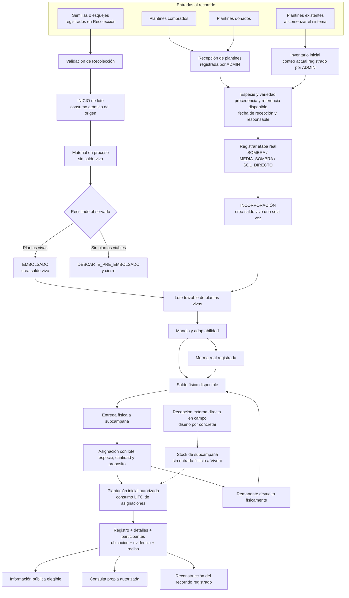

*Nota.* Adaptación de los diagramas del 4 de noviembre a NEC-01–NEC-08 y a los contratos del recorrido. La incorporación de plantines y el acceso por vivero son capacidades acordadas con implementación pendiente; la recepción directa requiere completar origen, custodia y remanentes. Las líneas discontinuas sitúan esta última variante sin atribuirle una solución física ya aplicada. Las etapas de sombra, media sombra y sol directo describen el estado observado, sin una autorización adicional de «listo para entregar».

En la operación ordinaria el mismo operario recibe y maneja material dentro de sus viveros. La incorporación especial de plantines vivos y del inventario inicial se reserva a ADMIN conforme a Inicio. Esa frontera debe quedar reflejada en los contratos antes del código dependiente. La propuesta técnica anterior de aptitud adicional no se adopta en esta versión.

**Figura 3.7. Genealogía del material vegetal en la ruta principal**

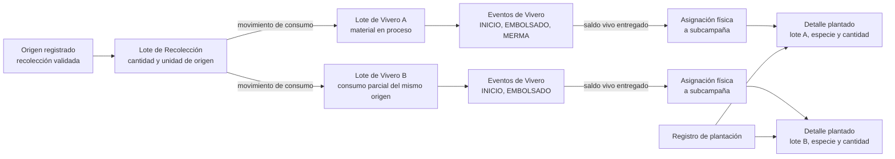

*Nota.* Elaboración propia a partir de los contratos M1→M2 y M2→M3. Un origen puede abastecer varios lotes y una plantación puede consumir varios orígenes, conservando su detalle. La incorporación de plantines sustituye el antecedente de Recolección por su recepción o conteo real; no inventa propagación anterior. La consulta integral de esta genealogía requiere sus pruebas en CO-4 y TR-1.

La estructura física actual exige `lote_vivero.recoleccion_id` y `vivero_id`. Por ello, ninguna de las variantes nuevas se declara disponible por estar dibujada. Las plantaciones ya realizadas necesitan un tratamiento histórico separado: no constituyen stock para volver a plantar. La recepción directa y su eventual traslado real a un vivero deben conservar su procedencia sin registrar entradas o despachos ficticios.

### 3.3.3. Requisitos y capacidades del sistema

La matriz de Inicio relaciona HAL→NEC→RF/CU. Aquí se precisa la responsabilidad de cada capacidad. Los RF de los módulos conservan sus IDs; PA-S01 y PA-S03 refinan el registro inicial y su autorización, y PA-S02 distingue consulta pública y propia. D01–D12 están aceptadas y sus decisiones no se vuelven a presentar como preguntas de diseño.

**Tabla 3.17**

*Capacidades seleccionadas y resultados de diseño*

| Código | Capacidad | Actor principal | Requisitos relacionados | Resultado esperado |
|---|---|---|---|---|
| CU-01 | administrar datos maestros | ADMIN | RF-GEN-01–RF-GEN-07 | referencias compartidas, usuarios y roles globales controlados |
| CU-02 | registrar y completar una recolección | operador de Recolección o ADMIN, según autoría y estado | RF-REC-01–RF-REC-03 | origen, material, cantidad, unidad, ubicación y evidencia |
| CU-03 | revisar una recolección | VALIDADOR o ADMIN | RF-REC-04 | aprobación con snapshots o rechazo motivado con historial |
| CU-04 | afectar el saldo de Recolección | actor autorizado por operación | RF-REC-05 | desecho autorizado o consumo iniciado por CU-05, sin saldo negativo |
| CU-05 | iniciar un lote de vivero | operario autorizado o ADMIN | RF-VIV-01; contrato M1→M2 | lote, INICIO y consumo de origen confirmados juntos |
| CU-06 | registrar resultado observado | operario autorizado o ADMIN | RF-VIV-02 y RF-VIV-02A | plantas vivas observadas o descarte pre-embolsado con causa |
| CU-07 | registrar movimientos de Vivero | operario autorizado o ADMIN | RF-VIV-03–RF-VIV-09 | manejo, pérdidas y salidas con saldo e historial explicables |
| CU-08 | planificar campaña y subcampaña | ADMIN | RF-PLA-01–RF-PLA-03 y RF-PLA-18 | zona, coordinación, polígono, meta y plan por especie |
| CU-09 | asignar plantas a subcampaña | ADMIN o coordinación autorizada | RF-PLA-04; RF-VIV-11 | entrega física y stock disponible en campo |
| CU-10 | devolver plantas no consumidas | ADMIN o coordinación autorizada | RF-PLA-05; RF-VIV-12 | retorno físico al lote de origen, sin superar el remanente |
| CU-11 | registrar plantación inicial | PLANTADOR, ADMINISTRADOR_SUBCAMPANIA o ADMIN | RF-PLA-06 y RF-PLA-13; PA-S01/03 | cantidades por especie, consumo LIFO, GPS, fotos, participantes y recibo |
| CU-12 | reconstruir un recorrido | persona autorizada para la vista | RF-REC-03/05, RF-VIV-07, RF-PLA-14; NEC-08 | origen, eventos, cantidades, responsables, evidencia y destino recuperables |

*Nota.* Elaboración propia a partir de los requisitos de los módulos y los refinamientos aceptados. RF-VIV-11 y RF-VIV-12 se definen en el contrato M2→M3. CU-04 no crea un descuento manual paralelo al inicio de Vivero. Los permisos de participación no se deducen del equipo logístico. La restricción futura por vivero se distingue del acceso actual en 3.3.13.

Las nuevas capacidades se nombran sin renumerar CU-01–CU-12: **asignar operarios por vivero**, **incorporar plantines vivos** y **registrar inventario inicial**. Se relacionan con NEC-01–NEC-08 según Inicio y conservan pendientes de contrato. El ingreso exige especie y variedad, cantidad viva contada, fecha de recepción o conteo, procedencia general y etapa actual; comprobantes y notas son opcionales. La obligatoriedad de fotografía operativa sigue pendiente: la propuesta de una foto del chat de diagramas no sustituye una decisión del autor.

Los criterios de integridad se desarrollan en 3.3.9. Los límites académicos se mantienen: el resultado evaluable termina en la plantación y su trazabilidad. Las vistas de Impacto y Mis registros sitúan las audiencias de consulta; no acreditan una consulta pública integral de todos los módulos. Mantenimiento posterior, carbono y blockchain quedan fuera del cumplimiento académico.

### 3.3.4. Casos de uso: vista general

La Figura 3.5 de Inicio conserva la vista general UML actualizada en `445f24f`. La Figura 3.8 desarrolla su distribución funcional, incorporando los permisos contextuales, la consulta propia y las capacidades de Vivero. Una asociación señala interacción y no concede por sí sola autoridad. Una persona puede desempeñar varias funciones sin tener varios roles globales.

**Figura 3.8. Actores y capacidades del diseño integrado**

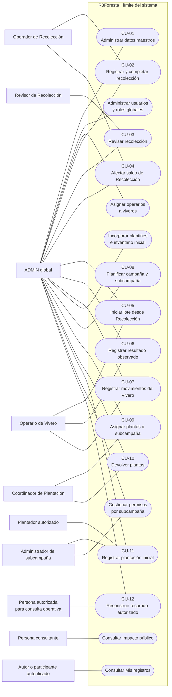

*Nota.* Adaptación de los diagramas revisados el 4 de noviembre y de la Figura 3.5 vigente. CU-01–CU-12 mantienen sus IDs. Las incorporaciones y el acceso por vivero muestran el diseño a desarrollar; la gestión de permisos y las consultas conservan los contratos PA-S02/03. En cada operación se comprueban cuenta, ámbito, estado y reglas del dominio.

### 3.3.5. Casos de uso específicos y relaciones incluidas o extendidas

Las asociaciones actor–caso se dibujan sin dirección. «include» apunta del caso base al comportamiento obligatorio reutilizado; «extend» apunta del comportamiento opcional al caso base e indica su condición. Los resultados excluyentes de revisión se explican en el proceso, sin convertir una elección en una extensión obligatoria.

**Figura 3.9. Casos de uso específicos de Recolección**

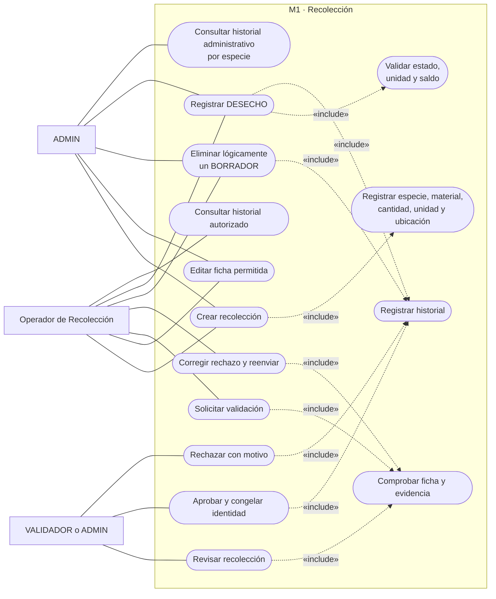

*Nota.* Adaptación de RF-REC-01–RF-REC-05 y del diagrama actualizado. La eliminación lógica se limita a BORRADOR y conserva historial; aprobar o rechazar no habilita a editar un registro validado. La inclusión de «Registrar historial» representa escritura del hecho, no una consulta que el usuario deba abrir.

**Figura 3.10. Casos de uso específicos de Vivero**

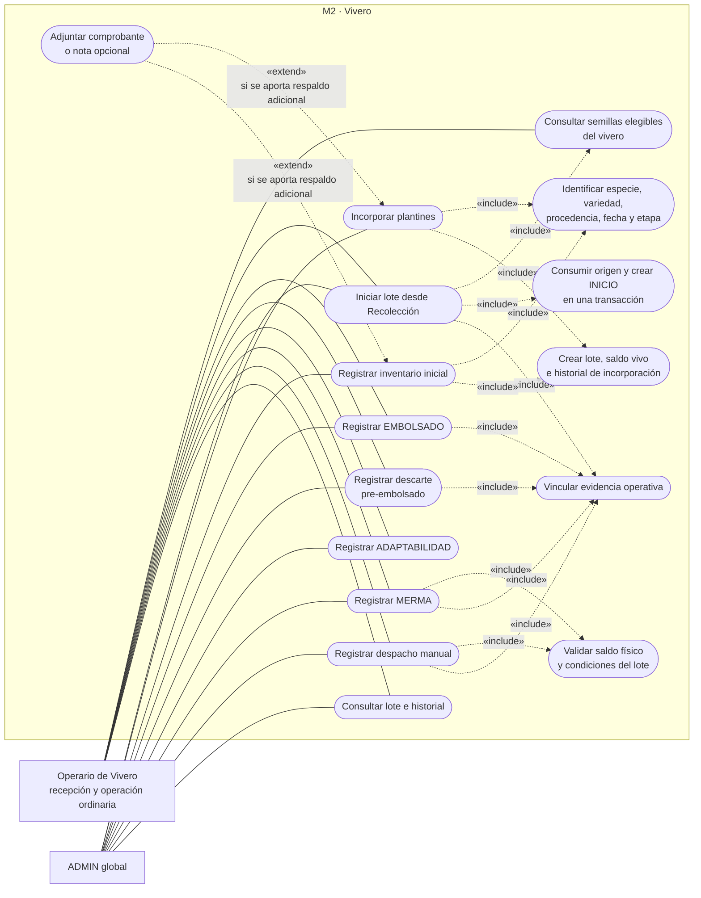

*Nota.* Adaptación de RF-VIV y de los acuerdos de incorporación del 4 de noviembre. «Vincular evidencia operativa» conserva las exigencias de los eventos existentes. Su obligatoriedad mínima en incorporación e inventario inicial sigue pendiente, por lo que no se dibuja allí como inclusión obligatoria. Recepción ordinaria y manejo corresponden al mismo operario; los dos ingresos especiales permanecen reservados a ADMIN. No se añade un embolsado o una aptitud ficticios para plantas ya vivas.

**Figura 3.11. Casos de uso específicos de Plantación**

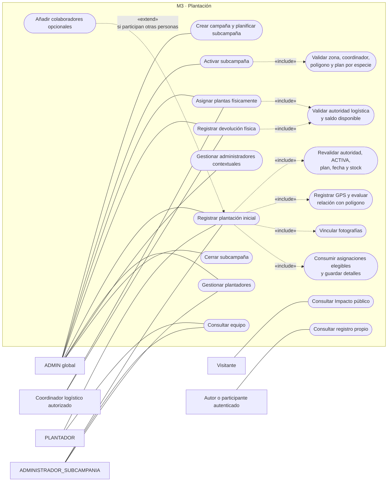

*Nota.* Adaptación de RF-PLA, PA-S01–PA-S03 y D01–D12. PLANTADOR y ADMINISTRADOR_SUBCAMPANIA son permisos por persona y ámbito; COORDINADOR es una responsabilidad logística. El acceso por vivero adicional para entregar y devolver es una propuesta contractual pendiente, no una condición ya implementada. El punto exterior se admite con evaluación y advertencia según el acuerdo vigente; el fallo técnico del evaluador impide confirmar el registro.

### 3.3.6. Procesos: estados, eventos y cambios de cantidad

El estado actual facilita la operación; los movimientos, eventos e historiales explican cómo se obtuvo. Ambos deben actualizarse en una misma transacción cuando representan una sola operación. Una corrección excepcional conserva el original y su historial conforme a PA-S04; no habilita edición libre del pasado ni resuelve los casos de esa spec que siguen pendientes.

En Recolección se separan la calidad de la ficha y la disponibilidad del saldo. Validar congela la identidad, mientras el consumo posterior modifica cantidad e historial.

**Figura 3.12. Estados de Recolección y saldo operativo**

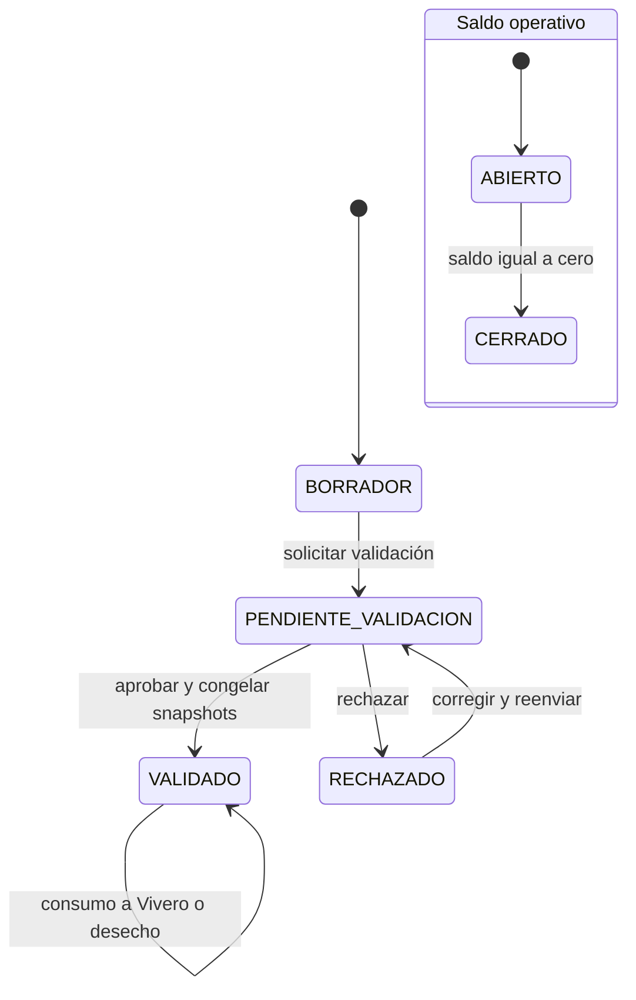

*Nota.* Elaboración propia a partir de RF-REC y RN-REC. ABIERTO/CERRADO describen el saldo operativo y no reemplazan el estado de revisión. El borrado lógico de un borrador tampoco se representa como desaparición de su historial.

En la ruta de propagación, INICIO conserva material y unidad de origen; EMBOLSADO crea el saldo vivo observado. En la incorporación propuesta, la recepción o conteo de plantines constituye la única base inicial del saldo. Registrar plantas vivas no requiere reconstruir una germinación previa.

**Figura 3.13. Bases iniciales y movimientos del lote de vivero**

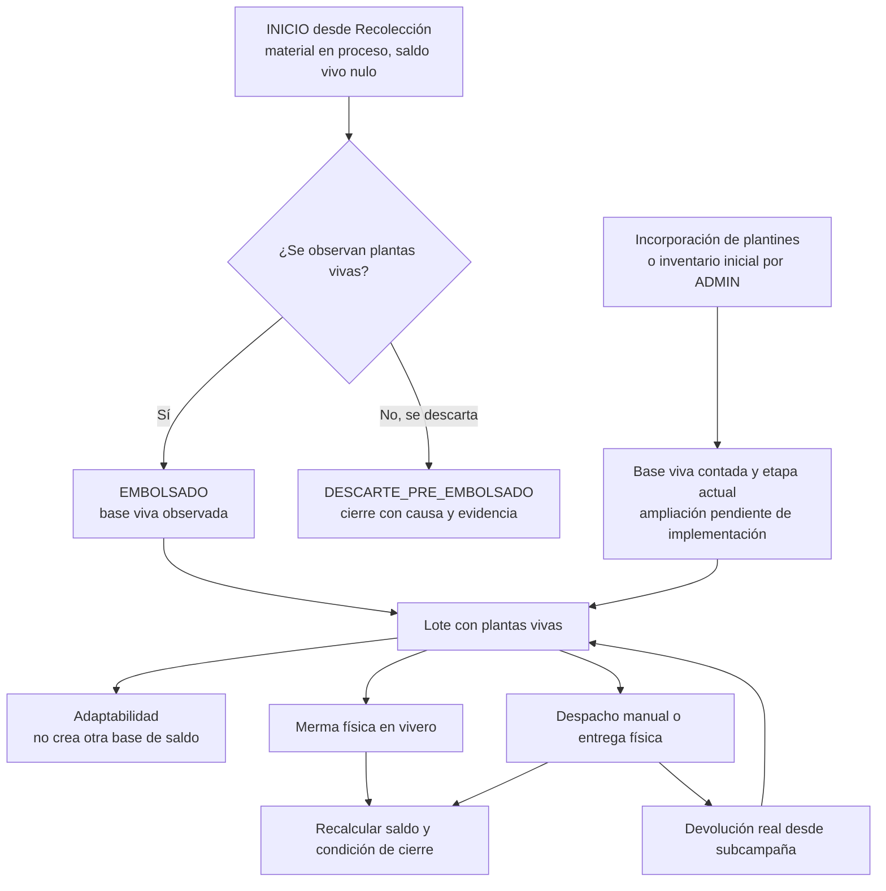

*Nota.* Adaptación del flujo de Vivero y de los acuerdos de incorporación. Una salida total no es mortalidad. La devolución puede aumentar el saldo del lote de origen según el contrato; no vuelve a crear su base inicial. La incorporación requiere revisar eventos, constraints, consultas y operaciones que hoy exigen EMBOLSADO.

La campaña conserva un estado derivado; la subcampaña concentra plan, polígono, coordinación y operación. Alcanzar la meta no cierra automáticamente ni impide registrar una cantidad superior dentro del stock elegible.

**Figura 3.14. Estados operativos de la subcampaña pertinentes al recorrido**

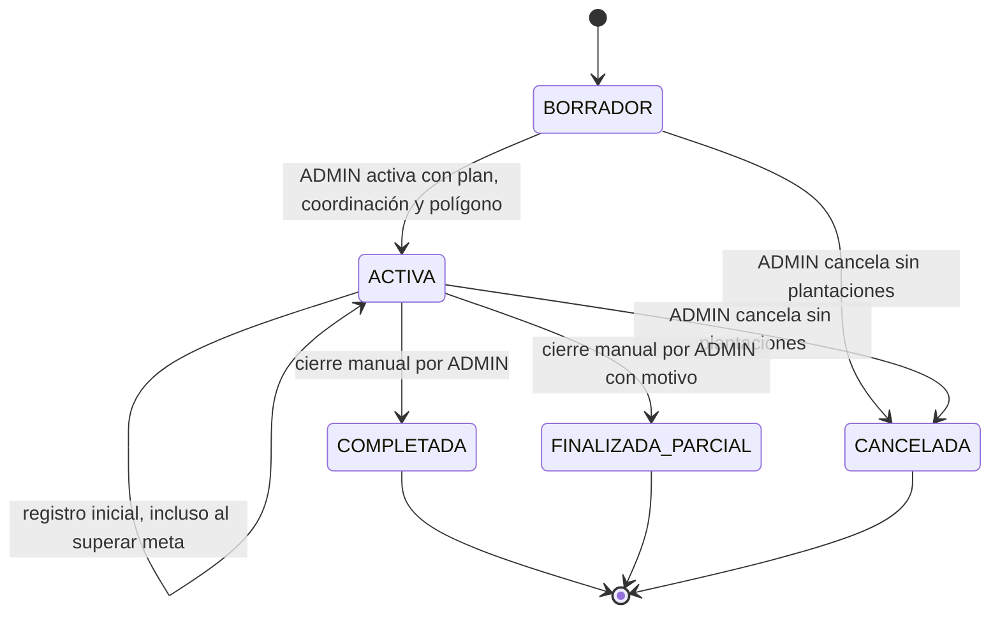

*Nota.* Elaboración propia a partir de RN-PLA-06/07/10/37, ADR-PLA-04 y PA-S01. No hay reapertura, tampoco por ADMIN. El cierre no representa devolución automática de todo remanente: el contrato vigente conserva stock sobrante y sus operaciones permitidas. La recepción externa directa exige desarrollar su tratamiento sin sustituir silenciosamente estas reglas.

#### 3.3.6.1. Diagramas de actividad de los flujos operativos

**Figura 3.15. Actividad de Recolección**

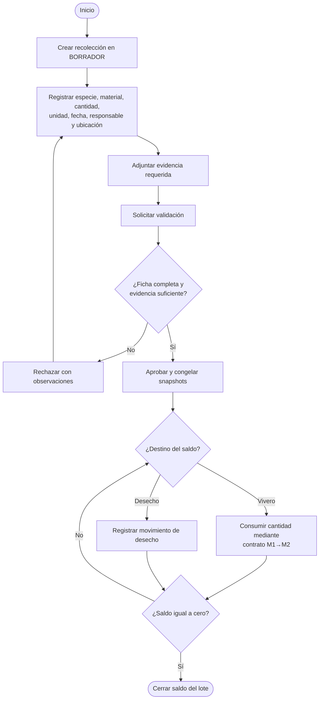

*Nota.* Elaboración propia a partir de RF-REC-01–RF-REC-05 y M1→M2. El consumo se ejecuta al iniciar Vivero; no se añade una segunda operación manual que descuente el mismo material.

**Figura 3.16. Actividad de Vivero por modalidad de ingreso**

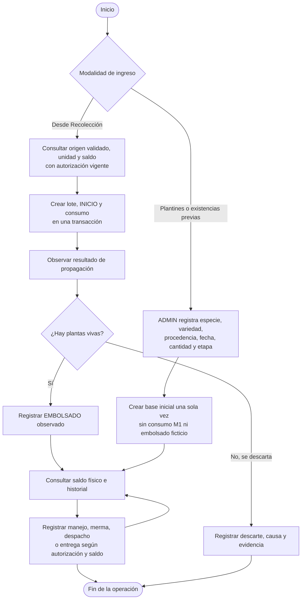

*Nota.* Adaptación del diseño integrado del 4 de noviembre. El camino desde Recolección tiene contrato existente; la incorporación es diseño pendiente de implementación. La evidencia mínima de este último debe concretarse antes de su aceptación. No se infieren pérdidas históricas ni conversiones de gramos a plantas.

**Figura 3.17. Actividad de Plantación y recuperación del resultado**

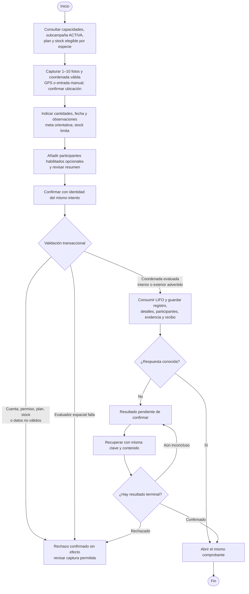

*Nota.* Elaboración propia a partir de PA-S01, sus escenarios CA01–CA14 y D07–D09. Abrir el formulario no reserva stock ni autoridad; ambos se revalidan al guardar. Un timeout también puede ocurrir antes de conocerse la ejecución y sigue el mismo camino de recuperación. El punto exterior evaluado no se confunde con fallo del evaluador. Las cantidades pertenecen al registro, no se multiplican por participantes.

### 3.3.7. Interacciones: contratos entre módulos

#### 3.3.7.1. Contrato entre Recolección y Vivero

El contrato M1→M2 se activa cuando Vivero inicia un lote desde una recolección validada, abierta y con saldo suficiente. El lote de Vivero selecciona su vivero operativo, hereda los snapshots oficiales de la recolección y registra evidencia propia del evento `INICIO`. Un origen puede abastecer varios lotes, pero cada lote de vivero conserva una sola recolección de procedencia.

La creación del lote, el evento `INICIO` y el movimiento `CONSUMO_A_VIVERO` forman una sola operación de negocio. El diseño exige que se completen juntos o que ninguno quede persistido. Además, mantiene las siguientes igualdades dentro de la unidad canónica de la recolección:

```text
abs(delta del movimiento CONSUMO_A_VIVERO)
= cantidad_inicial_en_proceso del lote de vivero
= cantidad_afectada del evento INICIO

unidad del movimiento
= unidad inicial del lote
= unidad del evento INICIO
```

**Figura 3.18. Secuencia diseñada para el contrato M1→M2**

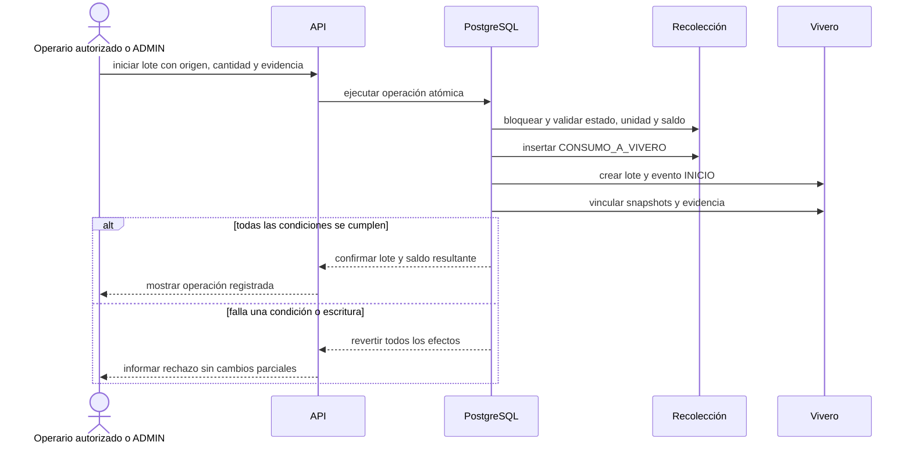

*Nota.* Elaboración propia a partir de `01_contrato_recoleccion_a_vivero.md`, `RN-REC-23` y `RN-REC-24A`.

El contrato no convierte gramos de semillas en unidades de plantas. La cantidad transferida en `INICIO` conserva la unidad del origen. El dato de plantas vivas aparece después, cuando el responsable registra el resultado observado en `EMBOLSADO`.

La propuesta de acceso por vivero restringe el camino ordinario a semillas almacenadas en el mismo establecimiento autorizado. El contrato vigente permite seleccionar otro vivero operativo. Esa igualdad no se atribuye al código actual: debe conciliarse antes de implementar la restricción, conservando el camino administrativo y sin inventar un traslado físico.

#### 3.3.7.2. Contrato entre Vivero y Plantación

Asignar representa entrega física: disminuye el saldo del lote y crea stock de subcampaña. Plantar consume ese stock, sin una segunda salida de Vivero. La cantidad asignada es inmutable y el disponible se obtiene de sus afectaciones:

```text
saldo_asignado_disponible
= cantidad_asignada - cantidad_consumida - cantidad_devuelta - cantidad_mermada
```

El registro inicial utiliza cantidades por especie y distribución LIFO en servidor (`fecha_asignacion DESC, id DESC`) entre asignaciones elegibles. La fecha operativa excluye entregas posteriores al hecho registrado; no basta que el stock exista hoy. Los locks siguen su orden común independiente del orden de reparto. La persona no elige un lote ni recibe stock personal. Meta orientativa y saldo físico tienen funciones distintas.

**Figura 3.19. Entrega física, consumo de stock y resultado recuperable**

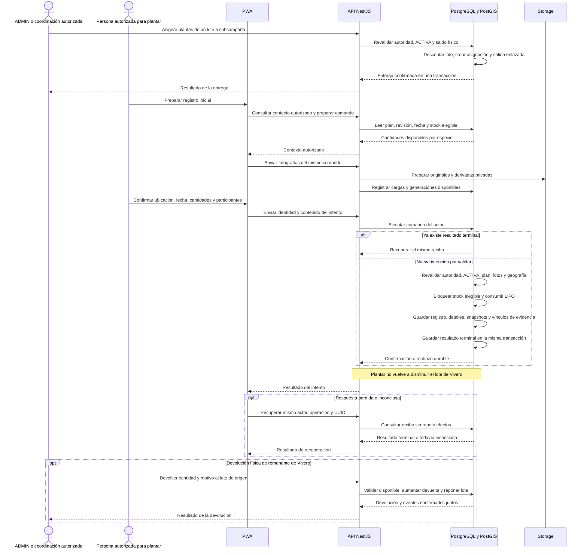

*Nota.* Adaptación de los diagramas actualizados a M2→M3 y D01–D12. Storage se prepara antes de la confirmación; la transacción SQL vincula cargas válidas y resultado, sin simular una transacción distribuida con el almacenamiento. La idempotencia corresponde a una intención, no detecta por sí sola que dos personas registraron el mismo trabajo real. La propuesta de acceso por vivero añade una intersección de autoridades para logística que todavía debe incorporarse al contrato.

#### 3.3.7.3. Incorporación de plantines y continuidad operativa

La operación propuesta registra modalidad, procedencia disponible, identidad vegetal, cantidad viva, fecha, responsable y etapa. Debe confirmar juntos el lote, la base inicial, los snapshots, los vínculos de evidencia exigibles y un resultado recuperable. No consume Recolección ni utiliza EMBOLSADO para eludir la exigencia de un origen. Un segundo embolsado no puede recrear las plantas incorporadas.

El diseño requiere revisar las dependencias que hoy presuponen Recolección y EMBOLSADO: nulabilidad y campos de material en proceso, código trazable, enum de eventos, unicidad de base inicial, constraints de aumento de saldo, adaptabilidad, merma, despacho, asignación, lecturas y timeline. Cambiar solo el formulario de alta no daría continuidad al recorrido. Las propuestas técnicas se consultan desde 3.3.13; sus alternativas anteriores de aptitud y cierre de remanentes no sustituyen las reglas aceptadas.

La recepción directa debe crear stock en su lugar real de custodia y conservar la procedencia al consumirlo. Su relación con el lote, las devoluciones a un vivero que efectivamente recibe y el destino de los remanentes permanecen por concretar. No se adopta por esta redacción un bloqueo nuevo del cierre de subcampaña.

### 3.3.8. Modelo de datos: conceptual, lógico y físico

Las tres vistas cumplen funciones diferentes. La conceptual expresa los conceptos del negocio; la lógica organiza relaciones e integridad del diseño integrado; la física conserva los objetos que aparecen en la exportación y las fuentes de relaciones. No se agregan al catálogo físico entidades nuevas por el hecho de necesitarlas en el diseño.

#### 3.3.8.1. Modelo conceptual

**Figura 3.20. Modelo conceptual del recorrido y sus modalidades de origen**

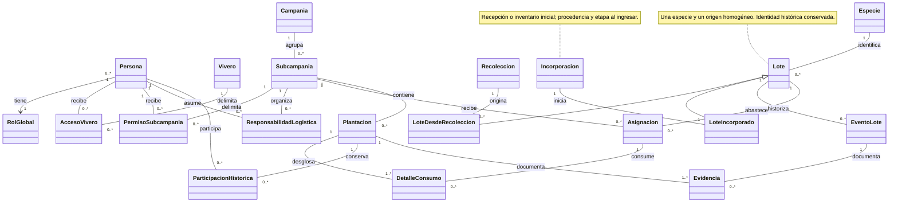

*Nota.* Adaptación del modelo conceptual actualizado el 4 de noviembre. Las especializaciones de Lote no exigen dos tablas ni dos motores de consumo. AccesoVivero e Incorporacion expresan capacidades por implementar; la custodia directa en campo requiere concretar su relación con el lote. Un mismo usuario puede asumir funciones diferentes, manteniendo una identidad.

#### 3.3.8.2. Modelo lógico

**Figura 3.21. Relaciones lógicas del diseño integrado**

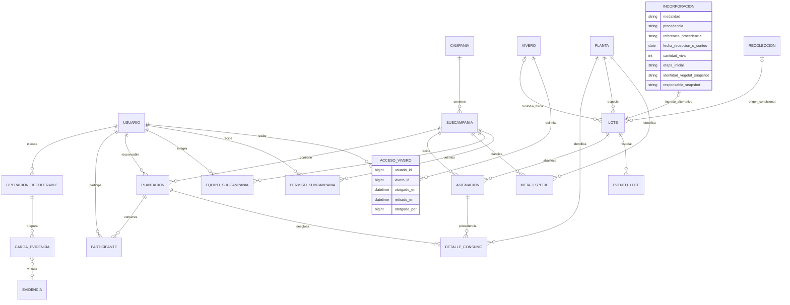

*Nota.* Adaptación del modelo lógico del chat de diagramas. ACCESO_VIVERO, INCORPORACION y LOTE son nombres de representación del diseño; no sustituyen los nombres físicos ni acreditan tablas nuevas. Las relaciones de procedencia se interpretan con la exclusión de origen indicada a continuación. La asociación polimórfica de evidencia se valida por tipo de hecho y no se convierte en varias FKs físicas desde entidad_id.

Cada lote utiliza exactamente una base de origen: una Recolección, con su consumo, o una incorporación de plantas vivas. Las referencias opcionales del diagrama no autorizan que falten ambas o existan ambas a la vez. Cada incorporación inicia un lote homogéneo, con especie y variedad conservadas históricamente; fecha y cantidad corresponden al hecho observado. La custodia de Vivero solo puede omitirse en la variante directa cuando su contrato haya definido dónde se mantiene el stock.

La procedencia plantada se recupera por detalle→asignación→lote→origen. Los totales agregados no sustituyen esos enlaces. Retirar acceso o cambiar un catálogo no borra las autorías ni los snapshots anteriores. La revisión técnica de incorporación también exige cotejar la herencia de variedad y la lectura de responsables: un nombre actual del catálogo no debe presentarse como snapshot del hecho.

#### 3.3.8.3. Modelo físico y contraste con la base de datos documentada

El modelo físico se actualizó el 4 de noviembre de 2026 con la exportación estructural de Supabase aportada por el autor: 51 tablas y 564 columnas. Conserva nombres, tipos, nulabilidad, claves primarias, unicidad individual e indicaciones de identidad de esa fuente. Las referencias simples se contrastaron con el catálogo PostgREST del proyecto `vyrjlehkhabydkhjxagx`; las referencias compuestas documentadas en las migraciones 070, 072, 074 y 082 se identifican por separado. El [modelo físico completo y sus fuentes](../../../../database/00_database_schema.md) permiten reconstruir esta representación. El contraste estructural no sustituye el replay limpio, la revisión completa de restricciones y privilegios ni las pruebas funcionales de RDI-03.

**Modelo físico del recorrido registrado**


**Modelo físico de permisos, comandos y cargas**


*Nota.* Elaboración propia a partir de la exportación aportada de Supabase y las fuentes de relaciones identificadas en el modelo físico. Las dos vistas conservan todas las columnas de las tablas que muestran y solo dibujan relaciones entre sus extremos incluidos; el diagrama completo contiene las 51 tablas, incluidas las conservadas de Plantación y la tabla técnica de PostGIS. `PK`, `FK` y `UK` identifican claves; `NN` y `NULL` conservan la nulabilidad exportada. La presencia de tablas de mantenimiento o corrección no amplía el alcance académico ni acredita sus interfaces. No se representan como desplegadas las nuevas incorporaciones de plantines ni el acceso de operarios por vivero.

**Tabla 3.18**

*Correspondencia del modelo físico con la exportación de Supabase*

| Componente físico documentado | Claves y campos de trazabilidad | Relación o restricción relevante | Estado del contraste |
|---|---|---|---|
| RECOLECCION | id; planta_id, ubicacion_id y vivero_id; cantidad_inicial_canonica, unidad_canonica, saldo_actual, snapshots, eliminación lógica y motivo_rechazo | conserva origen, estado y saldo; fechas operativas e historial con granularidad DATE | columnas contrastadas con la exportación; replay y pruebas conservan su verificación propia |
| RECOLECCION_MOVIMIENTO | id; recoleccion_id, lote_vivero_id, tipo_movimiento, delta, unidad_medida_evento y unidad_operativa | la unidad física es unidad_medida_evento; lote_vivero_id existe como columna, pero el catálogo consultado no lo identifica como FK | columnas contrastadas; el enlace semántico con el lote no se dibuja como FK física |
| LOTE_VIVERO y EVENTO_LOTE_VIVERO | recoleccion_id, planta_id, vivero_id, saldo_vivo_actual; lote_id, tipo_evento, cantidad_afectada y saldos antes/después | recoleccion_id y vivero_id del lote son NN; el evento referencia el lote mediante lote_id | columnas y referencias simples contrastadas; no admite aún origen nulo de incorporación |
| CAMPANIA, SUBCAMPANIA, SUBCAMPANIA_META_ESPECIE y SUBCAMPANIA_EQUIPO | campania_id, zona_id, poligono_geom, meta_total_arboles, plan_revision y membresías | CAMPANIA no almacena estado; SUBCAMPANIA sí conserva estado y contadores; coordinación es una fila de equipo | estructura contrastada; no se confunden contadores materializados con valores derivados |
| ASIGNACION_VIVERO_SUBCAMPANIA | lote_vivero_id, subcampania_id, cantidades asignada, consumida, devuelta, mermada, saldo_asignado_disponible y fecha_entrega_operativa | representa la entrega física del lote; saldo disponible figura nullable en la exportación | columnas y referencias simples contrastadas; la fórmula y la atomicidad requieren su evidencia SQL y de pruebas |
| REGISTRO_PLANTACION y REGISTRO_PLANTACION_DETALLE | subcampania_id, responsable_id, latitud, longitud, cantidad_total_plantada y revision_registro; asignacion_id, lote_vivero_id, planta_id y cantidad | el detalle conserva asignación, lote, especie y snapshots; GPS pertenece al registro | columnas y referencias simples contrastadas; esto no acredita el comportamiento de la validación espacial |
| TIPOS_ENTIDAD_EVIDENCIA y EVIDENCIAS_TRAZABILIDAD | tipo_entidad_id, entidad_id, bucket, ruta_archivo y metadata | tipo_entidad_id tiene FK; entidad_id participa en un vínculo polimórfico | columnas contrastadas; no se inventan FKs a cada tabla operativa |
| USUARIO, SUBCAMPANIA_PERMISO y SUBCAMPANIA_PERMISO_REVISION | rol, activo, revision_autoridad, organizacion_id; persona, ámbito, vigencias y revisión del permiso | autorización contextual separada de SUBCAMPANIA_EQUIPO | presentes en la exportación; referencias compuestas identificadas con fuente SQL |
| PARTICIPACION_COMANDO, USUARIO_AUTORIDAD_HISTORIAL y tablas de cargas | actor, operación, UUID, resultado, auditoría, generaciones y referencias de evidencia | claves de operación y de generación pueden ser compuestas; no son UUID globalmente únicos por inferencia | presentes; columnas contrastadas y procedencia de relaciones documentada |
| Tablas de corrección, estado efectivo y compensaciones | original, revisiones, participantes efectivos, créditos y compensaciones | preservan estructuras del original y su interpretación efectiva | siete tablas presentes; no acredita ejecución completa de todos los casos de PA-S04 |

*Nota.* Elaboración propia a partir de la exportación de Supabase del autor, el catálogo de referencias simples consultado el 4 de noviembre de 2026, las referencias compuestas de las migraciones indicadas y [database/00_database_schema.md](../../../../database/00_database_schema.md). La exportación no incluye todas las restricciones, fórmulas generadas, índices, triggers ni políticas de seguridad. Durante la maquetación se recomienda orientación horizontal solo si la tabla no resulta legible en orientación vertical; se repetirá su encabezado si continúa en otra página.

Las subsecciones 3.3.9 a 3.3.12 forman un bloque transversal de control del diseño. Explican las propiedades, la arquitectura, los riesgos y el resultado que condicionan los seis productos ya presentados; no añaden una etapa entre el modelo de datos y la implementación, que continúa en la sección 3.4.

### 3.3.9. Invariantes, mecanismos y pruebas previstas

Las propiedades se contrastan con mecanismos y escenarios observables. La existencia de una RPC o una tabla no equivale a una prueba aprobada. Los informes de [ESTADO](../../../../ESTADO.md) y del [tablero PA-F01](../../../../specs/plantacion/participacion-aliada/implementacion/README.md) conservan versión, entorno y límites de las comprobaciones ya realizadas; esta matriz define su correspondencia académica y lo que aún debe demostrarse.

**Tabla 3.19**

*Propiedades de diseño y criterio de comprobación*

| Código | Propiedad | Mecanismo o decisión de diseño | Comprobación requerida |
|---|---|---|---|
| INV-01 | saldo de Recolección no negativo | movimientos y operación transaccional | consumir/desechar el saldo exacto, excederlo y competir por el último saldo |
| INV-02 | M1→M2 conserva cantidad y unidad | igualdad movimiento–lote–INICIO | comparar las tres cantidades/unidades en consumos parciales y totales |
| INV-03 | no convertir masa a plantas ni inventar propagación | INICIO en unidad de origen; EMBOLSADO observado; incorporación viva diferenciada | 500 g y 320 plantas permanecen magnitudes distintas; conteo inicial 210 no infiere una pérdida histórica de 90 |
| INV-04 | operaciones críticas sin efectos parciales | transacción, locks y resultado conjunto | inducir fallos en pasos intermedios y comprobar rollback; Storage conserva su ciclo separado |
| INV-05 | salida física se descuenta una sola vez | asignación reduce lote; plantación consume asignación | entregar y plantar, verificando que el segundo paso no disminuya de nuevo Vivero |
| INV-06 | consumo no supera stock elegible | saldo derivado, locks y reparto LIFO | solicitudes competidoras; excluir otra subcampaña, otro propósito y entregas posteriores a la fecha |
| INV-07 | detalle explica el total plantado | suma de detalles y snapshots de procedencia | suma igual al total; participantes no multiplican plantas; reparto multiorigen reconstruible |
| INV-08 | devolución no supera remanente | actualización conjunta de asignación y lote de origen | devolver saldo exacto; rechazar exceso; comprobar retorno físico sin editar cantidad_asignada |
| INV-09 | catálogos no reescriben historia | snapshots y corrección trazable | cambiar nombres/variedad o inactivar cuentas y recuperar la interpretación anterior |
| INV-10 | evidencia corresponde al hecho y audiencia | cargas, vínculo polimórfico y permisos | rechazar foto ajena/ya vinculada; preservar fotos confirmadas durante limpieza y recuperación |
| INV-11 | ubicación válida y evaluación espacial distinguible | PostGIS; exterior con advertencia, fallo técnico sin efecto | interior, borde, exterior, captura manual y evaluador fallido según PA-S01-CA10 |
| RNF-INI-01 | autorización vigente por operación y ámbito | JWT, actividad, rol global y permisos; acceso por vivero propuesto | ámbitos ajenos, cambio de ID, retirada concurrente y cuenta inactiva; PA-S01-CA01/06 |
| RNF-INI-02 | interpretación histórica conservada | INV-09 y original/estado efectivo cuando corresponda | cambio de catálogo y rectificación sin desaparición del original |
| RNF-INI-03 | concurrencia y reintentos coherentes | comandos recuperables en PA; extensión pendiente a caminos de M1/M2 | mismo actor/operación/UUID devuelve mismo resultado; contenido distinto entra en conflicto; PA-S01-CA05/07 |
| RNF-INI-04 | datos y evidencia según finalidad | proyecciones públicas, propias e internas; credenciales de servicio en servidor | revisar respuestas, originales/derivadas y URLs por audiencia conforme a PA-S02 y D12 |
| RNF-INI-05 | recuperación de registros y archivos | respaldo y restauración coordinados por definir | restaurar un conjunto y comprobar genealogía y evidencia; RPO/RTO requieren definición y no tienen valores aprobados |
| RNF-INI-06 | registro y consulta utilizables | recorrido móvil, captura manual y recuperación de intento | tareas con usuarios/dispositivos representativos, errores y tiempos; conectividad, carga y suficiencia aún por fijar |

*Nota.* Elaboración propia a partir de los contratos, PA-S01/02/03 y RNF de Inicio. INV-01–INV-11 conservan sus IDs y se precisan con acuerdos posteriores. Las comprobaciones de incorporación y acceso por vivero son futuras; no se atribuyen resultados de pruebas existentes a esos cambios. Los RNF sin umbrales mantienen explícita su especificación pendiente.

### 3.3.10. Arquitectura de la solución

La solución utiliza PWA React/TypeScript/Vite, API REST NestJS como monolito modular y PostgreSQL/PostGIS con Storage en Supabase. El cliente guía la captura; la API autentica, autoriza y organiza la operación; las funciones y restricciones de la base protegen relaciones, saldos y confirmación atómica. PostGIS calcula la relación espacial. Storage mantiene los archivos y la base conserva sus vínculos y estado.

**Figura 3.22. Componentes y responsabilidades de la arquitectura académica**

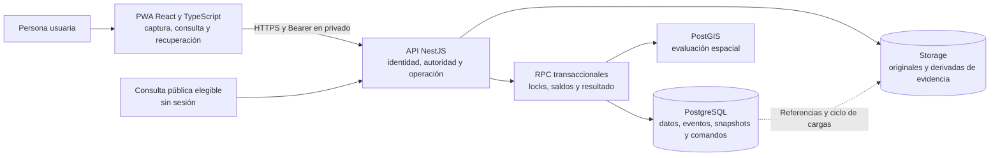

*Nota.* Elaboración propia a partir de ARCHITECTURE, los contratos aceptados y la lectura estática del backend `be62df0` y PWA `dbcedc5` del 4 de noviembre. El catálogo físico corresponde a las fuentes de 3.3.8.3. Blockchain e IPFS no participan en la arquitectura académica evaluada. El enlace con Storage es una relación de gestión, no una transacción SQL que abarque los archivos.

El monolito modular permite compartir identidad y transacciones sin introducir coordinación entre microservicios. El modelo combina estado materializado e historia, con snapshots para conservar interpretación. Los comandos de Participación añaden un resultado durable que permite recuperar el mismo intento tras una respuesta perdida.

La observación de julio sobre confianza exclusiva en x-auth-id no describe los controllers actuales de Recolección y Vivero: usan InternalActorGuard, que verifica Bearer y cuenta activa, rechaza un header discordante y adapta la identidad verificada para código legado. La [propuesta de acceso por vivero](../../../../../Backend-r3foresta/documentacion/tareas/propuesta-permisos-por-vivero.md) documenta lo que falta en autorización por establecimiento. La revisión de todas las rutas equivalentes, permisos de base y entorno destino conserva su evidencia separada.

La PWA instalable no promete operación completa sin conexión. Recuperar un envío o conservar una captura no equivale a tener cola de operaciones, sincronización diferida y resolución general de conflictos. Las condiciones de conectividad y validación humana corresponden a RNF-INI-06.

### 3.3.11. Riesgos y vacíos que condicionan el cierre del diseño

Se conservan RDI-01–RDI-08 de la revisión de septiembre y se actualiza su tratamiento al 4 de noviembre. Una decisión aceptada puede cerrar una discrepancia de especificación y seguir requiriendo verificación de implementación. Los responsables indicados son funciones de seguimiento; su designación y la decisión de riesgo residual deben constar en la revisión LCA.

**Tabla 3.20**

*Tratamiento actual de los riesgos de diseño*

| Código | Estado y efecto sobre el diseño | Tratamiento y evidencia de salida | Seguimiento propuesto |
|---|---|---|---|
| RDI-01 | abierto: incorporación y acceso por vivero diseñados parcialmente; origen NN y dependencias de EMBOLSADO impiden las variantes | conciliar recepción ordinaria/especial, evidencia mínima, base única, procedencia, custodia directa y remanentes; actualizar contratos y demostrar continuidad sin hechos ficticios | autor con responsables de Vivero/Plantación |
| RDI-02 | observación de identidad de julio superada en los controllers inspeccionados; autorización por vivero y verificación externa pendientes | conservar guard JWT/actividad; cerrar política por establecimiento, accesos por ID/agregados/evidencia y logística entre ámbitos; cotejar rutas y permisos de entorno destino | responsable backend y revisión de seguridad |
| RDI-03 | contraste físico actualizado: 51 tablas/564 columnas y fuentes de relaciones; reproducibilidad integral aún no acreditada | replay limpio y actualización de base existente, incluidos TIPO_PLANTA/destinos; cotejar restricciones, índices, RPC, grants y RLS que el extracto no enumera | responsable de base y backend |
| RDI-04 | decisión funcional resuelta el 11–12 de octubre: exterior evaluado con advertencia; fallo técnico sin guardado | mantener RN-PLA-32 y PA-S01 alineados; vincular CA10 y pruebas PostGIS reales a versión y entorno; no reabrir la decisión como bloqueo/advertencia | responsable backend/PWA y QA |
| RDI-05 | diferencia histórica de campos de DONACION en despacho manual sin nuevo cierre acreditado aquí | cotejar matriz canónica, DTO, RPC y pruebas del despacho vigente; separar despacho saliente de incorporación entrante | responsable M2 y QA |
| RDI-06 | mitigación parcial: comandos/recibos durables de Participación disponibles; no equivalen a idempotencia universal M1/M2 | reutilizar evidencia D/INT03/INT04 y revisar operaciones legadas; diseñar recuperación para nuevas incorporaciones; distinguir intento repetido de duplicado del trabajo real | backend/PWA y QA de concurrencia |
| RDI-07 | expediente académico de CO-1 sin cierre equivalente al de las entregas PA | consolidar versión M1, migraciones, pruebas, demostración y revisión; la eliminación de borradores y el inventario físico aportan evidencia parcial | autor y responsable M1 |
| RDI-08 | control de alcance vigente; estructuras físicas incluyen legado y mantenimiento | evaluar solo recorrido hasta plantación; usar PA-S02/03 para situar consulta/autorización, sin atribuir cobertura transversal total ni sumar mantenimiento, carbono o blockchain | autor y revisión académica |

*Nota.* Elaboración propia a partir de ESTADO, las fuentes físicas del 4 de noviembre, PA-S01/02/03, D01–D12 y las propuestas de Vivero. El estado se refiere a evidencia documental y estática identificada; no representa nuevas pruebas, migraciones ejecutadas o certificación de despliegue.

### 3.3.12. Resultado del diseño y evaluación de LCA

El diseño vincula origen registrado, identidad del lote, eventos, custodia, entrega física y detalle de consumo plantado. En la propagación conserva cantidad y unidad entre M1 y M2, y observa las plantas vivas sin conversión automática. La incorporación de plantines comienza en el hecho real de recepción o conteo. En M2→M3 la entrega y la plantación afectan saldos diferentes y conservan procedencia multiorigen. La autorización se evalúa por función y ámbito, y el resultado recuperable distingue rechazo, confirmación e incertidumbre.

La consolidación reúne casos de uso, procesos, interacciones, modelos conceptual/lógico, el modelo físico contrastado y la matriz INV/RNF. Integra los diagramas existentes sin mantener el corte de septiembre como una segunda descripción vigente. La [versión anterior](../elaboracion-rup-2026-11-04/README.md) conserva los textos sustituidos y sus pendientes históricos.

LCA (*Lifecycle Architecture*, arquitectura del ciclo de vida) requiere revisar estos productos junto con evidencia ejecutable y riesgos residuales. La evaluación actual es la siguiente:

1. **Casos prioritarios y variantes.** La ruta M1→M2→M3 tiene contratos y criterios; incorporación, acceso por vivero y recepción directa requieren completar los puntos de RDI-01/02. La etapa real, los documentos opcionales y el comienzo del historial ya están acordados y no se vuelven a someter a decisión.
2. **Arquitectura base ejecutable.** Existe implementación y pruebas técnicas referidas en ESTADO y PA-F01. Falta seleccionar una versión y entorno de evaluación académica y enlazar una demostración completa de identidad, propagación, entrega, consumo y reconstrucción; el inventario físico no la reemplaza.
3. **Integridad y riesgos técnicos.** INV-01–INV-11 y RNF-INI tienen mecanismos y escenarios. Deben vincularse los resultados disponibles y completar concurrencia/recuperación, exposición de datos, replay y restauración según los límites de cada informe. GPS tiene decisión vigente; su verificación no exige otra decisión funcional.
4. **Viabilidad de Construcción.** El tablero mantiene CO-1–CO-4 y TR-1. Es necesario estimar el trabajo residual de variantes y verificación, asignar responsables y registrar ajustes del plan con fecha real; no se crean iteraciones académicas por cada migración o entrega INT.
5. **Decisión humana.** Registrar fecha, versión y entorno, productos y resultados revisados, participantes competentes, decisión y condiciones residuales. No se dispone de una nueva decisión LCA por esta actualización documental.

**Estado de Elaboración:** consolidación documental avanzada; LCA pendiente de revisión y evidencia de salida. El siguiente trabajo prioritario es concretar los contratos de incorporación y autorización por vivero, y completar la línea arquitectónica con pruebas y reconstrucción del recorrido. La implementación continúa en sus repositorios y sus cierres se acreditan por separado.

### 3.3.13. Correspondencia de actores, permisos y fuentes de continuidad

Cada cuenta tiene un único rol global: ADMIN, GENERAL, VALIDADOR o VOLUNTARIO. Los permisos de subcampaña, las responsabilidades logísticas y la afiliación a organización son relaciones diferentes. ADMINISTRADOR_SUBCAMPANIA permite plantar y gestionar plantadores de su ámbito según PA-S03; no concede asignar roles globales, designar otros administradores contextuales ni afectar cualquier vivero. El permiso PLANTADOR no deriva de pertenecer a una organización o equipo logístico.

El acceso futuro por vivero utiliza un solo tipo de operario que recibe y maneja material. La propuesta admite cuentas internas elegibles asignadas a uno o varios establecimientos, con gestión por ADMIN. Hoy la escritura M2 admite ADMIN/GENERAL/VALIDADOR sin esa asignación. La elegibilidad concreta y la intersección para logística requieren alinear RN-VIV-42/43 y ambos contratos antes de implementarlas. El diseño propone ADMIN o COORDINADOR de la subcampaña con acceso al vivero afectado en la misma cuenta para entrega/devolución; no se presenta como política ya aplicada.

```mermaid
classDiagram
    direction TB

    class PersonaConsultante
    class Visitante
    class UsuarioAutenticado
    class AdministradorGlobal
    class OperadorRecoleccion
    class RevisorRecoleccion
    class OperarioVivero
    class CoordinadorPlantacion
    class Plantador
    class AdministradorSubcampania

    PersonaConsultante <|-- Visitante
    PersonaConsultante <|-- UsuarioAutenticado

    UsuarioAutenticado <|-- AdministradorGlobal
    UsuarioAutenticado <|-- OperadorRecoleccion
    UsuarioAutenticado <|-- RevisorRecoleccion
    UsuarioAutenticado <|-- OperarioVivero
    UsuarioAutenticado <|-- CoordinadorPlantacion
    UsuarioAutenticado <|-- Plantador
    UsuarioAutenticado <|-- AdministradorSubcampania

    note for AdministradorGlobal "Rol global ADMIN. Administración transversal y operación sujeta a reglas del dominio."
    note for OperadorRecoleccion "GENERAL o ADMIN. Edición y envío según autoría y estado."
    note for RevisorRecoleccion "VALIDADOR o ADMIN."
    note for OperarioVivero "Acceso por vivero. También realiza recepción ordinaria."
    note for CoordinadorPlantacion "Responsabilidad logística en una subcampaña."
    note for Plantador "Permiso PLANTADOR en una subcampaña."
    note for AdministradorSubcampania "Permiso contextual. Planta y gestiona plantadores de su ámbito."
```

*Nota.* Adaptación de la vista de actores del 4 de noviembre. Las generalizaciones organizan funciones de interacción; no crean nuevos roles globales ni conceden privilegios por sí solas. El operario por establecimiento es el diseño objetivo. La autoridad logística sigue su contrato específico y la propuesta de intersección indicada arriba.

La continuidad se consulta desde las fuentes existentes:

- [Inicio, 3.2.6 y 3.2.8](../../../../documentacion-grado/06_entregables/proyecto_grado/03_1_fase_inicio.md): últimas precisiones del autor sobre recepción, incorporación y audiencias.
- [Propuesta de acceso de operarios por vivero](../../../../../Backend-r3foresta/documentacion/tareas/propuesta-permisos-por-vivero.md): ámbitos, consumo de semillas y frontera logística; propuesta no implementada.
- [Plan de incorporación y procedencia](../../../../../Backend-r3foresta/documentacion/tareas/plan-incorporacion-plantas-procedencia.md): dependencias técnicas y alternativas anteriores. La copia local termina en el apartado 16; prevalecen las respuestas del autor consolidadas en Inicio frente a aptitud adicional o reglas de cierre aún no conciliadas.
- [Contrato D01–D12](../../../../specs/plantacion/participacion-aliada/contrato-identidad-permisos-backend-propuesta.md) y [tablero PA-F01](../../../../specs/plantacion/participacion-aliada/implementacion/README.md): decisiones aceptadas, tareas y límites de cada entrega; PA-S04 conserva su cierre propio pendiente.
- [Modelo físico y sus fuentes](../../../../database/00_database_schema.md): exportación de Supabase, relaciones contrastadas y vistas vectoriales. Las 51 tablas no equivalen a 51 capacidades terminadas.
- [Tablero académico, fase de Elaboración](TODO_PROYECTO_GRADO.md#4-fase-de-elaboración--iteración-el-1--20-de-julio-al-16-de-agosto): control de ejecución y salida LCA, sin otro plan general.

Los diagramas se adaptan del chat [Genera diagramas del capítulo 3](codex://threads/01a0abb2-d8eb-7b62-bd57-05c969959b11), incluida su actualización versionada en `445f24f`. El texto conserva los acuerdos humanos frente a elecciones de representación de la IA. La revisión de implementación y pruebas corresponde a Construcción; la validación operativa y la aceptación del producto integrado corresponden a Transición.
