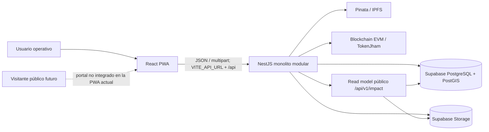
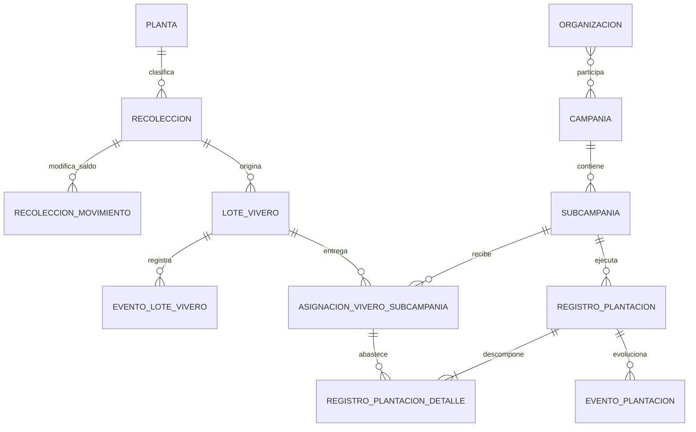

# Mapa estructurado y trazable del sistema R3Foresta

> Corte de análisis: 2026-09-10. Este documento prepara la comprensión del sistema y el futuro sustento teórico. **No desarrolla todavía la estructura ni el contenido del Marco aplicativo.**
>
> Repositorios observados: `r3foresta-docs` (`a7ad251`), `Backend-r3foresta` (`90620f4`) y `pwa-r3foresta` (`9104ef3`). Los dos repositorios de código estaban limpios al iniciar la lectura; `r3foresta-docs` ya contenía cambios locales del usuario, que no fueron alterados.

## 1. Índice del mapa

1. Método y alcance de la revisión.
2. Orden de autoridad de las fuentes.
3. Síntesis del sistema.
4. Arquitectura observada.
5. Mapa de repositorios y dependencias.
6. Índice de módulos y capacidades.
7. Flujos de extremo a extremo.
8. Reglas de negocio e invariantes.
9. Modelo de información.
10. Diferencias entre documentación e implementación.
11. Vacíos, contradicciones y riesgos.
12. Conceptos que requerirán sustento teórico.
13. Registro de evidencia.

El inventario individual de los 152 archivos Markdown que formaron el corpus de entrada está en `documentacion-grado/03_investigacion/anexo_corpus_markdown_2026-09-10.md`. El conteo no incluye ese anexo ni el presente mapa, porque ambos son salidas generadas por esta revisión.

## 2. Método y alcance

### 2.1. Secuencia aplicada

1. Se inventariaron todos los `.md` y `.mdx` de los tres repositorios, con exclusión únicamente de `.git`, `node_modules`, `dist` y `build`.
2. Se separaron fuentes activas, documentos históricos, copias de worktree y exportaciones temporales para evitar que una copia se convierta en una autoridad paralela.
3. Se leyó primero la documentación de dominio, decisiones, contratos, estado, arquitectura, guías de Backend/PWA y documentación académica.
4. Se contrastaron después los puntos ambiguos o temporalmente inestables contra controllers, DTO, services, policies, rutas PWA, configuración, migraciones y pruebas.
5. Las afirmaciones de despliegue se limitaron a la última evidencia explícita de `ESTADO.md`; la presencia en `main` local no se interpretó como despliegue.

### 2.2. Corpus

| Repo | Markdown versionado | Total encontrado | Observación |
|---|---:|---:|---|
| `r3foresta-docs` | 66 | 74 | Incluye 8 transcripciones/exportaciones temporales o no versionadas. |
| `Backend-r3foresta` | 50 | 51 | Incluye una tarea no versionada. |
| `pwa-r3foresta` | 18 | 27 | Incluye 9 archivos de una copia de worktree bajo `.claude/worktrees/`. |
| **Total de entrada** | **134** | **152** | El anexo conserva ruta, clase, estado Git, líneas, hash y primer encabezado; excluye los dos entregables creados por el análisis. |

### 2.3. Límite de certeza

- **Documentado:** existe una regla, contrato, ADR o guía.
- **Implementado localmente:** existe código/migración en el HEAD inspeccionado.
- **Probado en el repo:** existen pruebas o un gate ejecutable; no equivale a haberlo ejecutado en este corte.
- **Confirmado en producción:** solo cuando `ESTADO.md` lo afirma expresamente.
- **No confirmado:** no se infiere despliegue, aplicación de migraciones ni existencia de datos productivos a partir del repositorio.

## 3. Orden de autoridad

No existe un único archivo que responda diseño, implementación y producción al mismo tiempo. La resolución correcta es:

| Pregunta | Fuente prioritaria | Evidencia |
|---|---|---|
| ¿Qué comportamiento quiere el producto? | Reglas `RN-*`, requerimientos `RF-*`, contratos `90-*` y ADR | `r3foresta-docs/ARCHITECTURE.md:90-99`; [E-DOM-01]–[E-DOM-04]; [E-INT-01]–[E-INT-02] |
| ¿Qué datos deberían existir? | `database/00_database_schema.md` | [E-DAT-01] |
| ¿Qué acepta hoy una API? | Controller + DTO + Swagger del Backend | [E-BE-03], [E-BE-07], [E-BE-09] |
| ¿Qué transacción se ejecuta? | Última migración que define la RPC + service llamador | [E-BE-08], [E-INT-01], [E-INT-02] |
| ¿Qué experimenta hoy el usuario? | Router, pantallas, APIs y services de la PWA | [E-FE-01]–[E-FE-03]; [E-FE-05]–[E-FE-06] |
| ¿Qué está desplegado? | `ESTADO.md` con fecha y evidencia explícita | [E-STA-01] |

Regla de interpretación: una discrepancia no autoriza a convertir el bug en regla ni a presentar el documento desactualizado como implementación. Debe quedar registrada como drift.

## 4. Síntesis del sistema

R3Foresta registra la procedencia y el recorrido del material vegetal desde su recolección, pasando por vivero, hasta su asignación y plantación. Usa catálogos maestros, estados materializados, snapshots históricos, movimientos y eventos append-only, evidencias fotográficas y coordenadas. La consistencia de los saldos que cruzan agregados se protege con RPC PostgreSQL. Pinata/IPFS y blockchain complementan la auditoría de Recolección, pero no sustituyen la base operacional [E-ARC-01] [E-DOM-01] [E-INT-01].

La cadena principal es:

```text
Catálogos maestros
  → M1 Recolección (lote origen)
      → M2 Vivero (maduración y saldo vivo)
          → asignación física a subcampaña
              → M3 Plantación (campo, mortandad y reposición modeladas)
                  → proyección pública de impacto (lectura agregada)
```

El sistema observado es una SPA/PWA más un monolito modular y una base PostgreSQL/PostGIS administrada en Supabase. No es microservicios, event sourcing puro ni una solución offline-first.

## 5. Arquitectura observada

### 5.1. Vista de contenedores



### 5.2. Frontend

- React 19.2, TypeScript 5.9, Vite 7.2, React Router 6, Tailwind 3, Leaflet y WebAuthn [E-PKG-02].
- Arquitectura por funcionalidades: `modules/recolecciones`, `vivero`, `plantacion`, catálogos, autenticación, perfil, mapa y home.
- La entrada actual usa `React.lazy` y `Suspense`; las pantallas funcionales se cargan por ruta [E-FE-01].
- La PWA actual usa `vite-plugin-pwa`/Workbox con actualización automática y niega el fallback de navegación para `/api` [E-FE-02].
- El estado global sigue concentrado en `AuthContext` y `PwaInstallContext`; el resto se maneja con hooks/estado local.
- La capa HTTP no está unificada: hay `src/api`, `src/services` y services dentro de módulos con parsing y headers repetidos.
- `CO₂`, escaneo y actualización de lote siguen siendo placeholders; Plantación ya no lo es [E-FE-01].

### 5.3. Backend

- NestJS 11, TypeScript 5.7, Supabase JS, WebAuthn, JWT, Pinata y ethers [E-PKG-01].
- `AppModule` compone Auth, usuarios, maestros, M1, M2, M3, evidencias, salud, integraciones externas e Impact en un único proceso [E-BE-01].
- Prefijo global `/api`, excepto `GET /health`; Swagger en `/api/docs`; `ValidationPipe` aplica whitelist, rechazo de campos extra y transformación [E-BE-02].
- Los módulos complejos usan controller/DTO → application service → domain policy → Supabase/RPC. Los catálogos pequeños mantienen estructura plana.
- Las operaciones de saldo M1–M3 se delegan a RPC cuando requieren locks y escritura atómica.
- El nuevo módulo `impact` es público y de solo lectura; no tiene persistencia propia, compone una proyección desde Campaña, Subcampaña, Plantación, eventos, evidencias y geometrías [E-BE-09] [E-BE-10].

### 5.4. Persistencia e infraestructura

- PostgreSQL es la fuente de verdad operacional.
- PostGIS conserva polígonos y calcula relaciones/validaciones geográficas.
- Supabase Storage conserva binarios; `EVIDENCIAS_TRAZABILIDAD` conserva el vínculo y metadatos.
- Backend contiene migraciones `001`–`059`; la copia documental termina en `057`.
- No hay manifiesto suficiente para reconstruir el despliegue del Backend, ni estrategia documentada de backup/restore, RPO/RTO u outbox.

### 5.5. Seguridad y límites de confianza

La ceremonia WebAuthn emite un JWT, pero no existe un guard JWT global. La mayoría de rutas identifica al solicitante mediante `x-auth-id`; algunas reciben también `x-user-role`. Los services maduros vuelven a consultar el rol en BD, pero el header de identidad sigue siendo suplantable si la API se expone a un cliente no confiable [E-BE-04] [E-BE-05].

Los challenges se guardan en un `Map` en memoria del proceso y caducan a los cinco minutos; esto impide escalado horizontal fiable sin afinidad o almacenamiento compartido [E-BE-06]. El fallback de `JWT_SECRET` sigue presente [E-BE-05]. Los endpoints de mint, Pinata y diagnóstico no muestran guards [E-BE-11].

## 6. Mapa de repositorios y dependencias

| Repositorio | Ownership | Depende de | Lo consumen | Acoplamiento observable |
|---|---|---|---|---|
| `r3foresta-docs` | Dominio, reglas, contratos, ADR, esquema canónico, estado y trabajo académico | Evidencia que llega de Backend/PWA/producción | Equipo, Backend, PWA, proyecto de grado | Dependencia de proceso; copia documental de migraciones. |
| `Backend-r3foresta` | API, autorización, casos de uso, persistencia, migraciones, Storage, IPFS y blockchain | Contratos de docs; Supabase; Pinata; EVM | PWA y consumidores públicos | DTO/Swagger/RPC; nombres de tablas/enums compartidos. |
| `pwa-r3foresta` | UX operativa, navegación, formularios, validación de ayuda y consumo HTTP | Backend en `VITE_API_URL`; contrato duplicado en tipos TS | Usuario operativo | URLs, headers, DTO duplicados, enums y semántica de estados. |

No existe dependencia npm directa entre repositorios. La dependencia es contractual y de despliegue. Esto evita acoplamiento de build, pero crea riesgo de drift porque tipos y enums se copian manualmente.

### 6.1. Dependencias externas

| Dependencia | Función | Criticidad actual | Vacío principal |
|---|---|---|---|
| Supabase PostgreSQL | Estado, relaciones, saldos, historiales | Núcleo | Replay de esquema aún no demostrado de `001` a `059`. |
| PostGIS | Polígonos y GPS | Núcleo M3 | Regla escrita de bloqueo GPS no está reconciliada con la advertencia implementada. |
| Supabase Storage | Evidencia e imágenes | Núcleo de evidencia | Limpieza de evidencia provisional y privacidad pública requieren controles explícitos. |
| Pinata/IPFS | Metadata de Recolección | Complementaria | Sin outbox ni reintento durable. |
| EVM/TokenJham | Anclaje NFT | Complementaria | Endpoints privilegiados expuestos; dependencia de arranque. |
| Vercel/hosting estático | PWA | Operativa | Evidencia de despliegue posterior a julio no está centralizada. |

## 7. Índice de módulos y capacidades

### 7.1. General y maestros

Entidades: Usuario, credencial, roles, territorios, ubicación, vivero, planta/tipo de planta, método de recolección, organización y tipos de evidencia. Regla transversal: la entidad maestra es fuente viva; un módulo operativo congela snapshots en su hito formal y no reescribe historia por cambios posteriores [E-DOM-01].

Backend: `users`, `viveros`, `plantas`, `metodos-recoleccion`, `ubicaciones`, `comunidades`, `organizaciones`. PWA: perfil, plantas, comunidades y organizaciones.

### 7.2. Auth y perfil

Capacidades: challenge WebAuthn, alta y login con passkey, emisión de JWT, perfil complementario y persistencia local de sesión. La ruta `/auth/login` contiene el flujo WebAuthn real; `/auth/register` conserva una alta mock con contraseña que solo crea sesión local [E-FE-05].

### 7.3. Evidencias de trazabilidad

Modelo común `TIPOS_ENTIDAD_EVIDENCIA + EVIDENCIAS_TRAZABILIDAD`; el archivo debe conservar contexto de entidad, actor y tiempo. Evidencia auditable no debe comprimirse en frontend [E-DOM-01]. En M2/M3 se usa con frecuencia el patrón evidencia pendiente → IDs → comando final/RPC.

### 7.4. M1 — Recolección

Capacidades:

- alta de `BORRADOR` con ubicación y fotos;
- edición de borrador/rechazado y reenvío;
- validación o rechazo con motivo;
- snapshots al aprobar;
- saldo operacional e historial;
- consumo automático a Vivero;
- descarte parcial/total post-validación;
- dashboard administrativo de stock por especie/unidad.

Estados de registro: `BORRADOR`, `PENDIENTE_VALIDACION`, `VALIDADO`, `RECHAZADO`. Estado operativo derivado: `ABIERTO` si saldo > 0, `CERRADO` si saldo = 0 [E-DOM-02]. El nuevo descarte está implementado con endpoint, service y RPC `059`, pero las migraciones `058`/`059` no están copiadas todavía al repo documental [E-BE-07] [E-BE-08].

### 7.5. M2 — Vivero

Capacidades:

- crear lote desde una única Recolección validada;
- registrar `INICIO` sin saldo vivo;
- `DESCARTE_PRE_EMBOLSADO` si nunca nacen plantas vivas;
- `EMBOLSADO` como nacimiento del saldo vivo;
- adaptabilidad, merma y despacho manual;
- asignación física a Subcampaña;
- devolución física desde M3;
- timeline y cierre automático.

Secuencia mínima: `INICIO → (DESCARTE_PRE_EMBOLSADO → cierre | EMBOLSADO → eventos* → cierre)` [E-DOM-03]. Los eventos son append-only y el saldo vivo usa `UNIDAD` desde Embolsado.

### 7.6. M3 — Plantación

Jerarquía: `CAMPANIA → SUBCAMPANIA → REGISTRO_PLANTACION → EVENTO_PLANTACION` [E-DOM-04]. Incluye:

- campaña y asociaciones N:M con organizaciones;
- subcampaña con polígono, meta total, plan por especie y equipo;
- coordinador como membresía contextual;
- activación, cancelación y cierre;
- asignaciones de Vivero con propósito;
- plantación inicial y reposición por detalle de asignación/lote;
- mortandad, mantenimiento y monitoreo histórico modelados;
- desactivación atómica de campaña.

El estado de Campaña se deriva desde Subcampañas; la meta agregada también se deriva. Plantación inicial está implementada en la PWA, mientras mortandad y transición nocturna a monitoreo no muestran un flujo operativo completo confirmado [E-DOM-04] [E-STA-01].

### 7.7. Impacto y transparencia pública

Backend añadió cinco GET públicos: organizaciones, dashboard, detalle de campaña, timeline de monitoreo y galería paginada [E-BE-09]. Es una proyección sin tablas propias y evita exponer usuarios, stock, asignaciones y rutas internas; sin embargo publica GPS, polígonos y fotos [E-BE-12].

No hay cliente ni ruta de Impact en la PWA actual. `/app/co2` continúa como placeholder. El dashboard administrativo sí muestra “Supervivencia” y “CO₂ proyectado” mediante métricas internas [E-FE-06].

### 7.8. Operación técnica

Incluye `/health`, Swagger, configuración CORS, tests Backend, build/lint PWA, service worker, instalación PWA y endpoints de diagnóstico. No hay observabilidad central, trazas, métricas, alertas ni correlación de request.

## 8. Flujos de extremo a extremo

### 8.1. Autenticación

```text
GET /api/auth/challenge
  → ceremonia WebAuthn en navegador
  → POST /api/auth/register o /api/auth/login
  → Backend verifica challenge y credencial
  → persiste usuario/credencial y emite JWT
  → PWA guarda authToken + auth_id + perfil en localStorage
  → llamadas operativas envían Authorization + x-auth-id (y a veces x-user-role)
```

Quiebre: el JWT emitido no se valida globalmente y `ProtectedRoute` solo comprueba que exista un usuario hidratado en cliente [E-BE-05] [E-FE-03].

### 8.2. Recolección

```text
BORRADOR
  → PENDIENTE_VALIDACION
      ├─ VALIDADO → snapshots congelados → intento Pinata/blockchain
      └─ RECHAZADO → corrección → BORRADOR → nuevo envío

VALIDADO + ABIERTO
  ├─ CONSUMO_A_VIVERO (automático)
  └─ DESECHO (manual, parcial o total)
```

El descarte usa cantidad positiva, registra delta negativo, conserva unidad canónica y cierra al llegar a cero [E-DOM-02] [E-BE-08].

### 8.3. Recolección → Vivero

```text
evidencia pendiente
  → POST /api/lotes-vivero
      → RPC atómica
          ├─ bloquea/valida Recolección VALIDADO y saldo
          ├─ inserta LOTE_VIVERO
          ├─ inserta INICIO
          ├─ inserta CONSUMO_A_VIVERO negativo
          ├─ vincula evidencia
          └─ congela snapshots heredados
```

Cantidad y unidad deben coincidir en movimiento, lote y evento; `INICIO` deja `saldo_vivo_antes/después = null` [E-INT-01].

### 8.4. Ciclo de Vivero

```text
INICIO
  ├─ DESCARTE_PRE_EMBOLSADO → CIERRE_AUTOMATICO
  └─ EMBOLSADO → saldo vivo
       ├─ ADAPTABILIDAD* (sin saldo)
       ├─ MERMA* (reduce stock en vivero)
       ├─ DESPACHO MANUAL* (salida no M3)
       ├─ ASIGNACION_SUBCAMPANIA* (entrega física a M3)
       ├─ DEVOLUCION_PLANTACION* (reingreso desde M3)
       └─ saldo 0 → CIERRE_AUTOMATICO
```

### 8.5. Vivero → Plantación

```text
Asignar
  → descuenta saldo_vivo_actual del lote
  → crea ASIGNACION_VIVERO_SUBCAMPANIA
  → registra evento M2 + evento M3 + evidencia

Plantar/reponer
  → consume saldo_asignado_disponible
  → crea REGISTRO_PLANTACION + DETALLE
  → NO vuelve a descontar LOTE_VIVERO

Devolver
  → incrementa cantidad_devuelta
  → repone saldo_vivo_actual del lote
  → registra eventos M2 y M3
```

La frontera completa y sus locks están definidos en [E-INT-02].

### 8.6. Impacto público

```text
organización activa
  → campañas asociadas no eliminadas
      → subcampañas no eliminadas
          → plantaciones + detalles por especie
          → eventos de mortandad
          → evidencia de REGISTRO_PLANTACION
          → polígono PostGIS
              → agregados, mapa, timeline y galería
```

La atribución es por asociación campaña–organización, no por propiedad exclusiva de árboles [E-BE-12].

## 9. Reglas de negocio e invariantes

| Código/tema | Regla | Implementación observada | Evidencia |
|---|---|---|---|
| RN-GEN-02/15/29 | Inactivar, no borrar historia | Soft delete en entidades con historial | [E-DOM-01] |
| RN-GEN-04/11/12/25 | Fuente viva antes del hito; snapshot después | Backend congela snapshots; hay un drift de lectura en detalle PWA | [E-DOM-01], [E-GAP-05] |
| RN-GEN-21–23a | Evidencia con vínculo y contexto; original auditable | Modelo común y uploads multipart | [E-DOM-01] |
| RN-REC-08 | Estado de registro separado del operativo | Campos y lógica separados | [E-DOM-02] |
| RN-REC-10A/B/E | Saldo M1 solo cambia por movimiento; no negativo; descarte controlado | RPC `fn_recoleccion_registrar_desecho` usa lock y recalcula saldo | [E-BE-08] |
| RN-REC-12/13 | Persistir solo `G` o `UNIDAD`; esqueje entero | DTO/policies y reglas documentales | [E-DOM-02] |
| RN-VIV-02 | Un lote M2 tiene un origen M1 | FK/servicio/RPC | [E-DOM-03] |
| RN-VIV-11/11A | Embolsado crea saldo vivo; descarte pre-embolsado cierra sin saldo vivo | RPC separadas | [E-DOM-03] |
| RN-VIV-13/35 | Eventos M2 append-only | UI sin edición; tabla de eventos | [E-DOM-03] |
| RN-VIV-47 | Asignación significa entrega física | RPC 052 descuenta lote al asignar | [E-INT-02] |
| RN-VIV-49 | `cantidad_asignada` inmutable | Consumo/devolución/merma separados | [E-INT-02] |
| RN-VIV-53 | Suma de detalles = total de plantación | RPC M3 y contrato | [E-INT-02] |
| RN-VIV-57 | Saldo M2 separado de stock entregado M3 | Vista/DTO con dos familias de saldo | [E-INT-02] |
| RN-PLA-01/02 | Estado de Campaña derivado | Backend lee `campania_estado` | [E-DOM-04], [E-BE-10] |
| RN-PLA-08 | Activación exige polígono, coordinador, meta y plan consistente | Policy/service/migraciones | [E-DOM-04] |
| RN-PLA-20/21 | Coordinador es membresía; uno por Subcampaña | Equipo N:M + unique parcial | [E-DOM-04] |
| RN-PLA-23–26 | Plantación consume asignación y congela detalle/snapshots; no despacha M2 | RPC 053 y PWA de plantación | [E-DOM-04], [E-INT-02] |
| RN-PLA-28 | Mortandad es evento delta con evidencia | Esquema/modelo existen; flujo de alta no fue encontrado en controller/PWA | [E-DOM-04], [E-GAP-07] |
| RN-PLA-32 | PostGIS es autoridad GPS | RPC y campos de resultado; bloqueo vs advertencia sigue ambiguo | [E-GAP-06] |

## 10. Modelo de información

### 10.1. Grupos de entidades

| Grupo | Entidades principales | Responsabilidad |
|---|---|---|
| Identidad | `USUARIO`, `USUARIO_CREDENCIAL` | Actor global y passkeys. |
| Catálogos | `PLANTA`, `TIPO_PLANTA`, `VIVERO`, `METODO_RECOLECCION`, `ORGANIZACION` | Fuente viva reusable. |
| Geografía | `PAIS`, `DIVISION_ADMINISTRATIVA`, `UBICACION` | Territorio, puntos y contexto. |
| Evidencia | `TIPOS_ENTIDAD_EVIDENCIA`, `EVIDENCIAS_TRAZABILIDAD` | Vínculo polimórfico controlado + metadata de archivo. |
| M1 | `RECOLECCION`, `RECOLECCION_HISTORIAL`, `RECOLECCION_MOVIMIENTO` | Lote origen, ciclo de calidad y ledger de saldo. |
| M2 | `LOTE_VIVERO`, `EVENTO_LOTE_VIVERO` | Maduración, saldo vivo e historial operacional. |
| Frontera M2/M3 | `ASIGNACION_VIVERO_SUBCAMPANIA` | Entrega física y saldo consumible. |
| Planeación M3 | `CAMPANIA`, `CAMPANIA_ORGANIZACION`, `SUBCAMPANIA`, `SUBCAMPANIA_META_ESPECIE`, `SUBCAMPANIA_EQUIPO`, `SUBCAMPANIA_HISTORIAL` | Estrategia, plan, territorio, equipo y estados. |
| Ejecución M3 | `REGISTRO_PLANTACION`, `REGISTRO_PLANTACION_DETALLE`, corresponsables, `EVENTO_PLANTACION` | Plantación, procedencia exacta, mortandad/reposición y timeline. |
| Impacto | Sin tablas nuevas | Proyección de lectura sobre M3, evidencia y geografía. |

### 10.2. Relaciones clave



### 10.3. Identidades cuantitativas

```text
M1.saldo_actual = cantidad_inicial + SUM(delta_movimientos)

M2.saldo_vivo_actual = plantas vivas físicamente aún en vivero

asignacion.saldo_asignado_disponible
  = cantidad_asignada
  - cantidad_consumida
  - cantidad_devuelta
  - cantidad_mermada

SUM(detalle.cantidad por registro) = registro.cantidad_total_plantada
```

Estas identidades son reglas de conservación y deben probarse bajo concurrencia, no solo en UI.

### 10.4. Modelo temporal

- Estado actual materializado para lectura operativa.
- Historial/eventos append-only para explicar cambios.
- Snapshots para preservar identidad pasada.
- `created_at` como momento de persistencia y fecha operativa como momento declarado del hecho.
- Cierres y fases derivadas por reglas; no todo estado debe persistirse.

## 11. Diferencias entre lo documentado y lo implementado

| ID | Diferencia | Documentación | Implementación local | Clasificación |
|---|---|---|---|---|
| DRIFT-01 | Auditoría integral desactualizada | `r3foresta-docs/ARCHITECTURE.md` fija commits de julio y describe SW manual/sin lazy loading | PWA usa `lazy`, Workbox y `vite-plugin-pwa` | Documento obsoleto [E-FE-01] [E-FE-02]. |
| DRIFT-02 | Estado de implementación incompleto | `ESTADO.md` termina con confirmaciones 2026-07-23 | Backend/PWA añadieron descarte, stock, health e Impact en agosto–septiembre | Falta actualizar estado; producción no confirmada [E-STA-01]. |
| DRIFT-03 | Migraciones no sincronizadas | Copia documental termina en `057` | Backend tiene `058` y `059` | Drift reproducible de repos [E-BE-08]. |
| DRIFT-04 | Índice PWA desactualizado | `pwa-r3foresta/CLAUDE.md:89-91` presenta Plantación como placeholder | Router tiene dashboard, campañas, subcampañas y registro | Contradicción documental [E-FE-01]. |
| DRIFT-05 | Snapshots vs catálogo vivo en UI | Reglas exigen no recalcular identidad validada | Detalle de Recolección prioriza `recoleccion.planta.*` sobre snapshots y contiene TODO de verificación | Posible violación histórica [E-GAP-05]. |
| DRIFT-06 | Alcance académico vs producto M3 | Capítulo II dice que la solución concluye en plantación y no medirá supervivencia/monitoreo | Dominio M3 modela mortandad; Impact expone timeline y supervivencia | Alcance académico debe decidir si excluye o incorpora esa evolución [E-TH-01] [E-DOM-04] [E-BE-10]. |
| DRIFT-07 | CO₂ sin metodología | Capítulo II niega cuantificación de carbono | Backend usa `saldoVivo * 0.022` marcado como placeholder y la PWA lo muestra como toneladas estimadas | Contradicción crítica de semántica [E-GAP-08]. |
| DRIFT-08 | Portal Impact sin cliente | Backend documenta/implementa cinco endpoints públicos | PWA no contiene módulo/cliente `impact`; `/app/co2` es placeholder | Integración parcial [E-BE-09] [E-FE-01]. |
| DRIFT-09 | Registro alterno inseguro | Flujo oficial es passkey | `/auth/register` usa contraseña y crea `mock_auth_id` local | Funcionalidad paralela no válida [E-FE-05]. |
| DRIFT-10 | Logout dividido | `WebAuthnService.logout` borra token | `AuthContext.logout`, usado por Perfil, no borra `authToken` | Credencial residual [E-GAP-03]. |

## 12. Vacíos, contradicciones y riesgos

### 12.1. Prioridad crítica

| ID | Hallazgo | Consecuencia | Evidencia |
|---|---|---|---|
| GAP-P0-01 | JWT emitido pero no validado globalmente; identidad por `x-auth-id` | Suplantación de identidad | [E-BE-04], [E-BE-05] |
| GAP-P0-02 | Mint, wallet, Pinata y diagnóstico sin guard visible | Uso de recursos/secretos o exposición operativa | [E-BE-11] |
| GAP-P0-03 | Registro mock con password y sesión local | Usuario “autenticado” en UI sin identidad Backend | [E-FE-05] |
| GAP-P0-04 | Métrica CO₂ placeholder expuesta como toneladas | Afirmación ambiental sin metodología ni trazabilidad de cálculo | [E-GAP-08], [E-TH-01] |

### 12.2. Integridad y contrato

| ID | Hallazgo | Consecuencia |
|---|---|---|
| GAP-P1-01 | Migraciones `058`/`059` faltan en docs; replay histórico ya tenía otros drifts | Esquema canónico y Backend divergen. |
| GAP-P1-02 | No hay idempotency key para comandos append-only/de saldo | Doble toque o retry puede duplicar un evento. |
| GAP-P1-03 | Recolección coordina algunas escrituras con rollback compensatorio en TypeScript | Una caída entre pasos es menos segura que una transacción DB. |
| GAP-P1-04 | Detalle PWA puede mostrar nombre vivo antes que snapshot | Historia visible cambia al editar catálogos. |
| GAP-P1-05 | `RN-PLA-32` describe bloqueo GPS; implementación registra advertencia/distancia | Regla de aceptación ambigua. |
| GAP-P1-06 | Mortandad existe en esquema/reglas/lectura Impact, pero no se encontró controller/form de alta | Timeline puede depender de datos manuales o inexistentes. |
| GAP-P1-07 | El portal público expone GPS, polígonos y fotos sin política documental de consentimiento/generalización | Riesgo de privacidad, seguridad física y atribución. |
| GAP-P1-08 | Asociación Organización–Campaña no cuantifica participación | No se pueden atribuir árboles de forma exclusiva; solo “impacto asociado”. |

### 12.3. Operación y evolución

| ID | Vacío |
|---|---|
| GAP-P2-01 | Sin outbox, worker de reintentos o reconciliador para IPFS/blockchain. |
| GAP-P2-02 | Challenges WebAuthn en memoria: no multiinstancia. |
| GAP-P2-03 | Sin pruebas automatizadas de frontend ni E2E de navegador. |
| GAP-P2-04 | PWA instalable con app shell, pero sin cola offline, IndexedDB de dominio ni resolución de conflictos. |
| GAP-P2-05 | Sin request ID, logs estructurados, métricas, tracing o alertas. |
| GAP-P2-06 | Sin documentación reproducible de infraestructura Backend, rollback, backup, RPO/RTO. |
| GAP-P2-07 | Job de `MANTENIMIENTO_ACTIVO → MONITOREO_HISTORICO` pendiente. |
| GAP-P2-08 | Merma de stock entregado pero aún no plantado está modelada, no implementada. |
| GAP-P2-09 | Cliente HTTP y ciclo de sesión duplicados en la PWA. |
| GAP-P2-10 | No existe generación compartida de tipos/contratos entre Backend y PWA. |

## 13. Conceptos que requerirán sustento teórico

Este listado no redacta el Marco teórico; prepara su backlog y evita que el futuro texto siga la arquitectura sin fundamento conceptual.

### 13.1. Ya trabajados, pero deberán conectarse con evidencia del sistema

| Concepto | Qué deberá sustentar | Estado académico observado |
|---|---|---|
| Material forestal reproductivo y reforestación | Objeto físico y límite del sistema | Desarrollado en Cap. II. |
| Trazabilidad y reconstrucción de genealogía | Qué significa recuperar el recorrido de un lote | Desarrollado. |
| Cadena de custodia | Transferencias de responsabilidad y etapa | Desarrollado. |
| Unidad trazable/lote | Granularidad M1, M2 y M3 | Desarrollado. |
| Evento, transferencia y transformación | Diferenciar consumo, embolsado, asignación y plantación | Desarrollado. |
| Modelo relacional, entidad, atributo, cardinalidad | Justificación del DER y entidades asociativas | Desarrollado. |
| Conservación de cantidades y balance | Saldos M1–M3 y sus invariantes | Desarrollado; conectar con fórmulas reales. |
| Transacción, atomicidad y concurrencia | Por qué las RPC y locks protegen saldos | Desarrollado; falta mapear operaciones concretas. |
| Evidencia digital y procedencia | Qué respalda una foto/GPS y qué no demuestra | Desarrollado. |
| Calidad, verificación, validación y aceptación | Criterios de cierre y pruebas | Desarrollado. |
| Bonos/créditos de carbono y MRV | Delimitar que trazabilidad no equivale a crédito | Desarrollado con límite explícito. |
| RUP iterativo e incremental | Proceso rector | Desarrollado. |
| Spec-Driven Development e IA con control humano | Flujo de capacidad y responsabilidad | Desarrollado. |

### 13.2. Requieren refuerzo o tratamiento explícito

| Concepto | Por qué lo exige el sistema | Prioridad |
|---|---|---|
| Snapshot histórico vs maestro vivo | Es una decisión transversal y hay drift visible en frontend | Alta |
| Registro append-only vs event sourcing | El sistema usa eventos, pero materializa estado; debe evitarse llamarlo event sourcing puro | Alta |
| Ledger operativo e invariante de conservación | `RECOLECCION_MOVIMIENTO`, eventos M2 y asignaciones funcionan como registros de balance | Alta |
| Read model/proyección | Impact agrega múltiples tablas sin ser nueva fuente de verdad | Alta |
| Estado derivado vs estado persistido | Campaña, saldo operativo y fases combinan ambos patrones | Alta |
| Identidad, autenticación y autorización | WebAuthn, JWT, roles globales y membresías contextuales | Alta |
| Georreferenciación, geometría y tolerancia | GPS, puntos, polígonos, PostGIS y semántica “dentro/fuera” | Alta |
| Privacidad y minimización de datos geoespaciales | El portal público expone ubicaciones, polígonos y fotografías | Alta |
| Integridad, autenticidad y no repudio | Diferenciar hash/blockchain de veracidad del hecho físico | Alta |
| Idempotencia | Reintentos de red frente a comandos append-only | Media-Alta |
| Consistencia eventual y outbox | Efectos IPFS/blockchain best effort | Media-Alta |
| PWA, app shell y offline-first | La instalabilidad actual no equivale a operación offline | Media |
| Arquitectura modular/DDD ligero | Módulos, agregados, policies y services sin afirmar adopción DDD completa | Media |
| API REST y contrato | DTO, Swagger, códigos HTTP y versionado de interfaz | Media |
| Control de configuración y trazabilidad de requisitos | RF → RN → DTO/RPC → UI → prueba → estado | Alta |

### 13.3. Conceptos bloqueados por decisión de alcance

| Concepto | Decisión previa necesaria |
|---|---|
| Supervivencia y monitoreo forestal | ¿Pertenecen al producto académico o solo a evolución posterior? |
| Mortandad y reposición | ¿Se documentarán como modelo diseñado o capacidad ejecutada y validada? |
| Proyección pública de impacto | ¿Forma parte del alcance de R3Foresta App evaluado? |
| Estimación de CO₂ | Debe retirarse del alcance o definirse una metodología científicamente sustentada; el factor `0.022` no basta. |
| Atribución de impacto a organizaciones | Definir participación, financiación, propiedad o solo asociación. |
| Taxonomía, origen nativo/categoría ecológica | Hoy los datos no existen y el API devuelve `UNKNOWN`/`null`. |
| Certificación/bonos de carbono | Mantener como proyección, salvo que se incorporen metodología, línea base, adicionalidad, permanencia, fugas y MRV. |

## 14. Matriz de trazabilidad mínima para el trabajo posterior

Para cada capacidad que entre al documento académico o a una futura auditoría, conservar:

```text
Necesidad
  → RF
    → RN / ADR
      → entidad y restricción
        → migración/RPC
          → DTO/controller/Swagger
            → API/service/pantalla PWA
              → prueba
                → evidencia de despliegue/aceptación
```

Campos mínimos por fila: identificador, afirmación, estado (`diseñado`, `implementado`, `probado`, `desplegado`, `aceptado`), repositorio, ruta, línea/commit, fecha de observación, diferencia encontrada y acción pendiente.

## 15. Registro de evidencia

### Documentación de dominio y estado

- **[E-ARC-01]** `r3foresta-docs/ARCHITECTURE.md:12-48` — arquitectura híbrida y límites.
- **[E-STA-01]** `r3foresta-docs/ESTADO.md:5-13,36-41,83-98` — último estado explícito de producción y pendientes.
- **[E-DOM-01]** `r3foresta-docs/00-general-module/01_reglas_de_negocio_general.md:28-49,71-81,87-118,146-182` — inactivación, snapshots, maestros y evidencia.
- **[E-DOM-02]** `r3foresta-docs/01-recoleccion-module/01_reglas_de_negocio_recoleccion.md:103-192,200-226` — estados, movimientos, descarte y unidades.
- **[E-DOM-03]** `r3foresta-docs/02-vivero-module/01_reglas_de_negocio_vivero_core.md:81-177,191-217,219-377` — ciclo, saldo y eventos M2.
- **[E-DOM-04]** `r3foresta-docs/03-plantacion-module/01_reglas_de_negocio_plantacion.md:15-35,83-135,141-213` — Campaña/Subcampaña, estado, plan, equipo, plantación y mortandad.
- **[E-DAT-01]** `r3foresta-docs/database/00_database_schema.md:115-300` — entidades M1/M2 y frontera M2–M3; resto del archivo para M3 y relaciones.
- **[E-INT-01]** `r3foresta-docs/90-contratos-integracion/01_contrato_recoleccion_a_vivero.md:33-130` — elegibilidad, snapshots, conservación y atomicidad M1→M2.
- **[E-INT-02]** `r3foresta-docs/90-contratos-integracion/02_contrato_vivero_a_plantacion.md:71-191,219-249,282-447` — asignación, consumo, devolución, saldos y locks.
- **[E-TH-01]** `r3foresta-docs/documentacion-grado/06_entregables/proyecto_grado/02_capitulo_marco_teorico_conceptual.md:5-23,281-303,443-464` — límites académicos, carbono y síntesis conceptual.

### Backend

- **[E-PKG-01]** `Backend-r3foresta/package.json:5-56` — scripts y stack.
- **[E-BE-01]** `Backend-r3foresta/src/app.module.ts:5-50` — módulos compuestos.
- **[E-BE-02]** `Backend-r3foresta/src/main.ts:35-93,95-143` y `src/app.routes.ts:3-6` — CORS, validación, prefijos y Swagger.
- **[E-BE-03]** `Backend-r3foresta/src/recolecciones/api/recolecciones.controller.ts:46-235` — contrato observable M1.
- **[E-BE-04]** `Backend-r3foresta/src/recolecciones/api/recolecciones.controller.ts:51-58,74-89,93-128` — identidad por headers.
- **[E-BE-05]** `Backend-r3foresta/src/auth/auth.module.ts:11-20` — JWT con fallback y sin guard global registrado.
- **[E-BE-06]** `Backend-r3foresta/src/auth/auth.service.ts:15-67` — challenges en memoria.
- **[E-BE-07]** `Backend-r3foresta/src/recolecciones/api/recolecciones.controller.ts:157-200` — descarte y stock summary.
- **[E-BE-08]** `Backend-r3foresta/migrations/058_recoleccion_motivo_rechazo.sql:1-44` y `059_recoleccion_desecho_rpc.sql:1-233` — migraciones nuevas no copiadas a docs.
- **[E-BE-09]** `Backend-r3foresta/src/impact/impact.controller.ts:22-114` — cinco endpoints públicos.
- **[E-BE-10]** `Backend-r3foresta/src/impact/impact.service.ts:348-444,565-725,997-1023` — fuentes y cálculo de Impact.
- **[E-BE-11]** `Backend-r3foresta/src/blockchain/blockchain.controller.ts:13-127`, `src/pinata/pinata.controller.ts:11-42`, `src/auth/auth.controller.ts:40-47` — endpoints sin guard visible.
- **[E-BE-12]** `Backend-r3foresta/documentacion/frontend/impact-portal.md:1-10,47-113,184-241,298-340` — contrato, métricas, privacidad y atribución.

### Frontend

- **[E-PKG-02]** `pwa-r3foresta/package.json:5-36` — scripts y stack.
- **[E-FE-01]** `pwa-r3foresta/src/App.tsx:1-106,151-245` — lazy loading y rutas actuales.
- **[E-FE-02]** `pwa-r3foresta/vite.config.ts:1-33` y `src/main.tsx:1-22` — Workbox/PWA y registro.
- **[E-FE-03]** `pwa-r3foresta/src/routes/ProtectedRoute.tsx:4-18` y `src/contexts/AuthContext.tsx:29-99` — guard cliente e hidratación desde cache.
- **[E-FE-05]** `pwa-r3foresta/src/modules/auth/RegisterScreen.tsx:7-21,49-103` y `src/contexts/AuthContext.tsx:101-124` — registro mock.
- **[E-FE-06]** `pwa-r3foresta/src/modules/plantacion/screens/CampaniaAdminDashboardScreen.tsx:669-688` — supervivencia y CO₂ visibles.
- **[E-GAP-03]** `pwa-r3foresta/src/contexts/AuthContext.tsx:159-164` frente a `src/services/webauthn.service.ts:257-277` — logout dividido.
- **[E-GAP-05]** `pwa-r3foresta/src/modules/recolecciones/RecoleccionDetailScreen.tsx:210-217` — catálogo vivo priorizado sobre snapshot.
- **[E-GAP-06]** `r3foresta-docs/ARCHITECTURE.md:381-390` — contradicción GPS ya detectada.
- **[E-GAP-07]** búsqueda de `MORTANDAD_REPORTADA` en controllers y PWA sin endpoint/form de escritura; lectura sí presente en `Backend-r3foresta/src/impact/impact.service.ts:584-601`.
- **[E-GAP-08]** `Backend-r3foresta/src/campanias/application/campanias-metrics.service.ts:190-195` y `pwa-r3foresta/src/modules/plantacion/utils/dashboardAggregates.ts:197-202` — factor CO₂ placeholder; exposición visual en [E-FE-06].

## 16. Conclusión de esta fase

El núcleo coherente del sistema es la trazabilidad cuantitativa M1→M2→M3 mediante lotes, snapshots, eventos, evidencia y transacciones de saldo. La mayor divergencia actual ya no está en ese contrato central, sino en cuatro fronteras: seguridad de identidad, sincronía documental posterior a julio, alcance real de monitoreo/Impact y presentación de CO₂ sin metodología.

Antes de construir el Marco aplicativo conviene cerrar, como decisiones documentales, si Impact/monitoreo pertenecen al alcance académico, retirar o fundamentar la métrica CO₂, actualizar el estado a los commits actuales y fijar una matriz RF→RN→código→prueba→despliegue. Este mapa deja preparada esa base sin anticipar la estructura del capítulo aplicativo.
