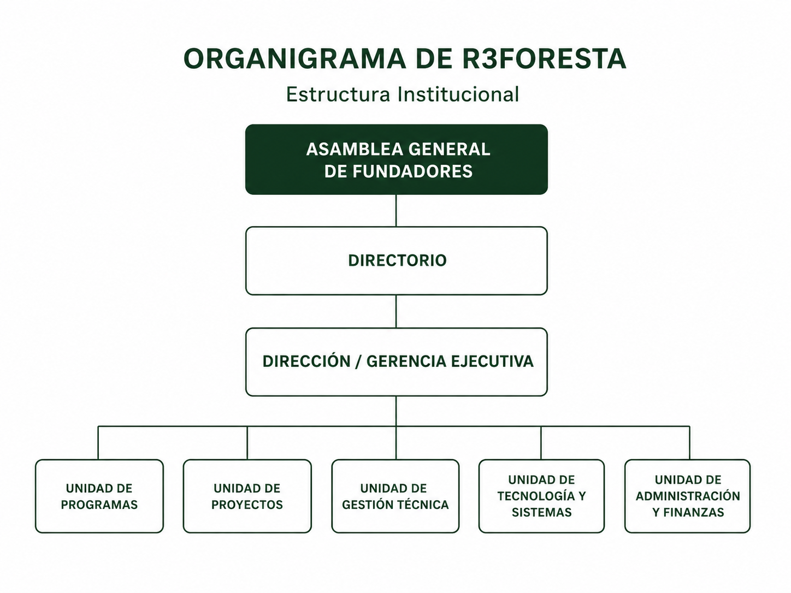

# CAPÍTULO I — MARCO INTRODUCTORIO

## 1.1 Introducción

La reforestación es un proceso que involucra distintas etapas, actores y decisiones, desde la obtención del material vegetal hasta su establecimiento en campo. Esta complejidad aumenta cuando una organización proyecta que sus actividades puedan formar parte, en el futuro, de iniciativas relacionadas con bonos de carbono, donde intervienen procesos adicionales de monitoreo, medición, validación y verificación.

Para R3Foresta, la generación futura de bonos de carbono constituye un objetivo estratégico de largo plazo (R3Foresta, 2026). Su consecución requiere trabajos posteriores que exceden el alcance de este Proyecto de Grado. Antes de esos procesos, existe una necesidad inmediata: organizar y relacionar la información que se genera durante las actividades de reforestación.

Actualmente, parte de esta información se encuentra distribuida entre fotografías, redes sociales, servicios de mensajería, cuadernos, notas y el conocimiento de las personas involucradas. Esto dificulta responder preguntas básicas sobre el material vegetal: de dónde provino, quién estuvo a cargo, qué ocurrió durante su paso por el vivero, cuántas unidades fueron movilizadas y dónde terminó siendo plantado.

Este Proyecto de Grado aborda ese primer nivel del problema y desarrolla un sistema de trazabilidad como componente de **R3foresta App**, orientado a preservar el historial del material vegetal desde su origen registrado, ya sea mediante la recolección de semillas o la incorporación de material adquirido externamente, pasando por su desarrollo en vivero cuando corresponda, hasta el registro de su plantación. El sistema integra información sobre procedencia, cantidades, responsables, ubicaciones y evidencias mediante los módulos de **Recolección, Vivero y Plantación**.

R3Foresta puede así comenzar a construir un historial organizado de sus actividades de reforestación que responda a sus necesidades actuales y que, en el futuro, pueda evaluarse como parte de una base documental para iniciativas de carbono. El alcance del proyecto concluye con el registro de la plantación y no incluye el monitoreo posterior de los árboles, la cuantificación de carbono ni los procesos de certificación o emisión de créditos.

El Resumen constituye un elemento preliminar independiente y se redactará cuando el documento completo esté estabilizado. Después de este capítulo, el Capítulo II desarrolla los fundamentos teóricos y conceptuales de la trazabilidad, RUP, SDD y asistencia de IA, y delimita la proyección hacia bonos de carbono; el Capítulo III presenta el análisis, el diseño, la implementación e integración, la verificación y la evaluación del recorrido. Finalmente se incluyen las Conclusiones, las Recomendaciones, las Referencias bibliográficas y los Anexos.

## 1.2 Antecedentes

### 1.2.1 Antecedentes institucionales

R3Foresta fue creada en 2019 como una iniciativa socioambiental orientada a la bioregeneración de ecosistemas y al fortalecimiento de las comunidades vinculadas. Actualmente integra reforestación, agua, biodiversidad, residuos, alimentación y tecnología mediante los componentes R3Carbon, R3Water, R3Bio y R3F10 — Reciclaje y Economía Circular (R3Foresta, 2026).

**Figura 1.1. Estructura organizacional de R3Foresta**

*Nota.* Organigrama institucional proporcionado por la Fundación R3Foresta.

**R3foresta App** se vincula con la proyección institucional de R3Carbon mediante la trazabilidad del material vegetal (R3Foresta, 2026). La aplicación relaciona su recorrido desde su origen registrado, ya sea mediante la recolección de semillas o la incorporación de material adquirido externamente al proceso de trazabilidad, hasta el registro de su plantación, incluido su desarrollo en vivero cuando corresponda. El seguimiento posterior, la medición de carbono y la certificación quedan fuera del proyecto.

### 1.2.2 Trabajos similares

En Perú, Salamanca Contreras (2024) implementó un sistema web para administrar existencias y despachos de un vivero comercial y reportó mejoras en la exactitud del inventario. El trabajo muestra el aporte de centralizar los movimientos del vivero, pero no reconstruye la procedencia del material ni su transferencia hacia actividades de reforestación.

En Ecuador, Mayorga Vásquez et al. (2022) propusieron un sistema web que integró información administrativa y productiva de viveros. A diferencia de R3foresta App, no relaciona de extremo a extremo la recolección, el manejo en vivero y la evidencia geográfica de la plantación.

En el ámbito de la trazabilidad, Thakur et al. (2011) utilizaron eventos para representar estados, movimientos y transformaciones y recuperar relaciones históricas dentro de una cadena. Su dominio es agroalimentario y no contempla los cambios biológicos, las unidades de medida ni las reglas del material vegetal utilizado por R3Foresta.

En Bolivia, Quispe Tola y Condori Zapana (2020) desarrollaron para la Autoridad de Fiscalización y Control Social de Bosques y Tierra un sistema que centraliza iniciativas forestales e incorpora consultas, mapas y reportes. Su unidad principal es la iniciativa o proyecto forestal, no la cadena operativa del material vegetal entre Recolección, Vivero y Plantación.

En las fuentes revisadas no se identificó un trabajo equivalente desarrollado en la ciudad de La Paz. Los antecedentes más cercanos corresponden al departamento de La Paz y a la ciudad de El Alto. Limachi Mamani (2020) desarrolló para la Autoridad de Fiscalización y Control Social de Bosques y Tierra un sistema que registra y geolocaliza viveros, especies y volúmenes de producción. Su unidad principal es el vivero, por lo que no reconstruye el recorrido del material vegetal desde su procedencia hasta la plantación.

Valdez Alvarado (2023) desarrolló para la Unidad de Forestación del Gobierno Autónomo Municipal de El Alto un sistema que centraliza información sobre plantines, responsables, solicitudes y plantaciones. Es el antecedente local más cercano al recorrido entre Vivero y Plantación. R3foresta App incorpora además la Recolección y las relaciones necesarias para reconstruir la procedencia, los movimientos, las cantidades y las evidencias.

Los trabajos revisados resuelven partes del problema, como el inventario de viveros, la geolocalización, la producción o la representación de eventos. Dentro del alcance de la búsqueda, no se identificó una solución que integre la procedencia propia o externa, los movimientos entre Recolección, Vivero y Plantación, la consistencia de cantidades y saldos y la evidencia del destino. Esta conclusión se limita a las fuentes consultadas.

## 1.3 Planteamiento del problema

### 1.3.1 Situación problemática

Para construir un historial integrado del material vegetal, R3Foresta necesita relacionar la información que se genera durante cada etapa de las actividades de Recolección, Vivero y Plantación. Sin embargo, actualmente estos registros se encuentran distribuidos entre fotografías, redes sociales, servicios de mensajería, cuadernos, notas y el conocimiento de las personas involucradas, sin una forma común de relacionarlos entre sí.

Esta dispersión dificulta relacionar información que pertenece a un mismo recorrido. Una fotografía, por ejemplo, puede mostrar el resultado de una plantación, pero, de forma aislada, no permite determinar con claridad cuántas plantas fueron utilizadas, qué especies participaron, cuándo ocurrió la actividad, dónde se realizó o quiénes estuvieron involucrados.

En el vivero, es necesario conocer qué material de propagación se encuentra disponible, qué cantidad está en proceso de germinación, qué plantas continúan en desarrollo y cuáles pueden destinarse a una futura plantación. Sin esta información relacionada, resulta difícil conocer la disponibilidad real del material vegetal y tomar decisiones sobre su utilización.

La plantación presenta una necesidad similar. Al planificar una plantación, se debe definir cuántas plantas se utilizan y qué especies la componen, incluso estableciendo su distribución porcentual cuando corresponda. Para ello es necesario conocer previamente qué material está disponible y si es necesario complementarlo con plantas adquiridas externamente.

A medida que se realizan nuevas recolecciones, procesos de vivero y plantaciones, aumenta también la cantidad de información que debe administrarse y relacionarse. Cuando estos registros permanecen separados, reconstruir posteriormente el recorrido del material requiere revisar distintas fuentes y recurrir al conocimiento de las personas que participaron en los procesos.

Esta situación dificulta tanto la administración interna de las actividades de reforestación como la presentación de historiales organizados a comunidades, patrocinadores y otras partes interesadas. También limita la posibilidad de conservar desde ahora antecedentes que, complementados posteriormente con procesos de monitoreo, medición y verificación, puedan evaluarse como parte de futuras iniciativas relacionadas con carbono.

El árbol de problemas que sintetiza esta situación se presenta en el **Anexo A**.

### 1.3.2 Problema central

> Actualmente, R3Foresta no dispone de un historial integrado que le permita reconstruir, a partir de sus registros, el recorrido del material vegetal desde su origen registrado hasta el registro de su plantación.

### 1.3.3 Formulación del problema

#### 1.3.3.1 Pregunta general

> ¿Cómo puede R3Foresta organizar y relacionar la información generada durante sus actividades de reforestación para reconstruir, a partir de sus registros, el recorrido del material vegetal desde su origen registrado hasta el registro de su plantación?

#### 1.3.3.2 Preguntas específicas

1. ¿Qué información se genera y cómo se gestiona actualmente en las actividades de Recolección, Vivero y Plantación de R3Foresta?
2. ¿Qué información y relaciones deben registrarse para reconstruir el recorrido registrado del material vegetal desde su origen registrado hasta el registro de su plantación?
3. ¿Qué debe permitir el sistema en Recolección, Vivero y Plantación para mantener vinculada la información del material vegetal durante su recorrido?
4. ¿Cómo verificar que lo implementado cumple los requerimientos definidos y que los registros conservan coherencia entre las cantidades y los movimientos del material vegetal?
5. ¿En qué medida el sistema permite reconstruir, a partir de sus registros y evidencias, el recorrido del material vegetal en escenarios operativos representativos de R3Foresta?

## 1.4 Objetivos

### 1.4.1 Objetivo general

Desarrollar un sistema web que permita a R3Foresta registrar, organizar y relacionar la información generada en las actividades de Recolección, Vivero y Plantación, para reconstruir, a partir de sus registros, el recorrido del material vegetal desde su origen registrado hasta el registro de su plantación.

### 1.4.2 Objetivos específicos

1. **Analizar** la información que se genera y cómo se gestiona actualmente en las actividades de Recolección, Vivero y Plantación de R3Foresta.
2. **Diseñar** la organización de la información y las relaciones necesarias para reconstruir el recorrido registrado del material vegetal desde su origen registrado hasta el registro de su plantación.
3. **Implementar** en el sistema las funciones de Recolección, Vivero y Plantación necesarias para mantener vinculada la información del material vegetal durante su recorrido.
4. **Verificar** que las funciones implementadas cumplan los requerimientos definidos y que los registros mantengan coherencia entre las cantidades y los movimientos del material vegetal.
5. **Evaluar**, mediante escenarios operativos representativos, en qué medida el sistema permite reconstruir, a partir de sus registros y evidencias, el recorrido del material vegetal.

## 1.5 Justificación

R3Foresta necesita una cadena informacional común para reconstruir el recorrido del material vegetal y conocer su procedencia, disponibilidad, pérdidas, transferencias y destino. Olsen y Borit (2013) sustentan la necesidad de recuperar información vinculada, mientras que la Organización Internacional de Normalización (ISO) aporta un marco general de cadena de custodia para relacionar el material y sus registros (International Organization for Standardization, 2020). El sistema relaciona los registros de Recolección, Vivero y Plantación con el propósito de reducir la dependencia de búsquedas manuales y de la memoria de las personas.

La generación futura de bonos de carbono forma parte de la orientación institucional de R3Foresta (R3Foresta, 2026). R3foresta App conserva, desde su origen registrado, un historial de cantidades, saldos, responsables, ubicaciones y evidencias. Esta base puede respaldar la información presentada a comunidades, patrocinadores y aliados y evaluarse para una posible reutilización en futuras iniciativas de carbono. Registrar esos antecedentes desde ahora reduce la necesidad de reconstruirlos después a partir de fuentes dispersas.

El historial no demuestra por sí mismo la supervivencia o el crecimiento de las plantas, la biomasa, las remociones de dióxido de carbono equivalente, la línea base, la adicionalidad, la permanencia o las fugas. Tampoco sustituye el seguimiento de campo, el monitoreo, la cuantificación, la validación, la verificación ni la emisión de créditos (ISO, 2019; Verra, s. f.). Estas actividades corresponden a proyectos posteriores y no amplían el alcance académico.

El aporte tecnológico y académico consiste en integrar el análisis del dominio, un modelo de trazabilidad, reglas de integridad, tres módulos y evidencia de verificación y validación. Los beneficios se informan según los escenarios ejecutados, sin asumir mejoras ni impactos ambientales antes de evaluarlos.

## 1.6 Alcances y límites

### 1.6.1 Alcance funcional

El alcance funcional comprende tres módulos. El recorrido académico se inicia con el origen registrado: una recolección de semillas o la incorporación, en Vivero o Plantación, de material vegetal adquirido externamente. En esta última variante se conserva la información disponible sobre su procedencia, proveedor o entidad de origen, cantidad, unidad, fecha de ingreso, responsable y evidencia asociada.

- **Recolección.** Registra la especie, la cantidad y unidad de medida, la fecha, el responsable, la ubicación y la evidencia del material recolectado. Permite identificar el lote de origen y su transferencia al vivero hasta su cierre o vinculación con el material resultante.
- **Vivero.** Registra la recepción y el manejo del material procedente de Recolección o adquirido externamente. Para el material externo, conserva su ingreso y la procedencia disponible. También conserva los hechos que explican cambios de cantidad, mermas, descartes, saldo vivo y salidas hacia Plantación, hasta el despacho, cierre o agotamiento del material.
- **Plantación.** Registra el material procedente de Vivero y, cuando corresponde, el adquirido externamente para su incorporación directa a esta etapa. Relaciona el material con la campaña o subcampaña y conserva la procedencia, las cantidades recibidas, plantadas, devueltas o descartadas, los responsables, la fecha, la ubicación y la evidencia.

Los módulos comparten identificadores para reconstruir el recorrido del material vegetal y explicar los saldos. El historial distingue los movimientos entre responsables o etapas de los cambios biológicos u operativos que modifican cantidades o unidades.

Como controles transversales, el producto aplica autenticación y autorización, registro de operaciones críticas, respaldo y recuperación, protección de credenciales y tratamiento restringido de fotografías, coordenadas y datos personales. Esta información no se proporciona a agentes de inteligencia artificial sin autorización.

Los registros de trazabilidad pueden evaluarse para su posible reutilización y complemento en futuras iniciativas de carbono. No constituyen monitoreo ni certificación; su pertinencia depende de la metodología, las mediciones y los controles que se adopten posteriormente.

### 1.6.2 Límites

- El alcance concluye con el registro de la plantación; no comprende mantenimiento, reposición, crecimiento ni seguimiento de supervivencia.
- El sistema no calcula biomasa o dióxido de carbono equivalente, no aborda línea base, adicionalidad o permanencia y no implementa monitoreo, reporte y verificación de carbono ni evalúa elegibilidad bajo un estándar.
- El proyecto no certifica plantaciones, no genera, emite ni comercializa bonos o créditos y no se integra con mercados de carbono o certificadoras.
- Las fotografías, coordenadas, fechas y documentos respaldan el registro con el que se relacionan, pero no constituyen autenticación forense ni certificación independiente del hecho físico.
- Blockchain, NFT, contratos inteligentes, IPFS, anclajes criptográficos y componentes equivalentes quedan fuera del aporte académico, de la verificación y de los resultados.
- El producto se desarrolla para el caso y los procesos de R3Foresta; no incluye una operación nacional, un despliegue masivo ni la generalización automática a otras organizaciones.

## 1.7 Metodología de desarrollo

El proyecto adopta un proceso de desarrollo basado en **Rational Unified Process (RUP)**, complementado con **Spec-Driven Development (SDD) asistido por inteligencia artificial**. RUP organiza el ciclo de vida completo; SDD guía el paso de las especificaciones al diseño, las tareas, la implementación y las pruebas; la IA actúa como herramienta de apoyo bajo control humano. No se incorpora una metodología de investigación adicional ni se organiza el trabajo mediante sprints. Los fundamentos se desarrollan en el Capítulo II; esta sección explica su aplicación al proyecto.

### 1.7.1 RUP como proceso rector

RUP es un proceso dirigido por casos de uso, centrado en la arquitectura e iterativo e incremental. Ordena el proyecto en las fases de Inicio, Elaboración, Construcción y Transición. Los riesgos prioritarios orientan cada iteración y cada fase concluye con un hito de revisión (IBM, s. f.; Kruchten, 2004).

En Inicio se delimitan el problema, los actores, el alcance, los requisitos iniciales, los riesgos y la viabilidad. En Elaboración se estabilizan las reglas críticas, el modelo de trazabilidad, la arquitectura y los contratos entre módulos. Construcción produce e integra los incrementos ejecutables. Transición reúne la verificación final, la validación operativa, las correcciones, el despliegue, los manuales y la aceptación.

### 1.7.2 Adaptación de RUP al proyecto

La adaptación conserva las fases, los hitos, las iteraciones, las disciplinas y la evidencia necesaria para revisar el avance, pero simplifica los roles y documentos que no aportan a una ejecución individual. Las disciplinas de requisitos, análisis y diseño, implementación, pruebas, despliegue, gestión del proyecto y gestión de configuración y cambios se aplican según el objetivo de cada iteración.

Los hitos son **LCO** (*Lifecycle Objectives*, objetivos del ciclo de vida), **LCA** (*Lifecycle Architecture*, arquitectura del ciclo de vida), **IOC** (*Initial Operational Capability*, capacidad operativa inicial) y **PR** (*Product Release*, liberación del producto). Su cierre depende de la revisión de productos, resultados y riesgos residuales; una fecha cumplida o la existencia de código no equivalen a la aprobación del hito.

### 1.7.3 Fases, iteraciones e hitos

Una iteración es un intervalo planificado que recorre las disciplinas pertinentes y concluye con una revisión. El incremento es la versión ejecutable obtenida al cerrar una iteración de Construcción. Las iteraciones IN-1 y EL-1 producen resultados de definición y arquitectura; CO-1 a CO-4 producen cuatro incrementos ejecutables; TR-1 verifica, valida y prepara la liberación.

IN-1 concluye con la revisión LCO y EL-1 con LCA. Las cuatro iteraciones de Construcción culminan en la versión candidata y el hito IOC. TR-1 estabiliza, valida y prepara el producto para la decisión PR. Cada revisión debe registrar la evidencia examinada, la decisión de salida y los riesgos o defectos residuales.

### 1.7.4 Incrementos e integraciones de Construcción

Construcción produce cuatro incrementos ejecutables:

1. M1 Recolección funcional y probado;
2. M2 Vivero e integración M1→M2;
3. M3 Plantación e integración M2→M3;
4. trazabilidad transversal, integración completa, regresión y versión candidata.

Las cuatro iteraciones de Construcción mantienen el orden M1 Recolección → M2 Vivero e integración M1→M2 → M3 Plantación e integración M2→M3 → trazabilidad transversal, regresión y versión candidata. Las consultas, el historial y la reconstrucción son capacidades transversales y no un cuarto módulo.

### 1.7.5 Flujo SDD asistido por IA

SDD se aplica como práctica subordinada a RUP mediante la cadena `necesidad → requisito → especificación → diseño → tarea → implementación → prueba → resultado → aceptación`. Antes de programar una capacidad se definen sus actores, escenarios, reglas, datos, casos límite y criterios de aceptación. Luego se preparan el diseño y las tareas; la implementación y las pruebas deben corresponder a esa especificación.

Si una prueba o la implementación revela una ambigüedad, se actualizan primero la especificación y los productos afectados. SDD no reemplaza la visión, la arquitectura, el registro de riesgos, las revisiones de iteración, los hitos ni el despliegue de RUP.

### 1.7.6 Asistencia de inteligencia artificial y control humano

La inteligencia artificial puede apoyar el análisis, el diseño, el código, las pruebas y la documentación. Sus salidas se consideran propuestas sujetas a revisión. La IA no aprueba el alcance, los requisitos, las reglas del dominio, los resultados ni la liberación, y no sustituye la revisión del código ni la responsabilidad autoral (GitHub, 2026; Tabassi, 2023).

Cada aporte material debe registrar la fecha, la herramienta y el modelo o versión disponible, la tarea, el artefacto afectado, la salida adoptada, modificada o rechazada, la revisión humana, la prueba y la referencia al cambio. No es necesario publicar conversaciones privadas completas.

### 1.7.7 Verificación, validación y aceptación

La **verificación técnica** contrasta requisitos, reglas e invariantes mediante pruebas unitarias, funcionales, de integración, regresión, concurrencia y fallos críticos. Como mínimo se comprueban el saldo no negativo, el rechazo de consumos superiores al disponible, la prevención de duplicados, la atomicidad de las operaciones críticas y la consistencia de las transferencias M1→M2 y M2→M3.

La **validación operativa** utiliza escenarios representativos derivados de variantes reales de R3Foresta. Cada escenario identifica si utiliza una operación real autorizada o datos controlados y registra precondiciones, pasos, resultado esperado, resultado observado, evidencia y defectos. La **aceptación** confronta esos resultados con criterios definidos para cada incremento y para el producto integrado. Estas actividades pertenecen a la ingeniería del producto y no se presentan como diseño experimental ni certificación externa.

### 1.7.8 Seguimiento y cadenas de evidencia

El seguimiento compara lo planificado con lo realizado por fase e iteración. Cada revisión registra objetivos, riesgos, productos, decisiones, pruebas, desviaciones, resultado, riesgo residual y estado de aceptación. Se conservan dos cadenas complementarias:

1. `necesidad → requisito → especificación → decisión de diseño → tarea → cambio → prueba → resultado → aceptación`;
2. `requisito → regla → invariante → mecanismo → prueba → resultado`.

La presencia de un documento, una migración, una prueba o una función implementada se registra como evidencia técnica disponible. Solo se utiliza el estado **verificado** cuando existe un resultado reproducible vinculado con la versión evaluada, y **aceptado** cuando la persona competente toma y registra esa decisión.

### 1.7.9 Periodización y estado metodológico al corte

**Tabla 1.1**

*Aplicación de RUP adaptado y periodización del proyecto*

| Fase | Iteración y periodo | Resultado planificado | Hito relacionado |
|---|---|---|---|
| Inicio | IN-1, 6–19 jul | visión, alcance, actores, requisitos iniciales, riesgos y plan | LCO |
| Elaboración | EL-1, 20 jul–16 ago | arquitectura base, modelo de dominio y datos, contratos y especificaciones prioritarias | LCA |
| Construcción | CO-1, 17 ago–6 sep | incremento 1: M1 Recolección funcional y probado | seguimiento de Construcción |
| Construcción | CO-2, 7–27 sep | incremento 2: M2 Vivero e integración M1→M2 | seguimiento de Construcción |
| Construcción | CO-3, 28 sep–18 oct | incremento 3: M3 Plantación e integración M2→M3 | seguimiento de Construcción |
| Construcción | CO-4, 19 oct–1 nov | incremento 4: trazabilidad transversal, integración completa y versión candidata | IOC |
| Transición | TR-1, 2–15 nov | pruebas del sistema, validación, despliegue, manuales y aceptación | PR |

*Nota.* Elaboración propia a partir de la metodología y el cronograma aprobados en el Perfil. Los periodos corresponden a 2026. La tabla presenta el plan; el estado real se expone en los párrafos siguientes y en el registro de avance metodológico.

Al 15 de septiembre de 2026 existen productos de análisis, arquitectura, requisitos, reglas, contratos, implementación y pruebas que respaldan avances de IN-1, EL-1 y Construcción. Sin embargo, no se han consolidado las actas de cierre de LCO y LCA ni el expediente de cierre de CO-1. CO-2 se encuentra dentro de su periodo planificado. La implementación adelantada de capacidades de M2 y M3 se conserva como evidencia técnica disponible, pero deberá revalidarse en la iteración que corresponda y vincularse con especificaciones, tareas, pruebas y decisiones de aceptación.

El registro `../../04_metodologia/registro_avance_rup_sdd.md` muestra por separado lo planificado, la evidencia disponible, los vacíos y el estado de cada iteración e hito. Por ello, este documento describe una estructura metodológica adoptada y avances respaldados, sin declarar completadas actividades o aprobaciones que aún no cuentan con registro.
