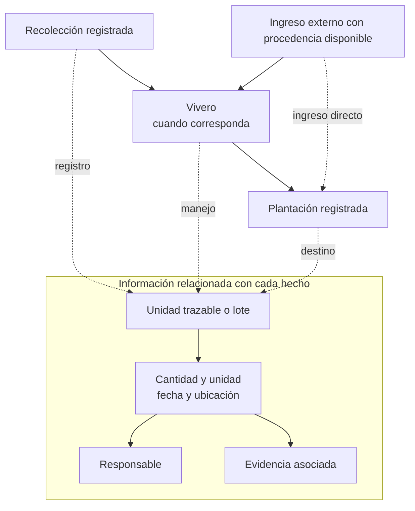
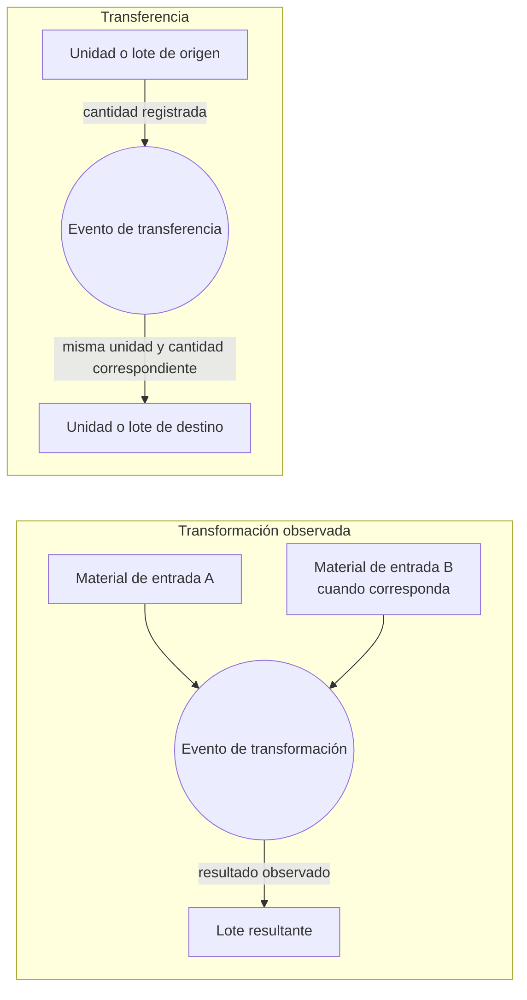
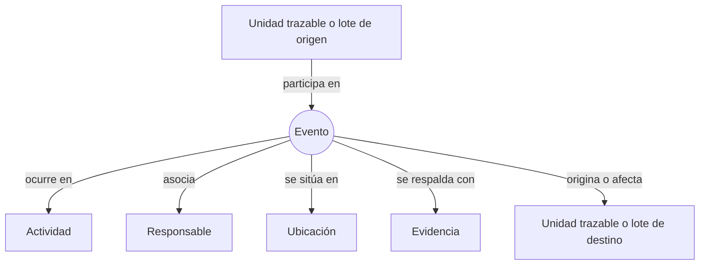
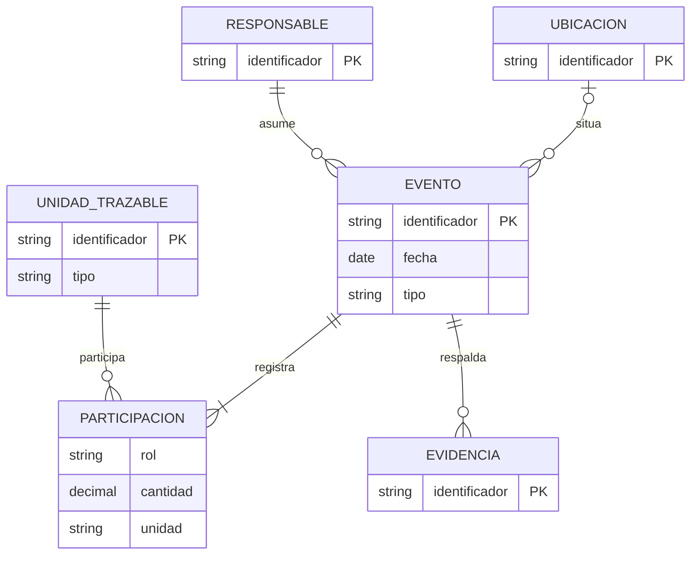
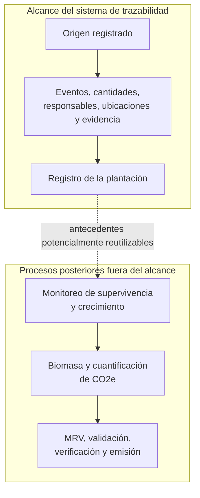
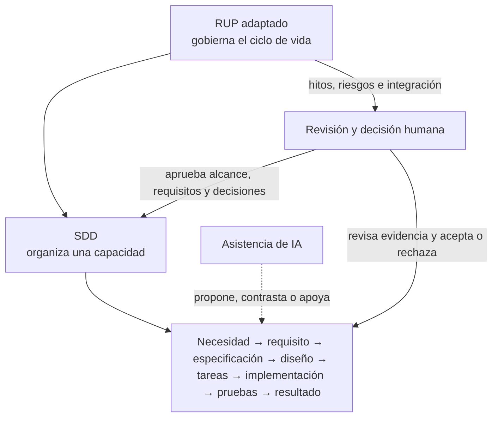

# CAPÍTULO II — MARCO TEÓRICO Y CONCEPTUAL

El problema de R3Foresta no se resuelve con la acumulación de fotografías, formularios o inventarios aislados. Requiere conservar información que mantenga relación con el material vegetal cuando este cambia de etapa, responsable, ubicación, cantidad o condición. Por ello, este capítulo desarrolla los conceptos necesarios para comprender el recorrido registrado desde su origen hasta el registro de la plantación, las reglas que permiten conservar su coherencia y los criterios con los que posteriormente se comprobará el producto.

La exposición parte del proceso físico que se desea registrar y avanza hacia el modelo informacional que permite reconstruirlo. Después delimita la relación de esa información con una eventual iniciativa de carbono y presenta los fundamentos del proceso de desarrollo adoptado. El capítulo no desarrolla todavía la arquitectura, las decisiones de implementación ni los resultados de R3foresta App. La sección 2.10 registra únicamente un inventario sintético de las tecnologías efectivamente utilizadas; la arquitectura, la configuración y la evidencia de su aplicación corresponden al Marco aplicativo.

## 2.1 Material vegetal y procesos de reforestación

### 2.1.1 Material reproductivo forestal y procedencia

El material vegetal no se limita a las plantas ya listas para establecerse en campo. La Organización de las Naciones Unidas para la Alimentación y la Agricultura incluye en el material reproductivo forestal las semillas, las partes de plantas utilizadas para propagación y las plantas producidas a partir de ellas (Food and Agriculture Organization of the United Nations, s. f.). Esta amplitud permite comprender que la trazabilidad debe comenzar antes del vivero, cuando existe un origen registrado del material que posteriormente podrá germinar, propagarse, agruparse o trasladarse.

La procedencia no es un dato accesorio. La misma fuente recomienda conservar información sobre la fuente del material, su cantidad, los tratamientos recibidos, su distribución y el lugar donde se utiliza; cuando procede de un proveedor, también resulta pertinente conservar la documentación disponible de ese ingreso (Food and Agriculture Organization of the United Nations, s. f.). En este proyecto, la procedencia se entiende como la información disponible que permite explicar de dónde ingresó el material vegetal al recorrido: una recolección registrada o una recepción externa en Vivero o Plantación.

Esta delimitación no pretende certificar la calidad genética, física o fitosanitaria del material. Tales afirmaciones requerirían procedimientos, ensayos o certificaciones ajenos al alcance. El sistema conservará la información declarada y la evidencia asociada para que la procedencia registrada pueda recuperarse junto con el resto de la traza.

### 2.1.2 Etapas de recolección, vivero y plantación

La gestión del material reproductivo forestal comprende, entre otras actividades, la identificación de especies y procedencias, la recolección o adquisición, el manejo y almacenamiento, la producción de plantas en vivero, el transporte y la distribución para su uso en campo (Food and Agriculture Organization of the United Nations, s. f.). Estas actividades no siempre ocurren de forma lineal ni con la misma intensidad; sin embargo, muestran por qué una reforestación genera información en distintos momentos y por parte de diferentes responsables.

Para R3Foresta, el recorrido se organiza en Recolección, Vivero y Plantación. Recolección establece una variante de origen registrado; Vivero recibe material procedente de esa etapa o de una fuente externa y conserva los hechos de su manejo; Plantación registra la asignación o recepción del material y su establecimiento en una campaña o subcampaña. Cada etapa puede modificar la ubicación, el responsable, la agrupación, la unidad de medida o la cantidad disponible. El interés del sistema no es sustituir el proceso biológico, sino conservar la relación entre los registros que ese proceso produce.

La reforestación proporciona el contexto de uso de ese material. La FAO la relaciona con el restablecimiento de bosque mediante plantación o siembra deliberada en terrenos clasificados como bosque (Food and Agriculture Organization of the United Nations, 2023). En este proyecto, el término delimita el propósito de las actividades registradas; no implica que el sistema mida recuperación ecológica, supervivencia o captura de carbono después de la plantación.

### 2.1.3 Transformación biológica observada

El paso de una semilla o de una unidad de propagación a una planta no constituye una equivalencia aritmética automática. La germinación, el enraizamiento, el desarrollo en vivero y las pérdidas dependen de características del material y de condiciones de manejo; la FAO señala, por ejemplo, la importancia de la calidad inicial, los tratamientos, el almacenamiento y los resultados de pruebas de germinación (Food and Agriculture Organization of the United Nations, s. f.). Por ello, una cantidad de semillas registrada al inicio no permite inferir por sí sola una cantidad posterior de plantas disponibles.

En consecuencia, R3Foresta tratará el resultado de una transformación biológica como un hecho observado y registrado. La relación con el material de entrada explica el antecedente del lote resultante, pero no afirma que cada unidad de entrada se conserve físicamente ni que la conversión pueda calcularse sin observación. Esta distinción evita trasladar de manera inapropiada modelos contables o industriales a un proceso biológico.

**Figura 2.1. Recorrido conceptual del material vegetal y de la información asociada**

*Nota.* Elaboración propia con base en Food and Agriculture Organization of the United Nations (s. f.), Olsen y Borit (2013) y el alcance definido en el Perfil de Proyecto de Grado. La figura representa relaciones informacionales; no afirma continuidad física individual ni una conversión automática entre semillas y plantas.

## 2.2 Trazabilidad y cadena de custodia

### 2.2.1 Definición y propósito de la trazabilidad

La trazabilidad se refiere a la capacidad de acceder a información relacionada con un objeto a lo largo de las etapas definidas para su seguimiento. Olsen y Borit (2013) subrayan que esta capacidad exige precisar el objeto considerado y las propiedades sobre las cuales se desea recuperar información. No basta, por tanto, con almacenar datos del material vegetal: los datos deben conservar vínculos que permitan volver desde un registro actual hacia sus antecedentes o desde un origen hacia sus destinos registrados.

En R3Foresta se adopta la expresión **trazabilidad reconstruible** para designar la capacidad de recomponer, a partir de registros relacionados, la procedencia, los movimientos, las cantidades, los responsables, las fechas, las ubicaciones y el destino del material vegetal. La definición se limita deliberadamente a lo que el sistema puede recuperar desde sus propios registros. No equivale a una certificación independiente de la verdad física declarada ni a la trazabilidad completa entre organizaciones.

### 2.2.2 Trazabilidad interna y trazabilidad entre etapas

Moe (1998) distingue la trazabilidad interna, que se ocupa de las relaciones dentro de una operación, de la trazabilidad que conecta etapas sucesivas de una cadena. La primera permite explicar, por ejemplo, los cambios producidos dentro de Vivero; la segunda permite relacionar ese material con el origen registrado en Recolección y con su destino en Plantación. Ambas son necesarias cuando una organización quiere reconstruir un recorrido que atraviesa más de un proceso.

La separación es útil para R3Foresta porque los tres módulos no son aplicaciones independientes. Cada uno conserva información propia, pero las transferencias, recepciones, transformaciones y asignaciones deben mantener relaciones suficientes para que una consulta posterior atraviese el recorrido completo. El proyecto no declara interoperabilidad plena con proveedores u otras organizaciones; conserva, en cambio, la información disponible cuando el material ingresa desde una fuente externa.

### 2.2.3 Cadena de custodia

La cadena de custodia organiza la relación entre el material, los responsables y los cambios registrados a lo largo de un recorrido. ISO, mediante la norma ISO 22095:2020, proporciona un marco general y terminología aplicable a materiales y productos, pero advierte que la existencia de una cadena de custodia no basta, por sí sola, para realizar o verificar afirmaciones sobre sus características (ISO, 2020). Esta advertencia es central para el proyecto: un historial ordenado mejora la recuperabilidad de la información, sin transformar cada registro en una prueba independiente del hecho físico.

En el caso estudiado, la cadena de custodia relaciona la procedencia registrada, los responsables, las cantidades, las ubicaciones, las evidencias y el destino de cada unidad trazable. Cuando cambia la persona responsable o la etapa operativa, el sistema conservará el hecho que explica ese cambio. La adopción es conceptual: R3Foresta no declara conformidad con un modelo de certificación ni con una norma sectorial.

### 2.2.4 Unidad trazable y granularidad

La unidad trazable determina qué se sigue y con qué nivel de detalle. Dabbene et al. (2014) muestran que la identificación, la granularidad y la posibilidad de recuperar relaciones históricas son componentes esenciales de un sistema de trazabilidad; Olsen y Borit (2018) destacan, además, la importancia de conservar las unidades trazables, sus atributos y las relaciones producidas cuando se unen o se dividen. Elegir una unidad demasiado amplia impide explicar diferencias relevantes; elegir una demasiado pequeña puede volver inviable el registro operativo.

Para R3Foresta, el lote es la unidad principal para agrupar material vegetal que comparte un antecedente operativo relevante. Un lote puede dividirse para atender distintos destinos o agruparse cuando el proceso lo justifique, siempre que el historial conserve el vínculo entre las unidades anteriores y posteriores. La granularidad no se impone como una identidad individual de cada semilla o planta; se ajustará a la información que el proceso permite registrar y a la necesidad de reconstruir cantidades, eventos y destino.

## 2.3 Eventos, transformaciones y procedencia

### 2.3.1 Evento de trazabilidad

Un evento de trazabilidad representa un hecho ocurrido durante el recorrido del material, a diferencia de los datos relativamente estables que describen especies, usuarios, lugares o tipos de unidad. Thakur et al. (2011) emplean esta distinción para representar estados, movimientos y transformaciones de una cadena física. El valor del enfoque no está en acumular eventos, sino en poder explicar posteriormente qué ocurrió con una unidad identificada y en qué orden.

EPCIS 2.0 ofrece un referente técnico para describir eventos mediante las dimensiones qué, cuándo, dónde, por qué y, cuando corresponde, cómo (GS1 AISBL, 2023). R3Foresta toma ese vocabulario como guía conceptual, no como obligación de implementar el estándar. Cada hecho relevante deberá identificar el material o lote afectado, la fecha, el contexto u operación, el lugar cuando corresponda, el responsable y la evidencia asociada. Los atributos concretos se definirán en las especificaciones y no se deducirán automáticamente de una fotografía o de una coordenada.

### 2.3.2 Transferencias y transformaciones

Una transferencia conserva la identidad del material mientras modifica su custodia, su ubicación o la etapa que lo recibe. Una transformación, en cambio, relaciona una o más entradas con un resultado registrado. La guía EPCIS distingue los eventos de transformación precisamente porque las entradas pueden consumirse total o parcialmente y dar lugar a salidas diferentes (GS1 AISBL, 2023). Solanki y Brewster (2014) muestran que el enlace entre entradas, evento y salidas permite recuperar la procedencia de los resultados.

Esta diferencia permite que R3Foresta distinga, por ejemplo, el despacho de un lote desde Vivero hacia Plantación de un resultado observado de germinación o embolsado. En el primer caso se conserva una transferencia entre etapas; en el segundo se registra una relación entre el material antecedente y un lote resultante. Ninguna de las dos operaciones permite afirmar, sin información adicional, que el material conservó una identidad física individual durante todo el proceso.

### 2.3.3 Relaciones de entrada y salida

Las relaciones de entrada y salida permiten que una traza no se reduzca a una lista cronológica sin conexión. Cuando un lote se divide, se agrupa, se transforma o se transfiere parcialmente, la consulta debe poder mostrar qué unidades participaron y qué resultado quedó registrado. Dabbene et al. (2014) denominan genealogía a la recuperación de esas relaciones históricas; el modelo de entradas y salidas de los eventos de transformación aporta una forma de expresarlas (Solanki & Brewster, 2014).

En R3Foresta, estas relaciones permitirán reconstruir ramificaciones sin forzar una cadena estrictamente lineal. Un origen registrado puede alimentar más de un lote posterior y una plantación puede recibir material de varios lotes. Lo relevante es que cada vínculo conserve el hecho que lo explica y la cantidad correspondiente. El modelo no inferirá conexiones que no hayan sido registradas.

**Figura 2.2. Diferencia conceptual entre transferencia y transformación**

*Nota.* Elaboración propia con base en GS1 AISBL (2023), Solanki y Brewster (2014) y Food and Agriculture Organization of the United Nations (s. f.). La relación de transformación conserva el antecedente del resultado, pero no establece una equivalencia aritmética entre unidades o etapas biológicas distintas.

### 2.3.4 Procedencia, actividades y responsables

El modelo PROV-O distingue entidades, actividades y agentes: una actividad ocurre durante un periodo e interviene sobre entidades, mientras que un agente asume alguna forma de responsabilidad por esa actividad o por una entidad (World Wide Web Consortium, 2013). Estas nociones permiten razonar sobre el origen de un registro sin comprometer una tecnología semántica específica.

Para este proyecto, el material vegetal y sus lotes se interpretan como entidades; la recolección, recepción, manejo, transferencia, transformación observada y plantación se interpretan como actividades; y las personas u organizaciones que registran o asumen un rol se conservan como responsables asociados. Esta relación mejora la posibilidad de explicar quién intervino en cada hecho. No obstante, la responsabilidad registrada expresa una declaración dentro del sistema y no reemplaza un mecanismo externo de autenticación, auditoría o certificación.

**Figura 2.3. Modelo conceptual de una traza basada en eventos**

*Nota.* Elaboración propia con base en Thakur et al. (2011), GS1 AISBL (2023), Solanki y Brewster (2014) y World Wide Web Consortium (2013). Las flechas expresan relaciones conceptuales para reconstruir una traza; no son claves foráneas, tablas ni mecanismos de implementación.

### 2.3.5 Entidades, relaciones y cardinalidades

El modelo entidad–relación permite representar de forma conceptual los objetos relevantes de un dominio, las propiedades que los describen y las relaciones que mantienen entre sí. Elmasri y Navathe (2016) presentan este modelo como un recurso para el modelado conceptual de datos, anterior a la transformación en tablas, tipos de datos o tecnologías de persistencia. En consecuencia, un diagrama entidad–relación no es todavía el esquema físico de una base de datos.

Una **entidad** representa una clase de elementos distinguibles dentro del problema, por ejemplo, una unidad trazable, un evento, una persona responsable o una evidencia. Un **atributo** describe una propiedad pertinente de esa entidad; un **identificador** permite distinguir sus instancias. Una **relación** expresa cómo se vinculan entidades, mientras que la **cardinalidad** y la opcionalidad delimitan cuántas instancias pueden participar. Cuando el vínculo necesita conservar propiedades propias —como el rol de una unidad en un evento, la cantidad y su unidad de medida— conviene representarlo mediante una entidad asociativa en vez de ocultarlo en una flecha sin información.

La Figura 2.4 es un ejemplo didáctico de esa idea. No corresponde al modelo definitivo de R3Foresta ni utiliza nombres de tablas, campos SQL o restricciones físicas. Su finalidad es preparar la lectura del modelo de dominio y del DER lógico que se justificarán en el Capítulo III.

**Figura 2.4. Ejemplo didáctico de modelo entidad–relación para una traza**

*Nota.* Elaboración propia con base en Elmasri y Navathe (2016), y en los conceptos de eventos y procedencia presentados en esta sección. La entidad asociativa `PARTICIPACION` solo ilustra que una relación puede requerir rol, cantidad y unidad; no es una propuesta de esquema físico.

## 2.4 Integridad de cantidades y saldos

### 2.4.1 Cantidades, unidades de medida y saldos

La trazabilidad de R3Foresta necesita conservar no solo de dónde proviene un lote, sino también qué cantidad queda disponible y qué hechos explican sus variaciones. Una cantidad registrada expresa el valor asociado con un hecho y su unidad de medida; un saldo es el resultado explicable de las entradas, salidas y ajustes admitidos hasta un momento determinado. Esta distinción evita presentar el inventario como un número aislado sin historia.

En el vocabulario operativo del proyecto, el saldo vivo representa la cantidad de plantas observadas que permanece físicamente disponible en el vivero después de registrar mermas y salidas. Una **asignación física** transfiere una cantidad del vivero hacia una subcampaña: desde ese momento deja de formar parte del saldo del lote de vivero y pasa a constituir stock asignado en el destino. La plantación consume ese stock asignado sin descontar por segunda vez el saldo del vivero. Si una cantidad entregada no fue consumida y retorna físicamente, la devolución reduce el stock de la subcampaña y reincorpora la cantidad al lote de origen. Las identidades exactas de estos saldos, sus unidades y los mecanismos que las preservan se presentan en el Marco aplicativo.

### 2.4.2 Conciliación cuantitativa y doble contabilización

La conciliación cuantitativa exige que cada salida pueda relacionarse con una cantidad disponible y con el hecho que la autorizó. ISO 22095-2:2026 trata los límites del sistema, los factores de conversión y la atribución de características dentro de modelos de balance de masa (ISO, 2026). Este referente resulta útil para distinguir registros contables de identidad física, pero no se adopta como modelo de R3Foresta.

El proceso biológico del material vegetal impide asumir que una cantidad inicial de semillas se conserva como una cantidad equivalente de plantas. Por ello, la conciliación del proyecto se basa en hechos observados, cantidades registradas y reglas de disponibilidad. Una asignación, consumo o despacho no podrá superar el saldo que corresponda, ni la misma cantidad podrá quedar disponible simultáneamente para destinos incompatibles. Estas propiedades se comprobarán mediante pruebas; no se demostrarán por la sola existencia de una interfaz.

### 2.4.3 Invariantes de consistencia

Una invariante es una propiedad que debe mantenerse antes y después de una operación crítica (Meyer, 1992). En este caso, expresa obligaciones observables: los saldos no pueden ser negativos, una salida debe tener una fuente identificable, una devolución no puede exceder la cantidad previamente entregada y un cambio de etapa debe conservar una relación con sus antecedentes. Las invariantes no describen todavía el mecanismo de base de datos o de interfaz que las hará cumplir; describen el comportamiento que se espera preservar.

Definirlas desde el marco conceptual permite distinguir tres preguntas que no deben confundirse: qué propiedad se desea conservar, qué mecanismo se elegirá para conservarla y qué prueba comprobará que el mecanismo responde ante casos normales, límites y fallos. Esta separación será importante al pasar del modelo conceptual a los contratos y pruebas del Marco aplicativo.

### 2.4.4 Atomicidad y consistencia transaccional

Algunas operaciones modifican más de un registro y no deben dejar resultados parciales. Una transferencia entre etapas, por ejemplo, puede requerir registrar la salida del origen, la recepción del destino y la actualización de los saldos relacionados. La teoría de transacciones estudia precisamente cómo evitar que una operación incompleta, fallida o concurrente deje datos que otros procesos interpreten como definitivos (Härder & Reuter, 1983).

En R3Foresta, la atomicidad se entiende como la necesidad de que una operación crítica se complete de forma coherente o no produzca efectos parciales. La consistencia exige que el resultado respete las invariantes definidas; el aislamiento evita que operaciones simultáneas utilicen de forma incompatible la misma disponibilidad. El capítulo no anticipa si estas propiedades se implementarán mediante procedimientos almacenados, restricciones, bloqueos u otro mecanismo: esa decisión deberá justificarse con el diseño y demostrarse con pruebas.

### 2.4.5 Diseño por contrato y trazabilidad de requerimientos

El diseño por contrato expresa el comportamiento esperado de una operación mediante precondiciones, poscondiciones e invariantes. Meyer (1992) propone estas afirmaciones como una forma de hacer explícitas las obligaciones entre quien solicita una operación y quien la ejecuta. En una asignación de material, por ejemplo, una precondición puede exigir disponibilidad suficiente; una poscondición puede exigir que la reserva o el despacho quede registrado; y una invariante puede exigir que el saldo permanezca explicable.

La trazabilidad de requisitos relaciona esas obligaciones con su origen, la decisión de diseño, la implementación y las pruebas. Gotel y Finkelstein (1994) distinguen problemas de trazabilidad antes y después de la especificación, lo que refuerza la necesidad de conservar el vínculo entre una necesidad del dominio y los productos que la materializan. Para R3Foresta, la cadena necesidad → requisito → regla → especificación → decisión → prueba → resultado permitirá explicar por qué existe una regla y cómo se comprobó, sin confundir la regla con el mecanismo técnico elegido.

**Tabla 2.1**

*Separación entre propiedad, mecanismo y comprobación*

| Propiedad que se busca conservar | Ejemplo de formulación conceptual | Mecanismo por decidir en Capítulo III | Comprobación posterior |
|---|---|---|---|
| Saldo no negativo | Una salida no puede exceder la disponibilidad registrada para la unidad y etapa correspondiente. | Restricción, transacción, procedimiento u otro control justificado. | Intentar una salida mayor al saldo y comprobar que no se alteren los datos. |
| No doble consumo | Una cantidad asignada no puede permanecer disponible para destinos incompatibles. | Modelo de asignación, control de concurrencia y actualización de saldos. | Ejecutar operaciones competidoras y verificar que solo se acepte la operación válida. |
| Transferencia explicable | Toda salida e ingreso relacionados deben conservar fuente, destino, cantidad y evento que los explica. | Relaciones, contratos de integración y registros de eventos. | Reconstruir el recorrido desde origen o destino y contrastarlo con el escenario. |
| Sin estados parciales | Una operación crítica debe completar sus efectos coherentes o no dejar cambios definitivos. | Tratamiento transaccional y manejo de fallos. | Forzar un fallo controlado y comprobar que no queden efectos parciales. |

*Nota.* Elaboración propia con base en Meyer (1992), Härder y Reuter (1983), Gotel y Finkelstein (1994) y las reglas de consistencia comprometidas por el Perfil de Proyecto de Grado. La tabla no anticipa el mecanismo concreto de implementación.

## 2.5 Evidencia e información geográfica

### 2.5.1 Evidencia asociada con eventos

Una evidencia asociada aporta contexto a un evento registrado. Una fotografía, un documento, una fecha, una ubicación o la identificación de un responsable pueden ayudar a interpretar qué se declaró y con qué información se relacionó. El modelo de procedencia permite vincular entidades, actividades y agentes para expresar estas relaciones sin exigir que todos los elementos tengan el mismo peso probatorio (World Wide Web Consortium, 2013).

En R3Foresta, la evidencia se conservará vinculada con el hecho al que se refiere, no como un archivo aislado. Esta relación permitirá recuperar, junto con una recolección o plantación, los documentos, imágenes o datos de contexto disponibles. La evidencia respalda la trazabilidad reconstruible porque facilita contrastar el registro; no demuestra por sí sola la identidad física, la cantidad exacta, la supervivencia de las plantas ni la autenticidad forense de una actividad.

### 2.5.2 Información geográfica

La información geográfica permite relacionar un hecho con un lugar. Una coordenada puede representar un punto de referencia, mientras que un polígono permite representar un área de plantación cuando el proceso requiere delimitarla. Los estándares de información geográfica distinguen estas geometrías y sus relaciones espaciales para que su representación sea consistente e interpretable (Open Geospatial Consortium, 2011).

Para R3Foresta, la ubicación complementa el recorrido registrado: puede explicar dónde se recolectó, recibió, manejó o plantó material vegetal. La validez de una geometría, la referencia espacial utilizada y la consistencia entre el dato y el registro se comprobarán como propiedades técnicas del producto. El registro de una coordenada o de un polígono no equivale a demostrar que el material permaneció allí ni a certificar el sitio de plantación.

### 2.5.3 Límites probatorios

La consistencia de un registro y la recuperabilidad de una traza son propiedades distintas de la certificación de un hecho físico. ISO 22095:2020 señala que un sistema de cadena de custodia no es suficiente por sí solo para hacer o verificar afirmaciones sobre las características de un material o producto (ISO, 2020). El límite no disminuye la utilidad del registro; aclara qué puede respaldar razonablemente.

En este proyecto, el sistema podrá mostrar qué información fue registrada, por quién, cuándo, con qué evidencia y cómo se relacionó con otros eventos. No podrá establecer por sí mismo que una fotografía sea auténtica, que una coordenada pruebe una presencia continua, que una planta sobrevivió ni que una declaración cumpla un estándar de carbono. Estas diferencias deberán mantenerse explícitas también en la interpretación de los resultados.

## 2.6 Reconstrucción y comprobación de la trazabilidad

### 2.6.1 Reconstrucción de una traza

Reconstruir una traza consiste en recuperar, desde una unidad o un evento de interés, los antecedentes y relaciones registrados que explican su recorrido. Dabbene et al. (2014) vinculan esta capacidad con la recuperación de genealogías e información histórica, mientras que Donnelly et al. (2012) muestran que una traza puede comprobarse intentando recuperar de manera controlada el origen, el lote y la información relacionada. El principio transferible es que la trazabilidad debe ponerse a prueba mediante consultas y evidencias recuperables, no suponerse por la presencia de datos.

En R3Foresta, una reconstrucción podrá comenzar en el origen registrado o en un material recibido en Vivero o Plantación. Deberá permitir recuperar, según el escenario, los eventos relacionados, las cantidades, los responsables, las fechas, las ubicaciones, las pérdidas y el destino registrado. Cuando un dato no exista, el resultado deberá mostrar ese vacío como una limitación del registro y no rellenarlo mediante inferencias.

### 2.6.2 Completitud, coherencia y tiempo de recuperación

Para este proyecto, la comprobación de la trazabilidad se expresa mediante criterios observables. La completitud se refiere a la disponibilidad de los datos y relaciones requeridos por un escenario; la coherencia se refiere a que las cantidades, eventos y vínculos no contradigan las reglas del modelo; y el tiempo de recuperación expresa el intervalo necesario para obtener una traza bajo condiciones definidas. Estos criterios no son equivalentes entre sí: una respuesta rápida no compensa una traza incompleta, y una traza extensa no es útil si contiene relaciones inconsistentes.

La norma ISO/IEC 25010:2023, emitida conjuntamente por la ISO y la Comisión Electrotécnica Internacional (IEC), propone un modelo de calidad para especificar, medir y evaluar características de productos de software, así como para definir objetivos de prueba y criterios de aceptación (ISO, 2023). R3Foresta no buscará certificar el producto conforme a esa norma ni medir todas sus características. Utilizará únicamente los criterios que correspondan a los objetivos del proyecto: adecuación funcional de los flujos, fiabilidad de las reglas críticas, interacción suficiente para registrar y consultar información, seguridad de acceso y mantenibilidad de los componentes que se modifiquen.

### 2.6.3 Carga operativa

En este proyecto, la carga operativa se entiende como el esfuerzo requerido para registrar los datos necesarios y recuperar posteriormente una traza. Depende de la cantidad de campos, la disponibilidad de información en cada etapa, el contexto de conectividad y la claridad de los flujos, entre otros factores. Por ello, no debe suponerse que la digitalización reduce automáticamente el trabajo de las personas involucradas.

Durante la validación se podrán observar los pasos requeridos, los datos faltantes, las dificultades de recuperación y el tiempo empleado en escenarios definidos. Esos resultados servirán para describir el comportamiento de la versión evaluada; no se interpretarán como una comparación causal con la práctica anterior si no existe un diseño que permita sostener esa comparación.

### 2.6.4 Calidad del producto software pertinente al caso

La calidad pertinente no se establece mediante una lista completa de atributos, sino mediante criterios que corresponden al problema y al alcance del producto. En este caso, la adecuación funcional se observará al comprobar que los módulos permiten registrar y relacionar el recorrido definido; la fiabilidad se observará mediante las reglas de saldos, transferencias y recuperación ante fallos; la seguridad se restringirá a controles de acceso y protección de información; y la mantenibilidad se considerará cuando las decisiones de diseño permitan modificar reglas o flujos sin perder coherencia.

Cada criterio deberá convertirse en una condición verificable, una prueba o un escenario de aceptación. Esta operación mantiene separados el concepto de calidad, la propiedad concreta que interesa al caso y la evidencia con la que se evaluará. Los resultados solo permitirán afirmar el grado de cumplimiento observado durante las pruebas y escenarios ejecutados.

### 2.6.5 Verificación, validación y aceptación

La verificación y la validación responden a preguntas diferentes. La verificación contrasta, mediante evidencia objetiva, si los requisitos especificados se cumplieron; la validación confirma si el producto satisface el uso previsto y las necesidades de las partes interesadas en un contexto semejante al operativo (Institute of Electrical and Electronics Engineers, 2025). La aceptación es la decisión explícita de cierre que toma la parte autorizada al comparar la versión entregada con criterios previamente acordados.

En R3Foresta, la **verificación técnica** abarcará reglas, invariantes, contratos e integraciones mediante pruebas. La **validación operativa** utilizará escenarios representativos, reales autorizados o controlados e identificados como tales, para comprobar si es posible registrar y reconstruir el recorrido definido. La **aceptación** no reemplaza a las dos actividades anteriores: utiliza sus resultados, defectos residuales y criterios de liberación para decidir si un incremento o la versión integrada puede cerrarse. Esta delimitación evita usar “evaluación” como una etiqueta imprecisa para actividades distintas.

## 2.7 Bonos de carbono y alcance de la proyección

### 2.7.1 Bonos o créditos de carbono

La expresión bonos de carbono se utiliza en el título como una denominación general para una posible proyección institucional futura. En el programa Verified Carbon Standard, una unidad de carbono verificada representa una reducción o remoción de dióxido de carbono equivalente atribuida a un proyecto, y su emisión se encuentra vinculada con requisitos de metodología, validación, monitoreo, verificación y revisión (Verra, s. f.). Por tanto, la sola existencia de una plantación o de un registro digital no constituye un crédito de carbono.

La cuantificación de reducciones o remociones exige, además, definir una metodología, una línea base, las fuentes y sumideros pertinentes, el monitoreo, el reporte y la gestión de la calidad de los datos (ISO, 2019). Estos componentes pertenecen a un proyecto posterior de gases de efecto invernadero y no se incorporan a la solución académica.

### 2.7.2 Relación indirecta con la trazabilidad operativa

La trazabilidad operativa puede conservar información que posteriormente resulte útil como parte de una base documental: procedencia registrada, especie declarada, cantidades, responsables, fechas, ubicaciones y evidencias de las actividades. Esta información puede reducir la dependencia de fuentes dispersas cuando una organización necesite revisar antecedentes de una plantación. Su utilidad futura dependerá de los requisitos, instrumentos y controles que se adopten en ese contexto.

La relación es indirecta porque R3foresta App concluye con el registro de la plantación. No medirá supervivencia, crecimiento, biomasa, captura de carbono ni toneladas de dióxido de carbono equivalente; tampoco implementará monitoreo, reporte y verificación (MRV), validación o verificación independiente, ni emisión de créditos. Mantener este límite permite que el historial del material vegetal responda a la necesidad actual de R3Foresta sin atribuir al sistema resultados climáticos que no puede demostrar.

**Figura 2.5. Frontera entre trazabilidad operativa y procesos de carbono**

*Nota.* Elaboración propia con base en ISO (2019), Verra (s. f.) y el alcance del Perfil de Proyecto de Grado. La flecha discontinua expresa una posible reutilización documental futura, no una relación de certificación ni una capacidad actual del sistema.

## 2.8 Rational Unified Process

### 2.8.1 Concepto y propósito

Rational Unified Process es un proceso configurable de ingeniería de software **dirigido por casos de uso, centrado en la arquitectura e iterativo e incremental**. Su propósito no es imponer una secuencia rígida de documentos, sino proporcionar una estructura para gestionar requisitos, riesgos, arquitectura, construcción, calidad, cambios y entrega. Los riesgos prioritarios orientan la selección y el orden del trabajo de cada iteración (Kruchten, 2004).

Que RUP sea **iterativo** significa que se vuelve sobre requisitos, diseño, código y pruebas para refinar la solución a medida que aumenta el conocimiento. La iteración es el intervalo de trabajo que recorre las disciplinas pertinentes y concluye con una revisión. Que sea **incremental** significa que la iteración produce una versión ejecutable que amplía lo construido. Por ello RUP no equivale a un ciclo secuencial de una sola pasada y tampoco necesita una capa adicional de sprints para admitir aprendizaje y entregas progresivas.

### 2.8.2 Dimensión temporal: fases e iteraciones

RUP divide el ciclo de vida en cuatro fases (IBM, s. f.; Kruchten, 2004):

1. **Inicio:** establece visión, alcance, interesados, requisitos principales, viabilidad y riesgos iniciales. Su pregunta de salida es si existe acuerdo suficiente sobre qué se construirá y por qué.
2. **Elaboración:** profundiza los requisitos significativos, establece una arquitectura base ejecutable y reduce los riesgos que podrían invalidar el proyecto. No es solamente documentación previa a programar.
3. **Construcción:** completa el producto mediante incrementos integrados y probados, manteniendo la arquitectura y gestionando cambios y defectos.
4. **Transición:** lleva el producto a su contexto de operación, corrige problemas de liberación y completa documentación, despliegue, validación y aceptación.

Las fases describen el estado de madurez del proyecto completo. Dentro de ellas existen iteraciones, pero una iteración no es sinónimo de módulo y las cuatro fases no deben repetirse artificialmente para cada módulo. R3Foresta establece una iteración de Inicio, una de Elaboración, cuatro de Construcción y una de Transición. Las cuatro iteraciones de Construcción producen incrementos que incorporan Recolección, Vivero, Plantación y sus integraciones sobre una arquitectura compartida.

### 2.8.3 Hitos de ciclo de vida

Cada fase termina con un punto de revisión:

- **LCO — Lifecycle Objectives:** confirma visión, alcance, viabilidad, riesgos y plan inicial;
- **LCA — Lifecycle Architecture:** confirma que la arquitectura base y los requisitos significativos permiten construir con un riesgo aceptable;
- **IOC — Initial Operational Capability:** confirma que la versión candidata está integrada y preparada para la transición;
- **PR — Product Release:** confirma que el producto ha satisfecho las condiciones de liberación y aceptación definidas.

Un hito no es solamente una fecha. Requiere revisar productos y criterios observables para decidir si existe evidencia suficiente para avanzar de una fase a otra.

### 2.8.4 Disciplinas y artefactos

RUP organiza actividades recurrentes en disciplinas como modelado del negocio, requisitos, análisis y diseño, implementación, pruebas, despliegue, gestión de configuración y cambios, gestión del proyecto y entorno. Estas disciplinas aparecen con distinta intensidad a lo largo de las fases; por ejemplo, requisitos y arquitectura dominan Elaboración, mientras implementación y pruebas adquieren mayor peso en Construcción.

Un **artefacto** es un producto de trabajo controlado: visión, modelo de casos de uso, especificación, arquitectura, código, prueba, registro de riesgo, versión o manual. RUP es configurable y no obliga a producir todos sus artefactos posibles. La adaptación debe conservar los necesarios para controlar el riesgo, comunicar decisiones, construir y demostrar el resultado.

### 2.8.5 Adaptación de RUP a R3Foresta

R3Foresta es un proyecto individual y de duración limitada. Por ello una sola persona puede desempeñar varios roles y los artefactos se consolidan para evitar burocracia. Se conservan, sin embargo, los elementos que dan rigor al proceso: fases, iteraciones, hitos, riesgos, arquitectura, requisitos, configuración, incrementos ejecutables, pruebas, integración y aceptación.

La adaptación tampoco añade ceremonias o roles de Scrum que no se utilizarán. El orden de los incrementos responde a la ruta principal M1→M2→M3: M1 registra una variante de origen registrado; M2 recibe material de M1 y M3 recibe material de M2. Las incorporaciones externas en Vivero o Plantación se mantienen como variantes de ingreso dentro de esos módulos. La trazabilidad transversal se completa sobre los tres módulos integrados.

### 2.8.6 Notaciones para los artefactos de análisis y diseño

RUP no obliga a adoptar una colección fija de diagramas. Los artefactos se seleccionan según los riesgos, las decisiones que se deben comunicar y la evidencia que se necesita conservar. Para este proyecto se empleará una notación mínima y complementaria: el modelo entidad–relación para estructurar la información; y UML para representar capacidades, flujos, estados, interacciones y componentes. Fowler (2004) presenta UML como un lenguaje de modelado que reúne distintos tipos de diagramas; la OMG clasifica los casos de uso, actividades y máquinas de estado como vistas de comportamiento, los diagramas de secuencia como interacciones y los diagramas de componentes y despliegue como vistas estructurales (Object Management Group, s. f.).

En el Marco aplicativo, el diagrama de casos de uso responderá quién interactúa con qué capacidades; el diagrama de actividad mostrará el flujo y las decisiones de un proceso; el diagrama de estados delimitará transiciones válidas; el diagrama de secuencia mostrará participantes y orden de una operación crítica; y el diagrama de componentes o despliegue explicará la organización técnica real. Ninguno reemplaza a los demás, y no se utilizarán dos notaciones distintas para repetir un mismo flujo sin una finalidad adicional.

El DER lógico, los casos de uso, las actividades, los estados, las secuencias y la arquitectura concreta se presentarán en el Capítulo III. En este capítulo se definen las ideas que permiten interpretar dichos artefactos. La sección 2.10 solo identifica tecnologías efectivamente utilizadas, sin anticipar que una tabla, servicio, restricción o decisión técnica concreta sea la solución adoptada.

## 2.9 Spec-Driven Development y asistencia de inteligencia artificial

### 2.9.1 Concepto de Spec-Driven Development

Spec-Driven Development es una forma de trabajo en la que una especificación explícita y versionada precede a la implementación y actúa como referencia para planificar, construir y comprobar el software. En vez de redactar documentación después de que el código ya decidió el comportamiento, primero se expresa qué necesita el usuario, qué reglas deben preservarse, qué entradas y salidas existen, qué casos límite importan y cómo se aceptará el resultado.

El término no designa, en este proyecto, un estándar internacional ni una metodología de ciclo de vida equivalente a RUP. Se adopta como práctica operacional mediante un protocolo propio basado en el flujo central de GitHub Spec Kit —especificar, planificar, descomponer en tareas e implementar—, sin declarar adopción completa de la herramienta. La validez de una especificación depende de su claridad, revisión y correspondencia con el dominio, no de la herramienta utilizada (GitHub, 2026).

Un requisito expresa una capacidad, condición o restricción necesaria para satisfacer una necesidad identificada; una especificación desarrolla ese requisito mediante comportamiento esperado, reglas, excepciones y criterios de aceptación. Wiegers y Beatty (2013) destacan la necesidad de que los requisitos sean comunicables y verificables. En R3Foresta, los criterios de aceptación no sustituyen el juicio humano: convierten el resultado esperado de una capacidad en condiciones que pueden revisarse antes de decidir su cierre.

### 2.9.2 Flujo de una capacidad especificada

El flujo adoptado es:

`necesidad → requisito → especificación → diseño → tareas → implementación → pruebas → resultado → aceptación`

- la **necesidad** expresa el problema o resultado operativo buscado;
- el **requisito** establece una obligación verificable del sistema;
- la **especificación** detalla comportamiento, reglas, datos, interfaces, escenarios y criterios de aceptación;
- el **diseño** decide cómo satisfacerla dentro de la arquitectura;
- las **tareas** dividen el cambio en unidades ejecutables;
- la **implementación** materializa el comportamiento;
- las **pruebas** contrastan el producto con la especificación;
- el **resultado** conserva evidencia de conformidad o defecto;
- la **aceptación** decide si la capacidad puede cerrarse o requiere corrección.

El flujo no debe interpretarse como cascada. Una contradicción encontrada durante diseño, implementación o pruebas puede devolver el trabajo a la especificación. La diferencia es que el cambio se hace explícito y versionado antes de aceptar un comportamiento nuevo. Toda modificación aprobada actualizará la especificación y, según corresponda, el plan, las tareas y las pruebas, conservando el historial de la decisión.

### 2.9.3 Relación entre SDD y RUP

RUP y SDD resuelven niveles distintos. RUP responde **cómo se gobierna el proyecto completo**; SDD responde **cómo se trabaja una capacidad concreta dentro de una iteración**. En Inicio, SDD ayuda a convertir necesidades en requisitos y escenarios principales. En Elaboración, profundiza reglas, contratos y criterios que sostienen la arquitectura. En Construcción, guía las capacidades de cada incremento desde la especificación hasta las pruebas. En Transición, permite relacionar defectos y solicitudes de ajuste con el comportamiento aprobado.

Los artefactos SDD materializan el detalle de requisitos, diseño y planificación de las capacidades. No sustituyen los productos transversales de RUP cuya finalidad es diferente: visión, arquitectura, registro de riesgos, gestión de configuración, revisión de iteraciones, hitos y despliegue.

Esta subordinación evita presentar una suma de metodologías sin jerarquía. RUP sigue siendo el proceso rector; el desarrollo iterativo e incremental es su estrategia inherente; SDD es la práctica de especificación y ejecución; la IA es una herramienta transversal.

### 2.9.4 IA en la variante de SDD adoptada

SDD no cuenta con un estándar normativo ni con una única definición obligatoria. El referente adoptado por el proyecto, GitHub Spec Kit, sí define un flujo agentic en el que los artefactos proporcionan contexto estructurado a agentes de programación (GitHub, 2026). Por ello la IA está integrada operativamente en la variante seleccionada. Aun así, se conserva la formulación **Spec-Driven Development asistido por inteligencia artificial** para declarar con transparencia el uso de agentes y distinguirlos de la revisión y responsabilidad humanas.

La IA puede proponer preguntas para descubrir ambigüedades, alternativas de diseño, casos límite, código, migraciones, pruebas y explicaciones. También puede contrastar una modificación con una especificación y detectar posibles omisiones. Estas capacidades aceleran la exploración, pero no garantizan corrección: una salida puede inventar requisitos, desconocer una regla del dominio, introducir vulnerabilidades o producir una prueba que verifica el comportamiento equivocado.

### 2.9.5 Control humano, autoría y evidencia

Cada salida relevante de IA debe someterse a revisión del dominio, revisión técnica y pruebas ejecutadas. Las decisiones institucionales, la aprobación de requisitos, la aceptación, la interpretación de resultados y la autoría académica no se delegan. Esta separación hace explícitos los roles y responsabilidades humanos dentro de la configuración humano–IA (Tabassi, 2023).

La trazabilidad del trabajo no exige publicar conversaciones completas ni atribuir autoría a la herramienta. Requiere conservar especificaciones, decisiones, cambios, pruebas y resultados suficientes para explicar qué se hizo y por qué. Cuando la IA influya materialmente en una alternativa, se registrarán la herramienta y el modelo o versión disponible, la tarea, el artefacto afectado, la salida adoptada, modificada o rechazada, la revisión humana, la prueba y la referencia al cambio.

### 2.9.6 Riesgos y controles del uso de IA

Los riesgos principales son la generación de información falsa, la aceptación automática de código, la pérdida de coherencia entre documentación e implementación, la exposición de información sensible y la dependencia de resultados no reproducibles. Los controles correspondientes son:

- proporcionar contexto acotado y sin datos sensibles innecesarios;
- exigir correspondencia entre cambio y especificación;
- revisar diferencias y ejecutar pruebas en el entorno del proyecto;
- mantener decisiones y artefactos importantes bajo control de versiones;
- separar sugerencia de IA, decisión humana y resultado verificado;
- rechazar afirmaciones o resultados que no cuenten con evidencia suficiente.

**Figura 2.6. Relación entre RUP, SDD, asistencia de IA y control humano**

*Nota.* Elaboración propia con base en Kruchten (2004), GitHub (2026) y Tabassi (2023). La figura representa una jerarquía de trabajo: RUP es el proceso rector, SDD es una práctica subordinada y la IA no asume responsabilidad ni aceptación.

## 2.10 Tecnologías utilizadas

R3Foresta utiliza las siguientes tecnologías y componentes confirmados en la implementación observada. El inventario identifica qué se emplea, sin desarrollar la arquitectura, la configuración ni la evaluación técnica de cada elemento; esos aspectos se presentan en el Marco aplicativo.

**Tabla 2.2**

*Tecnologías y componentes efectivamente observados en R3Foresta*

| Tecnología o componente | Uso delimitado en R3Foresta |
|---|---|
| TypeScript | Lenguaje utilizado en el frontend y en el backend. |
| React, Vite y PWA | Construcción de la interfaz SPA/PWA y de su comportamiento de actualización. |
| React Router, Tailwind CSS y Leaflet | Navegación por rutas, estilos de la interfaz y visualización cartográfica. |
| NestJS y API REST | Backend monolítico modular y exposición de operaciones mediante HTTP, JSON o formularios multipartes. |
| Supabase JS, PostgreSQL y funciones RPC | Persistencia relacional operacional, consultas y operaciones críticas de saldo con escritura atómica. |
| PostGIS | Conservación y validación de puntos, polígonos y otras relaciones geográficas. |
| Supabase Storage | Almacenamiento de fotografías y otros binarios de evidencia, vinculados mediante sus metadatos. |
| WebAuthn y JWT | Ceremonia de autenticación y manejo de sesión del sistema. |
| Pinata/IPFS, blockchain EVM/TokenJham y `ethers` | Metadata y anclaje complementario de recolecciones validadas; no constituyen la fuente de verdad operacional. |

*Nota.* Elaboración propia a partir de la implementación observada en [`ARCHITECTURE.md`](../../../ARCHITECTURE.md) y en el corte de análisis del [`mapa estructurado y trazable del sistema`](../../03_investigacion/mapa_sistema_trazable_2026-09-10.md). La tabla describe tecnologías efectivamente utilizadas, no una arquitectura definitiva ni resultados de evaluación.

## 2.11 Síntesis conceptual adoptada por R3Foresta

R3Foresta adopta la trazabilidad como capacidad de reconstruir el recorrido registrado del material vegetal mediante relaciones entre unidades, eventos, cantidades, responsables, ubicaciones y evidencias. Distingue transferencias de transformaciones, preserva invariantes de cantidades y reconoce que la evidencia digital respalda un registro sin certificar por sí sola el hecho físico.

El desarrollo se gobierna con RUP adaptado. Inicio define propósito y alcance; Elaboración estabiliza arquitectura y riesgos; Construcción produce los tres módulos y sus integraciones mediante iteraciones con incrementos ejecutables; Transición valida, corrige, despliega y acepta. SDD convierte cada necesidad priorizada en una cadena versionada de especificación, diseño, tareas, implementación y pruebas. La IA apoya esas actividades, pero toda decisión y aceptación permanece bajo responsabilidad humana.

Esta combinación conecta tres niveles sin duplicarlos:

1. **RUP:** gobierno y ciclo de vida del proyecto;
2. **SDD:** práctica de trabajo para cada capacidad dentro de una iteración;
3. **IA:** asistencia transversal sometida a revisión y prueba.

La síntesis sirve como puente al Marco aplicativo, donde deberán presentarse los artefactos y resultados que demuestren la aplicación real de estos conceptos.

## 2.12 Correspondencia entre proceso y fundamento conceptual

**Tabla 2.3**

*Correspondencia entre el proceso de desarrollo y el fundamento conceptual adoptado*

| Componente de desarrollo | Fundamento desarrollado en este capítulo | Uso posterior |
|---|---|---|
| RUP adaptado | Fases, iteraciones, hitos, disciplinas, riesgos, arquitectura y artefactos | Gobernar el proyecto y justificar el paso entre fases e iteraciones |
| Desarrollo iterativo e incremental | Iteraciones, incrementos ejecutables, integración y retroalimentación | Construir M1, M2, M3 y la trazabilidad transversal |
| Spec-Driven Development | Especificación precedente, criterios de aceptación y trazabilidad del cambio | Definir y ejecutar cada capacidad del incremento |
| Asistencia de IA | Apoyo generativo, revisión humana, autoría, riesgos y controles | Acelerar tareas sin delegar responsabilidad ni aceptación |
| Verificación técnica | Cantidades, saldos, atomicidad, consistencia y trazabilidad de requerimientos | Diseñar la matriz de pruebas críticas |
| Validación y aceptación | Completitud, coherencia y evidencia recuperable | Diseñar escenarios operativos y criterios de cierre |

*Nota.* Elaboración propia a partir de las secciones 2.4, 2.6 y 2.8 a 2.11, con base en Kruchten (2004), IBM (s. f.), GitHub (2026) y Tabassi (2023). Las filas sobre verificación, validación y aceptación sintetizan los criterios definidos para este proyecto en el Capítulo I.

La metodología del Capítulo I explica **cómo se organizará el desarrollo**; este capítulo explica **qué significan y cómo se relacionan** los conceptos adoptados. El Marco aplicativo mostrará **cómo se materializaron** en artefactos, incrementos, integraciones y resultados.

## 2.13 Selección de fuentes aplicada

La selección de fuentes y los límites de cada transferencia conceptual se documentan en [seleccion_fuentes_capitulo_ii.md](../../03_investigacion/seleccion_fuentes_capitulo_ii.md). El archivo distingue las referencias incorporadas de aquellas que permanecen en reserva por lectura pendiente, redundancia o falta de relación directa con las decisiones del proyecto. Las referencias citadas en este capítulo se integran, junto con las de los demás capítulos, en la [bibliografía consolidada final](04_referencias_bibliograficas.md) conforme a APA 7.
