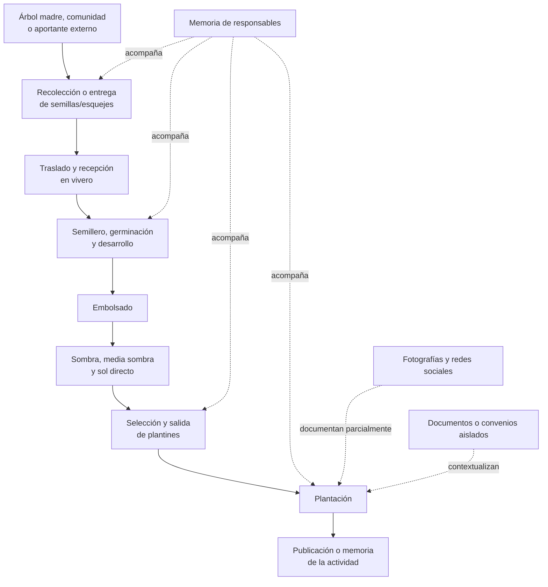
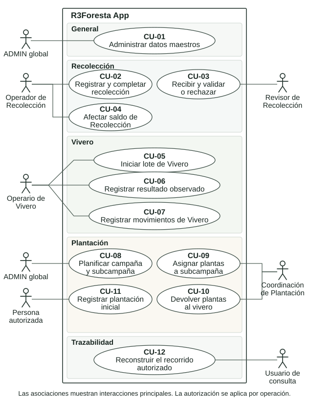

## 3.1. Análisis de requerimientos

Para maquetar las figuras en hojas carta verticales, usar las [láminas por figura](figuras/paginas/README.md). Los bloques Mermaid conservan la fuente completa; los diagramas extensos continúan en paneles legibles.

> Parte del [Capítulo III](03_capitulo_marco_aplicativo.md). Diagnóstico con corte principal al 22 de julio de 2026; contraste documental de septiembre, consolidación del 29 de octubre y precisiones del autor incorporadas el 4 y el 16 de noviembre. La exposición metodológica sigue exclusivamente RUP adaptado conforme a la directriz del 3 de noviembre. El autor confirma el cierre actual de Inicio/LCO el 4 de noviembre para continuar con Elaboración; se conserva la ausencia de acta histórica de IN-1 y no se atribuye aceptación institucional no documentada.

### 3.1.1. Propósito y correspondencia con RUP

Esta sección responde al primer objetivo específico: **analizar la información que se genera y cómo se gestiona actualmente en las actividades de Recolección, Vivero y Plantación de R3Foresta**. Conserva el diagnóstico y lo relaciona con los productos de Inicio: visión, alcance, actores del sistema, casos de uso principales, requisitos iniciales, riesgos y evaluación documental del hito LCO. Inicio expresa la correspondencia metodológica de estos productos dentro de RUP adaptado. La sección se organiza por el análisis de requerimientos; las fases y disciplinas se retoman durante las iteraciones. El análisis y diseño detallados continúan en la sección 3.2.

La planificación metodológica adoptada el 25 de agosto de 2026 organiza el periodo académico en IN-1, del 6 al 19 de julio, y EL-1, del 20 de julio al 16 de agosto, seguidas por Construcción y Transición. Esta organización posterior permite relacionar los productos con las fases, pero no demuestra que las actividades se hubieran ejecutado originalmente bajo esos identificadores. Las fechas comprobables del levantamiento son el 20 y el 22 de julio; no se dispone de un registro anterior al 20 de julio que acredite la ejecución de IN-1 ni de un acta de LCO, según la confirmación del autor del 29 de octubre.

**Tabla 3.3**

*Cronología documentada y relación con los productos metodológicos*

| Fecha o periodo | Actividad o documento acreditado | Producto que aporta | Relación con RUP y límite de la evidencia |
|---|---|---|---|
| 6–19 de julio de 2026 | Periodo asignado a IN-1 en el cronograma adoptado posteriormente | Productos de Inicio previstos | No se acredita la ejecución ni el cierre de IN-1 durante ese intervalo |
| 20 de julio de 2026 | Reunión FP-01 | Necesidades expresadas, expectativas y primeras delimitaciones | Insumo de requisitos; su fecha coincide con el periodo asignado a EL-1, sin demostrar una revisión de iteración |
| 22 de julio de 2026 | Entrevista FP-02 y registro fotográfico FO-01 | Descripción de la operación y evidencia parcial de Vivero | Profundización del diagnóstico que alimenta Inicio y Elaboración |
| 25 de agosto de 2026 | Registro de adopción de RUP y reorganización del periodo | Plan de fases, iteraciones e hitos | Decisión metodológica posterior al levantamiento de julio |
| 14–15 de septiembre de 2026 | Referencia al dossier FD-01 y registro metodológico | Contraste público y balance de artefactos disponibles | No modifica el corte de julio; el registro mantiene LCO y LCA sin cierre formal |
| 29 de octubre de 2026 | Consolidación de esta sección | Visión, casos de uso generales, requisitos iniciales, riesgos y evaluación documental de LCO | Preparación para revisión; no constituye aceptación institucional o académica |
| 3–4 de noviembre de 2026 | Directriz de RUP exclusivo y precisiones del autor sobre actores e incorporación de plantines | Ajuste de responsabilidades, audiencias de consulta y necesidades de recepción e inventario inicial | Refinamiento posterior al diagnóstico; el estado técnico se acredita por versión y entorno |
| 16 de noviembre de 2026 | Aprobación de refinamientos funcionales y de RNF-INI-01/03/04/06 | Reglas de recepción, incorporación y consulta pública; criterios transversales | Aprobación documental posterior; no acredita por sí sola prueba, despliegue ni aceptación del producto |

*Nota.* Elaboración propia a partir de las fuentes primarias FP-01 y FP-02, el inventario FO-01, el registro de decisiones del 25 de agosto, el cronograma del Perfil, el registro de avance metodológico con corte al 15 de septiembre y la confirmación del autor del 29 de octubre. Las fechas de consolidación se distinguen de las fechas de los hechos descritos.

La entrevista, la observación, el análisis documental y la revisión de registros aportaron técnicas de levantamiento que se relacionan aquí con las disciplinas de requisitos y análisis de RUP. No constituyen una metodología investigativa adicional. Su función fue recuperar necesidades, reconocer variantes, identificar riesgos y distinguir la práctica existente de las propuestas de expansión mencionadas por la organización.

**Tabla 3.4**

*Fuentes empleadas para analizar la gestión actual*

| Código | Fuente y fecha | Aporte al análisis | Limitación principal |
|---|---|---|---|
| FP-01 | [Reunión de trabajo](../../03_investigacion/fuentes_primarias/reunion_r3foresta_2026-07-20.md), 20 de julio de 2026 | Presentó las etapas inicialmente consideradas, la urgencia institucional y la información que se esperaba registrar | Combina práctica actual, propuesta de producto y aspiraciones comerciales |
| FP-02 | [Entrevista a Hernán Lara](../../03_investigacion/fuentes_primarias/entrevista_pablo_fernandez_hernan_lara_2026-07-22.md), 22 de julio de 2026 | Describió los soportes utilizados, la procedencia del material, el trabajo en vivero, las plantaciones y la distribución funcional de responsabilidades | La transcripción automática contiene términos y cifras que deben interpretarse con cautela |
| FO-01 | [Inventario fotográfico de Chasquipampa](../../03_investigacion/inventario_evidencia_fotografica_2026-07-22.md), 22 de julio de 2026 | Permitió observar plantines en bolsas dentro de un ambiente protegido y en exposición directa al sol | Solo cubre Vivero; no registra recolección, despacho ni plantación definitiva |
| FD-01 | Dossier documental, corte declarado al 14 de septiembre de 2026; referencia conservada en el [índice de fuentes primarias](../../03_investigacion/fuentes_primarias/README.md) | Sirvió como índice de localización de publicaciones y posibles diferencias entre cifras | No se localizó una copia del dossier ni se verificaron sus publicaciones originales en esta revisión; no sustenta cifras o contradicciones como resultados confirmados |
| DT-01 | Requisitos y reglas de [General](../../../00-general-module/README.md), [Recolección](../../../01-recoleccion-module/README.md), [Vivero](../../../02-vivero-module/README.md) y [Plantación](../../../03-plantacion-module/README.md) | Permiten relacionar las necesidades con especificaciones posteriores | Describen la solución especificada y sus refinamientos; no prueban la práctica anterior ni la fecha de identificación de un requisito |

*Nota.* Elaboración propia a partir de las fuentes identificadas en la tabla. Las transcripciones FP-01 y FP-02 se conservan como fuentes primarias sin corregir. FD-01 se utiliza como índice de contraste; antes de emplear una afirmación pública como resultado definitivo deberá verificarse su fuente original.

Las precisiones posteriores del autor se consultaron en los chats [Revisar actores y casos de uso](codex://threads/01a18a33-5969-7261-b845-25979ea63c2f) y [Analizar incorporación inicial de plantines](codex://threads/01a1a620-7305-7ac3-803e-f39c764312c8), con acuerdos del 4 de noviembre. Las [propuestas técnicas de Vivero](../../../../Backend-r3foresta/documentacion/tareas/README.md) permiten localizar sus antecedentes y dependencias. Estas fuentes precisan necesidades de la solución y no amplían lo observado en julio ni acreditan implementación.

Para interpretar las fuentes se utilizaron cinco categorías: práctica actual, necesidad, propuesta futura, decisión de alcance y dato pendiente de confirmación. Esta separación resultó necesaria porque en las reuniones aparecen, dentro de una misma explicación, actividades efectivamente realizadas, funciones que se deseaba incorporar a la aplicación y proyecciones relacionadas con carbono, blockchain o expansión territorial. Las dos últimas no se tratan como capacidades vigentes ni como compromisos del producto académico.

### 3.1.2. Contexto operativo seleccionado

R3Foresta trabaja con viveros, comunidades, juntas vecinales, instituciones educativas y otros aliados. Sin embargo, las actividades no se desarrollan con una estructura idéntica en todos los lugares. Para disponer de un contexto operativo concreto se seleccionó Chasquipampa como referencia principal. Según la confirmación del responsable del proyecto, este proceso es el utilizado por Hernán Lara, sirve para enseñar la secuencia a otras comunidades y será el escenario principal de las pruebas del sistema.

La selección no convierte a Chasquipampa en una muestra estadística ni permite atribuir automáticamente sus condiciones a todas las comunidades. Se utiliza como escenario operativo representativo porque reúne la secuencia de semillas, vivero y plantación, existe acceso para observar el trabajo y se dispone de antecedentes documentales y fotográficos. Cuando otro proyecto presente una variante —por ejemplo, ingreso de material donado, trabajo mediante convenio comunitario o recepción directa de plantas— la diferencia deberá registrarse sin forzarla dentro de una única secuencia.

El registro fotográfico del 22 de julio permite observar el componente de Vivero. En el ambiente protegido se encuentran plantines de diferentes tamaños agrupados en bolsas y recipientes. La imagen respalda la existencia de manejo por grupos y distintas condiciones de desarrollo, pero no permite determinar la especie, la cantidad exacta ni el origen de cada conjunto.

**Figura 3.2. Plantines en ambiente protegido del vivero de Chasquipampa**

*Nota.* Registro fotográfico propio del 22 de julio de 2026. La fecha y la ubicación fueron proporcionadas por el autor; el archivo no conserva esos datos en metadatos EXIF. La imagen respalda la observación del ambiente de vivero, pero no certifica especies, cantidades ni procedencias.

También se observó un espacio exterior con plantas embolsadas expuestas directamente al sol. La organización describió esta transición como parte del fortalecimiento previo a la salida del vivero. La condición heterogénea visible entre ejemplares muestra por qué un registro de entrada no basta para inferir la cantidad posterior de plantas disponibles: los resultados deben contarse y registrarse cuando se observan.

**Figura 3.3. Plantas embolsadas en exposición directa al sol**

*Nota.* Registro fotográfico propio del 22 de julio de 2026. La fotografía documenta una condición de manejo del vivero; no permite establecer por sí sola cuánto tiempo permaneció cada planta en esa etapa ni su aptitud para plantación.

### 3.1.3. Flujo operativo actual

El recorrido de propagación informado en julio parte de la obtención de semillas o esquejes y continúa con su recepción y manejo en vivero, el embolsado de las plantas resultantes, su exposición progresiva a sombra, media sombra o sol directo y la selección de plantines para una plantación. La secuencia física produce información en distintos momentos, pero antes del sistema esa información no se conservaba en un historial integrado.

La práctica descrita no es completamente lineal. Un mismo origen puede alimentar más de un grupo del vivero; un vivero puede contener material de diferentes procedencias; y una plantación puede requerir plantas procedentes de varios grupos o viveros. También existe la posibilidad de incorporar material entregado por comunidades, colaboradores o donantes. Por tanto, el análisis no asume que cada semilla se convierte en una planta ni que cada plantación se abastece desde un único origen.

**Figura 3.4. Flujo actual y soportes de información identificados**

<!-- diagrama: 03_1_fase_inicio-01 -->

*Nota.* Diagrama de flujo descriptivo de elaboración propia a partir de FP-01, FP-02 y FO-01. Las líneas discontinuas representan soportes parciales de la situación anterior al sistema. No es un diagrama UML de actividades ni representa la implementación informática.

El refinamiento del 4 de noviembre distingue ese recorrido de la recepción de plantas que ya están vivas: compradas, donadas o existentes antes del uso del sistema. Su historial debe comenzar en la recepción o el conteo actual y continuar desde la etapa en que se incorporan. No corresponde atribuirles una recolección, germinación o pérdida anterior no registrada. La entrega directa en campo también es una variante contemplada, sin suponer tránsito físico por Vivero; su diseño y continuidad de stock permanecen pendientes. La Figura 3.4 conserva la ruta de propagación del diagnóstico de julio, no todas estas variantes posteriores.

#### 3.1.3.1. Recolección e ingreso de semillas o esquejes

La identificación de árboles madre se realiza considerando características observables como tamaño, condición general, fruto y hojas, además de la cercanía entre la procedencia y el lugar donde se espera utilizar el material. A partir de esos árboles pueden obtenerse semillas o esquejes. La organización considera relevantes el nombre común, el nombre científico, el tipo de material, la ubicación y la cantidad, expresada mediante conteo o peso según corresponda (FP-02).

La recolección no está asignada exclusivamente a un cargo. Puede efectuarla personal vinculado al vivero, una persona de la comunidad u otro colaborador. También puede existir entrega de material por un actor externo. En consecuencia, el primer responsable del recorrido no siempre es un empleado de R3Foresta y el sistema debe conservar, cuando esté disponible, quién recolectó o entregó el material y cuál fue su procedencia.

En la práctica anterior, una parte de esa información permanecía en la memoria de quienes participaron o acompañaba físicamente al material durante su traslado. No existía un registro uniforme que permitiera consultar el origen, la cantidad recibida, la fecha, el responsable y la evidencia como una sola unidad. Por ello, el ingreso al vivero se convierte en un punto de control decisivo: si el origen no se recupera en ese momento, la relación resulta difícil de reconstruir después.

#### 3.1.3.2. Manejo dentro del vivero

Al recibir el material, el personal del vivero puede pesarlo o contarlo y organizar su incorporación al proceso. Las semillas pasan al semillero y los esquejes siguen el tratamiento correspondiente. La germinación o el enraizamiento producen resultados observados, no una conversión automática de la cantidad inicial. Después se reconocen plantas que pueden embolsarse, grupos que sufren pérdidas y lotes que continúan su desarrollo.

El manejo incluye momentos descritos como germinación, embolsado, sombra, media sombra y sol directo. Las fotografías FO-01 documentan plantines en bolsas bajo protección y en un espacio con exposición solar. Sin embargo, no se observaron etiquetas o identificadores que permitieran relacionar visualmente cada grupo con un origen, una especie, una fecha de ingreso o una cantidad inicial. La organización física permite trabajar con el material, pero no constituye por sí sola un historial consultable.

La entrevista señala que la información más útil para la gestión comprende la cantidad que ingresó, la cantidad que produjo plantas, las plantas que permanecen vivas en el vivero y las pérdidas registradas durante el proceso. También resulta necesario conocer qué material se encuentra disponible para atender una plantación. Antes de la estructuración del sistema, estos valores no se mantenían de forma uniforme en Excel, cuadernos u otra base compartida; el estado del vivero se conocía principalmente mediante observación directa y memoria de los responsables (FP-02).

#### 3.1.3.3. Selección, salida y plantación

Cuando se requiere una actividad de arborización, forestación o reforestación, se define el lugar, la cantidad de plantas y las especies que se pretenden utilizar. Una plantación puede abastecerse con plantas procedentes de uno o varios viveros. Esto exige diferenciar la cantidad observada en el vivero, la cantidad comprometida para un destino, la cantidad entregada y la cantidad finalmente plantada.

R3Foresta informó que su producción es predominantemente propia. No obstante, durante la entrevista se reconocieron donaciones de plantas y se consideró necesario admitir una compra excepcional si una actividad futura no pudiera cubrirse con la producción disponible. Esta evolución de la respuesta muestra que la procedencia no debe reducirse a una regla absoluta de producción interna. El ingreso externo debe registrarse como una variante, sin convertirlo en un módulo independiente.

La información que con mayor frecuencia se difundía después de una plantación era la fecha, la cantidad y el lugar, acompañados de fotografías cuando las condiciones comunitarias permitían publicarlas. Facebook fue descrito como el repositorio público más antiguo y completo de la organización. Sin embargo, no todas las actividades fueron publicadas y una publicación aislada no siempre conserva la relación con la recolección, el lote del vivero, las pérdidas, los responsables o los movimientos que explican el resultado final.

**Tabla 3.5**

*Actividades, información y soportes identificados en el flujo actual*

| Etapa | Actividad | Información generada o necesaria | Soporte anterior predominante | Limitación observada |
|---|---|---|---|---|
| Recolección | Identificar árbol madre u origen | especie, características del árbol, ubicación | memoria, fotografía o referencia personal | el origen no siempre queda asociado con el material posterior |
| Recolección | Recoger o recibir material | tipo de material, cantidad, unidad, fecha, recolector o aportante | memoria y manejo físico | no existe una ficha uniforme para todas las entradas |
| Vivero | Recibir material | procedencia, cantidad y unidad recibidas, fecha, vivero y responsable | observación y coordinación directa | el ingreso puede perder su vínculo con la recolección |
| Vivero | Germinar o enraizar | fecha de inicio, material en proceso y resultado observado | memoria y observación | no puede explicarse de forma histórica la diferencia entre entrada y resultado |
| Vivero | Embolsar y desarrollar | plantas observadas, fecha, grupo y responsable | agrupación física y fotografías ocasionales | no se dispone de una identidad compartida para cada lote |
| Vivero | Registrar pérdidas y disponibilidad | cantidad perdida, causa y saldo utilizable | conteo eventual o conocimiento del responsable | no existe un saldo reconstruible mediante movimientos relacionados |
| Vivero→Plantación | Seleccionar y entregar | origen, cantidad, destino, fecha y responsables de entrega/recepción | coordinación directa, mensajes o documentos aislados | una plantación puede recibir de varios orígenes sin conciliación común |
| Plantación | Planificar y ejecutar | tipo de actividad, especies, cantidades, lugar, fecha, participantes y evidencia | coordinación operativa, fotografías y publicaciones | la publicación final no explica necesariamente la procedencia ni las diferencias de cantidad |

*Nota.* Elaboración propia a partir de FP-01, FP-02 y FO-01. La expresión “información generada o necesaria” no implica que todos esos datos se registraran de manera sistemática antes del proyecto.

### 3.1.4. Actores y distribución funcional de responsabilidades

La estructura actual se comprende mejor mediante funciones que mediante cargos rígidos. En proyectos comunitarios, una misma persona puede recolectar material, apoyar el vivero y participar en la plantación; a su vez, la dirección puede coordinar varias etapas. Durante las reuniones se propusieron niveles de vivero, plantación y zona, pero esa jerarquía se presentó como una necesidad de crecimiento y no como una estructura homogénea ya implantada.

**Tabla 3.6**

*Responsabilidades funcionales identificadas*

| Actor o función | Responsabilidades actuales identificadas | Información que produce o utiliza | Observación |
|---|---|---|---|
| Dirección o coordinación de R3Foresta | priorizar actividades, coordinar comunidades y viveros, definir destinos, supervisar plantaciones y comunicar resultados | necesidades, lugares, cantidades estimadas, participantes y publicaciones | concentra una parte importante de la memoria institucional |
| Recolector o aportante de material | identificar el origen, obtener o entregar semillas y esquejes | procedencia, especie declarada, ubicación, cantidad y fecha | puede pertenecer a R3Foresta, al vivero, a una comunidad o ser externo |
| Responsable de vivero | recibir, pesar o contar, organizar semillero, observar resultados, embolsar, cuidar y preparar plantas | cantidad recibida, resultado observado, etapa, pérdidas, disponibilidad y evidencia | incluye recepción y manejo como funciones operativas; RF-REC-04 precisa la autoridad requerida y la separación respecto del recolector |
| Coordinador de plantación | definir o confirmar lugar, especies y cantidad; coordinar entrega y ejecución | planificación, destino, equipo, cantidad recibida y cantidad plantada | puede ser asumido por dirección o por un responsable local |
| Participante en plantación | ejecutar o apoyar la plantación conforme a la coordinación de la actividad | actividad, fecha, lugar, especies, cantidades plantadas, participación y evidencia cuando corresponda | puede ser integrante comunitario, aliado o voluntario; la función de campo no supone un cargo fijo ni acceso operativo al sistema |
| Comunidad o aliado local | aportar trabajo, terreno, cuidado, producción o recepción según el convenio | participantes, material producido o recibido, destino y evidencia | la distribución de beneficios y plantas depende del acuerdo específico |
| Donante, proveedor o colaborador externo | entregar material vegetal cuando se presenta una incorporación externa | entidad de origen, material, cantidad, fecha y documento disponible | es una variante menos frecuente, pero debe conservarse para explicar la procedencia |
| Patrocinador u organización asociada | consultar resultados o respaldar una actividad | información agregada, ubicación, evidencia y avance | no necesariamente interviene en el registro operativo diario |

*Nota.* Elaboración propia a partir de FP-01, FP-02 y las aclaraciones proporcionadas por el autor del proyecto. La tabla caracteriza funciones y no constituye todavía el modelo de autorización del sistema.

Una persona puede colaborar físicamente en la plantación sin operar la aplicación. Los actores de interacción se presentan en la [sección 3.1.8](#318-actores-del-sistema-y-casos-de-uso-generales) y su correspondencia con roles y permisos se desarrolla en la [sección 3.2.13 de Elaboración](03_2_fase_elaboracion.md#3213-correspondencia-de-actores-permisos-y-fuentes-de-continuidad). En el recorrido digital definido en [PA-S01](../../../specs/plantacion/participacion-aliada/01-registro-plantacion-inicial/spec.md), la selección individual de participantes adicionales se limita a personas registradas y habilitadas en la misma subcampaña; ese recorrido no contempla identificar individualmente a colaboradores sin cuenta. Esta restricción del registro digital no limita su participación física en la actividad.

El control formal del material comienza principalmente con su recepción en vivero, pero la trazabilidad exige capturar también el antecedente disponible. Por ello, no resulta adecuado identificar a una sola persona como “encargado de recolección” para todos los casos. La necesidad real es distinguir al actor que origina o entrega el material del responsable que lo recibe y registra.

La distinción entre quien entrega y quien recibe conserva RAN-01. La recepción y el manejo pueden corresponder a funciones de una persona que opera Vivero; para semillas, RF-REC-04 precisa que recibe y valida ADMIN o VALIDADOR asignado, distinto del recolector. GENERAL y VALIDADOR activos operan dentro de los viveros asignados según su capacidad; ADMIN conserva alcance global. La incorporación especial de plantines corresponde a ADMIN. Estas precisiones posteriores no se atribuyen como estructura de permisos acreditada en julio; su evidencia técnica y límites por entorno figuran en [ESTADO.md](../../../ESTADO.md).

Dentro del vivero se identifican funciones de recepción, manejo y seguimiento. En Chasquipampa estas actividades son coordinadas por R3Foresta y ejecutadas por las personas que atienden el espacio. Para la plantación, la coordinación puede permanecer en la dirección o delegarse a un responsable de la actividad. Los cargos de encargado zonal y los niveles jerárquicos comunitarios mencionados en la entrevista se tratarán como evolución organizativa; no se utilizarán para afirmar que todos los proyectos ya operan con esa estructura.

### 3.1.5. Gestión y calidad de la información disponible

El problema no consiste en una ausencia absoluta de información. Existen fotografías, publicaciones, nombres de lugares, cantidades declaradas y conocimiento acumulado por los responsables. La dificultad es que esos elementos no comparten una estructura que permita vincularlos y recuperarlos como un recorrido.

Facebook cumple una doble función: comunica públicamente las actividades y conserva una memoria cronológica parcial. Esta memoria permitió recuperar eventos pasados, pero presenta cuatro límites. Primero, no todas las comunidades autorizan la toma o publicación de imágenes. Segundo, los campos incluidos varían entre publicaciones. Tercero, las publicaciones no poseen un identificador común con los grupos del vivero o la recolección de origen. Cuarto, una cifra publicada no siempre puede distinguir entre meta, plantín entregado, árbol plantado, reposición o árbol observado posteriormente.

La referencia al dossier FD-01 registra posibles diferencias entre cantidades difundidas públicamente. Como no se localizaron aquí el dossier completo y las publicaciones originales, esas diferencias se conservan como un asunto por verificar y no como evidencia principal de contradicciones en Chasquipampa. Para compararlas habría que comprobar proyecto, parcela o cohorte, fecha, unidad y significado de cada cifra. El diagnóstico de dispersión se apoya principalmente en FP-02; no depende de atribuir una pérdida o un porcentaje de supervivencia a una publicación no comprobada.

La evidencia fotográfica presenta una limitación semejante. Las figuras 3.2 y 3.3 permiten reconocer plantas embolsadas y ambientes de manejo, pero no contienen etiquetas visibles suficientes para recuperar especie, lote, cantidad o procedencia. Una fotografía adquiere mayor valor informacional cuando se vincula con el evento al que respalda, su fecha, ubicación, responsable y unidad trazable. Aun así, respalda el registro y no certifica por sí sola la correspondencia absoluta con el mundo físico.

**Tabla 3.7**

*Hallazgos del diagnóstico y consecuencias para la gestión de información*

| Código | Hallazgo conservado en la matriz OBJ-01 | Consecuencia o necesidad de gestión |
|---|---|---|
| HAL-01 | información distribuida entre redes, fotografías, mensajes, documentos y memoria | reconstruir una actividad exige consultar varias fuentes y personas |
| HAL-02 | ausencia de registro estructurado continuo entre las tres etapas | no puede relacionarse de manera uniforme origen, manejo y destino |
| HAL-03 | distintos actores pueden recolectar o entregar material | deben distinguirse aportante, recolector y receptor sin presuponer un cargo único |
| HAL-04 | el control práctico comienza al recibir en Vivero y el antecedente puede ser incompleto | se necesita recuperar la procedencia disponible al ingresar el material |
| HAL-05 | cantidades, resultados de germinación, pérdidas, exposición y disponibilidad no se conservaban sistemáticamente | los cambios de cantidad y unidad necesitan registros relacionados para explicar el saldo |
| HAL-06 | las fotografías no identifican lotes, cantidades exactas, especies o procedencias | la evidencia visual debe asociarse con datos del hecho y conservar su límite probatorio |
| HAL-07 | las publicaciones de plantación tienen cobertura incompleta | los registros operativos no pueden depender de la publicación en redes |
| HAL-08 | la coordinación y la memoria se concentran en dirección, con participación local variable | se requiere identificar responsabilidades por actividad sin imponer una jerarquía uniforme |
| HAL-09 | producción propia predominante, donaciones existentes y posible compra excepcional | el alcance debe contemplar procedencia externa como variante |
| HAL-10 | posible dificultad para conciliar cifras públicas sin identificadores suficientes | asunto señalado por FD-01 y pendiente de contraste con los originales; no se concluyen contradicciones concretas |
| HAL-11 | Chasquipampa fue seleccionado como referencia operativa y escenario principal de pruebas | el diagnóstico y la validación deben declarar su cobertura y evitar generalizaciones estadísticas |

*Nota.* Elaboración propia a partir de la [matriz de análisis de OBJ-01](../../03_investigacion/matriz_analisis_objetivo_1.md), FP-01, FP-02 y FO-01. Se conservan los significados de HAL-01 a HAL-11 de esa matriz. El borrador anterior reutilizaba HAL-03 a HAL-08 para otra síntesis; su copia archivada permite reconocer la corrección. HAL-10 conserva su carácter provisional por depender de FD-01.

### 3.1.6. Necesidades, requerimientos y reglas de negocio

Los hallazgos permiten formular necesidades de información antes de decidir tablas, servicios o interfaces. Cada etapa necesita conservar datos propios y relaciones suficientes para reconstruir el recorrido. La necesidad es mantener identidad y procedencia al recibir, transformar o trasladar material. Utilizar el lote como unidad de trazabilidad es una propuesta de solución desarrollada en Elaboración; su granularidad, sus divisiones y sus relaciones deben justificarse allí, sin deducirlos únicamente de las agrupaciones visibles en las fotografías.

El catálogo de esta sección identifica expresamente todos los RF y las RN con ID propio de las fuentes de módulos y contratos vigentes, junto con los seis RNF existentes y los refinamientos PA-S00–PA-S04. Las necesidades, reglas y requisitos alimentan actores/casos de uso, modelos, arquitectura, incrementos y comprobaciones; sus enlaces permiten seguir esa derivación sin sustituir sus enunciados. La formulación recoge las fechas de sus fuentes y la aprobación del 16 de noviembre, sin atribuirla retrospectivamente a IN-1 ni acreditar implementación o aceptación global.

#### 3.1.6.1. Reglas de negocio y condiciones del dominio

El análisis distingue las condiciones declaradas de la operación y las restricciones que orientan la solución. Los códigos RAN conservan esa clasificación y sus fuentes. Las reglas de negocio vigentes se mantienen en los módulos y contratos con sus identificadores; el análisis y diseño de la sección 3.2 desarrolla su relación con los modelos y las propiedades que deben comprobarse.

**Tabla 3.8**

*Condiciones del dominio y límites de la evidencia identificados en el análisis*

| Código | Condición identificada | Naturaleza y respaldo |
|---|---|---|
| RAN-01 | quien origina o entrega material puede ser distinto de quien lo recibe en Vivero | práctica declarada en FP-02 y aclaración del autor |
| RAN-02 | la propagación descrita utiliza semillas o esquejes; también se reconocen ingresos externos de plantas | dominio declarado en FP-01 y FP-02; el tratamiento informático de la variante debe especificarse |
| RAN-03 | las semillas pueden contarse o pesarse; las plantas vivas se cuentan como resultado observado | dominio declarado en FP-02; las unidades y precisiones del sistema se definen en Elaboración |
| RAN-05 | predomina la producción propia y se reconocen donaciones; la compra se plantea como posibilidad excepcional | práctica y posibilidad diferenciadas en FP-02 |
| RAN-06 | una plantación puede abastecerse de varios grupos o viveros | práctica declarada en FP-02; la representación mediante lotes corresponde al diseño |
| RAN-09 | una fotografía respalda el hecho documentado, pero no certifica por sí sola la realidad física declarada | límite de FO-01 y criterio editorial del proyecto |

*Nota.* Elaboración propia a partir de FP-01, FP-02, FO-01 y las aclaraciones del autor. Los códigos RAN se conservan; los saltos de numeración separan las condiciones del dominio de las decisiones de solución de la tabla siguiente. No representan controles informáticos ya existentes en la operación anterior.

**Tabla 3.9**

*Decisiones y restricciones de la solución diferenciadas del diagnóstico*

| Código | Decisión o restricción | Origen y tratamiento posterior |
|---|---|---|
| RAN-04 | no inferir automáticamente plantas vivas a partir de semillas, esquejes o peso inicial | requisito de integridad derivado de RAN-03; Elaboración define cómo registrar el resultado observado |
| RAN-07 | relacionar cada operación relevante con fecha, responsable, ubicación y evidencia cuando corresponda | necesidad de trazabilidad derivada de HAL-01, HAL-02 y HAL-06; los campos obligatorios se precisan por caso de uso |
| RAN-08 | permitir escritura operativa mediante identidad autenticada y autorización vigente para la actividad | restricción de acceso; el alta de una cuenta o la afiliación no equivalen a permiso operativo y el modelo contextual se detalla en Elaboración |
| RAN-10 | concluir el recorrido académico en el registro de la plantación | frontera del Perfil aprobado; excluye seguimiento posterior y cuantificación de carbono |

*Nota.* Elaboración propia a partir de las necesidades del diagnóstico, el alcance y los controles transversales del Perfil y del Capítulo I. Las cláusulas de conservación de procedencia de RAN-02, RAN-05 y RAN-06 se desarrollan mediante NEC-01, NEC-02 y NEC-07. Esta clasificación no acredita que todos los requisitos se aprobaran durante julio.

<!-- catalogo-rn-inicio -->

**Catálogo explícito de reglas de negocio del sistema**

Las condiciones RAN anteriores describen el diagnóstico y las restricciones iniciales. A continuación se enuncian las **170 reglas RN con ID propio** de las fuentes vigentes: 30 de General, 37 de Recolección, 47 del núcleo de Vivero, cinco del contrato M1→M2, trece del contrato M2→M3 y 38 de Plantación. Cada fila expresa una obligación y señala los requisitos que condiciona. Se conservan mayúsculas, sufijos, huecos de numeración y reglas trasladadas; no se crean RN-REC-05 ni RN-VIV-50/51 para completar secuencias.

El catálogo distingue el producto completo de su evaluación académica. Las reglas de mantenimiento y blockchain se conservan como contexto identificado; no amplían el alcance que concluye con la plantación. Las reglas del núcleo y las de integración mantienen responsabilidades distintas. Los acuerdos posteriores aceptados precisan el tratamiento de originales, permisos y correcciones; una formulación histórica no revoca esos acuerdos.

**General** · [Fuente y detalle operativo](../../../00-general-module/01_reglas_de_negocio_general.md).

| ID | Regla exigida | Requisitos que condiciona |
|---|---|---|
| **RN-GEN-01** | Cada operación relevante debe conservar un usuario responsable; las privadas verifican JWT y cuenta activa. El alta WebAuthn confirma usuario y primera passkey juntos; ante respuesta perdida se comprueba login. CORS/WebAuthn comparten orígenes exactos; reiniciar invalida desafíos pendientes. | [RF-GEN-01](#rf-gen-01) |
| **RN-GEN-02** | Los usuarios con historia deben inactivarse y conservarse; no se borran sus movimientos, validaciones, participaciones ni snapshots. | [RF-GEN-01](#rf-gen-01) |
| **RN-GEN-03** | Solo ADMIN administra roles y accesos; se protege al último ADMIN. M1 propio exige GENERAL/VALIDADOR con acceso; M2 exige vivero y capacidad. Recibe ADMIN o VALIDADOR asignado, distinto del recolector. Permiso contextual, coordinación, afiliación y autoría son hechos diferentes. | [RF-GEN-01](#rf-gen-01), [RF-PLA-17](#rf-pla-17) |
| **RN-GEN-04** | El nombre del responsable debe congelarse cuando el proceso requiere identidad histórica; no se reconstruye después desde el perfil vigente. | [RF-GEN-01](#rf-gen-01), [RF-PLA-14](#rf-pla-14) |
| **RN-GEN-05** | La latitud y longitud constituyen la referencia geográfica mínima; los datos administrativos complementan la coordenada y no la sustituyen. | [RF-GEN-04](#rf-gen-04) |
| **RN-GEN-06** | El contrato general exige conservar las coordenadas operativas en UBICACION. La aplicación de esta regla a las coordenadas directas del modelo de Plantación requiere la precisión de alcance indicada al final del catálogo. | [RF-GEN-04](#rf-gen-04) |
| **RN-GEN-07** | Toda ubicación operativa debe vincularse con una comunidad, localidad o división aprobada de la estructura territorial vigente. | [RF-GEN-04](#rf-gen-04), [RF-GEN-05](#rf-gen-05) |
| **RN-GEN-08** | El país y la división administrativa enviados deben pertenecer a la misma jerarquía y no contradecirse. | [RF-GEN-04](#rf-gen-04), [RF-GEN-05](#rf-gen-05) |
| **RN-GEN-09** | La comunidad debe seleccionarse de la fuente territorial oficial; en el MVP corresponde a Comunidad–Localidad de DIVISION_ADMINISTRATIVA, no a texto libre del registro. | [RF-GEN-05](#rf-gen-05) |
| **RN-GEN-10** | Solo ADMIN puede crear comunidades o zonas; los usuarios operativos no las incorporan desde los formularios del recorrido. | [RF-GEN-05](#rf-gen-05) |
| **RN-GEN-11** | Renombrar comunidades, zonas o divisiones no debe modificar los snapshots de hechos anteriores. | [RF-GEN-05](#rf-gen-05), [RF-PLA-14](#rf-pla-14) |
| **RN-GEN-12** | La planta maestra selecciona datos de nuevos registros; no recalcula la identidad histórica ya congelada de recolecciones y lotes. | [RF-GEN-03](#rf-gen-03) |
| **RN-GEN-13** | nombre_comun_principal es el nombre operativo vigente y alimenta nombre_comercial_snapshot para selección, visualización e identidad histórica. | [RF-GEN-03](#rf-gen-03) |
| **RN-GEN-14** | El campo nombres_comunes, aunque exista físicamente, no participa funcionalmente en el MVP. | [RF-GEN-03](#rf-gen-03) |
| **RN-GEN-15** | Inactivar una planta impide nuevos usos y debe mantener legibles los lotes, recolecciones y snapshots anteriores. | [RF-GEN-03](#rf-gen-03) |
| **RN-GEN-16** | La identidad científica, el nombre operativo y la variedad deben distinguirse; no se tratan como un mismo dato. | [RF-GEN-03](#rf-gen-03) |
| **RN-GEN-17** | Cada planta admite un único material permitido SEMILLA o ESQUEJE en el MVP; no se utiliza AMBOS. | [RF-GEN-03](#rf-gen-03) |
| **RN-GEN-18** | Vivero es un catálogo compartido. El acceso M2 se concede por persona/vivero; almacenamiento y destino son distintos, con igualdad ordinaria de custodia y excepción explícita de ADMIN. | [RF-GEN-02](#rf-gen-02), [RF-VIV-01](#rf-viv-01) |
| **RN-GEN-19** | Todo vivero debe apuntar a una ubicación válida. | [RF-GEN-02](#rf-gen-02), [RF-GEN-04](#rf-gen-04) |
| **RN-GEN-20** | Inactivar un vivero bloquea nuevas operaciones que lo seleccionan y conserva el historial previamente asociado. | [RF-GEN-02](#rf-gen-02) |
| **RN-GEN-21** | Las evidencias deben usar el modelo común de tipo de entidad y archivo asociado, sin modelos paralelos por módulo. | [RF-GEN-06](#rf-gen-06) |
| **RN-GEN-22** | Cada evidencia conserva entidad, actor, contexto y audiencia. La recepción usa la revisión vigente; recepción/incorporación admiten 1–5 fotos y la inicial participante 1–10. Los originales privados requieren acceso autorizado; un error de consulta o firma no se representa como ausencia. | [RF-GEN-06](#rf-gen-06), [RF-REC-04](#rf-rec-04), [RF-VIV-06](#rf-viv-06), [RF-PLA-13](#rf-pla-13), [RF-REC-06](#rf-rec-06), [RF-PLA-15](#rf-pla-15) |
| **RN-GEN-23** | La sustitución o retirada autorizada de fotos editables debe conservar trazabilidad. Los vínculos confirmados y recibos se preservan; una respuesta perdida conserva incertidumbre y no autoriza compensar o borrar archivos confirmados. | [RF-GEN-06](#rf-gen-06), [RF-REC-03](#rf-rec-03) |
| **RN-GEN-23a** | Las evidencias auditables nuevas conservan original intacto, SHA256, tamaño y MIME calculados en servidor, con derivados relacionados. Recepción/T5 admiten hasta 15 MiB por archivo y 100 MiB por carga; PA-S01 hasta 10 MiB por foto. No se presume backfill de datos históricos ausentes. | [RF-GEN-06](#rf-gen-06) |
| **RN-GEN-24** | Los módulos operativos deben consumir los maestros de General para usuarios, plantas, viveros, territorios y ubicaciones; no redefinirlos. | [RF-GEN-01](#rf-gen-01), [RF-GEN-02](#rf-gen-02), [RF-GEN-03](#rf-gen-03), [RF-GEN-04](#rf-gen-04), [RF-GEN-05](#rf-gen-05) |
| **RN-GEN-25** | Cada proceso fija el hito de congelamiento de snapshots: antes puede recalcularlos y después debe conservarlos. | [RF-GEN-03](#rf-gen-03), [RF-REC-03](#rf-rec-03), [RF-VIV-07](#rf-viv-07), [RF-PLA-14](#rf-pla-14) |
| **RN-GEN-26** | No deben existir catálogos semánticamente duplicados por módulo; una misma entidad maestra puede proyectarse mediante snapshots diferentes. | [RF-GEN-02](#rf-gen-02), [RF-GEN-03](#rf-gen-03), [RF-GEN-05](#rf-gen-05) |
| **RN-GEN-27** | ORGANIZACION es una entidad maestra real y compartida; no se sustituye por texto libre de una campaña. | [RF-GEN-07](#rf-gen-07) |
| **RN-GEN-28** | El tipo de organización pertenece al catálogo ONG, EMPRESA_PRIVADA, EMPRESA_PUBLICA, FUNDACION, ETFs, ALCALDIA, ASOCIACION_CIUDADANA u OTRO. | [RF-GEN-07](#rf-gen-07) |
| **RN-GEN-29** | Inactivar o renombrar una organización no altera los nombres históricos congelados al activar las subcampañas que la referencian. | [RF-GEN-07](#rf-gen-07), [RF-PLA-03](#rf-pla-03) |

**Recolección** · [Fuente y detalle operativo](../../../01-recoleccion-module/01_reglas_de_negocio_recoleccion.md).

| ID | Regla exigida | Requisitos que condiciona |
|---|---|---|
| **RN-REC-01** | Cada recolección debe tener un identificador automático, único e inmutable. | [RF-REC-01](#rf-rec-01) |
| **RN-REC-02** | Cada recolección debe relacionar recolector y ubicación; el actor autenticado es el recolector por defecto, salvo una facultad expresa para registrar por otra persona. | [RF-REC-01](#rf-rec-01), [RF-REC-02](#rf-rec-02) |
| **RN-REC-03** | La recolección representa el lote de origen referenciable desde Vivero; el uso y consumo se expresan mediante sus estados y movimientos. | [RF-REC-05](#rf-rec-05), [RF-VIV-01](#rf-viv-01) |
| **RN-REC-03A** | La ficha conserva snapshots no nulos desde BORRADOR, recalculables mientras es editable. La recepción conforme congela identidad científica, comercial, variedad, comunidad y recolector; VALIDADO no los recalcula. | [RF-REC-01](#rf-rec-01), [RF-REC-03](#rf-rec-03), [RF-REC-04](#rf-rec-04) |
| **RN-REC-04** | Crear o cambiar fecha exige hoy menos 45 días hasta hoy en America/La_Paz; conservarla permite corregir y recibir fichas envejecidas. Recolección ≤ recepción ≤ hoy e INICIO ≥ recepción. El bloqueo PWA de ciertas correcciones conserva AUD-036 pendiente. | [RF-REC-01](#rf-rec-01), [RF-REC-04](#rf-rec-04), [RF-VIV-01](#rf-viv-01) |
| **RN-REC-06** | El método de recolección debe elegirse de su catálogo cerrado de métodos predefinidos. | [RF-REC-01](#rf-rec-01) |
| **RN-REC-07** | El vivero de almacenamiento debe existir en el catálogo compartido; primero se registra en General si es nuevo. | [RF-REC-01](#rf-rec-01), [RF-GEN-02](#rf-gen-02) |
| **RN-REC-08** | El estado de revisión es BORRADOR, PENDIENTE_VALIDACION, VALIDADO o RECHAZADO; ABIERTO/CERRADO es otro estado, derivado del saldo positivo o cero y no elegido manualmente. | [RF-REC-03](#rf-rec-03), [RF-REC-05](#rf-rec-05) |
| **RN-REC-09** | Al crear una ficha, el sistema asigna BORRADOR, saldo igual a la cantidad inicial canónica positiva y estado operativo ABIERTO. | [RF-REC-01](#rf-rec-01) |
| **RN-REC-09A** | Solo un BORRADOR autorizado admite eliminación lógica; retiro, auditoría y evidencia permitida se confirman juntos. La respuesta perdida exige consultar el estado antes de repetir. | [RF-REC-03](#rf-rec-03) |
| **RN-REC-10** | Solo un origen VALIDADO y ABIERTO, recibido conforme, con saldo suficiente, snapshot y autoridad vigentes puede alimentar Vivero; la publicación en el banco no cambia esa elegibilidad. | [RF-REC-05](#rf-rec-05), [RF-VIV-01](#rf-viv-01) |
| **RN-REC-10D** | La revisión pendiente congela la ficha y la recepción conforme fija su snapshot oficial. Una vez VALIDADO no se sobrescribe ni recalcula; el campo comercial se denomina nombre_comercial_snapshot. | [RF-REC-03](#rf-rec-03), [RF-REC-04](#rf-rec-04) |
| **RN-REC-10A** | Después de validar, el saldo cambia solo por CONSUMO_A_VIVERO o DESECHO negativos e inmutables. DESECHO puede ser parcial o total y usa motivo técnico DESECHO_OTRO sin foto ni motivo libre. CORRECCION no es operación disponible del MVP. | [RF-REC-05](#rf-rec-05) |
| **RN-REC-10C** | El historial del ciclo de vida debe mantenerse separado del ledger de movimientos que alteran inventario. | [RF-REC-03](#rf-rec-03), [RF-REC-05](#rf-rec-05) |
| **RN-REC-10B** | El saldo es cantidad inicial más suma de deltas; nunca puede ser negativo. Saldo cero deriva CERRADO y el MVP no admite deltas positivos de corrección. | [RF-REC-05](#rf-rec-05) |
| **RN-REC-10E** | DESECHO exige ADMIN o acceso M2 vigente al almacenamiento, origen recibido/VALIDADO/ABIERTO y cantidad positiva no mayor al saldo. Conserva unidad, actor y fecha automáticos; el formulario no pide foto, fecha ni motivo libre. | [RF-REC-05](#rf-rec-05) |
| **RN-REC-11** | La cantidad inicial es obligatoria y estrictamente positiva. | [RF-REC-01](#rf-rec-01) |
| **RN-REC-12** | Las semillas pueden capturarse por peso o conteo; kg se convierte a G y nunca se persiste. El conteo usa UNIDAD; no se intercambian G y GR. | [RF-REC-01](#rf-rec-01), [RF-REC-05](#rf-rec-05) |
| **RN-REC-12A** | Las únicas unidades persistidas de Recolección y sus movimientos son UNIDAD y G. | [RF-REC-01](#rf-rec-01), [RF-REC-05](#rf-rec-05) |
| **RN-REC-13** | Los esquejes usan exclusivamente UNIDAD, con entero sin decimales y cantidad mínima uno. | [RF-REC-01](#rf-rec-01) |
| **RN-REC-14** | La captura requiere desde BORRADOR 1–5 fotos de Lugar y 1–5 de Total, entre 2 y 10 en conjunto. La comprobación backend por sección sigue pendiente; el control del total no sustituye esta obligación. | [RF-REC-01](#rf-rec-01), [RF-REC-04](#rf-rec-04) |
| **RN-REC-15** | Cada foto admite JPG/JPEG/PNG/WEBP/HEIC/HEIF hasta 15 MiB y la carga hasta 100 MiB, conservando original y metadatos. Recibir exige 1–5 fotos propias de la revisión actual; rechazar exige motivo y no foto. | [RF-REC-01](#rf-rec-01), [RF-REC-04](#rf-rec-04), [RF-GEN-06](#rf-gen-06) |
| **RN-REC-16** | Las observaciones admiten hasta 1000 caracteres y la fuente conserva la restricción técnica de emojis, pendiente de revisión si afecta el uso real. | [RF-REC-01](#rf-rec-01), [RF-REC-03](#rf-rec-03) |
| **RN-REC-17** | La ficha debe tener coordenadas desde BORRADOR; latitud entre −90 y 90 y longitud entre −180 y 180, con seis decimales. La validación informa el campo faltante. | [RF-REC-02](#rf-rec-02) |
| **RN-REC-18** | La ficha debe resolver comunidad/localidad/zona mediante catálogo o valor controlado desde BORRADOR, con país y divisiones coherentes cuando existan; no inventa un lugar como texto libre. | [RF-REC-02](#rf-rec-02) |
| **RN-REC-19** | Los identificadores administrativos enviados deben estar bien formados, existir y pertenecer a los catálogos correspondientes; una incoherencia rechaza la operación. | [RF-REC-02](#rf-rec-02) |
| **RN-REC-20** | El historial mínimo inmutable registra creación, solicitud, aprobación/recepción, rechazo y eliminación de borrador; no exige auditar cada campo editado ni reemplaza los movimientos de saldo. | [RF-REC-03](#rf-rec-03) |
| **RN-REC-21** | BORRADOR permite editar/eliminar; RECHAZADO corrige la misma ficha y guarda BORRADOR antes de reenviar; pendiente congela y validado sella. Conserva fecha/ubicación omitidas o iguales; un cambio de ubicación crea referencia nueva. Revisión y rechazo preservan la ficha revisada. | [RF-REC-01](#rf-rec-01), [RF-REC-02](#rf-rec-02), [RF-REC-03](#rf-rec-03), [RF-REC-04](#rf-rec-04) |
| **RN-REC-22** | El ciclo de vida debe conservar al menos creación, envío, recepción conforme, rechazo y eliminación. CONSUMO_A_VIVERO y DESECHO pertenecen al ledger; las ediciones ordinarias de borrador usan sus datos de control. | [RF-REC-03](#rf-rec-03), [RF-REC-05](#rf-rec-05) |
| **RN-REC-22A** | El sistema debe asignar automáticamente los usuarios y fechas de los datos de control. | [RF-REC-01](#rf-rec-01), [RF-REC-03](#rf-rec-03) |
| **RN-REC-22B** | La consulta debe distinguir creación, historial, recepción inmutable y movimientos. Receptor, día físico y persistencia se leen del hecho de recepción; su existencia no prueba una pantalla propia completa del recolector. | [RF-REC-03](#rf-rec-03), [RF-REC-04](#rf-rec-04) |
| **RN-REC-23** | INICIO requiere origen recibido, VALIDADO/ABIERTO, evidencia y ubicación completas, material definido, snapshot, autoridad y saldo suficientes; el consumo del origen se confirma atómicamente con el lote. | [RF-REC-05](#rf-rec-05), [RF-VIV-01](#rf-viv-01) |
| **RN-REC-24** | Crear un lote registra vínculo al origen, código trazable concatenado, destino autorizado y movimiento negativo en la misma unidad. Recalcula saldo y cierre; el consumo parcial no introduce un estado absoluto USADO. | [RF-REC-05](#rf-rec-05), [RF-VIV-01](#rf-viv-01) |
| **RN-REC-24A** | La magnitud del débito del origen, la cantidad inicial en proceso del lote y la cantidad de INICIO deben ser iguales, en la misma unidad; no se supera el disponible ni se habilita CORRECCION en el MVP. | [RF-REC-05](#rf-rec-05), [RF-VIV-01](#rf-viv-01) |
| **RN-REC-25** | La autoridad se comprueba por operación: M1 propio para captura, ADMIN o VALIDADOR asignado para recepción sin autorrecepción, y custodia M2 para INICIO/DESECHO. Afiliación, equipo o autoría no otorgan por sí solos esas facultades. | [RF-GEN-01](#rf-gen-01), [RF-REC-01](#rf-rec-01), [RF-REC-04](#rf-rec-04), [RF-REC-05](#rf-rec-05) |
| **RN-REC-26** | Una recolección nueva debe seleccionar una planta existente en el catálogo oficial, sin nombre científico libre que la sustituya. | [RF-REC-01](#rf-rec-01), [RF-GEN-03](#rf-gen-03) |
| **RN-REC-27** | Pinata/blockchain se ejecutan después de la recepción SQL y fuera de esa transacción; recuperar el comando no repite el mint. Un fallo externo no revierte el hecho y una caída puede dejar anclaje pendiente sin outbox ni recuperación automática. Este complemento no se evalúa académicamente. | [RF-REC-04](#rf-rec-04), [RF-REC-05](#rf-rec-05) |

**Vivero — núcleo** · [Fuente y detalle operativo](../../../02-vivero-module/01_reglas_de_negocio_vivero_core.md).

| ID | Regla exigida | Requisitos que condiciona |
|---|---|---|
| **RN-VIV-01** | El lote debe tener identidad única e inmutable. La propagación usa VIV-{lote}-{código de recolección}; la incorporación usa código VIV-INC- y conserva sus relaciones de procedencia. | [RF-VIV-01](#rf-viv-01), [RF-VIV-15](#rf-viv-15) |
| **RN-VIV-02** | Cada lote conserva un único origen: Recolección recibida y validada o incorporación de plantas vivas. No mezcla varios orígenes; la incorporación mantiene recoleccion_id nulo. | [RF-VIV-01](#rf-viv-01), [RF-VIV-15](#rf-viv-15) |
| **RN-VIV-03** | El MVP no permite dividir un lote en sublotes ni fusionar lotes. | [RF-VIV-01](#rf-viv-01), [RF-VIV-15](#rf-viv-15) |
| **RN-VIV-06** | Un origen puede abastecer varios lotes de vivero si cada consumo conserva su registro y las cantidades, unidades y saldos del contrato de entrada. | [RF-VIV-01](#rf-viv-01), [RF-REC-05](#rf-rec-05) |
| **RN-VIV-08** | La propagación sigue INICIO y luego EMBOLSADO o descarte total previo; la incorporación comienza con INCORPORACION. Tras la única base viva se admiten movimientos y cierre; un lote inviable no queda activo indefinidamente. | [RF-VIV-01](#rf-viv-01), [RF-VIV-02](#rf-viv-02), [RF-VIV-02A](#rf-viv-02a), [RF-VIV-15](#rf-viv-15) |
| **RN-VIV-09** | La adaptabilidad admite múltiples registros y subetapas sin secuencia ni duración mínima, no cambia saldo y no bloquea merma o despacho. | [RF-VIV-04](#rf-viv-04) |
| **RN-VIV-10** | Debe impedirse EMBOLSADO/descarte sin INICIO, descarte después del embolsado, movimientos vivos sin base viva y una segunda base. Los lotes incorporados no admiten INICIO, EMBOLSADO ni descarte previo. | [RF-VIV-01](#rf-viv-01), [RF-VIV-02](#rf-viv-02), [RF-VIV-02A](#rf-viv-02a), [RF-VIV-03](#rf-viv-03), [RF-VIV-04](#rf-viv-04), [RF-VIV-05](#rf-viv-05), [RF-VIV-15](#rf-viv-15) |
| **RN-VIV-11** | El saldo vivo nace una sola vez: EMBOLSADO para propagación o INCORPORACION para plantas recibidas/contadas; el material previo en proceso no es saldo vivo. | [RF-VIV-02](#rf-viv-02), [RF-VIV-15](#rf-viv-15) |
| **RN-VIV-11A** | El descarte previo es total, exige INICIO sin EMBOLSADO, causa, material, unidad y evidencia, cierra inmediatamente y conserva plantas_vivas_iniciales y saldo_vivo_actual nulos. | [RF-VIV-02A](#rf-viv-02a) |
| **RN-VIV-12** | Los estados del lote son únicamente ACTIVO o FINALIZADO. | [RF-VIV-01](#rf-viv-01), [RF-VIV-08](#rf-viv-08), [RF-VIV-15](#rf-viv-15) |
| **RN-VIV-13** | Cada evento insertado en el historial del lote es definitivo y se agrega sin editar ni reemplazar eventos previos. | [RF-VIV-07](#rf-viv-07) |
| **RN-VIV-14** | Los eventos de Vivero no tienen una segunda bandeja de aprobación o rechazo; el hecho confirmado se incorpora al historial con sus validaciones de guardado. | [RF-VIV-01](#rf-viv-01), [RF-VIV-02](#rf-viv-02), [RF-VIV-03](#rf-viv-03), [RF-VIV-04](#rf-viv-04), [RF-VIV-05](#rf-viv-05), [RF-VIV-15](#rf-viv-15) |
| **RN-VIV-15** | Un evento guardado no debe editarse ni sobrescribirse; los futuros ajustes requieren su propio diseño de eventos correctivos. | [RF-VIV-07](#rf-viv-07) |
| **RN-VIV-16** | INICIO debe conservar cantidad y unidad iniciales tanto en el lote como en su evento; representan material en proceso y se alinean con el consumo del origen. | [RF-VIV-01](#rf-viv-01) |
| **RN-VIV-17** | INICIO conserva la unidad canónica de semillas y UNIDAD entera para esquejes; a partir de EMBOLSADO/INCORPORACION las plantas vivas se manejan en UNIDAD. Material OTRO requiere definición adicional. | [RF-VIV-01](#rf-viv-01), [RF-VIV-02](#rf-viv-02), [RF-VIV-15](#rf-viv-15) |
| **RN-VIV-17B** | Solo se persisten G y UNIDAD: G admite decimales, UNIDAD exige entero y kg solo se admite como entrada normalizada; no se utiliza GR. | [RF-REC-01](#rf-rec-01), [RF-REC-05](#rf-rec-05), [RF-VIV-01](#rf-viv-01), [RF-VIV-02](#rf-viv-02), [RF-VIV-15](#rf-viv-15) |
| **RN-VIV-17C** | El sistema no convierte masa en plantas vivas; EMBOLSADO registra cuántas plantas se observaron efectivamente. | [RF-VIV-01](#rf-viv-01), [RF-VIV-02](#rf-viv-02) |
| **RN-VIV-18** | Los movimientos vivos deben conservar saldo antes/después: EMBOLSADO parte de nulo, INCORPORACION de cero y ambos fijan el conteo inicial; merma y despacho utilizan saldos calculados en servidor. | [RF-VIV-02](#rf-viv-02), [RF-VIV-03](#rf-viv-03), [RF-VIV-05](#rf-viv-05), [RF-VIV-15](#rf-viv-15) |
| **RN-VIV-18A** | Cada evento conserva su unidad: INICIO y descarte usan la del proceso; nacimiento vivo y movimientos posteriores, UNIDAD. El cierre hereda saldo cero o nulo según su disparador; adaptabilidad no altera saldo. | [RF-VIV-01](#rf-viv-01), [RF-VIV-02](#rf-viv-02), [RF-VIV-02A](#rf-viv-02a), [RF-VIV-03](#rf-viv-03), [RF-VIV-04](#rf-viv-04), [RF-VIV-05](#rf-viv-05), [RF-VIV-08](#rf-viv-08), [RF-VIV-15](#rf-viv-15) |
| **RN-VIV-19** | La pérdida posterior al nacimiento vivo debe registrarse como MERMA con causa, cantidad y responsable; la pérdida total previa a EMBOLSADO es descarte pre-embolsado. | [RF-VIV-03](#rf-viv-03), [RF-VIV-02A](#rf-viv-02a) |
| **RN-VIV-20** | Ni MERMA ni despacho manual pueden exceder el saldo físico actual; no debe restarse otra vez una reserva de asignaciones que ya salió del vivero. | [RF-VIV-03](#rf-viv-03), [RF-VIV-05](#rf-viv-05) |
| **RN-VIV-21** | Ningún evento puede dejar saldo vivo negativo. | [RF-VIV-02](#rf-viv-02), [RF-VIV-03](#rf-viv-03), [RF-VIV-05](#rf-viv-05), [RF-VIV-13](#rf-viv-13), [RF-VIV-15](#rf-viv-15) |
| **RN-VIV-22** | El nacimiento vivo fija la cantidad inicial. Cada incorporación crea un lote nuevo y los aumentos posteriores solo provienen de devoluciones autorizadas al lote original, sin cambiar cantidades iniciales o entregadas. | [RF-VIV-02](#rf-viv-02), [RF-VIV-12](#rf-viv-12), [RF-VIV-15](#rf-viv-15) |
| **RN-VIV-23** | El saldo vivo cero finaliza automáticamente el lote; si nunca hubo plantas vivas, el cierre corresponde al descarte pre-embolsado. | [RF-VIV-08](#rf-viv-08), [RF-VIV-02A](#rf-viv-02a) |
| **RN-VIV-24** | Todo cierre calcula DESPACHO_TOTAL, PERDIDA_TOTAL, MIXTO o DESCARTE_PRE_EMBOLSADO; pérdida total exige saldo vivo previo y no sustituye el descarte de material sin plantas. | [RF-VIV-08](#rf-viv-08) |
| **RN-VIV-25** | FINALIZADO impide eventos normales. La devolución física autorizada al origen restituye saldo y lo deja ACTIVO, con motivo actual nulo, conservando cierres históricos y sin reabrir la subcampaña. | [RF-VIV-08](#rf-viv-08), [RF-VIV-12](#rf-viv-12) |
| **RN-VIV-26** | INICIO, EMBOLSADO, INCORPORACION, descarte, merma y despacho exigen foto propia; adaptabilidad no. T5 prepara fotos privadas con ADMIN y solicitud/vivero, las vincula atómicamente y las consulta con acceso y firma temporales. | [RF-VIV-06](#rf-viv-06), [RF-VIV-15](#rf-viv-15) |
| **RN-VIV-27** | Un evento que exige evidencia debe rechazarse si no tiene soporte válido al confirmar. | [RF-VIV-06](#rf-viv-06) |
| **RN-VIV-28** | No existen aprobaciones especiales para omitir evidencia obligatoria en el MVP. | [RF-VIV-06](#rf-viv-06) |
| **RN-VIV-29** | La evidencia obligatoria debe registrarse con el evento; no se admite completarla tardíamente. | [RF-VIV-06](#rf-viv-06) |
| **RN-VIV-30** | Una merma que supere el umbral operativo configurado debe exigir observación y puede exigir evidencia adicional; el catálogo no fija ni aprueba un nuevo valor numérico del umbral. | [RF-VIV-03](#rf-viv-03) |
| **RN-VIV-31** | Cada evento distingue fecha física y fecha de persistencia con la precisión disponible. El created_at legado es DATE; la incorporación nueva conserva además registrado_en como instante de confirmación. | [RF-VIV-01](#rf-viv-01), [RF-VIV-07](#rf-viv-07), [RF-VIV-15](#rf-viv-15) |
| **RN-VIV-32** | No se admiten eventos con fecha física futura. | [RF-VIV-01](#rf-viv-01), [RF-VIV-02](#rf-viv-02), [RF-VIV-02A](#rf-viv-02a), [RF-VIV-03](#rf-viv-03), [RF-VIV-04](#rf-viv-04), [RF-VIV-05](#rf-viv-05), [RF-VIV-15](#rf-viv-15) |
| **RN-VIV-33** | Los eventos se registran dentro de diez días inclusivos del día operativo en America/La_Paz; SALDO_INICIAL usa el conteo actual y conserva las adquisiciones antiguas como antecedentes. | [RF-VIV-01](#rf-viv-01), [RF-VIV-03](#rf-viv-03), [RF-VIV-05](#rf-viv-05), [RF-VIV-15](#rf-viv-15) |
| **RN-VIV-34** | La fecha de un evento no puede preceder al hito que lo habilita. | [RF-VIV-01](#rf-viv-01), [RF-VIV-02](#rf-viv-02), [RF-VIV-02A](#rf-viv-02a), [RF-VIV-03](#rf-viv-03), [RF-VIV-04](#rf-viv-04), [RF-VIV-05](#rf-viv-05), [RF-VIV-15](#rf-viv-15) |
| **RN-VIV-35** | Los eventos del lote se agregan al historial y no se sobrescriben ni eliminan. | [RF-VIV-07](#rf-viv-07) |
| **RN-VIV-36** | El núcleo distingue INICIO, EMBOLSADO, INCORPORACION, DESCARTE_PRE_EMBOLSADO, ADAPTABILIDAD, MERMA, DESPACHO y CIERRE_AUTOMATICO; la salida a Plantación conserva su origen de despacho específico del contrato. | [RF-VIV-01](#rf-viv-01), [RF-VIV-02](#rf-viv-02), [RF-VIV-02A](#rf-viv-02a), [RF-VIV-03](#rf-viv-03), [RF-VIV-04](#rf-viv-04), [RF-VIV-05](#rf-viv-05), [RF-VIV-08](#rf-viv-08), [RF-VIV-15](#rf-viv-15) |
| **RN-VIV-37** | La base de datos conserva primero el historial operativo; una integración blockchain no debe bloquear registro, consulta ni cierre. | [RF-VIV-10](#rf-viv-10) |
| **RN-VIV-38** | Si se incorpora anclaje mínimo, solo DESPACHO es candidato y se conserva en metadata_blockchain; es complementario y no indispensable ni parte de la evaluación académica. | [RF-VIV-10](#rf-viv-10) |
| **RN-VIV-39** | La consulta operativa debe filtrar lotes por estado, vivero, planta/especie, origen, identificador de lote y motivo de cierre. | [RF-VIV-09](#rf-viv-09) |
| **RN-VIV-40** | Debe mostrarse la cadena desde el origen registrado hasta eventos y cierre, o desde recepción/conteo incorporado, con vacíos históricos explícitos. La completitud requiere todas las páginas del mismo corte y autoridad vigente; los fallos parciales y de fotos se informan. | [RF-VIV-07](#rf-viv-07), [RF-VIV-09](#rf-viv-09) |
| **RN-VIV-41** | Los reportes deben distinguir los cuatro motivos de cierre, separando salida física, pérdida y descarte previo al saldo vivo. | [RF-VIV-08](#rf-viv-08), [RF-VIV-09](#rf-viv-09) |
| **RN-VIV-42** | Se conservan los roles globales ADMIN, GENERAL, VALIDADOR y VOLUNTARIO; no se introduce AUDITOR ni COORDINADOR como rol global de Vivero. | [RF-GEN-01](#rf-gen-01) |
| **RN-VIV-43** | ADMIN opera globalmente; GENERAL/VALIDADOR requieren vivero y capacidad vigentes. Recibir exige ADMIN o VALIDADOR asignado distinto del recolector; incorporar exige ADMIN. Entregar/devolver exige ADMIN o acceso M2 y coordinación en la misma cuenta; perder autoridad conserva los resultados propios recuperables del contrato. | [RF-GEN-01](#rf-gen-01), [RF-VIV-01](#rf-viv-01), [RF-VIV-11](#rf-viv-11), [RF-VIV-12](#rf-viv-12), [RF-VIV-15](#rf-viv-15) |
| **RN-VIV-44** | El núcleo debe proteger origen único, trazabilidad, saldo vivo, historial auditable, evidencia mínima y cierre confiable. | [RF-VIV-01](#rf-viv-01), [RF-VIV-02](#rf-viv-02), [RF-VIV-06](#rf-viv-06), [RF-VIV-07](#rf-viv-07), [RF-VIV-08](#rf-viv-08), [RF-VIV-15](#rf-viv-15) |
| **RN-VIV-45** | El núcleo no incorpora división/fusión, excepciones o evidencia tardía, corrección genérica, reapertura discrecional, blockchain multihito, agronomía avanzada ni operación offline completa. Entregas, devoluciones y consumo M3 pertenecen a sus contratos de integración, no desaparecen del sistema. | [RF-VIV-01](#rf-viv-01), [RF-VIV-06](#rf-viv-06), [RF-VIV-10](#rf-viv-10), [RF-VIV-11](#rf-viv-11), [RF-VIV-12](#rf-viv-12) |
| **RN-VIV-46** | Las extensiones posteriores deben poder añadirse sin romper el núcleo y sus invariantes; esta previsión no acredita implementados nuevos subflujos, ajustes o anclajes. | [RF-VIV-04](#rf-viv-04), [RF-VIV-07](#rf-viv-07), [RF-VIV-10](#rf-viv-10) |

**Integración Recolección → Vivero** · [Fuente y detalle operativo](../../../90-contratos-integracion/01_contrato_recoleccion_a_vivero.md).

| ID | Regla exigida | Requisitos que condiciona |
|---|---|---|
| **RN-VIV-04** | INICIO solo consume un origen recibido, VALIDADO, habilitado, con saldo y snapshots suficientes. El operario usa el mismo vivero autorizado; ADMIN puede seleccionar explícitamente otro destino. El origen puede ser de otro recolector del mismo vivero sin exigir M1 al operario. | [RF-REC-05](#rf-rec-05), [RF-VIV-01](#rf-viv-01) |
| **RN-VIV-07** | El lote debe copiar identidad, variedad, comunidad y responsable desde el snapshot oficial de Recolección validada; el destino se selecciona según autoridad y custodia, no se hereda sin validación. | [RF-VIV-01](#rf-viv-01) |
| **RN-VIV-16A** | Los snapshots científico, comercial, material y variedad de INICIO deben coincidir con los del origen validado y conservarse después sin recalcular. | [RF-VIV-01](#rf-viv-01) |
| **RN-VIV-17A** | El débito de Recolección, la cantidad en proceso y la del evento INICIO deben ser iguales y conservar la misma unidad. El consumo es negativo y los saldos vivos de INICIO quedan nulos. | [RF-REC-05](#rf-rec-05), [RF-VIV-01](#rf-viv-01) |
| **RN-VIV-05** | Crear el lote, evento INICIO, movimiento negativo, evidencia y snapshots debe ejecutarse en una transacción; un fallo revierte todos sus efectos. | [RF-REC-05](#rf-rec-05), [RF-VIV-01](#rf-viv-01) |

**Integración Vivero → Plantación** · [Fuente y detalle operativo](../../../90-contratos-integracion/02_contrato_vivero_a_plantacion.md).

| ID | Regla exigida | Requisitos que condiciona |
|---|---|---|
| **RN-VIV-47** | La asignación es entrega física: crea stock de consumo en la subcampaña y descuenta el vivero al entregar; no se modela como reserva lógica. | [RF-VIV-11](#rf-viv-11), [RF-PLA-04](#rf-pla-04) |
| **RN-VIV-48** | La devolución retorna plantas al mismo lote, aumenta cantidad_devuelta y saldo físico y no exige foto en MVP. Las cancelaciones autorizadas usan esa misma semántica y eventos, también desde desactivación de campaña. | [RF-VIV-12](#rf-viv-12), [RF-PLA-05](#rf-pla-05) |
| **RN-VIV-49** | La cantidad originalmente asignada es inmutable; consumos, devoluciones y mermas se conservan en columnas separadas y no la corrigen. | [RF-VIV-13](#rf-viv-13), [RF-PLA-04](#rf-pla-04) |
| **RN-VIV-52** | Plantar o reponer consume la asignación ya entregada y no genera otro despacho M2 ni AUTOMATICO_PLANTACION. | [RF-VIV-13](#rf-viv-13), [RF-PLA-06](#rf-pla-06), [RF-PLA-10](#rf-pla-10) |
| **RN-VIV-53** | El total plantado debe ser igual a la suma de detalles; cada detalle conserva asignación, lote, especie y cantidad y actualiza conjuntamente el consumo de esa asignación. | [RF-PLA-06](#rf-pla-06), [RF-PLA-14](#rf-pla-14) |
| **RN-VIV-54** | La salida física hacia subcampaña debe tener evidencia propia vinculada al evento DESPACHO de M2; una foto posterior de plantación no la sustituye. | [RF-VIV-11](#rf-viv-11), [RF-PLA-04](#rf-pla-04), [RF-PLA-13](#rf-pla-13) |
| **RN-VIV-55** | El flujo vigente no utiliza AUTOMATICO_PLANTACION como origen de despacho; la entrega ocurre al asignar, con origen específico y sin registro de plantación todavía existente. | [RF-VIV-11](#rf-viv-11), [RF-PLA-04](#rf-pla-04), [RF-PLA-06](#rf-pla-06) |
| **RN-VIV-56** | El despacho manual se valida contra el saldo físico actual del vivero; no resta otra vez asignaciones ya entregadas. | [RF-VIV-05](#rf-viv-05), [RF-VIV-13](#rf-viv-13) |
| **RN-VIV-57** | El sistema expone por separado saldo del lote y saldo disponible de la asignación; no aplica la identidad antigua que sumaba stock reservado dentro del vivero. | [RF-VIV-13](#rf-viv-13) |
| **RN-VIV-58** | Cada asignación tiene propósito PLANTACION_INICIAL o REPOSICION y solo puede consumirse en el tipo de registro correspondiente. | [RF-VIV-11](#rf-viv-11), [RF-PLA-04](#rf-pla-04), [RF-PLA-06](#rf-pla-06), [RF-PLA-10](#rf-pla-10) |
| **RN-VIV-59** | Los estados de asignación son ACTIVA, AGOTADA y DEVUELTA; una merma se indica como dato o distintivo visual y no crea el estado AFECTADA_POR_MERMA. | [RF-VIV-13](#rf-viv-13), [RF-VIV-14](#rf-viv-14) |
| **RN-VIV-60** | La reposición puede consumir cualquier especie disponible con propósito REPOSICION y conserva la especie real; no exige coincidir con el grupo original. | [RF-PLA-10](#rf-pla-10) |
| **RN-VIV-61** | Asignar exige lote ACTIVO, una sola base viva EMBOLSADO/INCORPORACION y saldo vivo positivo no nulo. | [RF-VIV-11](#rf-viv-11), [RF-PLA-04](#rf-pla-04) |

**Plantación** · [Fuente y detalle operativo](../../../03-plantacion-module/01_reglas_de_negocio_plantacion.md).

| ID | Regla exigida | Requisitos que condiciona |
|---|---|---|
| **RN-PLA-01** | El estado de campaña se deriva del conjunto de subcampañas y no se materializa como columna propia. | [RF-PLA-01](#rf-pla-01) |
| **RN-PLA-02** | La campaña deriva BORRADOR si todas son borrador, ACTIVA si alguna está activa, EN_MANTENIMIENTO si están cerradas y alguna mantiene actividad, y MONITOREO_HISTORICO si todas están en esa fase. | [RF-PLA-01](#rf-pla-01) |
| **RN-PLA-03** | El tipo obligatorio de campaña se hereda idéntico por todas las hijas y queda inmutable al existir cualquier subcampaña; no se mezclan tipos en una campaña. | [RF-PLA-01](#rf-pla-01), [RF-PLA-02](#rf-pla-02) |
| **RN-PLA-04** | La ampliación se representa mediante nuevas subcampañas de la misma campaña, sin campañas hijas ni fases operativas adicionales de campaña. | [RF-PLA-01](#rf-pla-01), [RF-PLA-02](#rf-pla-02) |
| **RN-PLA-05** | La campaña se asocia a una o más organizaciones maestras y confirma código y vínculos atómicamente, conservando correlativos históricos y consulta tras respuesta perdida. El código admite cero organizaciones: esa diferencia sigue pendiente de decisión, sin cambiar el requisito. | [RF-GEN-07](#rf-gen-07), [RF-PLA-01](#rf-pla-01) |
| **RN-PLA-36** | La meta planificada de campaña es la suma derivada de metas de hijas no CANCELADA, incluidos borradores; no se persiste. La proyección pública usa solo sus estados elegibles y excluye borradores. | [RF-PLA-01](#rf-pla-01), [RF-PLA-18](#rf-pla-18), [RF-PLA-15](#rf-pla-15) |
| **RN-PLA-38** | La campaña admite correcciones básicas y de organizaciones conservando snapshots; su tipo solo cambia sin hijas y el código no se edita. La baja estricta no cancela implícitamente; la cancelación masiva de ADMIN requiere hijas elegibles sin plantaciones, devolución e historial en una transacción por campaña. Una hija no elegible revierte todo; DELETE solo sin hijas. | [RF-PLA-01](#rf-pla-01), [RF-PLA-02](#rf-pla-02), [RF-PLA-05](#rf-pla-05) |
| **RN-PLA-06** | Las transiciones son BORRADOR→ACTIVA, ACTIVA→COMPLETADA/FINALIZADA_PARCIAL por ADMIN y cancelación de BORRADOR/ACTIVA solo sin plantación inicial. PAUSADA permanece reservado sin flujo MVP. | [RF-PLA-02](#rf-pla-02), [RF-PLA-03](#rf-pla-03), [RF-PLA-07](#rf-pla-07), [RF-PLA-08](#rf-pla-08) |
| **RN-PLA-07** | COMPLETADA, FINALIZADA_PARCIAL y CANCELADA no se reabren, tampoco por ADMIN; para continuar se crea una nueva subcampaña. | [RF-PLA-07](#rf-pla-07), [RF-PLA-08](#rf-pla-08), [RF-PLA-17](#rf-pla-17) |
| **RN-PLA-08** | BORRADOR es planificación editable y no admite plantaciones ni asignaciones físicas de lotes. | [RF-PLA-02](#rf-pla-02), [RF-PLA-03](#rf-pla-03), [RF-PLA-04](#rf-pla-04) |
| **RN-PLA-09** | Activar exige polígono, coordinador, meta y plan coherentes; admite cero stock o cobertura parcial, informándola claramente y permitiendo asignaciones posteriores. | [RF-PLA-03](#rf-pla-03) |
| **RN-PLA-10** | Alcanzar la meta no cierra: ADMIN confirma COMPLETADA y fechas coherentes; la UI la propone al alcanzar la meta, pero el endpoint no compara el total. Cerrar bloquea iniciales y conserva sobrantes para devolución separada. El evento de cierre en historial mantiene su pendiente de implementación. | [RF-PLA-07](#rf-pla-07) |
| **RN-PLA-11** | ADMIN puede cerrar ACTIVA como FINALIZADA_PARCIAL con motivo y fechas coherentes; conserva lo plantado y las restricciones posteriores del cierre. | [RF-PLA-08](#rf-pla-08) |
| **RN-PLA-12** | Mortandad y reposición se admiten en los estados posteriores autorizados; una cerrada no admite iniciales y solo recibe asignaciones con propósito REPOSICION. Es mantenimiento contextual fuera de la evaluación académica. | [RF-PLA-09](#rf-pla-09), [RF-PLA-10](#rf-pla-10), [RF-PLA-04](#rf-pla-04) |
| **RN-PLA-37** | Cancelar exige ADMIN, motivo y cero plantaciones iniciales, incluso si BORRADOR no tiene polígono. Conserva registro e historial, excluye su meta del agregado y resuelve stock por devolución física; una campaña puede originar esa cancelación atómica. No publica ni reabre la cancelada. | [RF-PLA-02](#rf-pla-02), [RF-PLA-01](#rf-pla-01), [RF-PLA-05](#rf-pla-05) |
| **RN-PLA-13** | La fase de mantenimiento se deriva separada del estado: NO_APLICA en BORRADOR/ACTIVA, MANTENIMIENTO_ACTIVO desde cierre hasta su fecha final y MONITOREO_HISTORICO después; las fechas del cierre son explícitas. | [RF-PLA-07](#rf-pla-07), [RF-PLA-08](#rf-pla-08), [RF-PLA-11](#rf-pla-11) |
| **RN-PLA-14** | Al alcanzar fecha_fin_mantenimiento debe registrarse la transición de fase a MONITOREO_HISTORICO sin cambiar el estado operativo, conservando hechos permitidos y cesando alertas activas. | [RF-PLA-11](#rf-pla-11) |
| **RN-PLA-15** | El plan vive en SUBCAMPANIA_META_ESPECIE con planta, porcentaje y cantidad objetivo, separado de las entregas físicas de Vivero. | [RF-PLA-18](#rf-pla-18) |
| **RN-PLA-16** | Cada especie aparece una sola vez en el plan; al activar, porcentajes suman 100 y cantidades suman meta_total_arboles. | [RF-PLA-03](#rf-pla-03), [RF-PLA-18](#rf-pla-18) |
| **RN-PLA-17** | Solo ADMIN revisa meta y especies en BORRADOR/ACTIVA, con objetivos coherentes, versión y auditoría atómicos. No altera hechos ni stock ni elimina especies con inicial o stock disponible. Una versión obsoleta se rechaza para conciliar; las cerradas congelan el plan y leerlo no otorga autoridad operativa. | [RF-PLA-18](#rf-pla-18) |
| **RN-PLA-18** | La inicial solo admite especies planificadas, pero puede superar la meta por especie y total sin cambiar el plan. El límite es el stock inicial elegible disponible y el estado ACTIVA, no el objetivo planificado. | [RF-PLA-06](#rf-pla-06), [RF-PLA-18](#rf-pla-18) |
| **RN-PLA-19** | La reposición no avanza la meta inicial y puede usar otra especie; progreso inicial y composición viva posterior se muestran por separado. | [RF-PLA-10](#rf-pla-10), [RF-PLA-15](#rf-pla-15) |
| **RN-PLA-20** | COORDINADOR es una membresía en SUBCAMPANIA_EQUIPO, no rol global ni FK directo coordinador_id en SUBCAMPANIA. | [RF-PLA-12](#rf-pla-12), [RF-PLA-17](#rf-pla-17) |
| **RN-PLA-21** | Cada subcampaña conserva exactamente un coordinador; una persona puede coordinar varias y ser operaria en otras. | [RF-PLA-02](#rf-pla-02), [RF-PLA-12](#rf-pla-12) |
| **RN-PLA-22** | El registro interno autoriza mediante equipo; PA-S01 mediante permiso contextual, con responsable derivado del actor y cantidades contadas una vez. Corregir participación conserva original, responsable, cantidades y stock; retirarla por error extingue lectura propia salvo otra relación efectiva y restaurarla no reactiva una cuenta. | [RF-PLA-06](#rf-pla-06), [RF-PLA-12](#rf-pla-12), [RF-PLA-14](#rf-pla-14), [RF-PLA-17](#rf-pla-17) |
| **RN-PLA-23** | La inicial consume asignaciones de la misma subcampaña y especie; PA-S01 reparte LIFO en servidor y persiste cantidades por asignación/lote. La procedencia se reconstruye por esos consumos, con historia previa desconocida explícita y lectura/fotos según audiencia. | [RF-PLA-06](#rf-pla-06), [RF-PLA-14](#rf-pla-14) |
| **RN-PLA-24** | Registrar inicial exige ACTIVA, especies del plan y asignaciones ACTIVAS de propósito PLANTACION_INICIAL con saldo suficiente; superar la meta orientativa no sustituye ni amplía el stock. | [RF-PLA-06](#rf-pla-06) |
| **RN-PLA-25** | La plantación conserva original y snapshots de subcampaña, responsable y procedencia de especies; PA-S04 solo admite correcciones auditadas vinculadas a ese original. La versión efectiva no reemplaza el recibo original ni duplica el conteo del hecho. | [RF-PLA-06](#rf-pla-06), [RF-PLA-14](#rf-pla-14), [RF-PLA-16](#rf-pla-16) |
| **RN-PLA-26** | Plantar o reponer consume stock ya entregado, sin nuevo DESPACHO en Vivero ni AUTOMATICO_PLANTACION. | [RF-PLA-06](#rf-pla-06), [RF-PLA-10](#rf-pla-10), [RF-VIV-13](#rf-viv-13) |
| **RN-PLA-27** | ADMIN o un integrante OPERARIO/COORDINADOR del equipo autorizado puede reportar mortandad; el permiso contextual de participación no concede esa operación por sí solo. | [RF-PLA-09](#rf-pla-09), [RF-PLA-17](#rf-pla-17) |
| **RN-PLA-28** | La mortandad conserva un evento original con delta positivo, causa, foto y GPS; su acumulado no excede inicial más reposiciones y respeta sus estados. La prohibición de edición ordinaria no sustituye los casos excepcionales auditados de PA-S04, cuya implementación conserva pendientes. | [RF-PLA-09](#rf-pla-09) |
| **RN-PLA-29** | La reposición requiere grupo con mortandad previa, vínculo al origen y consumo exclusivo de asignaciones REPOSICION; es_reposicion la distingue y no incrementa la meta inicial. | [RF-PLA-10](#rf-pla-10) |
| **RN-PLA-30** | Antes de confirmar reposición deben mostrarse inicial, muerta, repuesta y pendiente = muerta − repuesta; exceder ese pendiente bloquea el registro. | [RF-PLA-10](#rf-pla-10) |
| **RN-PLA-31** | El saldo vivo del grupo es inicial más reposiciones menos mortandad acumulada y nunca puede ser negativo. Es un dato del producto posterior a la plantación; no acredita medición de carbono. | [RF-PLA-09](#rf-pla-09), [RF-PLA-10](#rf-pla-10) |
| **RN-PLA-32** | PostGIS evalúa la coordenada. PA-S01 admite exterior evaluado con advertencia y entrada manual válida; un fallo técnico confirmado no guarda ni consume y una respuesta perdida se recupera como incierta. No se amplía esa excepción a reposición/mortandad; cada recorrido conserva su contrato. | [RF-PLA-06](#rf-pla-06), [RF-PLA-13](#rf-pla-13) |
| **RN-PLA-33** | La activación exige polígono y el área se calcula de él; el área es referencial y no sustituye una meta ni se ingresa manualmente. | [RF-PLA-02](#rf-pla-02), [RF-PLA-03](#rf-pla-03) |
| **RN-PLA-34** | Impacto es público sin cuenta para estados y hechos elegibles, con cantidades deduplicadas, participantes efectivos y fotos sanitizadas. Se excluyen borradores, contactos, stock, observaciones y originales privados; la procedencia interna exige su autorización. No incorpora CO₂. | [RF-PLA-15](#rf-pla-15), [RF-PLA-14](#rf-pla-14) |
| **RN-PLA-35** | Se conservan los cuatro roles globales y las facultades internas legítimas. VOLUNTARIO con permiso contextual registra en ACTIVA; ADMIN global lo hace sin permiso extra. Administrar participación no concede roles globales, coordinación o acceso M1/M2; la presencia derivada de ADMIN se deduplica sin crear participación histórica. | [RF-PLA-17](#rf-pla-17), [RF-GEN-01](#rf-gen-01) |

**Precisiones de aplicación conservadas.** Los bloques sin RN propio sobre recepción recuperable, banco público e incorporación se expresan en RF-REC-04, RF-REC-06 y RF-VIV-15. No se les inventan códigos nuevos. Las especificaciones PA-S00–PA-S04 precisan identidad, registro, consultas, permisos y corrección excepcional, con sus IDs originales.

RN-GEN-06 establece UBICACION como representación general de coordenadas; el modelo físico recibido conserva latitud y longitud directas en REGISTRO_PLANTACION. La aplicabilidad de esa formulación general a M3 necesita precisión de diseño antes de declarar conformidad estructural global de RF-GEN-04; el catálogo hace visible la diferencia y no modifica el esquema ni aprueba una excepción nueva. Las reglas de inmutabilidad conservan originales; no deben interpretarse como prohibición de los casos de corrección excepcional ya aceptados en PA-S04.

<!-- catalogo-rn-fin -->

#### 3.1.6.2. Requerimientos funcionales

Los requerimientos funcionales expresan las capacidades necesarias para registrar el origen, manejar el material, explicar los movimientos y recuperar el destino. La matriz siguiente conserva la relación entre hallazgos, necesidades, requisitos y casos de uso; los refinamientos posteriores mantienen su fecha y su alcance documental.

<!-- catalogo-rf-inicio -->

**Catálogo explícito de requerimientos funcionales**

El sistema dispone de **47 RF con ID vigente**: siete de General, seis de Recolección, dieciséis de Vivero —incluidos RF-VIV-02A y los cuatro requisitos de integración RF-VIV-11–14— y dieciocho de Plantación. Cada enunciado indica el comportamiento exigido; el ID conserva la conexión con sus reglas, diseño y comprobaciones. La aprobación documental del 16 de noviembre conserva sus límites y las advertencias sin resolver.

**Alcance de lectura.** «Académico» identifica funciones de la traza hasta Plantación; «Mixto» conserva también condiciones o estados del producto posterior; «Complementario» identifica mantenimiento o blockchain fuera de la implementación y evaluación académicas. Esta clasificación delimita la evaluación, no elimina requisitos del sistema ni afirma que estén todos implementados. Los criterios técnicos y campos de las fuentes siguen vigentes; los enunciados siguientes los hacen legibles dentro del capítulo.

**Módulo General** · [Fuente de requisitos](../../../00-general-module/00_Requerimientos_Modulo_General.json).

| ID y denominación | Comportamiento exigido | Alcance |
|---|---|---|
| **RF-GEN-01 — Gestionar usuarios y roles base** | El sistema debe registrar usuarios mediante passkey y administrar identidad, actividad, roles y accesos por operación y ámbito, rechazando duplicados de identidad, correo o username según su contrato. El alta confirma usuario VOLUNTARIO y primera credencial juntos. Solo ADMIN modifica autoridad, con revisión, motivo, historial y protección del último ADMIN; el perfil propio no otorga permisos. Las operaciones privadas verifican JWT y cuenta activa; perder la respuesta de un alta exige comprobar el resultado antes de repetir. | Académico |
| **RF-GEN-02 — Gestionar viveros** | El sistema debe crear, actualizar, consultar e inactivar viveros con código único y ubicación válida. Recolección y Vivero deben seleccionarlos del mismo catálogo. El acceso se concede por persona y vivero; inactivar bloquea usos nuevos sin alterar el historial. Almacenamiento M1 y destino M2 son datos distintos sujetos a la custodia ordinaria y a la excepción explícita de ADMIN. | Académico |
| **RF-GEN-03 — Gestionar catalogo maestro de plantas** | El sistema debe mantener el catálogo oficial de plantas y especies, con identidad científica, nombre operativo y material permitido SEMILLA o ESQUEJE. Los registros operativos seleccionan plantas existentes y congelan identidad en su hito; renombrar o inactivar la planta no modifica snapshots. El nombre comercial histórico procede de nombre_comun_principal; nombres_comunes no interviene en el MVP. | Académico |
| **RF-GEN-04 — Gestionar ubicacion estructurada** | El sistema debe registrar ubicaciones con latitud entre −90 y 90, longitud entre −180 y 180 y referencia territorial válida y coherente. El contrato general utiliza UBICACION como entidad reutilizable. La coordenada es obligatoria cuando el recorrido la exige y la referencia administrativa la complementa; su representación física específica debe contrastarse con los modelos de cada módulo. | Académico |
| **RF-GEN-05 — Gestionar comunidades y estructura territorial** | El sistema debe mantener una estructura territorial oficial sin duplicados funcionales y con jerarquía coherente. Solo ADMIN crea comunidades o zonas. En el MVP, Comunidad–Localidad se resuelve mediante DIVISION_ADMINISTRATIVA y su tipo controlado; los nombres oficiales alimentan snapshots que no se reescriben después de congelarse. | Académico |
| **RF-GEN-06 — Gestionar evidencias y tipos de entidad** | El sistema debe cargar, vincular y consultar evidencias por tipo y entidad, reautorizando actor, objeto y contexto. Conserva originales auditables y metadatos calculados en servidor; separa originales privados y derivados públicos sanitizados. Aplica formatos y límites por operación: recepción/incorporación, 1–5 fotos hasta 15 MiB por archivo; inicial participante, 1–10 hasta 10 MiB. Diferencia ausencia, fallo de lectura y fallo de firma; Storage y confirmación SQL tienen resultados separados. | Académico |
| **RF-GEN-07 — Gestionar organizaciones** | El sistema debe mantener organizaciones con nombre obligatorio, tipo del catálogo oficial y actividad. Las campañas las vinculan mediante una relación N:M. Inactivarlas impide nuevos usos y conserva las asociaciones y nombres históricos congelados; una afiliación declarada por una persona no crea organizaciones ni permisos. | Académico |

**Módulo Recolección** · [Fuente de requisitos](../../../01-recoleccion-module/00_requerimientos_recoleccion.json).

| ID y denominación | Comportamiento exigido | Alcance |
|---|---|---|
| **RF-REC-01 — Registrar recoleccion (BORRADOR)** | El sistema debe crear una recolección en BORRADOR con recolector, especie, material, cantidad positiva, unidad, fecha, vivero, ubicación y evidencia. GENERAL o VALIDADOR requieren acceso M1 vigente; ADMIN tiene autoridad global. Al crear o cambiar fecha se admite hoy menos 45 días hasta hoy; conservarla permite corregir fichas envejecidas. Exige 1–5 fotos de Lugar y 1–5 de Total, persiste G o UNIDAD y exige enteros para esquejes. | Académico |
| **RF-REC-02 — Ubicacion estructurada** | El sistema debe asociar GPS válido, con seis decimales, y comunidad/localidad/zona de catálogo o valor controlado permitido. Debe rechazar referencias administrativas inexistentes o incoherentes. Omitir o conservar la ubicación mantiene su referencia; cambiarla crea una nueva sin alterar la anterior ni otras fichas que la comparten. Corregir cantidad, notas o fotos no exige recapturar GPS. | Académico |
| **RF-REC-03 — Edicion e historial del registro** | El sistema debe permitir editar BORRADOR y corregir RECHAZADO, congelar PENDIENTE_VALIDACION y conservar inmutable VALIDADO. Solo elimina lógicamente borradores autorizados. El historial de creación, envío, recepción, rechazo y eliminación permanece separado del inventario; la corrección del rechazo conserva ficha, código y revisión previa. Los snapshots validados y el historial no se borran ni recalculan. | Académico |
| **RF-REC-04 — Solicitar recepcion y validar conformidad fisica o rechazar** | El sistema debe enviar BORRADOR a PENDIENTE_VALIDACION y permitir recibir-validar o rechazar la revisión vigente. Recibe ADMIN o VALIDADOR asignado al almacenamiento, siempre distinto del recolector, incluido ADMIN. La conformidad exige cantidad/unidad exactas, fecha física coherente y 1–5 fotos propias; rechazo exige motivo de 10–500 caracteres y permite corregir la misma ficha. Recepción, snapshots, historial, evidencia y resultado se confirman juntos; la misma clave/intención recupera el resultado. | Académico |
| **RF-REC-05 — Movimientos e inventario (saldo)** | El sistema debe registrar CONSUMO_A_VIVERO y DESECHO como movimientos inmutables, negativos, en la unidad del origen recibido y validado, sin exceder saldo. DESECHO exige autoridad de custodia, no solo autoría. INICIO confirma lote, evento, débito y evidencia atómicamente, conserva cantidades/unidades y snapshots y no precede la recepción. El saldo cero cierra el origen; plantar no vuelve a descontarlo. | Académico |
| **RF-REC-06 — Consultar banco publico de semillas** | El sistema debe ofrecer sin cuenta resumen, filtros, lista paginada y detalle de semillas no eliminadas en BORRADOR, PENDIENTE_VALIDACION, VALIDADO o RECHAZADO. Separa cantidades y saldos en G y UNIDAD; publica fotografías sanitizadas solo de VALIDADO. Excluye identidad de cuenta, contactos, notas y originales privados. Un fallo se presenta como indisponibilidad con reintento; publicar una ficha no habilita consumirla. | Académico |

**Módulo Vivero** · [Fuente de requisitos](../../../02-vivero-module/00_requerimientos_vivero_core.json). RF-VIV-11–14 conservan su [fuente de integración](../../../90-contratos-integracion/02_contrato_vivero_a_plantacion.md).

| ID y denominación | Comportamiento exigido | Alcance |
|---|---|---|
| **RF-VIV-01 — Inicio: Crear lote de vivero desde recoleccion recibida y validada** | El sistema debe iniciar un lote ACTIVO desde una única Recolección recibida y validada, con cantidad positiva, unidad heredada, destino autorizado, responsable, fechas, snapshots y evidencia propia. INICIO, lote y consumo del origen se confirman en una transacción, sin crear saldo vivo. El operario usa el mismo vivero de custodia; ADMIN conserva la excepción explícita de otro destino. La fecha respeta recepción y ventana de diez días. | Académico |
| **RF-VIV-02 — Embolsado: Registrar nacimiento del saldo vivo por propagacion** | El sistema debe registrar una sola vez EMBOLSADO después de INICIO, con cantidad observada positiva en UNIDAD, fecha, responsable y foto. Este hecho crea el saldo vivo por propagación; no convierte gramos en plantas. Debe rechazar un segundo nacimiento, un lote finalizado y un lote ya nacido mediante INCORPORACION. | Académico |
| **RF-VIV-02A — Descarte pre-embolsado: Cerrar lote que no produce plantas vivas** | El sistema debe registrar DESCARTE_PRE_EMBOLSADO cuando un lote iniciado no producirá plantas vivas. Exige causa, totalidad del material en proceso, unidad original, fecha, responsable y evidencia. Rechaza el descarte parcial o posterior a EMBOLSADO. Conserva el saldo vivo nulo, finaliza el lote y registra el cierre automático vinculado al descarte. | Académico |
| **RF-VIV-03 — Merma: Registrar perdida explicita por causa y cantidad** | El sistema debe registrar MERMA como pérdida positiva de plantas vivas, con causa de catálogo, fecha, responsable y foto. Requiere base viva EMBOLSADO o INCORPORACION, lote y vivero autorizados y cantidad no superior al saldo físico. Calcula saldos antes/después sin negativos y activa el cierre si llega a cero; no afecta plantas ya entregadas a una subcampaña. | Académico |
| **RF-VIV-04 — Adaptabilidad: Registrar fortalecimiento en ambientes controlados** | El sistema debe registrar ADAPTABILIDAD sobre la totalidad del lote vivo, con fecha, responsable y subetapa SOMBRA, MEDIA_SOMBRA o SOL_DIRECTO. Permite repetirla y cambiar de subetapa sin permanencia mínima ni secuencia rígida. No modifica saldo ni es condición para despachar; la fotografía es opcional y los lotes finalizados no admiten nuevos eventos normales. | Académico |
| **RF-VIV-05 — Despacho manual: Registrar salida real desde Vivero** | El sistema debe registrar despachos manuales parciales o totales con destino estructurado, cantidad positiva, fecha, responsable y foto propia, descontando solo el saldo físico disponible. No admite PLANTACION_CAMPANIA como despacho manual: la entrega a subcampaña usa RF-VIV-11. DONACION exige comunidad de destino. El movimiento calcula saldos y cierra el lote si se agota; no exige adaptabilidad previa. | Académico |
| **RF-VIV-06 — Evidencia: Vincular soporte por evento** | El sistema debe vincular evidencia al evento que documenta y bloquear la confirmación cuando falta soporte obligatorio. INICIO, EMBOLSADO, INCORPORACION, descarte previo, MERMA y despacho manual requieren foto; ADAPTABILIDAD no. No admite excepciones ni evidencia tardía. Las fotos de incorporación son privadas, fijan solicitud/vivero y se consultan mediante acceso autorizado y firma temporal. | Académico |
| **RF-VIV-07 — Historial y cadena de custodia: Consultar timeline auditable del lote** | El sistema debe consultar el historial del lote desde su origen registrado, con eventos, identidad congelada, saldos y evidencias. La incorporación comienza en recepción o conteo y muestra la historia previa desconocida. Debe revalidar acceso por vivero en cada página, recorrer el mismo corte antes de declarar completitud y distinguir fechas físicas, persistencia, ausencia de snapshot y fallos de lectura o firma. | Académico |
| **RF-VIV-08 — Cierre automatico: Finalizar lote y calcular motivo_cierre** | El sistema debe finalizar automáticamente el lote por saldo vivo cero o descarte pre-embolsado y guardar motivo DESPACHO_TOTAL, PERDIDA_TOTAL, MIXTO o DESCARTE_PRE_EMBOLSADO, con evento disparador. Debe bloquear nuevos movimientos normales del finalizado y conservar los cierres anteriores. La devolución física autorizada al lote de origen mantiene la excepción de restitución del contrato M2→M3. | Académico |
| **RF-VIV-09 — Listado operativo: Consultar lotes activos y finalizados** | El sistema debe listar y filtrar lotes activos/finalizados por vivero, especie, origen y motivo de cierre, limitando datos, filtros y totales al ámbito autorizado antes de paginar. Debe mostrar modalidad y procedencia y distinguir producción observada mediante EMBOLSADO de plantas compradas o contadas como saldo inicial. Perder acceso no concede lectura actual por conservar un recibo propio. | Académico |
| **RF-VIV-10 — Blockchain minima: Anclar despacho sin bloquear la operacion** | El sistema puede conservar el anclaje blockchain complementario de DESPACHO en metadata_blockchain. La base de datos confirma primero el hecho operativo y un fallo de anclaje no impide registrar, consultar o cerrar el lote. Este requisito del producto se conserva como capacidad complementaria, fuera de la implementación y evaluación académicas. | Complementario |
| **RF-VIV-11 — Asignación física de lote a subcampaña** | El sistema debe entregar físicamente plantas de un lote ACTIVO con base viva y saldo suficientes a una subcampaña elegible, con propósito, cantidad entera, fecha, responsable y foto de entrega. ADMIN o la misma cuenta con acceso M2 y coordinación de destino confirma asignación, salida M2, débito y evento M3 juntos. Inicial requiere ACTIVA y especie del plan; REPOSICION conserva sus estados propios. | Académico |
| **RF-VIV-12 — Devolución física de saldo asignado al vivero** | El sistema debe devolver físicamente al mismo lote de origen una cantidad positiva no consumida de su asignación, sin exceder remanente. ADMIN o coordinación con acceso M2 registra cantidad y motivo; no se exige foto en MVP. Confirma cantidad devuelta, restitución del lote y eventos M2/M3 juntos, incluso en las devoluciones de cancelación autorizadas. No modifica la cantidad originalmente entregada. | Académico |
| **RF-VIV-13 — Saldos físicos de Vivero y de subcampaña** | El sistema debe mantener separados el saldo físico del lote en vivero y el stock entregado a la subcampaña. Debe calcular disponible = asignada − consumida − devuelta − mermada, con cantidades originales inmutables, saldos no negativos y estados derivados de la asignación. La entrega ya descontó Vivero: plantar reduce la asignación y no causa un segundo débito del lote. | Académico |
| **RF-VIV-14 — Separación de merma en Vivero y pérdida de stock entregado** | El sistema debe descontar una MERMA de Vivero solo de plantas que continúan físicamente allí. Una pérdida del stock ya entregado pertenece a la asignación de campo y a cantidad_mermada, con el historial y flujo M3 que correspondan. La existencia de esa columna no acredita un flujo de merma de campo implementado; no debe imputarse la pérdida de campo nuevamente al vivero. | Mixto |
| **RF-VIV-15 — Incorporar plantas vivas con procedencia** | El sistema debe permitir a ADMIN incorporar plantas vivas por RECEPCION de COMPRA/DONACION o SALDO_INICIAL de existencias contadas, creando un lote nuevo homogéneo con especie, vivero, cantidad entera entre 1 y 2.147.483.647 en UNIDAD, fecha dentro de diez días inclusivos sin futuro, responsable, procedencia y 1–5 fotos privadas. SALDO_INICIAL admite además PRODUCCION_PROPIA/DESCONOCIDA; esta última exige observaciones. Confirma lote, evento, procedencia, evidencia y resultado propio recuperable juntos. No inventa Recolección ni propagación anteriores y debe excluir inventario ya representado. | Académico |

**Módulo Plantación** · [Fuente de requisitos](../../../03-plantacion-module/00_Requerimientos_Modulo_3_Plantacion.json).

| ID y denominación | Comportamiento exigido | Alcance |
|---|---|---|
| **RF-PLA-01 — Crear campaña estrategica con organizaciones asociadas** | El sistema debe permitir a ADMIN crear y mantener campañas con nombre, tipo, fechas coherentes y una o más organizaciones del catálogo. Confirma código, campaña y vínculos juntos; conserva códigos históricos y consulta tras una respuesta perdida antes de repetir. El estado y la meta agregada se derivan de subcampañas, sin persistirse. Tipo solo editable sin hijas; desactivación estricta y cancelación masiva son acciones separadas y auditadas. | Mixto |
| **RF-PLA-02 — Crear y planificar subcampaña (BORRADOR)** | El sistema debe crear una subcampaña BORRADOR dentro de una campaña, con zona, tipo heredado, meta positiva y coordinación prevista, y permitir planificar especies y polígono. Al activarse exige plan coherente y un coordinador; el área se calcula. Código, borrador e historial inicial se confirman juntos. Conserva la exigencia documental de fechas estimadas futuras al crear, cuya diferencia con el código sigue pendiente de decisión. | Académico |
| **RF-PLA-03 — Activar subcampaña** | El sistema debe activar BORRADOR cuando existen campaña y zona válidas, polígono, coordinador, meta positiva y plan con especies únicas, porcentajes que suman 100 y cantidades que suman la meta. Puede activar con cero o cobertura parcial de stock y debe mostrarla. La activación congela identidad de zona, coordinación y organizaciones, habilitando asignaciones posteriores. | Académico |
| **RF-PLA-04 — Asignar fisicamente lotes de vivero a subcampaña con proposito** | El sistema debe asignar plantas físicamente desde lotes activos con base viva EMBOLSADO/INCORPORACION y saldo suficiente, con propósito PLANTACION_INICIAL o REPOSICION. Autoriza ADMIN o coordinación con acceso vigente al vivero. La asignación inicial requiere ACTIVA y especie del plan; la reposición admite sus estados posteriores. Debe preservar lote y procedencia, generar salida M2 y stock M3 y no reutilizar AUTOMATICO_PLANTACION. | Mixto |
| **RF-PLA-05 — Devolver arboles asignados al Vivero** | El sistema debe registrar devoluciones físicas de plantas no consumidas al lote de origen, con autoridad logística, cantidad válida y motivo. Debe rechazar excesos y asignaciones ya devueltas y actualizar cantidad_devuelta, saldo del lote y eventos de ambos módulos juntos. La devolución no exige fotos en MVP y conserva origen y base viva de la asignación. | Académico |
| **RF-PLA-06 — Registrar plantacion inicial consumiendo stock asignado** | El sistema debe registrar plantación inicial en ACTIVA, con fecha no futura dentro de diez días, coordenada válida, fotos, responsable y cantidades positivas de especies del plan. Consume exclusivamente stock elegible ya asignado a esa subcampaña; PA-S01 reparte LIFO en servidor y persiste cada asignación/lote/especie/cantidad. Las metas son orientativas; el stock limita. Registro, detalles, snapshots, evidencia y resultado se confirman juntos, sin otro débito M2 ni duplicación por participantes. | Académico |
| **RF-PLA-07 — Cierre manual a COMPLETADA por ADMIN** | El sistema debe permitir únicamente a ADMIN cerrar manualmente una ACTIVA como COMPLETADA, con fechas de cierre y fin de mantenimiento coherentes. La interfaz propone este estado al alcanzar la meta; alcanzarla no cierra automáticamente y el endpoint no impone esa comparación. Tras cerrar bloquea iniciales y conserva sobrantes asignados hasta devolución física separada. El mantenimiento posterior pertenece al contexto del producto fuera del alcance evaluado. | Mixto |
| **RF-PLA-08 — Cierre manual a FINALIZADA_PARCIAL por admin** | El sistema debe permitir únicamente a ADMIN cerrar una ACTIVA como FINALIZADA_PARCIAL con motivo obligatorio y fechas coherentes, conservando lo plantado. Bloquea nuevas iniciales y no reabre el ámbito. El stock sobrante permanece asignado hasta una devolución física; los hechos de mantenimiento posteriores conservan sus contratos independientes. | Mixto |
| **RF-PLA-09 — Reportar mortandad con foto y GPS obligatorios** | El sistema debe registrar mortandad observada de un grupo como delta positivo, con causa, responsable, fecha, GPS y foto. El acumulado no supera plantas iniciales más reposiciones; conserva historial y recalcula saldo del grupo. Los estados y la geografía son los del contrato de mortandad, sin extender por analogía la excepción GPS de PA-S01. Es una capacidad del producto posterior a la plantación y excluida de la evaluación académica. | Complementario |
| **RF-PLA-10 — Registrar reposicion vinculada a grupo origen** | El sistema debe registrar reposición vinculada a un grupo con mortandad previa, sin exceder la cantidad pendiente y consumiendo solo asignaciones REPOSICION. Permite especie distinta y conserva cantidad y procedencia efectivas. Exige autoridad interna, evidencia y geografía propias; muestra los acumulados antes de confirmar. No avanza la meta inicial ni vuelve a descontar Vivero. Su evaluación queda fuera del alcance académico. | Complementario |
| **RF-PLA-11 — Transicion automatica a MONITOREO_HISTORICO por fecha** | El sistema debe pasar automáticamente de MANTENIMIENTO_ACTIVO a MONITOREO_HISTORICO cuando hoy alcanza fecha_fin_mantenimiento, sin cambiar el estado operativo. Conserva los hechos y operaciones posteriores permitidos y deja de esperar alertas activas. Es una capacidad posterior del producto, fuera de la evaluación académica; la existencia del requisito no acredita el job implementado. | Complementario |
| **RF-PLA-12 — Gestion de equipo de subcampaña** | El sistema debe permitir gestionar el equipo interno de subcampaña a ADMIN o COORDINADOR en los estados operativos admitidos, con usuarios de rol compatible, conservando exactamente un coordinador y los registros de personas retiradas. El cambio de coordinador usa su operación propia. El equipo logístico no equivale a los permisos contextuales ni a la participación efectiva de PA-S01/03/04. | Mixto |
| **RF-PLA-13 — Evidencia y geolocalizacion estricta por evento** | El sistema debe exigir evidencia y coordenadas según cada operación, impedir confirmaciones sin soporte obligatorio y conservar originales privados y derivados públicos permitidos. Inicial participante admite 1–10 fotos de hasta 10 MiB y punto exterior evaluado con advertencia; el fallo técnico confirmado del evaluador impide guardar/consumir y la respuesta perdida se recupera como incierta. Entrega, devolución, mortandad y reposición conservan sus límites propios. | Mixto |
| **RF-PLA-14 — Historial y cadena de custodia** | El sistema debe consultar originales y versiones efectivas, reconstruyendo la procedencia por detalle → asignación → lote → origen. Totales, cantidades y snapshots deben corresponder a consumos persistidos, con ausencias históricas explícitas y paginación completa del mismo corte. Autoría o participación efectiva habilita lectura propia; las lecturas administrativa, M2 y pública aplican sus autorizaciones. Debe distinguir ausencia, fallo de evidencia, firma y expiración. | Mixto |
| **RF-PLA-15 — Vista publica sin autenticacion** | El sistema debe publicar sin cuenta ni login Impacto global y detalles elegibles de campaña, subcampaña y plantación, con enlaces directos, mapa, fotos sanitizadas y cantidades deduplicadas. No publica BORRADOR, stock, contactos, perfiles completos, motivos ni originales privados. Una sesión vencida no bloquea Impacto. Los faltantes iniciales se calculan por subcampaña como max(meta vigente − inicial, 0), sin añadir CO₂ ni mezclar reposición y bajas con progreso inicial. | Mixto |
| **RF-PLA-16 — Blockchain minima: anclar eventos clave** | El sistema puede anclar eventos clave en blockchain como complemento del historial en base de datos, sin bloquear registro, consulta ni cierre cuando falla la integración. Debe conservar el original y sus referencias ante correcciones excepcionales autorizadas. Blockchain se mantiene fuera del aporte y la evaluación académicos. | Complementario |
| **RF-PLA-17 — Roles y permisos** | El sistema debe autorizar por cuenta activa, rol global y ámbito según cada operación. ADMIN crea, cierra y administra autoridad global; PLANTADOR y ADMINISTRADOR_SUBCAMPANIA habilitan acciones contextuales sin promover roles, conceder M1/M2 ni convertir a la persona en coordinador. Debe revalidar al confirmar, preservar facultades internas legítimas y separar pérdida de permiso operativo de lectura propia efectiva. | Académico |
| **RF-PLA-18 — Planificar metas por especie de subcampaña** | El sistema debe mantener el plan por especie separado del stock, con especies únicas, objetivos positivos, porcentajes que suman 100 y cantidades que suman la meta. Solo ADMIN revisa meta/especies en BORRADOR o ACTIVA; plan, versión y auditoría se confirman juntos y una versión obsoleta exige conciliación. No altera plantaciones ni stock ni retira especies con hechos o disponibilidad inicial. Las cerradas conservan el plan congelado. | Académico |

**Refinamientos funcionales del incremento PA-F01**

Las cinco especificaciones siguientes precisan requisitos existentes y no constituyen otros módulos, nuevos RF ni iteraciones RUP adicionales. Sus comportamientos se presentan explícitamente; los 103 criterios CA conservados se desarrollan en la [verificación, 3.4.3.3](03_verificacion_pruebas.md#3433-criterios-de-aceptación-del-incremento-participante). PA-S00–PA-S03 están aprobadas en comportamiento; PA-S04 conserva acuerdos confirmados y cierre integral propio pendiente.

| Especificación existente | Comportamiento requerido | RF que precisa |
|---|---|---|
| **PA-S00 — Entrada, identidad y perfil** [Fuente](../../../specs/plantacion/participacion-aliada/00-experiencia-participante/spec.md) | El visitante debe consultar Impacto sin cuenta. Para registrar se autentica y el sistema comprueba autoridad en una subcampaña; el alta nace VOLUNTARIO y el perfil no cambia permisos. La afiliación es opcional, de catálogo, «Otra» o ausente, sin wallet ni documento obligatorios en el piloto. La experiencia reducida no reemplaza las herramientas internas y no descarga datos privados sin facultades. | RF-GEN-01, RF-GEN-07, RF-PLA-15, RF-PLA-17 |
| **PA-S01 — Registro inicial participante** [Fuente](../../../specs/plantacion/participacion-aliada/01-registro-plantacion-inicial/spec.md) | El plantador autorizado debe confirmar ubicación/fotos, cantidades por especie, fecha, participantes permitidos y observaciones opcionales hasta 2000 caracteres, revisar el resumen y guardar una única intención recuperable. El servidor revalida ACTIVA, autoridad, plan, evidencia, geografía y stock y reparte LIFO; no reduce cantidades ni retira participantes silenciosamente ante un cambio concurrente. La idempotencia no detecta por sí sola dos registros humanos del mismo trabajo. | RF-PLA-06, RF-PLA-13, RF-PLA-17, RF-VIV-13 |
| **PA-S02 — Impacto y registros propios** [Fuente](../../../specs/plantacion/participacion-aliada/02-consulta-impacto-y-registros/spec.md) | La consulta debe separar proyección pública, lectura propia por autoría/participación efectiva y datos administrativos. Los enlaces públicos conservan destino sin login; los agregados deduplican el registro. Perder permiso para operar conserva la lectura propia efectiva, mientras retirar una participación errónea la extingue salvo otra relación o autoría. Los errores de capacidades o fotos no se presentan como ausencia y los datos privados se aíslan por cuenta. | RF-PLA-14, RF-PLA-15 |
| **PA-S03 — Gestión de acceso por subcampaña** [Fuente](../../../specs/plantacion/participacion-aliada/03-gestion-acceso-subcampania/spec.md) | ADMIN global debe designar administradores contextuales y estos deben gestionar plantadores solo en sus ámbitos. Debe protegerse al último administrador, también ante concurrencia o baja de cuenta, y revalidar selecciones masivas todo-o-nada. Se puede preparar acceso en BORRADOR sin permitir plantar; las cerradas no incorporan nuevos plantadores. La búsqueda admite nombre/correo exacto sin publicar contactos. No hay reapertura ni ascenso a rol global por permiso contextual. | RF-GEN-01, RF-PLA-17 |
| **PA-S04 — Corrección excepcional vinculada al original** [Fuente](../../../specs/plantacion/participacion-aliada/04-correccion-excepcional/spec.md) | Las correcciones deben conservar original, actor, motivo, versión y efectos auditados. Observaciones mantienen autoridad central; participantes y cantidades usan exclusivamente los casos acordados y sus autoridades/estados. Cantidades no cambian especie y compensan consumo trazable en la subcampaña, nunca cantidad entregada ni stock físico de Vivero. Las reversiones de errores no borran hechos posteriores reales ni reabren estados. Participantes085 conserva fallo HTTP y el cierre integral de cantidades/reversiones/interfaz está pendiente. | RF-PLA-06, RF-PLA-14; RF-PLA-09/10 como contexto posterior |

**Necesidades aún sin especificación funcional cerrada.** La recepción externa directa en Plantación y la recuperación de plantaciones ya realizadas conservan NEC-01/NEC-07 y RDI-01 como referencias de análisis. Necesitan precisar custodia, stock, procedencia y remanentes; no se las presenta como implementadas ni se extiende RF-VIV-15 —que crea un lote en vivero— para simular un ingreso que no ocurrió. Etapa y variedad de incorporación conservan su diferencia pendiente respecto del diseño previo.

La [matriz de realización por RF, 3.2.3.1](03_2_fase_elaboracion.md#3231-derivación-del-diseño-y-los-incrementos-por-requerimiento) conecta todas estas entradas con actores/casos de uso, artefactos e incrementos; la [matriz de verificación por RF, 3.4.3.1](03_verificacion_pruebas.md#3431-comprobaciones-por-requerimiento-funcional) expresa el resultado observable y el alcance de su evidencia. Una referencia de trazabilidad no sustituye el enunciado anterior ni constituye una prueba aprobada.

<!-- catalogo-rf-fin -->

**Tabla 3.10**

*Matriz puente entre hallazgos, necesidades, requisitos y casos de uso*

| Hallazgos de OBJ-01 | Necesidad y respuesta inicial esperada | Referencias funcionales existentes | Casos de uso y continuidad documental |
|---|---|---|---|
| HAL-02, HAL-03, HAL-04, HAL-09 | **NEC-01:** registrar el origen disponible, tipo de material, especie, cantidad, unidad, fecha, ubicación y aportante o recolector | `RF-REC-01`, `RF-REC-02`, `RF-VIV-15`; catálogos `RF-GEN-03`, `RF-GEN-04`, `RF-GEN-05` | CU-02 y CU-05; incorporación en Vivero según RF-VIV-15 y recepción directa en Plantación aún por especificar |
| HAL-02, HAL-04, HAL-05 | **NEC-02:** conservar la identidad del material y sus relaciones entre etapas | `RF-REC-05`, `RF-VIV-01`, `RF-VIV-15`, `RF-PLA-04`, `RF-PLA-06`; contratos M1→M2 y M2→M3 | CU-04, CU-05, CU-09 y CU-11; Elaboración justifica el uso de lotes y sus relaciones |
| HAL-04, HAL-05 | **NEC-03:** diferenciar cantidades y unidades del material de entrada de las plantas vivas observadas | `RF-REC-01`, `RF-REC-05`, `RF-VIV-01`, `RF-VIV-02`, `RF-VIV-02A` | CU-02, CU-05 y CU-06; criterios por unidad y resultado observado |
| HAL-02, HAL-05 | **NEC-04:** registrar resultados, pérdidas, salidas y devoluciones que expliquen el saldo | `RF-VIV-02`, `RF-VIV-02A`, `RF-VIV-03`, `RF-VIV-05`, `RF-VIV-08`, `RF-VIV-11`, `RF-VIV-12`, `RF-VIV-13`, `RF-VIV-14`; `RF-PLA-04`, `RF-PLA-05`, `RF-PLA-06` | CU-06, CU-07, CU-09, CU-10 y CU-11; reglas e invariantes de cantidades |
| HAL-01, HAL-06, HAL-07 | **NEC-05:** relacionar fecha, responsable, ubicación y evidencia con la operación correspondiente | `RF-GEN-01`, `RF-GEN-04`, `RF-GEN-06`; `RF-REC-01`, `RF-REC-02`, `RF-VIV-06`, `RF-PLA-13` | CU-02, CU-06, CU-07 y CU-11; precisar evidencia obligatoria y tratamiento de datos |
| HAL-03, HAL-08 | **NEC-06:** distinguir responsabilidades de origen, recepción, manejo, coordinación y registro de plantación | `RF-GEN-01`; base histórica `RF-PLA-12` y `RF-PLA-17` | CU-01 y operaciones autorizadas; Elaboración distingue roles globales, logística y permisos contextuales |
| HAL-02, HAL-05, HAL-09 | **NEC-07:** registrar el destino, la procedencia y las cantidades entregadas y efectivamente plantadas | `RF-PLA-04`, `RF-PLA-05`, `RF-PLA-06`; `RF-VIV-11`, `RF-VIV-12` | CU-09, CU-10 y CU-11; la entrada externa directa requiere especificación propia |
| HAL-01, HAL-02, HAL-06, HAL-07 | **NEC-08:** recuperar el recorrido con origen, eventos, cantidades, responsables, evidencia y destino | `RF-REC-03`, `RF-REC-05`, `RF-REC-06`, `RF-VIV-07`, `RF-PLA-14`, `RF-PLA-15` | CU-12 y proyecciones públicas acotadas; verificación en 3.4 y escenarios de reconstrucción en 3.5 |

*Nota.* Elaboración propia, consolidada el 29 de octubre de 2026 y refinada el 16 de noviembre con los requisitos vigentes, a partir de la matriz OBJ-01, los requisitos de General, Recolección, Vivero y Plantación y los contratos de integración. Los requisitos `RF-VIV-11` y `RF-VIV-12` se definen en el contrato M2→M3. Los CU-01 a CU-12 conservan los identificadores del catálogo desarrollado en Elaboración. Las relaciones expresan correspondencia documental propuesta para revisión; no acreditan que todos los requisitos se identificaran en julio, estuvieran implementados o hubieran sido aceptados.

La tabla relaciona el diagnóstico con los requisitos y casos de uso dentro de las disciplinas de requisitos, análisis y diseño de RUP: `HAL → NEC → RF y CU → detalle del comportamiento y criterios de aceptación`. Las [fuentes funcionales de los módulos](../../../README.md) y los [contratos de integración](../../../90-contratos-integracion/README.md) ya expresan comportamiento, reglas y excepciones y se aprovechan con sus fechas e identificadores. La realización de 3.2 conserva esa correspondencia para modelos, contratos y arquitectura; 3.3 identifica sus incrementos y 3.4–3.5 distinguen verificación y aceptación, con los vacíos todavía abiertos. Los diseños, cambios, pruebas, resultados y decisiones de revisión se enlazarán utilizando los identificadores disponibles y los artefactos útiles para cada riesgo.

Un refinamiento posterior permite reconocer cómo continúa esa cadena: [PA-S01](../../../specs/plantacion/participacion-aliada/01-registro-plantacion-inicial/spec.md) desarrolla el registro inicial de CU-11 y [PA-S03](../../../specs/plantacion/participacion-aliada/03-gestion-acceso-subcampania/spec.md) precisa la autorización relacionada con NEC-06. Son documentos de requisitos de Participación aliada desarrollados posteriormente, no entregables acreditados de julio. `RF-PLA-17` conserva una base histórica de acceso y no reemplaza esos refinamientos. Las entregas INT agrupan tareas técnicas; no son casos de uso ni iteraciones RUP adicionales.

**Refinamientos del análisis del 4 y el 16 de noviembre y continuidad hacia Elaboración.** Las capacidades siguientes se relacionan con las necesidades existentes, sin crear módulos ni casos de uso adicionales. Su aprobación documental y sus avances técnicos se distinguen de la verificación y aceptación integrales.

1. **Operación por vivero y recepción habitual — NEC-05 y NEC-06.** Una cuenta puede intervenir en varios viveros conforme a sus asignaciones y capacidades. La recepción y validación conjuntas de semillas corresponden a ADMIN o VALIDADOR asignado al vivero de almacenamiento, distinto del recolector; el manejo ordinario respeta el ámbito autorizado. Las reglas de entrega y devolución distinguen además la coordinación de la subcampaña. Los avances y límites de aplicación, corte y verificación externa se consultan en [ESTADO.md](../../../ESTADO.md).
2. **Incorporación de plantines vivos — NEC-01, NEC-02, NEC-03, NEC-04, NEC-07 y NEC-08.** Compras, donaciones y existencias previas deben continuar el recorrido sin una recolección ficticia. El autor precisó especie y variedad obligatorias, cantidad viva contada, fecha de recepción o de incorporación/conteo, procedencia general y etapa actual; ADMIN registra el ingreso y determina esa etapa. Los comprobantes son opcionales y no se exige reconstruir la crianza anterior. El refinamiento del 16 de noviembre exige observaciones para procedencia DESCONOCIDA; en los demás casos son opcionales. Tampoco se acordó una habilitación adicional de «listo para entregar». RF-VIV-15 exige fotografía operativa. Semillas, semilleros y esquejes en desarrollo quedan fuera de esta incorporación inicial; las plantaciones ya realizadas requieren otro tratamiento, todavía por definir, para evitar contarlas como stock disponible.

La [propuesta de incorporación y procedencia](../../../../Backend-r3foresta/documentacion/tareas/plan-incorporacion-plantas-procedencia.md) conserva alternativas anteriores. El núcleo T5 y su interfaz de alta y recuperación cuentan con evidencia identificada en [ESTADO.md](../../../ESTADO.md); las diferencias sobre etapa y variedad, la aceptación integral y la verificación en los entornos pendientes requieren seguimiento. La recepción directa en campo, sus remanentes y su relación con el cierre de actividades necesitan desarrollo. Estas diferencias no se resuelven simulando traslados, embolsados o cantidades anteriores.

El 16 de noviembre el autor aprobó los refinamientos de RF-REC-04 y el nuevo RF-VIV-15. La recepción y validación son conjuntas por ADMIN o VALIDADOR asignado al vivero, distinto del recolector. La incorporación por ADMIN exige fotografía y conserva el origen recibido o contado. RF-REC-06 incorpora la consulta pública de semillas con su proyección. Las diferencias de etapa actual y variedad del diseño previo frente al DTO T5 mantienen su revisión pendiente. Las versiones y evidencias se enlazan desde [ESTADO.md](../../../ESTADO.md).

#### 3.1.6.3. Requerimientos no funcionales

Además de las funciones, se consolidan los siguientes requisitos no funcionales iniciales. Se conservan los identificadores consolidados el 29 de octubre y los refinamientos aprobados el 16 de noviembre, sin presentarlos como un catálogo aprobado en IN-1. Las reglas de cantidades y movimientos de la matriz anterior son requisitos de integridad del dominio; las condiciones siguientes describen propiedades transversales que deben concretarse y comprobarse.

**Tabla 3.11**

*Requisitos no funcionales iniciales y aspectos pendientes de especificación*

| Código | Requisito no funcional exigido | Criterio de comprobación | Precisión pendiente |
|---|---|---|---|
| RNF-INI-01 | El sistema debe revalidar identidad, actividad, autoridad y ámbito al confirmar operaciones y consultar datos privados | ensayar acciones permitidas y denegadas, cambio de ID y retirada concurrente conforme al orden de autorización | matriz por operación de rol global, acceso M1, vivero M2 y permiso contextual; lecturas públicas, propias e internas con su contrato |
| RNF-INI-02 | El sistema debe conservar la interpretación histórica ante cambios o inactivación de usuarios y catálogos | recuperar un registro anterior después de modificar nombres o inactivar sus referencias | datos históricos que deben conservarse y política de corrección |
| RNF-INI-03 | El sistema debe conservar consistencia transaccional y recuperar el resultado según el contrato de cada operación | ensayar concurrencia, fallo parcial, respuesta perdida, misma clave/intención y conflicto por contenido diferente | comandos recuperables conservan actor, clave, intención y resultado; altas sin recibo exigen consulta antes de repetir tras respuesta perdida |
| RNF-INI-04 | El sistema debe proteger credenciales y evidencias mediante autorización, proyecciones y configuración del entorno | verificar orígenes exactos compartidos por CORS/WebAuthn, HTTPS en producción, claves de servicio en servidor y acceso a fotos por audiencia | clasificar conservación y eliminación por tipo de dato y acreditar los valores de configuración del destino |
| RNF-INI-05 | El sistema debe permitir respaldo y recuperación de los registros y de su evidencia relacionada | restaurar un conjunto identificado y comprobar su recorrido y asociaciones | procedimiento, entorno y objetivos de pérdida de datos y tiempo de recuperación; no hay umbrales aprobados |
| RNF-INI-06 | El sistema debe permitir completar registro y consulta con estados diferenciados de carga, vacío, fallo y resultado incierto | ensayar conservación de captura y recuperación con usuarios y dispositivos representativos, anotando errores y tiempos | condiciones de conectividad, carga, dispositivos y suficiencia pendientes de medir; recuperación según cada contrato |

*Nota.* Elaboración propia a partir de los controles transversales y la evaluación previstos en el Perfil y el Capítulo I, la continuidad histórica de los requisitos `RF-GEN-*` y `RF-VIV-07`, y las condiciones de integridad de los contratos M1→M2 y M2→M3. RNF-INI-01 a RNF-INI-06 conservan sus identificadores de la consolidación del 29 de octubre. El autor aprobó el refinamiento de RNF-INI-01/03/04/06 el 16 de noviembre. Su verificación corresponde a las operaciones, versiones y entornos que la evidencia identifique. RNF-INI-05 conserva pendientes el procedimiento y los objetivos RPO/RTO.

La autorización concedida para utilizar nombres, ubicaciones y convenios en el documento académico no elimina la necesidad de controlar su publicación en el producto. Tampoco la presencia de fotografías o coordenadas acredita por sí sola la correspondencia absoluta entre un registro y el mundo físico.

### 3.1.7. Visión y delimitación del sistema

La visión del producto es ofrecer a R3Foresta un sistema integrado para registrar y consultar la procedencia, los cambios y el destino del material vegetal hasta su plantación, con cantidades, responsables, fechas, ubicaciones y evidencia relacionadas. Se espera que los responsables puedan reconstruir el recorrido registrado y explicar sus cantidades; la evaluación deberá determinar en qué medida esa propiedad se cumple y con qué limitaciones.

**Tabla 3.12**

*Visión y alcance inicial del producto académico*

| Elemento | Delimitación |
|---|---|
| Problema que atiende | información fragmentada y dificultad para relacionar origen, manejo en vivero y destino en plantación |
| Usuarios previstos | personas que administran referencias, registran o revisan operaciones y consultan información según autorización; Chasquipampa es el contexto principal previsto para las pruebas |
| Inicio del recorrido | recolección registrada o incorporación de plantines vivos por compra, donación o existencias previas contadas al incorporarse; se contempla recepción en Vivero y la variante directa en campo, pendiente de diseño |
| Cobertura funcional | M1 Recolección, M2 Vivero y M3 Plantación, apoyados por datos maestros y controles transversales del Módulo General |
| Resultado final incluido | registro de la plantación con procedencia, cantidades y evidencia, y consulta del recorrido hasta ese registro |
| Variantes incluidas | abastecimiento desde varias procedencias, compra o donación y, por precisión del autor del 4 de noviembre, incorporación de existencias previas; sin crear un módulo adicional ni presumir producción propia por pertenecer a R3Foresta |
| Exclusiones | mantenimiento, reposición, crecimiento y supervivencia posterior; biomasa, CO₂, MRV, certificación y comercialización de carbono; blockchain, NFT, contratos inteligentes e IPFS |
| Condiciones de evaluación | versión y datos identificados, escenarios explícitos y diferencia entre registro declarado, evidencia asociada y realidad física |

*Nota.* Elaboración propia a partir de los objetivos y el alcance del Perfil aprobado, las secciones 1.6 y 1.7 del Capítulo I, NEC-01 a NEC-08 y las precisiones del autor del 4 de noviembre. La incorporación de existencias previas se identifica como refinamiento posterior; no se atribuye retrospectivamente a la aprobación del Perfil. La tabla no acredita aceptación ni entrega del software.

Las tres etapas físicas se corresponden con los tres módulos operativos. El Módulo General mantiene usuarios, viveros, plantas, ubicaciones, organizaciones y tipos de evidencia utilizados en esas etapas; no añade un cuarto momento al recorrido físico. La trazabilidad, el historial y las consultas atraviesan los módulos y tampoco constituyen un módulo funcional adicional.

El alcance aprobado incluye ingresos externos, pero su inclusión no demuestra que la documentación técnica o el software los resuelvan. La ruta principal especificada exige una recolección validada para iniciar Vivero y stock asignado desde Vivero para registrar la plantación. La incorporación de plantas vivas cuenta con avances acreditados por versión y entorno; su cobertura integral y la variante directa en campo requieren completar las reglas y comprobaciones pendientes. Esta diferencia se registra como riesgo y condición del trabajo de Elaboración.

### 3.1.8. Actores del sistema y casos de uso generales

#### 3.1.8.1. Actores de interacción y autoridad

Las funciones organizativas de la sección 3.1.4 describen quién participa en el trabajo de campo. Un actor del sistema representa, en cambio, una forma de interactuar con el producto. Una persona puede asumir varios actores y pertenecer a una comunidad o ser donante no le concede automáticamente una cuenta ni permisos. La vista inicial utiliza responsabilidades de interacción y deja para Elaboración su correspondencia con roles y autorizaciones por ámbito.

**Tabla 3.13**

*Actores de interacción y objetivos principales*

| Actor del sistema | Interacción principal | Casos de uso y alcance |
|---|---|---|
| Administración | mantener referencias y usuarios, planificar y operar los módulos conforme a sus reglas; registrar y revisar Recolección, operar Vivero, asignar y devolver plantas, registrar plantaciones y gestionar accesos | CU-01 a CU-11; CU-12 en las vistas internas permitidas; PA-S03 para gestionar plantadores y administradores contextuales. No queda limitada a CU-01 y CU-08; la incorporación especial por ADMIN conserva su evidencia y límites por entorno |
| Operador de Recolección | registrar el origen y las operaciones autorizadas sobre su cantidad disponible | CU-02, CU-04; dependen también de autoría, estado y operación |
| Revisor de Recolección | revisar la información de origen y resolver aprobación o rechazo | CU-03; función que también puede ejercer ADMIN |
| Operador de Vivero | recibir material, iniciar lotes, registrar resultados y movimientos y consultar información operativa | CU-05, CU-06, CU-07 y consultas permitidas. La recepción y validación de semillas exige la autoridad y separación del recolector definidas en RF-REC-04 |
| Coordinación de Plantación | gestionar las entregas y devoluciones del stock de su subcampaña | CU-09, CU-10; responsabilidad logística contextual, distinta del permiso para registrar plantaciones |
| Participante autorizado | registrar una plantación inicial donde tiene autorización vigente | CU-11; ADMIN global o permiso PLANTADOR o ADMINISTRADOR_SUBCAMPANIA, sujeto a las condiciones de la actividad |
| Administrador de subcampaña | registrar plantaciones e incorporar o retirar plantadores de sus ámbitos; conserva su rol global | CU-11 y PA-S03; designar, cambiar, retirar o reemplazar administradores corresponde a ADMIN global |
| Usuario de consulta privada u operativa | consultar sus registros o información interna según el vínculo y la autorización de cada vista | CU-12 para el recorrido permitido; PA-S02 para la consulta propia. No implica exposición pública de toda la traza |
| Visitante de consulta pública | consultar sin cuenta el banco de semillas y el Impacto y los registros públicos elegibles de Plantación | RF-REC-06 y PA-S02; proyecciones públicas acotadas, sin acceso a originales privados ni a operaciones M1/M2 |

*Nota.* Elaboración propia a partir de NEC-01 a NEC-08, el catálogo CU-01 a CU-12 de Elaboración y el contraste de actores y permisos del 4 de noviembre. La tabla amplía las asociaciones funcionales de ADMIN y distingue audiencias públicas y privadas. Los CU existentes y PA-S02 conservan sus IDs. Los avances de acceso por vivero e incorporación se interpretan según sus versiones, pruebas y límites de entorno registrados en ESTADO.md.

Cada cuenta conserva un rol global entre ADMIN, GENERAL, VALIDADOR y VOLUNTARIO; las responsabilidades logísticas y los permisos por ámbito son relaciones adicionales. «Operador de Vivero» describe una función, no un rol global nuevo. GENERAL y VALIDADOR activos operan en los viveros asignados según sus capacidades, y ADMIN conserva alcance global. La acreditación técnica de esa frontera se consulta por versión y entorno en ESTADO.md. Un permiso para plantar en una subcampaña no concede acceso operativo a Vivero.

En Plantación, COORDINADOR describe logística, mientras PLANTADOR y ADMINISTRADOR_SUBCAMPANIA habilitan las operaciones contextuales de participación definidas en PA-S01 y PA-S03. Ser parte del equipo, colaborador o afiliado a una organización no concede por sí solo permiso para registrar una inicial. Las consultas públicas de [PA-S02](../../../specs/plantacion/participacion-aliada/02-consulta-impacto-y-registros/spec.md) conviven con vistas propias e internas; Impacto público no demuestra una consulta pública completa M1→M2→M3. La matriz detallada de autorización permanece en sus contratos y en Elaboración.

<!-- catalogo-cu-inicio -->

#### 3.1.8.2. Catálogo explícito de casos de uso

Los doce CU existentes expresan objetivos de interacción y resultados observables. RF-REC-06 añade consulta pública de semillas y RF-VIV-15 incorpora plantas vivas sin crear números CU nuevos. PA-S00–PA-S04 precisan los recorridos de participación. Los actores de la tabla anterior y las reglas del catálogo determinan la autoridad de cada objetivo; estar autenticado o figurar como participante no concede todas las acciones.

| ID y objetivo | Actor | Resultado exigido |
|---|---|---|
| **CU-01 — Administrar datos maestros** | ADMIN; cuenta propia en las acciones de perfil permitidas | Mantener usuarios, roles/accesos, plantas, viveros, territorios, evidencias y organizaciones según su operación; conservar referencias e historia. |
| **CU-02 — Registrar y completar Recolección** | GENERAL/VALIDADOR con M1, o ADMIN | Crear ficha con origen, cantidades/unidades, lugar y fotos; corregir BORRADOR/RECHAZADO conservando identidad y fecha cuando corresponde. |
| **CU-03 — Recibir y validar o rechazar Recolección** | ADMIN o VALIDADOR asignado, distinto del recolector | Resolver la revisión vigente con conformidad física, evidencia y snapshot oficial, o rechazo motivado que permite corregir la misma ficha. |
| **CU-04 — Afectar saldo de Recolección** | Custodio autorizado por operación | Registrar DESECHO autorizado o el consumo disparado por CU-05, sin editar directamente el saldo ni admitir negativos. |
| **CU-05 — Iniciar lote de Vivero** | ADMIN u operario M2; incorporación solo ADMIN | Crear lote desde origen recibido con INICIO/consumo atómicos; RF-VIV-15 precisa el nacimiento alternativo mediante incorporación viva. |
| **CU-06 — Registrar resultado observado** | ADMIN u operario autorizado del vivero | Registrar EMBOLSADO con plantas vivas observadas o descarte total previo cuando no habrá plantas, sin convertir magnitudes ni duplicar base viva. |
| **CU-07 — Registrar movimientos de Vivero** | ADMIN u operario autorizado del vivero | Registrar adaptabilidad, merma y despacho propios, conservar saldos y evidencia y producir cierre automático cuando corresponde. |
| **CU-08 — Planificar campaña y subcampaña** | ADMIN; lector autenticado del plan según su contrato | Definir contenedores, zona, tipo, coordinación, polígono y metas/especies; activar y gestionar sus estados con las reglas aceptadas. |
| **CU-09 — Asignar plantas a subcampaña** | ADMIN o coordinación con acceso M2 | Entregar físicamente stock elegible con propósito y evidencia; confirmar salida del lote y disponibilidad de la subcampaña juntas. |
| **CU-10 — Devolver plantas al vivero** | ADMIN o coordinación con acceso M2 | Retornar físicamente remanente a su lote, actualizar asignación e historial y rechazar excesos o doble devolución. |
| **CU-11 — Registrar plantación inicial** | Equipo interno autorizado, permiso contextual vigente o ADMIN | Confirmar hecho en ACTIVA con especies/stock, fecha, GPS, fotos y personas; guardar detalle de procedencia y resultado recuperable sin otro débito M2. |
| **CU-12 — Reconstruir el recorrido autorizado** | Persona autorizada para la vista pública, propia o interna correspondiente | Recuperar origen registrado, eventos, cantidades, responsables y evidencia mediante vínculos persistidos; distinguir proyecciones, vacíos históricos y fallos parciales. |

La [realización de capacidades en 3.2.3](03_2_fase_elaboracion.md#323-capacidades-y-realización-de-los-requisitos) identifica los RF y sus artefactos; las secciones 3.2.4–3.2.5 detallan los diagramas y relaciones de los casos. La comprobación de resultados se mantiene en 3.4 y la aceptación operativa en 3.5.

<!-- catalogo-cu-fin -->

La Figura 3.5 reúne los doce casos de uso en un mismo límite de sistema. Los agrupa por módulo y muestra quién interviene en cada parte del recorrido.

**Figura 3.5. Actores y casos de uso generales del sistema académico**

*Nota.* Una asociación indica una interacción principal. La autorización se comprueba según la operación y su ámbito. La consulta pública, la consulta propia y la consulta operativa muestran información distinta.

CU-04 conserva la denominación «afectar saldo de Recolección». Según RN-REC-10A, el consumo hacia Vivero se genera al iniciar el lote mediante CU-05; no constituye una acción manual independiente del operador de Recolección. El desecho sigue su operación autorizada correspondiente.

### 3.1.9. Riesgos iniciales y prioridades

Los riesgos se priorizan por su efecto sobre la posibilidad de reconstruir el recorrido y cumplir el alcance. Esta es una lista cualitativa consolidada a partir del diagnóstico; no reconstruye una evaluación numérica realizada en julio. Los responsables de seguimiento indicados son propuestas por función y requieren confirmación en la revisión metodológica.

**Tabla 3.14**

*Riesgos de partida y acciones prioritarias*

| Código y prioridad | Riesgo e impacto | Respuesta y condición de seguimiento | Seguimiento propuesto y estado |
|---|---|---|---|
| RIN-01 — alta | atribuir procedencia o antecedentes no conocidos a una incorporación | conservar la procedencia general disponible y comenzar en recepción o conteo, sin exigir reconstruir la crianza anterior | autor con responsable operativo; abierto |
| RIN-02 — alta | cantidades o unidades confundidas y doble conteo de existencias previas o ingresos | separar entrada, resultado observado y movimientos; comprobar que una incorporación no vuelve a sumar plantas ya registradas | autor con responsables de Recolección y Vivero; abierto |
| RIN-03 — alta | incorporación de plantines e ingreso directo sin continuidad definida: deja variantes y remanentes sin cobertura | verificar los avances de incorporación y concretar custodia directa, stock y destino real de remanentes | autor con coordinación de R3Foresta; abierto |
| RIN-04 — alta | atribuir permisos a cargos o afiliaciones: permite operaciones indebidas o bloquea a participantes legítimos | distinguir funciones, cuentas y autorización por actividad; revisar casos permitidos y denegados | autor con coordinación de R3Foresta; abierto |
| RIN-05 — alta | confundir expectativas de carbono o seguimiento posterior con compromisos del proyecto | mantener RAN-10 y someter cualquier ampliación a revisión de alcance y viabilidad | autor con tutora y referente institucional según competencia; frontera documentada, seguimiento abierto |
| RIN-06 — media | cobertura desigual o dependencia de publicaciones: limita la validación y conciliación de resultados | seleccionar escenarios con registros identificados; comprobar originales de FD-01 si se utilizan sus cifras | autor con responsables operativos; abierto |
| RIN-07 — alta | ausencia de evidencia temporal de IN-1 y de acta histórica: limita la acreditación de julio | conservar fechas reales y registrar la decisión actual del autor sin atribuirle fecha anterior | cierre de Inicio/LCO confirmado por el autor el 4 de noviembre; ausencia histórica conservada |

*Nota.* Elaboración propia a partir de HAL-01 a HAL-11, los límites del Perfil, el registro metodológico y las confirmaciones del autor del 29 de octubre y 4 de noviembre. RIN-01 a RIN-07 se conservan desde la consolidación de octubre; RIN-01 a RIN-04 se precisan con las propuestas de noviembre. La prioridad es cualitativa; los responsables son funciones propuestas, no designaciones acreditadas. Los riesgos técnicos detectados posteriormente se desarrollan en Elaboración con sus propios identificadores y fechas.

La primera prioridad de continuidad es concretar procedencia, unidades y movimientos de la ruta principal y sus variantes, junto con el modelo de autorización. La consulta transversal depende de esas relaciones. Con Inicio/LCO confirmado por el autor el 4 de noviembre, Elaboración debe actualizar la estimación del esfuerzo restante, los responsables de revisión y la viabilidad del trabajo residual. La existencia de código adelantado no resuelve por sí sola estos pendientes de diseño y verificación.

### 3.1.10. Resultados y evaluación del hito de Inicio

El diagnóstico identifica procesos, actores funcionales, información, soportes y dificultades de gestión. La observación fotográfica respalda dos condiciones del manejo en Vivero; Recolección y Plantación se sustentan principalmente en las declaraciones de FP-01 y FP-02 y requieren sus propias evidencias para la validación operativa. No se utilizan cifras del dossier no verificadas como resultados confirmados.

La consolidación reúne once hallazgos canónicos, ocho necesidades, las condiciones RAN-01 a RAN-10 separadas por naturaleza, visión y alcance, actores del sistema, los casos de uso generales y una lista inicial de requisitos no funcionales y riesgos. La matriz puente permite continuar hacia los modelos y especificaciones de Elaboración sin duplicar los requisitos existentes. Estos son productos documentales disponibles para revisión; su existencia no equivale a aceptación de OBJ-01 o de la fase.

LCO (*Lifecycle Objectives*, objetivos del ciclo de vida) requiere una decisión humana sobre la coherencia del producto, el alcance, los casos principales, los riesgos y el plan. La evaluación siguiente relaciona los productos reunidos, la confirmación de cierre del autor del 4 de noviembre y las condiciones que continúan en Elaboración.

**Tabla 3.15**

*Evaluación documental de LCO y continuidad hacia Elaboración*

| Criterio de revisión | Evidencia disponible | Continuidad o límite conservado |
|---|---|---|
| Visión y alcance comprensibles | Perfil aprobado, Capítulo I y sección 3.1.7 | conservar las variantes externas al desarrollar sus contratos |
| Actores y casos de uso principales | funciones organizativas, tabla de actores, Figura 3.5 y catálogo CU-01 a CU-12 | detallar autorización y responsables de revisión en Elaboración |
| Necesidades y requisitos iniciales trazables | matriz OBJ-01, tabla puente y RNF iniciales | operacionalizar RNF y completar especificación de ingresos externos |
| Riesgos prioritarios identificados | RIN-01 a RIN-07 y vacíos de Elaboración | actualizar responsables, tratamiento, riesgo residual y efecto en el plan |
| Plan y viabilidad del trabajo | cronograma del Perfil, plan metodológico y tablero académico | estimar y ajustar el trabajo residual con fecha real |
| Revisión de Inicio y decisión de salida | confirmación actual del autor: Inicio/LCO terminado el 4 de noviembre y continuación hacia Elaboración | decisión del autor sobre los productos consolidados; no reconstruye un acta histórica ni acredita aceptación institucional independiente |

*Nota.* Elaboración propia a partir de los criterios de control de hitos de `metodologia_desarrollo.md`, el Perfil, el Capítulo I, el registro de avance metodológico y los productos de esta sección, con consolidación del 29 de octubre y ajuste documental del 4 de noviembre de 2026. El LCO de una capacidad o incremento particular no sustituye el LCO global del Proyecto de Grado.

**Estado de Inicio — actualización del 4 de noviembre de 2026:** el autor confirma que Inicio/LCO está terminado y dispone continuar con Elaboración. Se registra esta decisión actual sobre los productos consolidados y se trasladan las precisiones de diseño, verificación y responsables a Elaboración. La confirmación no reconstruye un acta de julio ni acredita una aprobación independiente de la tutora o de la organización. La versión anterior a este registro se conserva en la [copia de continuidad hacia Elaboración](../../../archivo/documentacion-grado/proyecto_grado/elaboracion-rup-2026-11-04/README.md).
