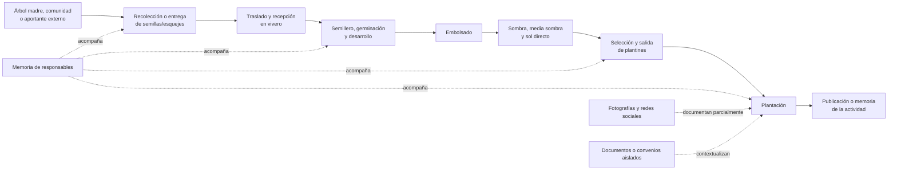
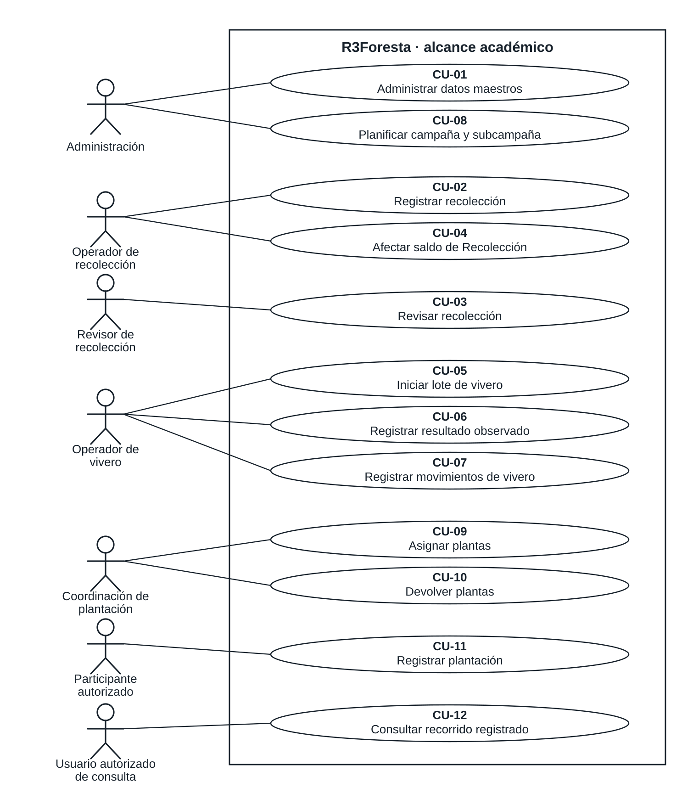

## 3.2. Fase de Inicio

> Parte del [Capítulo III](03_capitulo_marco_aplicativo.md). Diagnóstico con corte principal al 22 de julio de 2026; contraste documental de septiembre y consolidación editorial del 29 de octubre. Los artefactos reunidos aquí no acreditan un cierre histórico de IN-1 ni la aprobación de LCO.

### 3.2.1. Propósito y correspondencia con RUP

Esta sección responde al primer objetivo específico: **analizar la información que se genera y cómo se gestiona actualmente en las actividades de Recolección, Vivero y Plantación de R3Foresta**. Conserva el diagnóstico y lo relaciona con los productos de Inicio: visión, alcance, actores del sistema, casos de uso principales, requisitos iniciales, riesgos y evaluación documental del hito LCO. El diseño detallado continúa en la sección 3.3.

La planificación metodológica adoptada el 25 de agosto de 2026 organiza el periodo académico en IN-1, del 6 al 19 de julio, y EL-1, del 20 de julio al 16 de agosto, seguidas por Construcción y Transición. Esta organización posterior permite relacionar los productos con las fases, pero no demuestra que las actividades se hubieran ejecutado originalmente bajo esos identificadores. Las fechas comprobables del levantamiento son el 20 y el 22 de julio; no se dispone de un registro anterior al 20 de julio que acredite la ejecución de IN-1 ni de un acta de LCO, según la confirmación del autor del 29 de octubre.

**Tabla 3.3**

*Cronología documentada y relación con los productos metodológicos*

| Fecha o periodo | Actividad o documento acreditado | Producto que aporta | Relación con RUP y límite de la evidencia |
|---|---|---|---|
| 6–19 de julio de 2026 | Periodo asignado a IN-1 en el cronograma adoptado posteriormente | Productos de Inicio previstos | No se acredita la ejecución ni el cierre de IN-1 durante ese intervalo |
| 20 de julio de 2026 | Reunión FP-01 | Necesidades expresadas, expectativas y primeras delimitaciones | Insumo de requisitos; su fecha coincide con el periodo asignado a EL-1, sin demostrar una revisión de iteración |
| 22 de julio de 2026 | Entrevista FP-02 y registro fotográfico FO-01 | Descripción de la operación y evidencia parcial de Vivero | Profundización del diagnóstico que alimenta Inicio y Elaboración |
| 25 de agosto de 2026 | Registro de adopción de RUP y reorganización del periodo | Plan de fases, iteraciones e hitos | Decisión metodológica posterior al levantamiento de julio |
| 14–15 de septiembre de 2026 | Referencia al dossier FD-01 y registro metodológico | Contraste público y balance de artefactos disponibles | No modifica el corte de julio; el registro mantiene LCO y LCA sin cierre formal |
| 29 de octubre de 2026 | Consolidación de esta sección | Visión, casos de uso generales, requisitos iniciales, riesgos y evaluación documental de LCO | Preparación para revisión; no constituye aceptación institucional o académica |

*Nota.* Elaboración propia a partir de las fuentes primarias FP-01 y FP-02, el inventario FO-01, el registro de decisiones del 25 de agosto, el cronograma del Perfil, el registro de avance RUP y SDD del 15 de septiembre y la confirmación del autor del 29 de octubre. Las fechas de consolidación se distinguen de las fechas de los hechos descritos.

La entrevista, la observación, el análisis documental y la revisión de registros aportaron técnicas de levantamiento que se relacionan aquí con las disciplinas de requisitos y análisis de RUP. No constituyen una metodología investigativa adicional. Su función fue recuperar necesidades, reconocer variantes, identificar riesgos y distinguir la práctica existente de las propuestas de expansión mencionadas por la organización.

**Tabla 3.4**

*Fuentes empleadas para analizar la gestión actual*

| Código | Fuente y fecha | Aporte al análisis | Limitación principal |
|---|---|---|---|
| FP-01 | [Reunión de trabajo](../../03_investigacion/fuentes_primarias/reunion_r3foresta_2026-07-20.md), 20 de julio de 2026 | Presentó las etapas inicialmente consideradas, la urgencia institucional y la información que se esperaba registrar | Combina práctica actual, propuesta de producto y aspiraciones comerciales |
| FP-02 | [Entrevista a Hernán Lara](../../03_investigacion/fuentes_primarias/entrevista_pablo_fernandez_hernan_lara_2026-07-22.md), 22 de julio de 2026 | Describió los soportes utilizados, la procedencia del material, el trabajo en vivero, las plantaciones y la distribución funcional de responsabilidades | La transcripción automática contiene términos y cifras que deben interpretarse con cautela |
| FO-01 | [Inventario fotográfico de Chasquipampa](../../03_investigacion/inventario_evidencia_fotografica_2026-07-22.md), 22 de julio de 2026 | Permitió observar plantines en bolsas dentro de un ambiente protegido y en exposición directa al sol | Solo cubre Vivero; no registra recolección, despacho ni plantación definitiva |
| FD-01 | Dossier documental, corte declarado al 14 de septiembre de 2026; referencia conservada en el [índice de fuentes primarias](../../03_investigacion/fuentes_primarias/README.md) | Sirvió como índice de localización de publicaciones y posibles diferencias entre cifras | No se localizó una copia del dossier ni se verificaron sus publicaciones originales en esta revisión; no sustenta cifras o contradicciones como resultados confirmados |
| DT-01 | Requisitos y reglas de [General](../../../00-general-module/README.md), [Recolección](../../../01-recoleccion-module/README.md), [Vivero](../../../02-vivero-module/README.md) y [Plantación](../../../03-plantacion-module/README.md) | Permiten relacionar las necesidades con especificaciones posteriores | Describen la solución especificada y sus refinamientos; no prueban la práctica anterior ni la fecha de identificación de un requisito |

*Nota.* Elaboración propia. Las transcripciones FP-01 y FP-02 se conservan como fuentes primarias sin corregir. FD-01 se utiliza como índice de contraste; antes de emplear una afirmación pública como resultado definitivo deberá verificarse su fuente original.

Para interpretar las fuentes se utilizaron cinco categorías: práctica actual, necesidad, propuesta futura, decisión de alcance y dato pendiente de confirmación. Esta separación resultó necesaria porque en las reuniones aparecen, dentro de una misma explicación, actividades efectivamente realizadas, funciones que se deseaba incorporar a la aplicación y proyecciones relacionadas con carbono, blockchain o expansión territorial. Las dos últimas no se tratan como capacidades vigentes ni como compromisos del producto académico.

### 3.2.2. Contexto operativo seleccionado

R3Foresta trabaja con viveros, comunidades, juntas vecinales, instituciones educativas y otros aliados. Sin embargo, las actividades no se desarrollan con una estructura idéntica en todos los lugares. Para disponer de un contexto operativo concreto se seleccionó Chasquipampa como referencia principal. Según la confirmación del responsable del proyecto, este proceso es el utilizado por Hernán Lara, sirve para enseñar la secuencia a otras comunidades y será el escenario principal de las pruebas del sistema.

La selección no convierte a Chasquipampa en una muestra estadística ni permite atribuir automáticamente sus condiciones a todas las comunidades. Se utiliza como escenario operativo representativo porque reúne la secuencia de semillas, vivero y plantación, existe acceso para observar el trabajo y se dispone de antecedentes documentales y fotográficos. Cuando otro proyecto presente una variante —por ejemplo, ingreso de material donado, trabajo mediante convenio comunitario o recepción directa de plantas— la diferencia deberá registrarse sin forzarla dentro de una única secuencia.

El registro fotográfico del 22 de julio permite observar el componente de Vivero. En el ambiente protegido se encuentran plantines de diferentes tamaños agrupados en bolsas y recipientes. La imagen respalda la existencia de manejo por grupos y distintas condiciones de desarrollo, pero no permite determinar la especie, la cantidad exacta ni el origen de cada conjunto.

**Figura 3.2. Plantines en ambiente protegido del vivero de Chasquipampa**

*Nota.* Registro fotográfico propio del 22 de julio de 2026. La fecha y la ubicación fueron proporcionadas por el autor; el archivo no conserva esos datos en metadatos EXIF. La imagen respalda la observación del ambiente de vivero, pero no certifica especies, cantidades ni procedencias.

También se observó un espacio exterior con plantas embolsadas expuestas directamente al sol. La organización describió esta transición como parte del fortalecimiento previo a la salida del vivero. La condición heterogénea visible entre ejemplares muestra por qué un registro de entrada no basta para inferir la cantidad posterior de plantas disponibles: los resultados deben contarse y registrarse cuando se observan.

**Figura 3.3. Plantas embolsadas en exposición directa al sol**

*Nota.* Registro fotográfico propio del 22 de julio de 2026. La fotografía documenta una condición de manejo del vivero; no permite establecer por sí sola cuánto tiempo permaneció cada planta en esa etapa ni su aptitud para plantación.

### 3.2.3. Flujo operativo actual

El proceso general informado parte de la obtención de semillas o esquejes y continúa con su recepción y manejo en vivero, el embolsado de las plantas resultantes, su exposición progresiva a sombra, media sombra o sol directo y la selección de plantines para una plantación. La secuencia física produce información en distintos momentos, pero antes del sistema esa información no se conservaba en un historial integrado.

La práctica descrita no es completamente lineal. Un mismo origen puede alimentar más de un grupo del vivero; un vivero puede contener material de diferentes procedencias; y una plantación puede requerir plantas procedentes de varios grupos o viveros. También existe la posibilidad de incorporar material entregado por comunidades, colaboradores o donantes. Por tanto, el análisis no asume que cada semilla se convierte en una planta ni que cada plantación se abastece desde un único origen.

**Figura 3.4. Flujo actual y soportes de información identificados**

*Nota.* Diagrama de flujo descriptivo de elaboración propia a partir de FP-01, FP-02 y FO-01. Las líneas discontinuas representan soportes parciales de la situación anterior al sistema. No es un diagrama UML de actividades ni representa la implementación informática.

#### 3.2.3.1. Recolección e ingreso de semillas o esquejes

La identificación de árboles madre se realiza considerando características observables como tamaño, condición general, fruto y hojas, además de la cercanía entre la procedencia y el lugar donde se espera utilizar el material. A partir de esos árboles pueden obtenerse semillas o esquejes. La organización considera relevantes el nombre común, el nombre científico, el tipo de material, la ubicación y la cantidad, expresada mediante conteo o peso según corresponda (FP-02).

La recolección no está asignada exclusivamente a un cargo. Puede efectuarla personal vinculado al vivero, una persona de la comunidad u otro colaborador. También puede existir entrega de material por un actor externo. En consecuencia, el primer responsable del recorrido no siempre es un empleado de R3Foresta y el sistema debe conservar, cuando esté disponible, quién recolectó o entregó el material y cuál fue su procedencia.

En la práctica anterior, una parte de esa información permanecía en la memoria de quienes participaron o acompañaba físicamente al material durante su traslado. No existía un registro uniforme que permitiera consultar el origen, la cantidad recibida, la fecha, el responsable y la evidencia como una sola unidad. Por ello, el ingreso al vivero se convierte en un punto de control decisivo: si el origen no se recupera en ese momento, la relación resulta difícil de reconstruir después.

#### 3.2.3.2. Manejo dentro del vivero

Al recibir el material, el personal del vivero puede pesarlo o contarlo y organizar su incorporación al proceso. Las semillas pasan al semillero y los esquejes siguen el tratamiento correspondiente. La germinación o el enraizamiento producen resultados observados, no una conversión automática de la cantidad inicial. Después se reconocen plantas que pueden embolsarse, grupos que sufren pérdidas y lotes que continúan su desarrollo.

El manejo incluye momentos descritos como germinación, embolsado, sombra, media sombra y sol directo. Las fotografías FO-01 documentan plantines en bolsas bajo protección y en un espacio con exposición solar. Sin embargo, no se observaron etiquetas o identificadores que permitieran relacionar visualmente cada grupo con un origen, una especie, una fecha de ingreso o una cantidad inicial. La organización física permite trabajar con el material, pero no constituye por sí sola un historial consultable.

La entrevista señala que la información más útil para la gestión comprende la cantidad que ingresó, la cantidad que produjo plantas, las plantas que permanecen vivas en el vivero y las pérdidas registradas durante el proceso. También resulta necesario conocer qué material se encuentra disponible para atender una plantación. Antes de la estructuración del sistema, estos valores no se mantenían de forma uniforme en Excel, cuadernos u otra base compartida; el estado del vivero se conocía principalmente mediante observación directa y memoria de los responsables (FP-02).

#### 3.2.3.3. Selección, salida y plantación

Cuando se requiere una actividad de arborización, forestación o reforestación, se define el lugar, la cantidad de plantas y las especies que se pretenden utilizar. Una plantación puede abastecerse con plantas procedentes de uno o varios viveros. Esto exige diferenciar la cantidad observada en el vivero, la cantidad comprometida para un destino, la cantidad entregada y la cantidad finalmente plantada.

R3Foresta informó que su producción es predominantemente propia. No obstante, durante la entrevista se reconocieron donaciones de plantas y se consideró necesario admitir una compra excepcional si una actividad futura no pudiera cubrirse con la producción disponible. Esta evolución de la respuesta muestra que la procedencia no debe reducirse a una regla absoluta de producción interna. El ingreso externo debe registrarse como una variante, sin convertirlo en un módulo independiente.

La información que con mayor frecuencia se difundía después de una plantación era la fecha, la cantidad y el lugar, acompañados de fotografías cuando las condiciones comunitarias permitían publicarlas. Facebook fue descrito como el repositorio público más antiguo y completo de la organización. Sin embargo, no todas las actividades fueron publicadas y una publicación aislada no siempre conserva la relación con la recolección, el lote del vivero, las pérdidas, los responsables o los movimientos que explican el resultado final.

**Tabla 3.5**

*Actividades, información y soportes identificados en el flujo actual*

| Etapa | Actividad | Información generada o necesaria | Soporte anterior predominante | Limitación observada |
|---|---|---|---|---|
| Recolección | Identificar árbol madre u origen | especie, características del árbol, ubicación | memoria, fotografía o referencia personal | el origen no siempre queda asociado con el material posterior |
| Recolección | Recoger o recibir material | tipo de material, cantidad, unidad, fecha, recolector o aportante | memoria y manejo físico | no existe una ficha uniforme para todas las entradas |
| Vivero | Recibir material | procedencia, cantidad y unidad recibidas, fecha, vivero y responsable | observación y coordinación directa | el ingreso puede perder su vínculo con la recolección |
| Vivero | Germinar o enraizar | fecha de inicio, material en proceso y resultado observado | memoria y observación | no puede explicarse de forma histórica la diferencia entre entrada y resultado |
| Vivero | Embolsar y desarrollar | plantas observadas, fecha, grupo y responsable | agrupación física y fotografías ocasionales | no se dispone de una identidad compartida para cada lote |
| Vivero | Registrar pérdidas y disponibilidad | cantidad perdida, causa y saldo utilizable | conteo eventual o conocimiento del responsable | no existe un saldo reconstruible mediante movimientos relacionados |
| Vivero→Plantación | Seleccionar y entregar | origen, cantidad, destino, fecha y responsables de entrega/recepción | coordinación directa, mensajes o documentos aislados | una plantación puede recibir de varios orígenes sin conciliación común |
| Plantación | Planificar y ejecutar | tipo de actividad, especies, cantidades, lugar, fecha, participantes y evidencia | coordinación operativa, fotografías y publicaciones | la publicación final no explica necesariamente la procedencia ni las diferencias de cantidad |

*Nota.* Elaboración propia a partir de FP-01, FP-02 y FO-01. La expresión “información generada o necesaria” no implica que todos esos datos se registraran de manera sistemática antes del proyecto.

### 3.2.4. Actores y distribución funcional de responsabilidades

La estructura actual se comprende mejor mediante funciones que mediante cargos rígidos. En proyectos comunitarios, una misma persona puede recolectar material, apoyar el vivero y participar en la plantación; a su vez, la dirección puede coordinar varias etapas. Durante las reuniones se propusieron niveles de vivero, plantación y zona, pero esa jerarquía se presentó como una necesidad de crecimiento y no como una estructura homogénea ya implantada.

**Tabla 3.6**

*Responsabilidades funcionales identificadas*

| Actor o función | Responsabilidades actuales identificadas | Información que produce o utiliza | Observación |
|---|---|---|---|
| Dirección o coordinación de R3Foresta | priorizar actividades, coordinar comunidades y viveros, definir destinos, supervisar plantaciones y comunicar resultados | necesidades, lugares, cantidades estimadas, participantes y publicaciones | concentra una parte importante de la memoria institucional |
| Recolector o aportante de material | identificar el origen, obtener o entregar semillas y esquejes | procedencia, especie declarada, ubicación, cantidad y fecha | puede pertenecer a R3Foresta, al vivero, a una comunidad o ser externo |
| Responsable de recepción y vivero | recibir, pesar o contar, organizar semillero, observar resultados, embolsar, cuidar y preparar plantas | cantidad recibida, resultado observado, etapa, pérdidas, disponibilidad y evidencia | la función existe aunque el cargo y el número de responsables varíen por vivero |
| Coordinador de plantación | definir o confirmar lugar, especies y cantidad; coordinar entrega y ejecución | planificación, destino, equipo, cantidad recibida y cantidad plantada | puede ser asumido por dirección o por un responsable local |
| Participante en plantación | ejecutar o apoyar la plantación conforme a la coordinación de la actividad | actividad, fecha, lugar, especies, cantidades plantadas, participación y evidencia cuando corresponda | puede ser integrante comunitario, aliado o voluntario; la función de campo no supone un cargo fijo ni acceso operativo al sistema |
| Comunidad o aliado local | aportar trabajo, terreno, cuidado, producción o recepción según el convenio | participantes, material producido o recibido, destino y evidencia | la distribución de beneficios y plantas depende del acuerdo específico |
| Donante, proveedor o colaborador externo | entregar material vegetal cuando se presenta una incorporación externa | entidad de origen, material, cantidad, fecha y documento disponible | es una variante menos frecuente, pero debe conservarse para explicar la procedencia |
| Patrocinador u organización asociada | consultar resultados o respaldar una actividad | información agregada, ubicación, evidencia y avance | no necesariamente interviene en el registro operativo diario |

*Nota.* Elaboración propia a partir de FP-01, FP-02 y las aclaraciones proporcionadas por el autor del proyecto. La tabla caracteriza funciones y no constituye todavía el modelo de autorización del sistema.

Una persona puede colaborar físicamente en la plantación sin operar la aplicación. Los actores de interacción se presentan en la [sección 3.2.8](#328-actores-del-sistema-y-casos-de-uso-generales) y su correspondencia con roles y permisos se desarrolla en la [sección 3.3.13 de Elaboración](03_2_fase_elaboracion.md#3313-actualización-de-actores-y-participación-en-plantación). En el recorrido digital definido en [PA-S01](../../../specs/plantacion/participacion-aliada/01-registro-plantacion-inicial/spec.md), la selección individual de participantes adicionales se limita a personas registradas y habilitadas en la misma subcampaña; ese recorrido no contempla identificar individualmente a colaboradores sin cuenta. Esta restricción del registro digital no limita su participación física en la actividad.

El control formal del material comienza principalmente con su recepción en vivero, pero la trazabilidad exige capturar también el antecedente disponible. Por ello, no resulta adecuado identificar a una sola persona como “encargado de recolección” para todos los casos. La necesidad real es distinguir al actor que origina o entrega el material del responsable que lo recibe y registra.

Dentro del vivero se identifican funciones de recepción, manejo y seguimiento. En Chasquipampa estas actividades son coordinadas por R3Foresta y ejecutadas por las personas que atienden el espacio. Para la plantación, la coordinación puede permanecer en la dirección o delegarse a un responsable de la actividad. Los cargos de encargado zonal y los niveles jerárquicos comunitarios mencionados en la entrevista se tratarán como evolución organizativa; no se utilizarán para afirmar que todos los proyectos ya operan con esa estructura.

### 3.2.5. Gestión y calidad de la información disponible

El problema no consiste en una ausencia absoluta de información. Existen fotografías, publicaciones, nombres de lugares, cantidades declaradas y conocimiento acumulado por los responsables. La dificultad es que esos elementos no comparten una estructura que permita vincularlos y recuperarlos como un recorrido.

Facebook cumple una doble función: comunica públicamente las actividades y conserva una memoria cronológica parcial. Esta memoria permitió recuperar eventos pasados, pero presenta cuatro límites. Primero, no todas las comunidades autorizan la toma o publicación de imágenes. Segundo, los campos incluidos varían entre publicaciones. Tercero, las publicaciones no poseen un identificador común con los grupos del vivero o la recolección de origen. Cuarto, una cifra publicada no siempre puede distinguir entre meta, plantín entregado, árbol plantado, reposición o árbol observado posteriormente.

La referencia al dossier FD-01 registra posibles diferencias entre cantidades difundidas públicamente. Como no se localizaron aquí el dossier completo y las publicaciones originales, esas diferencias se conservan como un asunto por verificar y no como evidencia principal de contradicciones en Chasquipampa. Para compararlas habría que comprobar proyecto, parcela o cohorte, fecha, unidad y significado de cada cifra. El diagnóstico de dispersión se apoya principalmente en FP-02; no depende de atribuir una pérdida o un porcentaje de supervivencia a una publicación no comprobada.

La evidencia fotográfica presenta una limitación semejante. Las figuras 3.2 y 3.3 permiten reconocer plantas embolsadas y ambientes de manejo, pero no contienen etiquetas visibles suficientes para recuperar especie, lote, cantidad o procedencia. Una fotografía adquiere mayor valor informacional cuando se vincula con el evento al que respalda, su fecha, ubicación, responsable y unidad trazable. Aun así, respalda el registro y no certifica por sí sola la correspondencia absoluta con el mundo físico.

**Tabla 3.7**

*Hallazgos del diagnóstico y consecuencias para la gestión de información*

| Código | Hallazgo conservado en la matriz OBJ-01 | Consecuencia o necesidad de gestión |
|---|---|---|
| HAL-01 | información distribuida entre redes, fotografías, mensajes, documentos y memoria | reconstruir una actividad exige consultar varias fuentes y personas |
| HAL-02 | ausencia de registro estructurado continuo entre las tres etapas | no puede relacionarse de manera uniforme origen, manejo y destino |
| HAL-03 | distintos actores pueden recolectar o entregar material | deben distinguirse aportante, recolector y receptor sin presuponer un cargo único |
| HAL-04 | el control práctico comienza al recibir en Vivero y el antecedente puede ser incompleto | se necesita recuperar la procedencia disponible al ingresar el material |
| HAL-05 | cantidades, resultados de germinación, pérdidas, exposición y disponibilidad no se conservaban sistemáticamente | los cambios de cantidad y unidad necesitan registros relacionados para explicar el saldo |
| HAL-06 | las fotografías no identifican lotes, cantidades exactas, especies o procedencias | la evidencia visual debe asociarse con datos del hecho y conservar su límite probatorio |
| HAL-07 | las publicaciones de plantación tienen cobertura incompleta | los registros operativos no pueden depender de la publicación en redes |
| HAL-08 | la coordinación y la memoria se concentran en dirección, con participación local variable | se requiere identificar responsabilidades por actividad sin imponer una jerarquía uniforme |
| HAL-09 | producción propia predominante, donaciones existentes y posible compra excepcional | el alcance debe contemplar procedencia externa como variante |
| HAL-10 | posible dificultad para conciliar cifras públicas sin identificadores suficientes | asunto señalado por FD-01 y pendiente de contraste con los originales; no se concluyen contradicciones concretas |
| HAL-11 | Chasquipampa fue seleccionado como referencia operativa y escenario principal de pruebas | el diagnóstico y la validación deben declarar su cobertura y evitar generalizaciones estadísticas |

*Nota.* Elaboración propia a partir de la [matriz de análisis de OBJ-01](../../03_investigacion/matriz_analisis_objetivo_1.md), FP-01, FP-02 y FO-01. Se conservan los significados de HAL-01 a HAL-11 de esa matriz. El borrador anterior reutilizaba HAL-03 a HAL-08 para otra síntesis; su copia archivada permite reconocer la corrección. HAL-10 conserva su carácter provisional por depender de FD-01.

### 3.2.6. Necesidades y requisitos iniciales derivados

Los hallazgos permiten formular necesidades de información antes de decidir tablas, servicios o interfaces. Cada etapa necesita conservar datos propios y relaciones suficientes para reconstruir el recorrido. La necesidad es mantener identidad y procedencia al recibir, transformar o trasladar material. Utilizar el lote como unidad de trazabilidad es una propuesta de solución desarrollada en Elaboración; su granularidad, sus divisiones y sus relaciones deben justificarse allí, sin deducirlos únicamente de las agrupaciones visibles en las fotografías.

**Tabla 3.8**

*Condiciones del dominio y límites de la evidencia identificados en el análisis*

| Código | Condición identificada | Naturaleza y respaldo |
|---|---|---|
| RAN-01 | quien origina o entrega material puede ser distinto de quien lo recibe en Vivero | práctica declarada en FP-02 y aclaración del autor |
| RAN-02 | la propagación descrita utiliza semillas o esquejes; también se reconocen ingresos externos de plantas | dominio declarado en FP-01 y FP-02; el tratamiento informático de la variante debe especificarse |
| RAN-03 | las semillas pueden contarse o pesarse; las plantas vivas se cuentan como resultado observado | dominio declarado en FP-02; las unidades y precisiones del sistema se definen en Elaboración |
| RAN-05 | predomina la producción propia y se reconocen donaciones; la compra se plantea como posibilidad excepcional | práctica y posibilidad diferenciadas en FP-02 |
| RAN-06 | una plantación puede abastecerse de varios grupos o viveros | práctica declarada en FP-02; la representación mediante lotes corresponde al diseño |
| RAN-09 | una fotografía respalda el hecho documentado, pero no certifica por sí sola la realidad física declarada | límite de FO-01 y criterio editorial del proyecto |

*Nota.* Elaboración propia a partir de FP-01, FP-02, FO-01 y las aclaraciones del autor. Los códigos RAN se conservan; los saltos de numeración separan las condiciones del dominio de las decisiones de solución de la tabla siguiente. No representan controles informáticos ya existentes en la operación anterior.

**Tabla 3.9**

*Decisiones y restricciones de la solución diferenciadas del diagnóstico*

| Código | Decisión o restricción | Origen y tratamiento posterior |
|---|---|---|
| RAN-04 | no inferir automáticamente plantas vivas a partir de semillas, esquejes o peso inicial | requisito de integridad derivado de RAN-03; Elaboración define cómo registrar el resultado observado |
| RAN-07 | relacionar cada operación relevante con fecha, responsable, ubicación y evidencia cuando corresponda | necesidad de trazabilidad derivada de HAL-01, HAL-02 y HAL-06; los campos obligatorios se precisan por caso de uso |
| RAN-08 | permitir escritura operativa mediante identidad autenticada y autorización vigente para la actividad | restricción de acceso; el alta de una cuenta o la afiliación no equivalen a permiso operativo y el modelo contextual se detalla en Elaboración |
| RAN-10 | concluir el recorrido académico en el registro de la plantación | frontera del Perfil aprobado; excluye seguimiento posterior y cuantificación de carbono |

*Nota.* Elaboración propia a partir de las necesidades del diagnóstico, el alcance y los controles transversales del Perfil y del Capítulo I. Las cláusulas de conservación de procedencia de RAN-02, RAN-05 y RAN-06 se desarrollan mediante NEC-01, NEC-02 y NEC-07. Esta clasificación no acredita que todos los requisitos se aprobaran durante julio.

**Tabla 3.10**

*Matriz puente entre hallazgos, necesidades, requisitos y casos de uso*

| Hallazgos de OBJ-01 | Necesidad y respuesta inicial esperada | Referencias funcionales existentes | Casos de uso y continuidad documental |
|---|---|---|---|
| HAL-02, HAL-03, HAL-04, HAL-09 | **NEC-01:** registrar el origen disponible, tipo de material, especie, cantidad, unidad, fecha, ubicación y aportante o recolector | `RF-REC-01`, `RF-REC-02`; catálogos `RF-GEN-03`, `RF-GEN-04`, `RF-GEN-05` | CU-02 y CU-05; la incorporación externa requiere concretar su especificación |
| HAL-02, HAL-04, HAL-05 | **NEC-02:** conservar la identidad del material y sus relaciones entre etapas | `RF-REC-05`, `RF-VIV-01`, `RF-PLA-04`, `RF-PLA-06`; contratos M1→M2 y M2→M3 | CU-04, CU-05, CU-09 y CU-11; Elaboración justifica el uso de lotes y sus relaciones |
| HAL-04, HAL-05 | **NEC-03:** diferenciar cantidades y unidades del material de entrada de las plantas vivas observadas | `RF-REC-01`, `RF-REC-05`, `RF-VIV-01`, `RF-VIV-02`, `RF-VIV-02A` | CU-02, CU-05 y CU-06; criterios por unidad y resultado observado |
| HAL-02, HAL-05 | **NEC-04:** registrar resultados, pérdidas, salidas y devoluciones que expliquen el saldo | `RF-VIV-02`, `RF-VIV-02A`, `RF-VIV-03`, `RF-VIV-05`, `RF-VIV-08`, `RF-VIV-11`, `RF-VIV-12`; `RF-PLA-04`, `RF-PLA-05`, `RF-PLA-06` | CU-06, CU-07, CU-09, CU-10 y CU-11; reglas e invariantes de cantidades |
| HAL-01, HAL-06, HAL-07 | **NEC-05:** relacionar fecha, responsable, ubicación y evidencia con la operación correspondiente | `RF-GEN-01`, `RF-GEN-04`, `RF-GEN-06`; `RF-REC-01`, `RF-REC-02`, `RF-VIV-06`, `RF-PLA-13` | CU-02, CU-06, CU-07 y CU-11; precisar evidencia obligatoria y tratamiento de datos |
| HAL-03, HAL-08 | **NEC-06:** distinguir responsabilidades de origen, recepción, manejo, coordinación y registro de plantación | `RF-GEN-01`; base histórica `RF-PLA-12` y `RF-PLA-17` | CU-01 y operaciones autorizadas; Elaboración distingue roles globales, logística y permisos contextuales |
| HAL-02, HAL-05, HAL-09 | **NEC-07:** registrar el destino, la procedencia y las cantidades entregadas y efectivamente plantadas | `RF-PLA-04`, `RF-PLA-05`, `RF-PLA-06`; `RF-VIV-11`, `RF-VIV-12` | CU-09, CU-10 y CU-11; la entrada externa directa requiere especificación propia |
| HAL-01, HAL-02, HAL-06, HAL-07 | **NEC-08:** recuperar el recorrido con origen, eventos, cantidades, responsables, evidencia y destino | `RF-REC-03`, `RF-REC-05`, `RF-VIV-07`, `RF-PLA-14` | CU-12; escenarios de reconstrucción en Construcción y Transición |

*Nota.* Elaboración propia, consolidada el 29 de octubre de 2026, a partir de la matriz OBJ-01, los requisitos de General, Recolección, Vivero y Plantación y los contratos de integración. Los requisitos `RF-VIV-11` y `RF-VIV-12` se definen en el contrato M2→M3. Los CU-01 a CU-12 conservan los identificadores del catálogo desarrollado en Elaboración. Las relaciones expresan correspondencia documental propuesta para revisión; no acreditan que todos los requisitos se identificaran en julio, estuvieran implementados o hubieran sido aceptados.

La tabla constituye la entrada a la cadena SDD: `HAL → NEC → RF y CU → especificación y criterios de aceptación`. Las [fuentes funcionales de los módulos](../../../README.md) y los [contratos de integración](../../../90-contratos-integracion/README.md) ya expresan comportamiento, reglas y excepciones; no es necesario duplicarlos en nuevas specs para atribuirles retrospectivamente un origen en Inicio. Elaboración deberá revisar la correspondencia, resolver vacíos y precisar los criterios verificables. Después se enlazarán plan, tareas, cambio, prueba, resultado y aceptación.

Un refinamiento posterior permite reconocer cómo continúa esa cadena: [PA-S01](../../../specs/plantacion/participacion-aliada/01-registro-plantacion-inicial/spec.md) desarrolla el registro inicial de CU-11 y [PA-S03](../../../specs/plantacion/participacion-aliada/03-gestion-acceso-subcampania/spec.md) precisa la autorización relacionada con NEC-06. Son documentos de Participación aliada desarrollados posteriormente, no entregables acreditados de julio. `RF-PLA-17` conserva una base histórica de acceso y no reemplaza esos refinamientos. Las entregas INT agrupan tareas de las specs; no son casos de uso ni iteraciones RUP adicionales.

Además de las funciones, se consolidan los siguientes requisitos no funcionales iniciales. Sus identificadores se introducen en esta revisión y no se presentan como un catálogo aprobado en IN-1. Las reglas de cantidades y movimientos de la matriz anterior son requisitos de integridad del dominio; las condiciones siguientes describen propiedades transversales que deben concretarse y comprobarse.

**Tabla 3.11**

*Requisitos no funcionales iniciales y aspectos pendientes de especificación*

| Código | Propiedad requerida | Comprobación que deberá definirse | Precisión pendiente |
|---|---|---|---|
| RNF-INI-01 | restringir las operaciones y el acceso a datos según identidad y autorización vigente | comprobar acciones permitidas y denegadas por usuario y ámbito, incluida la retirada de permisos | matriz de permisos y datos públicos, propios e internos por caso de uso |
| RNF-INI-02 | conservar la interpretación histórica ante cambios o inactivación de usuarios y catálogos | recuperar un registro anterior después de modificar nombres o inactivar sus referencias | datos históricos que deben conservarse y política de corrección |
| RNF-INI-03 | mantener coherencia de operaciones críticas ante fallos, concurrencia o reintentos | ensayar consumo concurrente, fallo parcial y repetición de la misma operación sin duplicar sus efectos | fronteras de operación y resultados esperados por contrato |
| RNF-INI-04 | proteger credenciales, fotografías, coordenadas y datos personales según su finalidad | revisar exposición de secretos, acceso a evidencia y publicación de información | clasificación, autorización, conservación y eliminación según tipo de dato |
| RNF-INI-05 | permitir respaldo y recuperación de los registros y de su evidencia relacionada | restaurar un conjunto identificado y comprobar su recorrido y asociaciones | procedimiento, entorno y objetivos de pérdida de datos y tiempo de recuperación; no hay umbrales aprobados |
| RNF-INI-06 | permitir que los usuarios previstos completen el registro y recuperen la información necesaria | ejecutar tareas de registro y consulta con usuarios y dispositivos representativos, anotando errores y tiempos | condiciones de conectividad, carga, dispositivos y criterios de suficiencia; no se promete operación sin conexión |

*Nota.* Elaboración propia a partir de los controles transversales y la evaluación previstos en el Perfil y el Capítulo I, la continuidad histórica de los requisitos `RF-GEN-*` y `RF-VIV-07`, y las condiciones de integridad de los contratos M1→M2 y M2→M3. RNF-INI-01 a RNF-INI-06 son identificadores documentales de la consolidación del 29 de octubre, pendientes de revisión y operacionalización en Elaboración; no representan pruebas ya ejecutadas.

La autorización concedida para utilizar nombres, ubicaciones y convenios en el documento académico no elimina la necesidad de controlar su publicación en el producto. Tampoco la presencia de fotografías o coordenadas acredita por sí sola la correspondencia absoluta entre un registro y el mundo físico.

### 3.2.7. Visión y delimitación del sistema

La visión del producto es ofrecer a R3Foresta un sistema integrado para registrar y consultar la procedencia, los cambios y el destino del material vegetal hasta su plantación, con cantidades, responsables, fechas, ubicaciones y evidencia relacionadas. Se espera que los responsables puedan reconstruir el recorrido registrado y explicar sus cantidades; la evaluación deberá determinar en qué medida esa propiedad se cumple y con qué limitaciones.

**Tabla 3.12**

*Visión y alcance inicial del producto académico*

| Elemento | Delimitación |
|---|---|
| Problema que atiende | información fragmentada y dificultad para relacionar origen, manejo en vivero y destino en plantación |
| Usuarios previstos | personas que administran referencias, registran o revisan operaciones y consultan información según autorización; Chasquipampa es el contexto principal previsto para las pruebas |
| Inicio del recorrido | origen registrado mediante recolección o incorporación de material adquirido externamente en Vivero o Plantación |
| Cobertura funcional | M1 Recolección, M2 Vivero y M3 Plantación, apoyados por datos maestros y controles transversales del Módulo General |
| Resultado final incluido | registro de la plantación con procedencia, cantidades y evidencia, y consulta del recorrido hasta ese registro |
| Variantes incluidas | donación o adquisición externa y abastecimiento desde varias procedencias, dentro de los tres módulos operativos |
| Exclusiones | mantenimiento, reposición, crecimiento y supervivencia posterior; biomasa, CO₂, MRV, certificación y comercialización de carbono; blockchain, NFT, contratos inteligentes e IPFS |
| Condiciones de evaluación | versión y datos identificados, escenarios explícitos y diferencia entre registro declarado, evidencia asociada y realidad física |

*Nota.* Elaboración propia a partir de los objetivos y el alcance del Perfil aprobado, las secciones 1.6 y 1.7 del Capítulo I y NEC-01 a NEC-08. La visión se reúne aquí como producto documental de Inicio; no amplía el compromiso académico ni acredita aceptación o entrega del software.

Las tres etapas físicas se corresponden con los tres módulos operativos. El Módulo General mantiene usuarios, viveros, plantas, ubicaciones, organizaciones y tipos de evidencia utilizados en esas etapas; no añade un cuarto momento al recorrido físico. La trazabilidad, el historial y las consultas atraviesan los módulos y tampoco constituyen un módulo funcional adicional.

El alcance aprobado incluye ingresos externos, pero su inclusión no demuestra que la documentación técnica o el software los resuelvan. La ruta principal especificada exige una recolección validada para iniciar Vivero y stock asignado desde Vivero para registrar la plantación. La alternativa externa requiere completar reglas, datos, evidencia y pruebas antes de declarar cobertura. Esta diferencia se registra como riesgo y condición del trabajo de Elaboración.

### 3.2.8. Actores del sistema y casos de uso generales

Las funciones organizativas de la sección 3.2.4 describen quién participa en el trabajo de campo. Un actor del sistema representa, en cambio, una forma de interactuar con el producto. Una persona puede asumir varios actores y pertenecer a una comunidad o ser donante no le concede automáticamente una cuenta ni permisos. La vista inicial utiliza responsabilidades de interacción y deja para Elaboración su correspondencia con roles y autorizaciones por ámbito.

**Tabla 3.13**

*Actores de interacción y objetivos principales*

| Actor del sistema | Interacción principal | Casos de uso relacionados |
|---|---|---|
| Administración | mantener datos maestros y planificar campañas y subcampañas | CU-01, CU-08 |
| Operador de Recolección | registrar el origen y las operaciones que afectan su cantidad disponible | CU-02, CU-04 |
| Revisor de Recolección | revisar la información de origen y resolver su aprobación o rechazo | CU-03 |
| Operador de Vivero | recibir material, registrar resultados observados y movimientos | CU-05, CU-06, CU-07 |
| Coordinación de Plantación | relacionar plantas entregadas con el destino y gestionar devoluciones | CU-09, CU-10 |
| Participante autorizado | registrar una plantación dentro de la actividad para la que está habilitado | CU-11 |
| Usuario autorizado de consulta | recuperar el recorrido y la información que puede consultar | CU-12 |

*Nota.* Elaboración propia a partir de NEC-01 a NEC-08 y del catálogo CU-01 a CU-12 de Elaboración. Son asociaciones principales entre actores y objetivos; no constituyen una matriz exhaustiva de permisos. La denominación «coordinación» no crea un rol global y «participante autorizado» no implica que toda persona inscrita pueda escribir registros.

La Figura 3.5 representa esta frontera mediante notación UML de casos de uso: actores externos, elipses para los objetivos y asociaciones con el sistema. Conserva los identificadores del catálogo de Elaboración; no representa tablas, pantallas ni secuencias de ejecución.

**Figura 3.5. Actores y casos de uso generales del sistema académico**

*Nota.* Elaboración propia a partir de la tabla anterior y de los requisitos `RF-GEN-*`, `RF-REC-*`, `RF-VIV-*` y `RF-PLA-*` seleccionados para el alcance académico. Las asociaciones indican interacciones principales y no privilegios exclusivos. El ingreso externo se conserva como variante de alcance pendiente de detallar; el diagrama no acredita su implementación. Las reglas, alternativas y criterios de aceptación se desarrollan en la sección 3.3.

CU-04 conserva la denominación «afectar saldo de Recolección». Según RN-REC-10A, el consumo hacia Vivero se genera al iniciar el lote mediante CU-05; no constituye una acción manual independiente del operador de Recolección. El desecho sigue su operación autorizada correspondiente.

### 3.2.9. Riesgos iniciales y prioridades

Los riesgos se priorizan por su efecto sobre la posibilidad de reconstruir el recorrido y cumplir el alcance. Esta es una lista cualitativa consolidada a partir del diagnóstico; no reconstruye una evaluación numérica realizada en julio. Los responsables de seguimiento indicados son propuestas por función y requieren confirmación en la revisión metodológica.

**Tabla 3.14**

*Riesgos de partida y acciones prioritarias*

| Código y prioridad | Riesgo e impacto | Respuesta y condición de seguimiento | Seguimiento propuesto y estado |
|---|---|---|---|
| RIN-01 — alta | procedencia incompleta al ingresar material: impide reconstruir el origen | especificar datos mínimos y cómo declarar antecedentes desconocidos, incluidos ingresos externos | autor con responsable operativo; abierto |
| RIN-02 — alta | cantidades o unidades confundidas: produce saldos y resultados no explicables | separar entrada, transformación observada y movimientos; definir criterios por unidad y ensayar un recorrido | autor con responsables de Recolección y Vivero; abierto |
| RIN-03 — alta | alcance externo comprometido sin especificación suficiente: deja variantes sin cobertura | cerrar contratos de ingreso externo en Vivero y Plantación antes de declarar completo el alcance | autor con coordinación de R3Foresta; abierto |
| RIN-04 — alta | atribuir permisos a cargos o afiliaciones: permite operaciones indebidas o bloquea a participantes legítimos | distinguir funciones, cuentas y autorización por actividad; revisar casos permitidos y denegados | autor con coordinación de R3Foresta; abierto |
| RIN-05 — alta | confundir expectativas de carbono o seguimiento posterior con compromisos del proyecto | mantener RAN-10 y someter cualquier ampliación a revisión de alcance y viabilidad | autor con tutora y referente institucional según competencia; frontera documentada, seguimiento abierto |
| RIN-06 — media | cobertura desigual o dependencia de publicaciones: limita la validación y conciliación de resultados | seleccionar escenarios con registros identificados; comprobar originales de FD-01 si se utilizan sus cifras | autor con responsables operativos; abierto |
| RIN-07 — alta | ausencia de evidencia temporal y de revisión de Inicio: impide acreditar el cierre metodológico | conservar fechas reales, reunir productos y registrar una revisión actual sin atribuirle fecha anterior | autor con revisores por confirmar; ausencia histórica confirmada, revisión pendiente |

*Nota.* Elaboración propia a partir de HAL-01 a HAL-11, los límites del Perfil, el registro metodológico y la confirmación del autor del 29 de octubre. RIN-01 a RIN-07 se introducen en esta consolidación. La prioridad es cualitativa; los responsables son funciones propuestas, no designaciones acreditadas. Los riesgos técnicos detectados posteriormente se desarrollan en Elaboración con sus propios identificadores y fechas.

La primera prioridad es cerrar procedencia, unidades y movimientos de la ruta principal y sus variantes, junto con el modelo de autorización. La consulta transversal depende de esas relaciones. El plan de iteraciones organiza su tratamiento, pero faltan una estimación consolidada del esfuerzo restante, responsables de revisión confirmados y una decisión de viabilidad que acompañe LCO. La existencia de código adelantado no resuelve por sí sola estos pendientes.

### 3.2.10. Resultados y evaluación del hito de Inicio

El diagnóstico identifica procesos, actores funcionales, información, soportes y dificultades de gestión. La observación fotográfica respalda dos condiciones del manejo en Vivero; Recolección y Plantación se sustentan principalmente en las declaraciones de FP-01 y FP-02 y requieren sus propias evidencias para la validación operativa. No se utilizan cifras del dossier no verificadas como resultados confirmados.

La consolidación reúne once hallazgos canónicos, ocho necesidades, las condiciones RAN-01 a RAN-10 separadas por naturaleza, visión y alcance, actores del sistema, los casos de uso generales y una lista inicial de requisitos no funcionales y riesgos. La matriz puente permite continuar hacia los modelos y especificaciones de Elaboración sin duplicar los requisitos existentes. Estos son productos documentales disponibles para revisión; su existencia no equivale a aceptación de OBJ-01 o de la fase.

LCO (*Lifecycle Objectives*, objetivos del ciclo de vida) requiere una decisión humana sobre la coherencia del producto, el alcance, los casos principales, los riesgos y el plan. La evaluación siguiente contrasta lo reunido con los criterios de la metodología adoptada, sin sustituir esa decisión.

**Tabla 3.15**

*Evaluación documental del hito LCO global del proyecto*

| Criterio de revisión | Evidencia disponible | Condición pendiente |
|---|---|---|
| Visión y alcance comprensibles | Perfil aprobado, Capítulo I y sección 3.2.7 | revisar la síntesis con las personas competentes; conservar expresamente las variantes externas |
| Actores y casos de uso principales | funciones organizativas, tabla de actores, Figura 3.5 y catálogo CU-01 a CU-12 | confirmar responsables reales y revisar la correspondencia con la autorización detallada |
| Necesidades y requisitos iniciales trazables | matriz OBJ-01, tabla puente y RNF iniciales | revisar los enlaces, precisar criterios de los RNF y completar la especificación de ingresos externos |
| Riesgos prioritarios identificados | RIN-01 a RIN-07 y vacíos de Elaboración | confirmar responsables, tratamiento, riesgo residual y efecto en el plan |
| Plan y viabilidad del trabajo | cronograma del Perfil, plan metodológico y tablero académico | contrastar esfuerzo y recursos con el trabajo pendiente; registrar ajustes y decisión de viabilidad |
| Revisión de Inicio y decisión de salida | registro metodológico del 15 de septiembre sin cierre; ausencia de acta confirmada por el autor el 29 de octubre | registrar fecha actual, participantes, evidencia examinada, resultado y condiciones; no reconstruir un acta retroactiva |

*Nota.* Elaboración propia a partir de los criterios de control de hitos de `metodologia_desarrollo.md`, el Perfil, el Capítulo I, el registro de avance RUP y SDD y los productos de esta sección, con revisión documental del 29 de octubre de 2026. El LCO de una capacidad o incremento particular no sustituye el LCO global del Proyecto de Grado.

**Estado de Inicio:** productos documentales reunidos, revisión y decisión LCO pendientes. La confirmación del autor de que no existe acta ni registro previo de IN-1 se conserva como límite de acreditación. Una revisión posterior podrá evaluar estos productos y registrar su decisión con fecha real; no cambiará las fechas del levantamiento ni acreditará una ejecución histórica no documentada.

La sección 3.3 utiliza estas necesidades para justificar la organización de la información, las relaciones del recorrido, las reglas e invariantes y las especificaciones detalladas. Los productos de Construcción, las pruebas, la publicación y el despliegue se acreditan en sus secciones y repositorios correspondientes.
