## 3.2. Fase de Elaboración: diseño de la organización de la información

> Parte del [Capítulo III](03_capitulo_marco_aplicativo.md). El diseño original corresponde al corte de septiembre de 2026; la sección 3.2.13 incorpora vistas revisadas el 29 de octubre. Queda pendiente contrastar y actualizar las figuras anteriores y el modelo físico.

### 3.2.1. Propósito y correspondencia con la metodología

Esta sección responde al segundo objetivo específico: **diseñar la organización de la información y las relaciones necesarias para reconstruir el recorrido registrado del material vegetal desde su origen registrado hasta el registro de su plantación**. El diseño se desarrolló en la fase de Elaboración, iteración EL-1, a partir de las necesidades identificadas en 3.1, los requisitos y reglas de cada módulo, los contratos de integración, el esquema de datos y las decisiones arquitectónicas disponibles.

La aplicación de RUP exigió tratar primero los riesgos que podían romper el recorrido completo: identidad del material, diferencia entre transferencia y transformación, conservación de cantidades dentro de cada unidad y etapa, atomicidad de los intercambios, evidencia asociada y recuperación del historial. La documentación disponible sigue parcialmente el protocolo SDD: existen necesidades, requisitos, reglas, decisiones de diseño, planes, cambios y pruebas, pero todavía falta consolidar los identificadores `SPEC-*`, `TASK-*`, `TEST-*` y las decisiones de aceptación. La solución se organizó como módulos que comparten datos maestros y contratos explícitos, y no como tres formularios aislados.

Para hacer verificable la relación entre los artefactos, la exposición sigue el orden **requerimientos → casos de uso → procesos → interacciones → modelo de datos → implementación**. La Tabla 3.7 ubica cada producto en esa secuencia; no convierte el orden de presentación en una afirmación de que todos los productos estén implementados o aceptados.

**Tabla 3.7**

*Productos de diseño elaborados para el objetivo específico 2*

| Orden y producto | Pregunta que responde | Fuente principal | Uso posterior |
|---|---|---|---|
| 1. Requerimientos y reglas (3.2.3) | ¿Qué debe registrar, impedir o conservar cada módulo? | `RF-GEN-*`, `RF-REC-*`, `RF-VIV-*` y `RF-PLA-*` | especificaciones y criterios de aceptación |
| 2. Casos de uso (3.2.4–3.2.5) | ¿Quién interactúa con qué capacidad y bajo qué responsabilidad? | requisitos, reglas y actores | diseño de pantallas, permisos y escenarios |
| 3. Procesos (3.2.6) | ¿Qué estados, decisiones y cambios de cantidad explican el flujo? | flujos operativos y reglas de los módulos | implementación, pruebas y reconstrucción |
| 4. Interacciones (3.2.7) | ¿Cómo se transfieren cantidades sin dejar estados parciales? | contratos M1→M2 y M2→M3 | operaciones atómicas y pruebas de integración |
| 5. Modelo de datos (3.2.8) | ¿Qué entidades, relaciones y restricciones sostienen el recorrido? | esquema canónico de base de datos y ADR | migraciones, consultas y contraste físico |
| 6. Implementación e integración (3.3) | ¿Qué parte de ese diseño está materializada y cuál requiere cierre? | arquitectura, cambios, migraciones, pruebas y estado técnico | verificación, despliegue y aceptación |
| Transversal. Invariantes, arquitectura y riesgos (3.2.9–3.2.11) | ¿Qué propiedades, componentes y vacíos condicionan el diseño? | lineamientos, contratos, esquema y arquitectura | plan de verificación y control de riesgos |

*Nota.* Elaboración propia a partir de `base_perfil_proyecto_grado.md`, `metodologia_desarrollo.md`, los documentos canónicos de los módulos 00 a 03, los contratos de integración y `ARCHITECTURE.md`.

### 3.2.2. Recorrido registrado y límites del diseño

El recorrido del material vegetal se definió como una secuencia observable de origen, ingresos, procesos o cambios, movimientos y destino, acompañada por las cantidades, unidades, responsables, fechas, ubicaciones y evidencias que correspondan. La ruta principal comienza con una recolección registrada, continúa con el ingreso y manejo en Vivero y concluye con la asignación y el registro de la plantación. El Perfil también admite el ingreso de material adquirido externamente en Vivero o Plantación, siempre que se conserve la procedencia disponible.

El Módulo General proporciona usuarios, roles, plantas, viveros, territorios, ubicaciones, organizaciones y evidencia. No constituye un cuarto módulo operativo, porque no representa una etapa del recorrido. La trazabilidad, el historial y las consultas también son capacidades transversales; se alimentan de los hechos registrados por Recolección, Vivero y Plantación.

**Figura 3.4. Recorrido diseñado y variantes de ingreso**

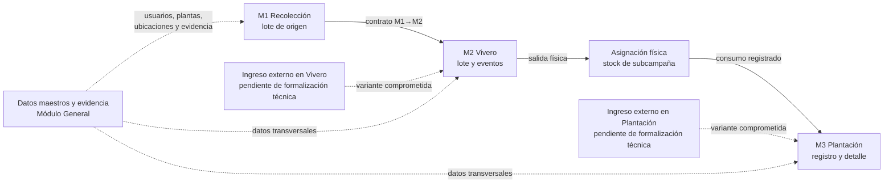

*Nota.* Elaboración propia a partir del alcance del Perfil, `NEC-01` a `NEC-08` y los contratos M1→M2 y M2→M3. Las líneas discontinuas representan variantes incluidas en el alcance académico cuya estructura técnica todavía debe cerrarse; no representan funciones ya implementadas.

El modelo técnico vigente desarrolla con mayor detalle la ruta principal M1→M2→M3. En cambio, el esquema canónico todavía exige que cada lote de vivero tenga una recolección de origen y que cada plantación consuma una asignación procedente de Vivero. Por ello, los ingresos externos no pueden declararse resueltos. Antes de cerrar Elaboración deben definirse sus entidades o relaciones, campos obligatorios, reglas de cantidad, evidencia, permisos y pruebas, sin crear un módulo adicional.

**Figura 3.5. Genealogía del material vegetal en la ruta principal**

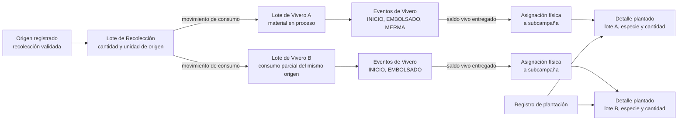

*Nota.* Elaboración propia a partir de los contratos M1→M2 y M2→M3. La figura muestra cómo un origen puede dividirse en varios lotes y reunirse de nuevo en una plantación sin perder la relación entre origen, transformaciones observadas, asignaciones y cantidades plantadas. No representa todavía una consulta transversal aceptada; esa comprobación corresponde a CO-4 y TR-1.

### 3.2.3. Requisitos y capacidades del sistema

Los requisitos se organizaron por responsabilidad funcional. El Módulo General conserva una sola fuente viva para los datos maestros. Recolección registra y valida el lote de origen. Vivero representa el material en proceso, observa el nacimiento de plantas vivas y explica sus cambios de saldo. Plantación planifica la subcampaña, recibe plantas mediante una asignación física y registra el consumo efectivo de ese stock en campo.

**Tabla 3.8**

*Capacidades de diseño seleccionadas para el recorrido académico*

| Código | Capacidad | Actor principal | Requisitos relacionados | Resultado esperado |
|---|---|---|---|---|
| CU-01 | administrar datos maestros | ADMIN | `RF-GEN-01` a `RF-GEN-07` | usuarios, viveros, plantas, ubicaciones, comunidades, organizaciones y tipos de evidencia disponibles |
| CU-02 | registrar y completar una recolección | GENERAL | `RF-REC-01` a `RF-REC-03` | lote de origen en borrador con cantidad, unidad, ubicación, responsable y evidencia |
| CU-03 | revisar una recolección | VALIDADOR | `RF-REC-04` | aprobación o rechazo con historial y snapshots congelados al validar |
| CU-04 | afectar el saldo de Recolección | GENERAL o ADMIN según la operación | `RF-REC-05` | consumo hacia Vivero o desecho sin saldo negativo |
| CU-05 | iniciar un lote de vivero | GENERAL autorizado | `RF-VIV-01` y contrato M1→M2 | lote, evento `INICIO` y movimiento de origen creados de manera coherente |
| CU-06 | registrar el resultado observado en Vivero | GENERAL autorizado | `RF-VIV-02` y `RF-VIV-02A` | plantas vivas registradas en `EMBOLSADO` o cierre pre-embolsado con causa |
| CU-07 | registrar movimientos de Vivero | GENERAL autorizado | `RF-VIV-03` a `RF-VIV-09` | mermas, adaptabilidad, despachos, evidencia, saldos y cierre explicables |
| CU-08 | planificar campaña y subcampaña | ADMIN | `RF-PLA-01`, `RF-PLA-02`, `RF-PLA-03` y `RF-PLA-18` | unidad operativa con zona, equipo, polígono, meta y plan por especie |
| CU-09 | asignar plantas a una subcampaña | ADMIN o coordinador de la subcampaña | `RF-PLA-04` y `RF-VIV-11` | salida física del Vivero y stock disponible en la subcampaña |
| CU-10 | devolver plantas no consumidas | ADMIN o coordinador de la subcampaña | `RF-PLA-05` y `RF-VIV-12` | disminución del stock asignado y retorno al saldo del lote de origen |
| CU-11 | registrar una plantación inicial | miembro operativo de la subcampaña | `RF-PLA-06` y `RF-PLA-13` | registro con GPS, evidencia y detalle de consumo por asignación, lote y especie |
| CU-12 | reconstruir un recorrido | usuario autorizado según la vista | `RF-VIV-07`, `RF-PLA-14` y `NEC-08` | recuperación de origen, eventos, cantidades, responsables, ubicación, evidencia y destino |

*Nota.* Elaboración propia a partir de los archivos de requerimientos y reglas de negocio de los módulos General, Recolección, Vivero y Plantación. La selección se limita al recorrido que concluye con el registro de la plantación; mantenimiento, mortandad, reposición, carbono y blockchain no forman parte del resultado académico evaluable.

### 3.2.4. Casos de uso: vista general

En el corte original del 15 de septiembre, la vista siguiente utiliza los roles globales a `ADMIN`, `GENERAL`, `VALIDADOR` y `VOLUNTARIO`. La coordinación y la operación de una subcampaña no se añadieron como roles globales: se representan mediante una membresía contextual en el equipo de la subcampaña. La actualización de la sección 3.2.13 distingue estos roles logísticos de los permisos de participación por subcampaña.

**Figura 3.6. Actores y casos de uso principales del alcance académico**

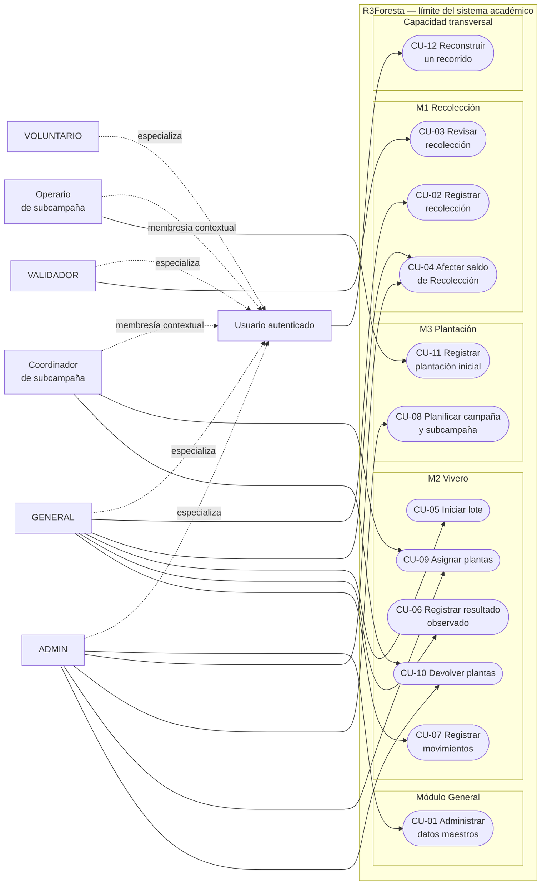

*Nota.* Elaboración propia a partir de la Tabla 3.8. El rectángulo exterior expresa el límite del sistema académico; las líneas continuas son asociaciones actor–caso de uso y las discontinuas representan especialización del actor o membresía contextual, no permisos por sí mismas. La figura no sustituye la matriz detallada de autorización.

### 3.2.5. Casos de uso específicos y relaciones incluidas o extendidas

La Figura 3.6 ofrece la vista general. Las tres figuras siguientes descomponen los casos de uso que cambian el recorrido del material. En ellas, una flecha etiquetada como include representa un comportamiento obligatorio reutilizado por el caso base; una flecha etiquetada como extend representa una alternativa condicionada. Esta notación expresa el diseño y las reglas aplicables; no sustituye una prueba de implementación.

**Figura 3.7. Casos de uso específicos de Recolección**

~~~mermaid
flowchart LR
  GEN[GENERAL]
  VAL[VALIDADOR]

  subgraph M1[M1 Recolección — límite del sistema]
    R1([Registrar o editar<br/>recolección])
    R2([Capturar datos de origen,<br/>cantidad, unidad y ubicación])
    R3([Adjuntar evidencia])
    R4([Solicitar validación])
    R5([Revisar recolección])
    R6([Congelar snapshots<br/>y aprobar])
    R7([Rechazar con observaciones])
    R8([Afectar saldo])
    R9([Validar ficha<br/>y evidencia])
    R10([Validar estado, unidad<br/>y saldo disponible])
  end

  GEN --> R1
  GEN --> R4
  GEN --> R8
  VAL --> R5
  R1 -. include .-> R2
  R1 -. include .-> R3
  R5 -. include .-> R9
  R6 -. extend: ficha válida .-> R5
  R7 -. extend: ficha incompleta .-> R5
  R8 -. include .-> R10
~~~

*Nota.* Elaboración propia a partir de RF-REC-01 a RF-REC-05 y las reglas de Recolección. La aprobación y el rechazo son resultados alternativos de la revisión; el consumo hacia Vivero se detalla como interacción en la Figura 3.16.

**Figura 3.8. Casos de uso específicos de Vivero**

~~~mermaid
flowchart LR
  GEN[GENERAL autorizado]

  subgraph M2[M2 Vivero — límite del sistema]
    V1([Iniciar lote desde<br/>Recolección])
    V2([Validar origen, unidad<br/>y saldo disponible])
    V3([Crear lote, evento INICIO<br/>y consumo atómico])
    V4([Registrar resultado<br/>observado])
    V5([Registrar EMBOLSADO])
    V6([Registrar descarte<br/>pre-embolsado])
    V7([Registrar movimiento<br/>de Vivero])
    V8([Registrar adaptabilidad,<br/>merma o despacho manual])
    V9([Asignar plantas a<br/>subcampaña])
    V10([Devolver plantas no<br/>consumidas])
  end

  GEN --> V1
  GEN --> V4
  GEN --> V7
  GEN --> V9
  GEN --> V10
  V1 -. include .-> V2
  V1 -. include .-> V3
  V5 -. extend: se observan plantas vivas .-> V4
  V6 -. extend: no hay plantas vivas .-> V4
  V7 -. include .-> V8
  V9 -. include .-> V7
  V10 -. include .-> V7
~~~

*Nota.* Elaboración propia a partir de RF-VIV-01 a RF-VIV-12 y las reglas del módulo Vivero. La recepción de material externo no aparece porque su especificación e implementación siguen pendientes; asignación y devolución se describen como interacción M2→M3 en la Figura 3.17.

**Figura 3.9. Casos de uso específicos de Plantación**

~~~mermaid
flowchart LR
  ADM[ADMIN]
  COO[Coordinador de subcampaña]
  OPE[Operario de subcampaña]

  subgraph M3[M3 Plantación — límite del sistema]
    P1([Planificar campaña<br/>y subcampaña])
    P2([Definir zona, equipo,<br/>polígono y meta por especie])
    P3([Activar subcampaña])
    P4([Asignar stock físico<br/>desde Vivero])
    P5([Validar lote y saldo<br/>de Vivero])
    P6([Registrar plantación<br/>inicial])
    P7([Validar contexto, permisos,<br/>meta y stock asignado])
    P8([Capturar evidencia y GPS])
    P9([Evaluar punto respecto<br/>del polígono])
    P10([Consumir asignaciones<br/>y crear detalles])
    P11([Registrar devolución<br/>a Vivero])
    P12([Advertir o bloquear<br/>resultado espacial])
  end

  ADM --> P1
  ADM --> P3
  ADM --> P4
  COO --> P4
  COO --> P11
  OPE --> P6
  P1 -. include .-> P2
  P3 -. include .-> P2
  P4 -. include .-> P5
  P6 -. include .-> P7
  P6 -. include .-> P8
  P6 -. include .-> P9
  P6 -. include .-> P10
  P12 -. extend: punto fuera de tolerancia .-> P9
~~~

*Nota.* Elaboración propia a partir de RF-PLA-01 a RF-PLA-06, RF-PLA-13, RF-PLA-18 y las reglas de Plantación. La extensión espacial representa el punto de decisión cuya conducta definitiva permanece abierta en RDI-04; no afirma que el bloqueo esté implementado. El ingreso externo directo tampoco se representa como capacidad disponible.

### 3.2.6. Procesos: estados, eventos y cambios de cantidad

El diseño separa el estado actual de los hechos que lo produjeron. Las tablas principales permiten consultar el estado operativo sin reconstruir toda la historia en cada lectura; los movimientos, eventos e historiales se agregan sin editar el pasado. Este modelo híbrido exige que la actualización del estado materializado y la inserción del hecho correspondiente formen parte de una misma operación coherente.

En Recolección se distinguen el estado de calidad del registro y el estado operativo del saldo. La validación congela la ficha, pero el lote de origen continúa abierto mientras conserve cantidad disponible.

**Figura 3.10. Estados de Recolección y saldo operativo**

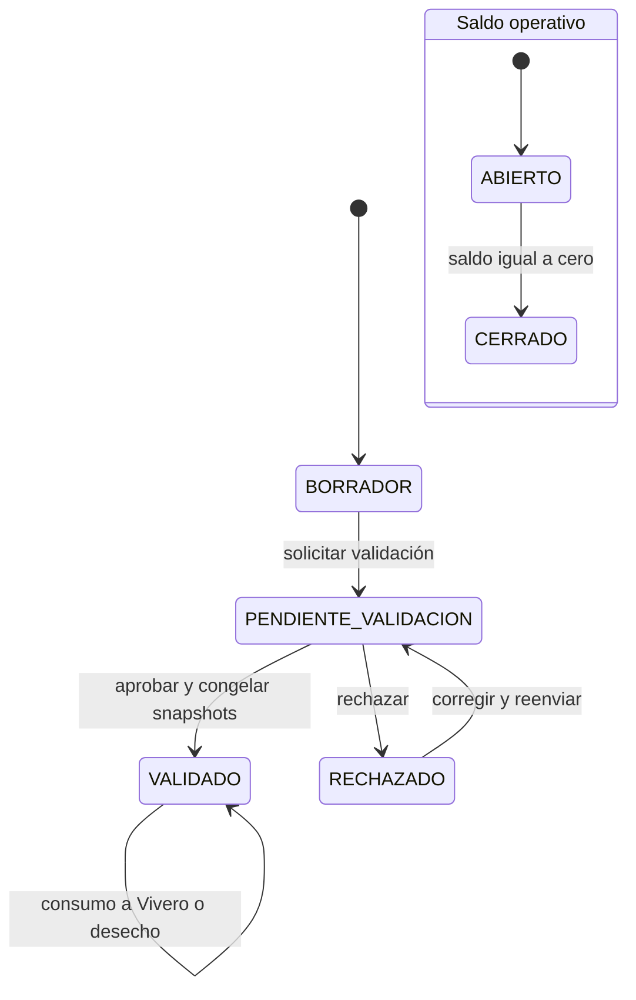

*Nota.* Elaboración propia a partir de `RF-REC-01` a `RF-REC-05` y `RN-REC-08` a `RN-REC-24A`. `ABIERTO` y `CERRADO` se derivan del saldo y no reemplazan los estados de validación.

En Vivero, `INICIO` registra material en proceso y no crea saldo vivo. `EMBOLSADO` registra una cantidad nueva observada en unidades. Si el material no llega a producir plantas vivas, `DESCARTE_PRE_EMBOLSADO` cierra el lote sin inventar un saldo. Después del embolsado, las mermas, los despachos, las asignaciones y las devoluciones explican los cambios del saldo físico.

**Figura 3.11. Hitos y movimientos del lote de vivero**

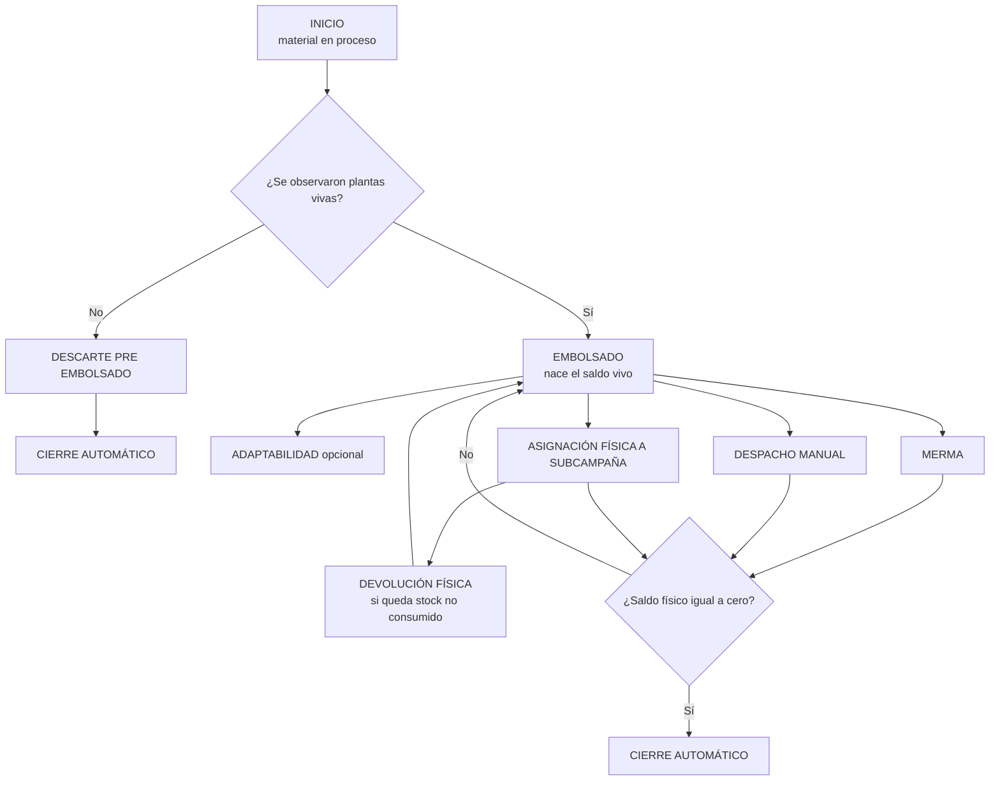

*Nota.* Elaboración propia a partir de `02_flujo_operativo_vivero_core.md` y el contrato M2→M3. La devolución constituye la excepción integrada que puede aumentar el saldo del lote porque representa un retorno físico; no corrige ni reescribe un evento anterior.

En Plantación, `CAMPANIA` funciona como contenedor estratégico y su estado se obtiene de sus subcampañas. `SUBCAMPANIA` concentra la operación, el equipo, el polígono y la meta por especie. Para el recorrido académico son relevantes su planificación, activación, recepción de stock y registro de la plantación. Los estados posteriores y los flujos de mantenimiento existentes en la documentación técnica no forman parte de la evaluación comprometida.

**Figura 3.12. Estados operativos de la subcampaña pertinentes al recorrido**

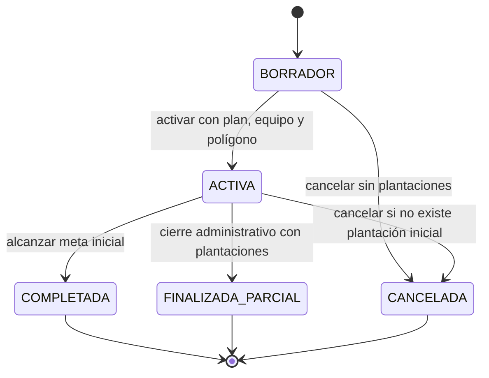

*Nota.* Elaboración propia a partir de `RN-PLA-06` a `RN-PLA-12` y `RN-PLA-37`. La figura se limita al estado operativo y no representa la fase técnica de mantenimiento, que se encuentra fuera del recorrido académico evaluado.

#### 3.2.6.1. Diagramas de actividad de los flujos operativos

Los diagramas siguientes muestran el comportamiento que debe contrastarse con los flujos reales y la implementación. Incluyen decisiones, rechazos y cierres que afectan la continuidad del recorrido. No sustituyen los casos de prueba ni prueban por sí mismos que cada alternativa esté implementada.

**Figura 3.13. Actividad de Recolección**

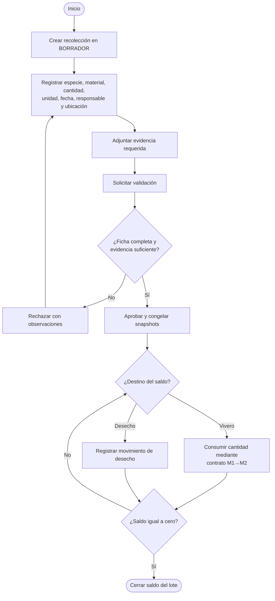

*Nota.* Elaboración propia a partir de `RF-REC-01` a `RF-REC-05` y del contrato M1→M2. La cantidad solo puede salir de una recolección validada y no puede exceder el saldo disponible.

**Figura 3.14. Actividad de Vivero**

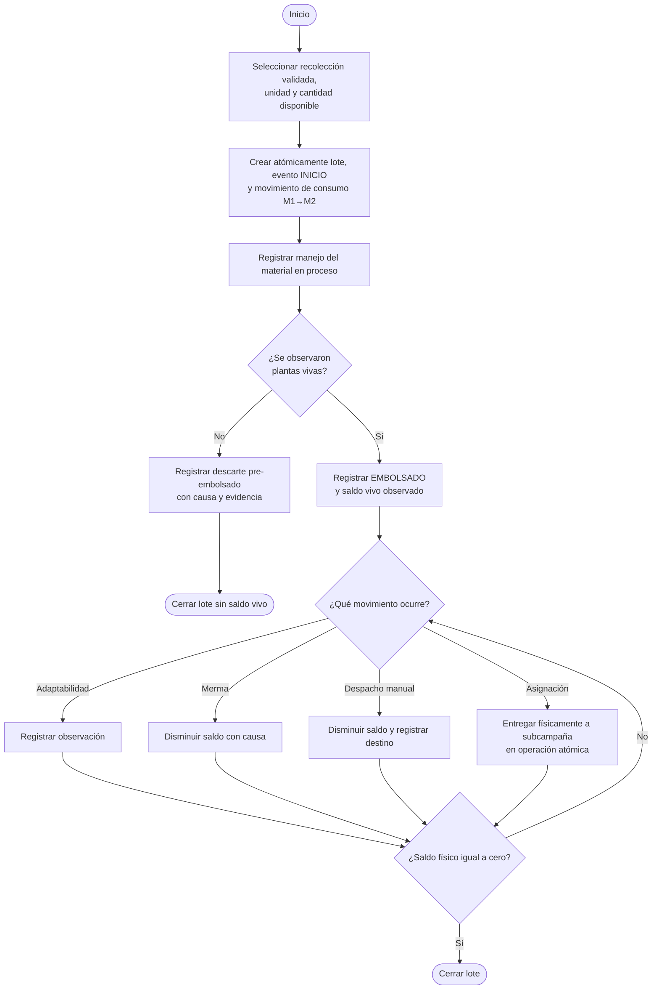

*Nota.* Elaboración propia a partir de `02_flujo_operativo_vivero_core.md` y los contratos de integración. El flujo externo comprometido para Vivero permanece pendiente de especificación e implementación y, por ello, no se presenta como una actividad disponible.

**Figura 3.15. Actividad de Plantación**

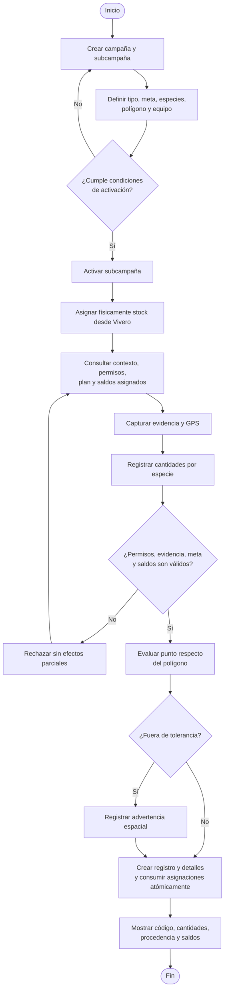

*Nota.* Elaboración propia a partir de los procesos de Plantación, el contrato M2→M3 y el flujo de registro inicial. Al corte, un punto fuera de tolerancia se guarda con advertencia en la implementación, mientras la regla escrita prevé bloqueo; la actividad deberá actualizarse cuando se cierre RDI-04. El ingreso externo directo permanece pendiente y no se representa como implementado.

### 3.2.7. Interacciones: contratos entre módulos

#### 3.2.7.1. Contrato entre Recolección y Vivero

El contrato M1→M2 se activa cuando Vivero inicia un lote desde una recolección validada, abierta y con saldo suficiente. El lote de Vivero selecciona su vivero operativo, hereda los snapshots oficiales de la recolección y registra evidencia propia del evento `INICIO`. Un origen puede abastecer varios lotes, pero cada lote de vivero conserva una sola recolección de procedencia.

La creación del lote, el evento `INICIO` y el movimiento `CONSUMO_A_VIVERO` forman una sola operación de negocio. El diseño exige que se completen juntos o que ninguno quede persistido. Además, mantiene las siguientes igualdades dentro de la unidad canónica de la recolección:

```text
abs(delta del movimiento CONSUMO_A_VIVERO)
= cantidad_inicial_en_proceso del lote de vivero
= cantidad_afectada del evento INICIO

unidad del movimiento
= unidad inicial del lote
= unidad del evento INICIO
```

**Figura 3.16. Secuencia diseñada para el contrato M1→M2**

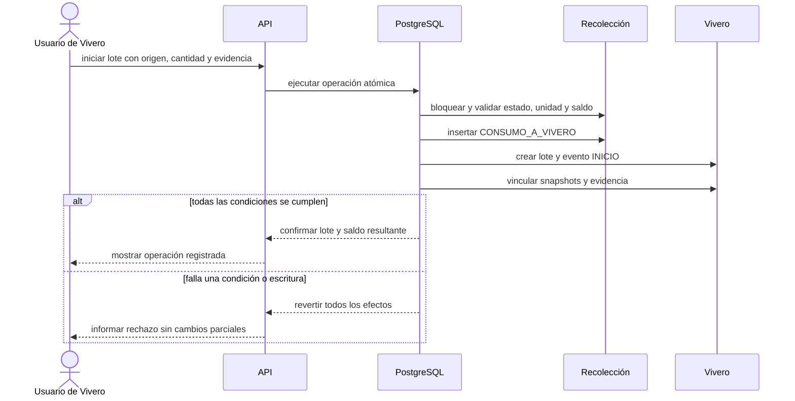

*Nota.* Elaboración propia a partir de `01_contrato_recoleccion_a_vivero.md`, `RN-REC-23` y `RN-REC-24A`.

El contrato no convierte gramos de semillas en unidades de plantas. La cantidad transferida en `INICIO` conserva la unidad del origen. El dato de plantas vivas aparece después, cuando el responsable registra el resultado observado en `EMBOLSADO`.

#### 3.2.7.2. Contrato entre Vivero y Plantación

El contrato M2→M3 adopta una asignación física, no una reserva lógica. Al asignar plantas, la cantidad sale del vivero, reduce el saldo físico del lote y queda disponible en la subcampaña. Cuando se registra la plantación, el sistema consume la asignación y conserva el detalle por lote y especie, pero no descuenta nuevamente el saldo del vivero.

La identidad del stock asignado se expresa como:

```text
saldo_asignado_disponible
= cantidad_asignada
- cantidad_consumida
- cantidad_devuelta
- cantidad_mermada
```

Para el alcance académico, `cantidad_mermada` se conserva en el modelo, pero la merma de plantas entregadas y aún no plantadas no integra el flujo evaluable. La devolución sí forma parte del contrato porque explica el retorno físico de una cantidad no consumida.

**Figura 3.17. Asignación física y consumo en Plantación**

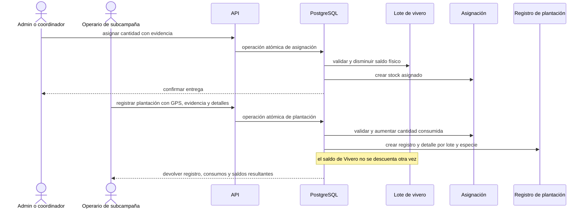

*Nota.* Elaboración propia a partir de `02_contrato_vivero_a_plantacion.md`, las reglas `RN-VIV-47` a `RN-VIV-61` y `RF-PLA-04` a `RF-PLA-06`.

La distinción evita una doble salida. El evento de Vivero se produce al entregar físicamente las plantas y utiliza el origen `ASIGNACION_SUBCAMPANIA`. El registro posterior de plantación incrementa `cantidad_consumida` en la asignación. El origen histórico `AUTOMATICO_PLANTACION` no debe emplearse en nuevas operaciones.

### 3.2.8. Modelo de datos: conceptual, lógico y físico

El modelo adopta el lote como unidad trazable principal. Una recolección constituye el lote de origen; un lote de vivero conserva un único origen y reúne el material que atraviesa los hitos de Vivero; una asignación física identifica la cantidad entregada desde un lote a una subcampaña; y el detalle de plantación conserva qué parte de cada asignación fue efectivamente utilizada.

Los datos maestros continúan como fuentes vivas para nuevas operaciones. En los hitos definidos por cada módulo se congelan snapshots de nombres, especie, procedencia y responsables. Así, un cambio posterior en el catálogo no reescribe la interpretación de un registro validado o ejecutado.

#### 3.2.8.1. Modelo conceptual

**Figura 3.18. Modelo conceptual de clases del recorrido principal**

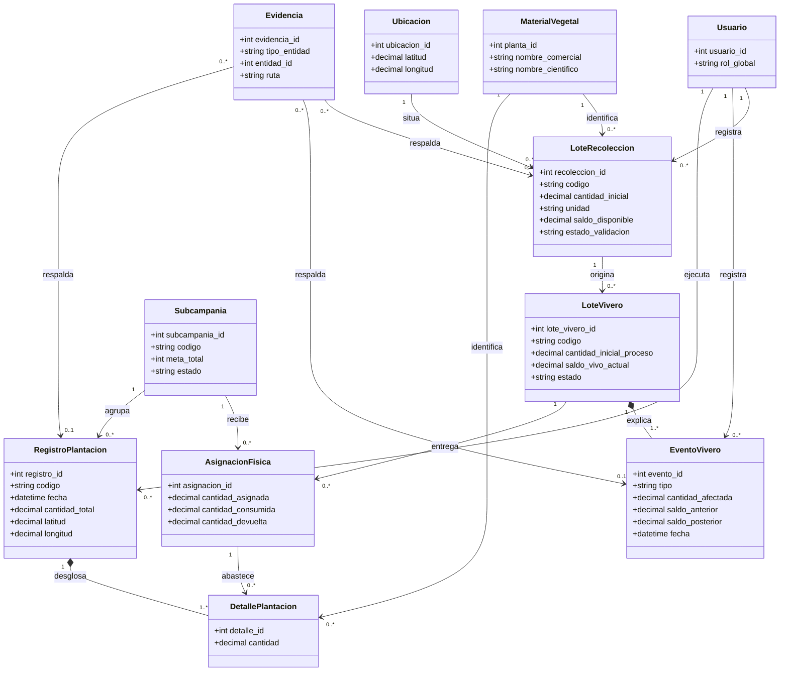

*Nota.* Elaboración propia a partir de `database/00_database_schema.md` y los documentos de dominio. El diagrama explica responsabilidades y relaciones de negocio; no representa todas las tablas, claves ni restricciones. La coordenada del registro de plantación se modela como dato propio del hecho y la evidencia se asocia conceptualmente con el hecho que respalda.

#### 3.2.8.2. Modelo lógico

**Figura 3.19. Modelo entidad-relación lógico de la base de datos académica**

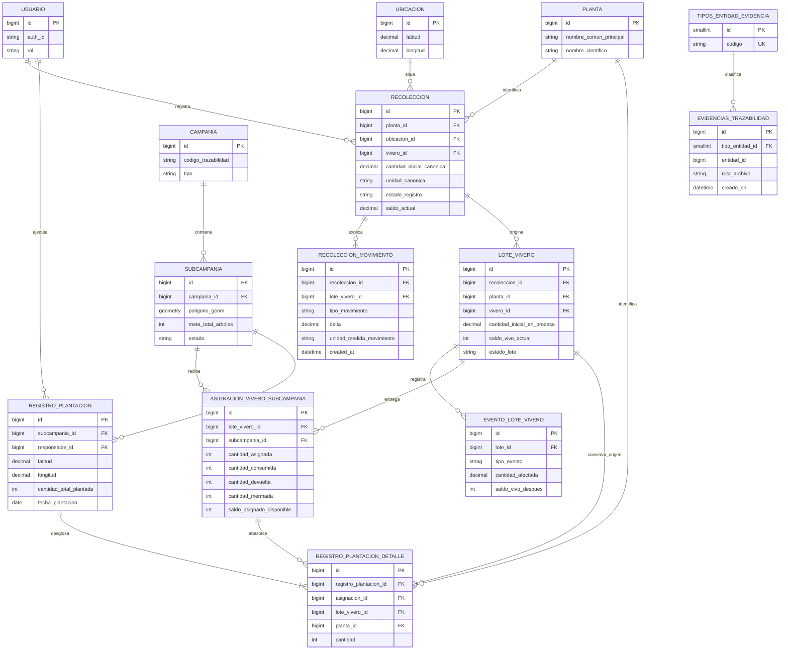

*Nota.* Elaboración propia a partir de `database/00_database_schema.md`. La figura presenta la estructura lógica del núcleo académico y omite catálogos e historiales auxiliares. `EVIDENCIAS_TRAZABILIDAD` usa una asociación polimórfica mediante `tipo_entidad_id` y `entidad_id`; por tanto, sus vínculos con Recolección, eventos de Vivero y Plantación se validan según el tipo de entidad y no mediante una única clave foránea física.

#### 3.2.8.3. Modelo físico y contraste con la base de datos documentada

El modelo físico conserva los nombres de tablas, claves y campos relevantes declarados en el esquema canónico. La Tabla 3.9 permite contrastar el modelo conceptual y lógico con esa estructura. No equivale a afirmar que una instancia de producción ya contiene todas las migraciones: el riesgo RDI-03 mantiene pendiente el replay limpio y la comparación contra la base aplicada.

**Tabla 3.9**

*Correspondencia del modelo físico documentado para el recorrido académico*

| Componente físico documentado | Claves y campos de trazabilidad | Relación o restricción relevante | Estado del contraste |
|---|---|---|---|
| RECOLECCION | id; planta_id, ubicacion_id y vivero_id; cantidad_inicial_canonica, unidad_canonica, saldo_actual y snapshots | origen único de cada LOTE_VIVERO; el saldo se explica por RECOLECCION_MOVIMIENTO | documentado; contraste de replay pendiente |
| RECOLECCION_MOVIMIENTO | id; recoleccion_id, lote_vivero_id, tipo_movimiento, delta y unidad_medida_movimiento | CONSUMO_A_VIVERO relaciona el origen con el lote sin convertir su unidad | documentado; operación y prueba deben contrastarse con la RPC vigente |
| LOTE_VIVERO y EVENTO_LOTE_VIVERO | recoleccion_id, planta_id, vivero_id, saldo_vivo_actual; lote_id, tipo_evento, cantidad_afectada y saldos antes/después | un lote tiene un único origen y conserva eventos append-only; lote_id es el nombre físico de la FK del evento | documentado; algunos enlaces físicos auxiliares siguen sujetos a alineación de migraciones |
| CAMPANIA, SUBCAMPANIA, SUBCAMPANIA_META_ESPECIE y SUBCAMPANIA_EQUIPO | campania_id, zona_id, poligono_geom, meta_total_arboles y membresías | la campaña agrupa subcampañas; la meta y el equipo pertenecen a la subcampaña | documentado; los estados y totales agregados se derivan según el esquema |
| ASIGNACION_VIVERO_SUBCAMPANIA | lote_vivero_id, subcampania_id, cantidades asignada, consumida, devuelta, mermada y saldo derivado | representa la salida física del lote y evita descontarlo de nuevo al plantar | documentado; requiere revalidación integrada M2→M3 |
| REGISTRO_PLANTACION y REGISTRO_PLANTACION_DETALLE | subcampania_id, responsable_id, latitud, longitud y cantidad_total_plantada; asignacion_id, lote_vivero_id, planta_id y cantidad | cada detalle debe coincidir con la asignación y conserva lote y especie de procedencia | documentado; la conducta GPS mantiene la discrepancia RDI-04 |
| TIPOS_ENTIDAD_EVIDENCIA y EVIDENCIAS_TRAZABILIDAD | tipo_entidad_id, entidad_id, ruta_archivo y metadata | asociación polimórfica para evidencia vinculada con el hecho respaldado | documentado; el vínculo se valida por tipo, no por una FK única |

*Nota.* Elaboración propia a partir de `database/00_database_schema.md`, ADR-VIV-01 a ADR-VIV-12, ADR-PLA-01 y ADR-PLA-02. Durante la maquetación se recomienda orientación horizontal solo si la tabla no resulta legible en orientación vertical; se repetirá su encabezado si continúa en otra página.

Las subsecciones 3.2.9 a 3.2.12 forman un bloque transversal de control del diseño. Explican las propiedades, la arquitectura, los riesgos y el resultado que condicionan los seis productos ya presentados; no añaden una etapa entre el modelo de datos y la implementación, que continúa en la sección 3.3.

### 3.2.9. Invariantes, mecanismos y pruebas previstas

Las invariantes se formularon antes de seleccionar o describir los mecanismos. En la implementación vigente, las operaciones que afectan varias entidades utilizan principalmente funciones transaccionales de PostgreSQL, restricciones, bloqueos y columnas derivadas. La verificación no se limitará a comprobar que estos mecanismos existen; deberá provocar los casos normales, límites, concurrentes y fallidos que permitan observar la propiedad.

**Tabla 3.10**

*Matriz de propiedades, mecanismos y comprobación prevista*

| Código | Propiedad | Mecanismo diseñado o implementado | Comprobación prevista |
|---|---|---|---|
| INV-01 | el saldo de Recolección no puede ser negativo | movimientos append-only, validación de saldo y operación transaccional | intentar consumir y desechar más de lo disponible |
| INV-02 | la transferencia M1→M2 conserva cantidad y unidad | contrato estricto entre movimiento, lote y `INICIO` | comparar las tres cantidades y unidades después de un consumo parcial y total |
| INV-03 | no existe conversión automática de masa a plantas | `INICIO` conserva `G` o `UNIDAD`; `EMBOLSADO` registra un resultado observado en `UNIDAD` | iniciar con gramos y comprobar que el saldo vivo permanezca nulo hasta embolsar |
| INV-04 | los eventos críticos no dejan estados parciales | función transaccional y reversión ante error | inducir un fallo antes de completar la escritura y comprobar ausencia de efectos parciales |
| INV-05 | una asignación física descuenta una sola vez el lote | operación de asignación y consumo separado en M3 | asignar y plantar; comprobar que el lote disminuya al asignar y no al plantar |
| INV-06 | el consumo no supera el stock asignado | saldo derivado, bloqueo de asignaciones y validación por detalle | intentar consumir una cantidad superior y ejecutar solicitudes competidoras |
| INV-07 | el detalle explica el total plantado | igualdad entre suma de detalles y total del registro | alterar o enviar un desglose inconsistente y comprobar el rechazo |
| INV-08 | una devolución no supera el stock sin consumir | validación del saldo asignado y actualización atómica de asignación y lote | devolver el saldo exacto y luego intentar una devolución adicional |
| INV-09 | los cambios de catálogos no reescriben la historia | snapshots congelados en validación, creación o activación | cambiar un nombre maestro y recuperar un registro anterior |
| INV-10 | la evidencia queda vinculada con el hecho correcto | entidad común de evidencias y validación del vínculo en la operación | consultar recolección, evento de vivero y plantación con sus archivos asociados |
| INV-11 | el GPS de plantación puede evaluarse respecto del polígono | función PostGIS y registro de resultado y distancia | probar puntos interior, límite, tolerancia y exterior según la regla que se cierre |

*Nota.* Elaboración propia a partir de los principios de trazabilidad del Perfil, los contratos de integración, `database/00_database_schema.md` y `ARCHITECTURE.md`. La columna de comprobación define pruebas pendientes o parciales; no anticipa conformidad.

### 3.2.10. Arquitectura de la solución

La versión observada utiliza una arquitectura distribuida de tres capas. El cliente es una aplicación web progresiva organizada por funcionalidades y construida con React, TypeScript y Vite. El backend es un monolito modular REST basado en NestJS. La persistencia utiliza PostgreSQL y PostGIS administrados en Supabase, mientras Supabase Storage conserva las evidencias.

Esta arquitectura mantiene las reglas complejas fuera del navegador. La PWA guía la captura y previene errores evidentes; la API valida la forma, la identidad, los permisos y la elegibilidad; las funciones y restricciones de PostgreSQL protegen relaciones, saldos, unicidad y atomicidad. PostGIS actúa como autoridad para calcular la relación espacial entre el punto de plantación y el polígono de la subcampaña.

**Figura 3.20. Componentes incluidos en la arquitectura académica**

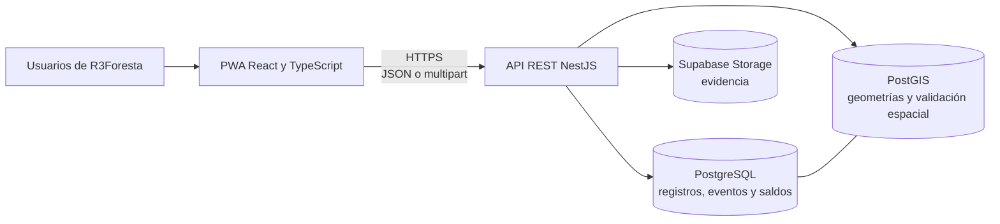

*Nota.* Elaboración propia a partir de `ARCHITECTURE.md`, revisión del 23 de julio de 2026. La figura excluye integraciones históricas de blockchain e IPFS porque no participan en los objetivos, la verificación ni la evaluación del Proyecto de Grado.

El uso de un monolito modular reduce la complejidad de despliegue y permite mantener límites funcionales sin introducir microservicios. El modelo de datos es híbrido: conserva el estado actual para la operación diaria y, en paralelo, los eventos necesarios para explicar cómo se obtuvo. La PWA es instalable, pero no debe describirse como una solución sin conexión completa; el service worker actual no implementa cola de comandos, sincronización diferida ni resolución de conflictos.

### 3.2.11. Riesgos y vacíos que condicionan el cierre del diseño

La revisión conjunta de requisitos, esquema, arquitectura y estado de implementación identificó diferencias que deben tratarse como trabajo pendiente. Ocultarlas produciría un diseño aparentemente completo, pero no verificable contra la versión real.

**Tabla 3.11**

*Riesgos y decisiones pendientes del diseño*

| Código | Riesgo o diferencia | Efecto sobre el proyecto | Tratamiento requerido |
|---|---|---|---|
| RDI-01 | los ingresos externos de material están comprometidos por el Perfil, pero no cuentan con un flujo técnico completo | impide cerrar OBJ-02 y OBJ-03 para todas las variantes | especificar la recepción externa dentro de Vivero y Plantación, con procedencia, cantidades, evidencia y pruebas |
| RDI-02 | la mayoría de los endpoints todavía confía en `x-auth-id` sin validación global del JWT | permite suplantación si la API se expone a clientes no confiables | unificar identidad, proteger endpoints y eliminar la sesión de registro simulada antes de la liberación |
| RDI-03 | el replay de migraciones no reconstruye por completo `TIPO_PLANTA` ni el enum vivo de destinos de Vivero | la base académica no es reproducible desde cero | crear migraciones idempotentes de alineación y probar instalación limpia y actualización |
| RDI-04 | la regla escrita de GPS bloquea el punto fuera de tolerancia, pero la implementación vigente lo guarda como advertencia | especificación, backend y prueba esperan resultados distintos | decidir el comportamiento y sincronizar regla, contexto, interfaz y pruebas |
| RDI-05 | el despacho manual no aplica todavía toda la matriz canónica de campos para `DONACION` | contrato escrito y contrato HTTP no coinciden | alinear DTO, función, documentación y pruebas |
| RDI-06 | no existe idempotencia completa para comandos de saldo y eventos | un reintento de red puede duplicar una operación | incorporar una clave durable o un mecanismo equivalente y probar reintentos |
| RDI-07 | el estado de implementación de M1 no está cerrado en `ESTADO.md` con el mismo nivel de detalle que M2 y M3 | dificulta demostrar el incremento CO-1 | auditar backend, frontend, base de datos y pruebas de M1 y registrar el cierre de la iteración |
| RDI-08 | la documentación técnica incluye mantenimiento, reposición, carbono, blockchain y vistas públicas fuera del recorrido académico | puede ampliar indebidamente el objeto evaluado | excluir esas capacidades de la matriz de cumplimiento y tratarlas solo como evolución o componente histórico |

*Nota.* Elaboración propia a partir de `ESTADO.md`, `ARCHITECTURE.md`, el plan del Capítulo II y la comparación entre el Perfil y la documentación técnica canónica, con corte al 14 de septiembre de 2026.

### 3.2.12. Resultado del diseño

El diseño estableció una cadena informacional que relaciona el lote de origen, el lote de vivero, sus eventos, la asignación física y el registro de plantación. La solución conserva estados operativos para consulta y hechos históricos para explicación; utiliza snapshots para impedir cambios retroactivos; separa el material en proceso de las plantas vivas observadas; y define contratos atómicos en los dos puntos donde una cantidad cambia de módulo.

El producto más relevante de OBJ-02 es la relación entre procedencia, cantidades y eventos. En M1→M2, el consumo del origen, el lote y `INICIO` comparten cantidad y unidad. En M2→M3, la asignación descuenta físicamente el lote y la plantación consume el stock de la subcampaña sin un segundo descuento. Estas decisiones proporcionan propiedades concretas para la implementación y la verificación.

El objetivo todavía requiere cerrar los ingresos externos, la regla de GPS, la identidad y la reproducibilidad de migraciones. El diseño se considera suficiente como borrador para revisión académica, pero no debe declararse cerrado hasta resolver esas diferencias y actualizar los artefactos afectados.

### 3.2.13. Actualización de actores y participación en Plantación

Los diagramas siguientes proceden de la revisión del código realizada el 29 de octubre de 2026 en el chat de diagramas. Complementan el corte de septiembre de las Figuras 3.6 y 3.9, que debe actualizarse antes de la versión final. La revisión identificó backend local `9eef958` y frontend local `dd36c57`; la presencia de código no demuestra su aplicación o despliegue en todos los entornos.

Un usuario `VOLUNTARIO` puede recibir el permiso `PLANTADOR` o `ADMINISTRADOR_SUBCAMPANIA` para un ámbito concreto. El segundo puede plantar y gestionar plantadores según la autoridad aplicable, sin convertirse en `ADMIN` global. Los permisos de participación, las responsabilidades logísticas y la afiliación a una organización son dimensiones distintas; la afiliación no concede autoridad.

**Diagrama de trabajo: roles, permisos y responsabilidades**

```mermaid
flowchart TB
    U["Usuario registrado<br/>identidad y cuenta activa"]

    subgraph GLOBAL["Rol global de la cuenta"]
        V["VOLUNTARIO<br/>valor inicial del alta"]
        G["GENERAL"]
        VA["VALIDADOR"]
        A["ADMIN"]
    end

    subgraph CONTEXTUAL["Permisos por persona y subcampaña"]
        P["PLANTADOR"]
        AS["ADMINISTRADOR_SUBCAMPANIA"]
        SC["Subcampaña específica"]
    end

    subgraph LOGISTICA["Responsabilidades logísticas independientes"]
        C["COORDINADOR"]
        O["OPERARIO"]
        EQ["Equipo logístico de subcampaña"]
    end

    U -->|"Tiene un rol global"| GLOBAL
    U -->|"Puede recibir permisos"| CONTEXTUAL
    U -->|"Puede tener responsabilidad logística"| LOGISTICA

    P --> SC
    AS --> SC
    C --> EQ
    O --> EQ

    P --> PL["Registrar plantación inicial<br/>en su ámbito ACTIVA"]
    P --> LE["Consultar equipo de su ámbito<br/>lectura incorporada en 087"]

    AS --> PL
    AS --> LE
    AS --> GP["Incorporar y retirar plantadores<br/>según estado y autoridad"]

    A --> GA["Designar, cambiar o retirar<br/>administradores contextuales"]
    A --> RG["Gestionar roles globales<br/>e inactivación de cuentas"]
    A --> AT["Autoridad sobre todas las subcampañas<br/>con las validaciones de cada operación"]

    C --> FI["Asignaciones y devoluciones físicas<br/>según política logística"]

    U --> AF["Afiliación opcional a organización"]
    AF -.-> NA["La afiliación no concede permisos"]
```


**Diagrama de trabajo: participación y administración contextual**

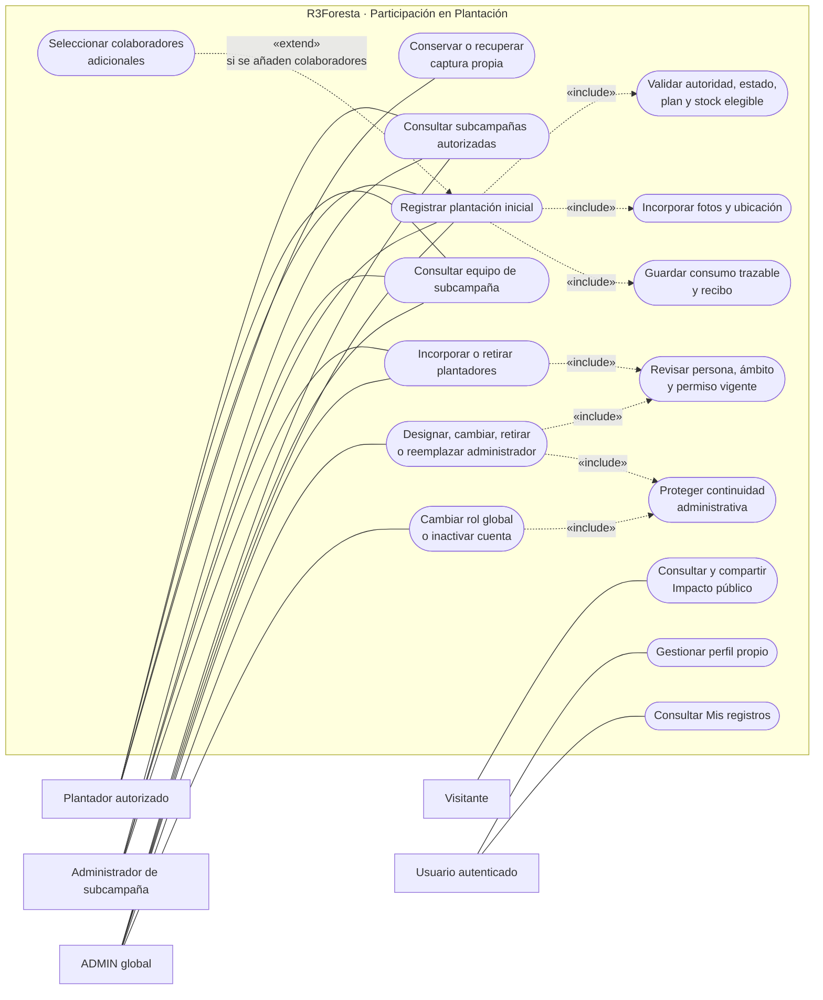


*Nota.* Elaboración propia a partir de la revisión del backend y frontend del 29 de octubre de 2026 y de los contratos PA-S00–PA-S04. Las vistas públicas y la gestión de acceso se muestran para situar el registro participante; su inclusión en la evaluación académica debe contrastarse con el alcance aprobado. El diagrama no acredita aceptación de PA-F01 ni cierre de sus entregas. La relación entre casos de uso y requisitos, así como la numeración definitiva de figuras, quedan pendientes de revisión académica.
