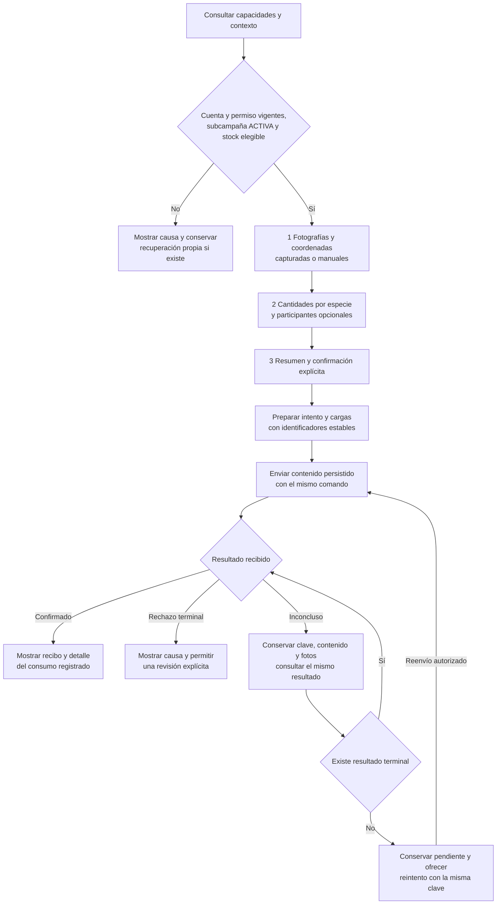
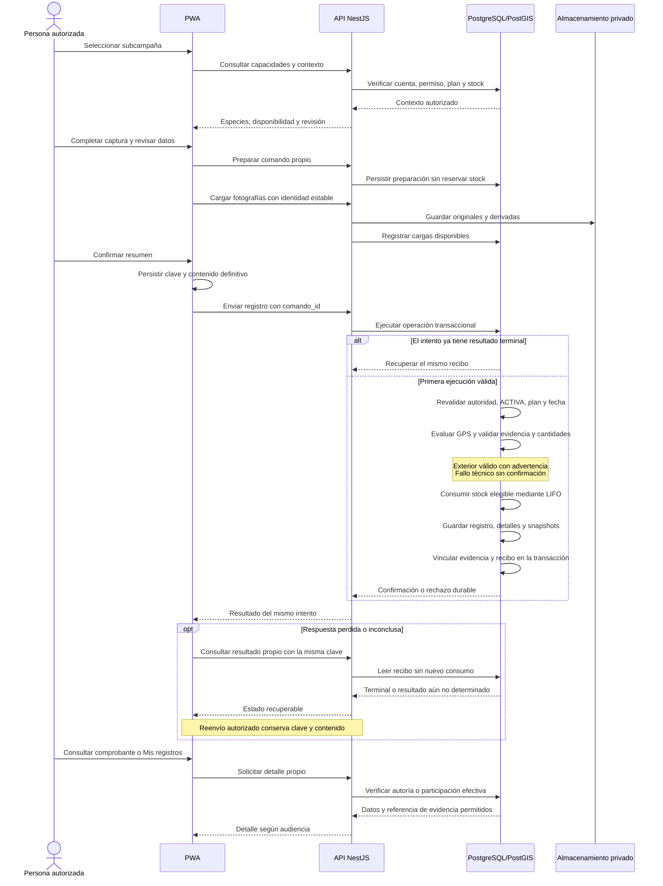

## 3.3. Implementación por iteraciones RUP

Para maquetar las figuras en hojas carta verticales, usar las [láminas por figura](figuras/paginas/README.md). Los bloques Mermaid conservan la fuente completa; los diagramas extensos continúan en paneles legibles.

> Parte del [Capítulo III](03_capitulo_marco_aplicativo.md). Edición retrospectiva del 4 de noviembre de 2026, actualizada con evidencia disponible hasta el 16 de noviembre. Las versiones y los resultados técnicos conservan las fechas y los entornos de sus fuentes.

### 3.3.1. Propósito y organización de la construcción

Los incrementos reciben los [47 requisitos funcionales explícitos de 3.1.6.2](03_1_fase_inicio.md#3162-requerimientos-funcionales), las 170 RN que los condicionan y los seis RNF transversales. La [derivación de 3.2.3.1](03_2_fase_elaboracion.md#3231-derivación-del-diseño-y-los-incrementos-por-requerimiento) asigna cada RF a un actor/caso, artefacto e incremento; los cambios y las entregas se vinculan con esos IDs y con las [comprobaciones de 3.4.3](03_verificacion_pruebas.md#343-correspondencia-con-los-casos-prioritarios). La relación documental identifica qué debe satisfacerse; los resultados de implementación mantienen sus versiones, entornos y límites propios.

La fase de Construcción materializó el tercer objetivo específico: **implementar en el sistema las funciones de Recolección, Vivero y Plantación necesarias para mantener vinculada la información del material vegetal durante su recorrido**. A partir de los requisitos, modelos y contratos de Elaboración, se desarrollaron las pantallas, los servicios y las operaciones de persistencia que relacionaron el origen registrado con el destino plantado.

El trabajo se organizó mediante CO-1, CO-2, CO-3 y CO-4. Estas etiquetas conservaron la distribución académica del proyecto; las fechas reales de los cambios y las pruebas se mantuvieron en sus informes. Los componentes construidos antes del periodo planificado se incorporaron como antecedentes técnicos. Las entregas INT de Participación aliada aportaron refinamientos de autorización, captura, recuperación y consulta, sin convertirse en nuevas fases de RUP.

**Tabla 3.21**

*Organización de los incrementos y sus aportes al producto integrado*

| Iteración | Capacidad desarrollada | Riesgo principal tratado | Artefactos y evidencia relacionados |
|---|---|---|---|
| CO-1 | captura, revisión e historial de Recolección | origen incompleto, unidad incorrecta o pérdida del historial | RF-REC, reglas de Recolección, checklist de validación y contrato M1→M2 |
| CO-2 | manejo del lote de Vivero e integración M1→M2 | confundir material en proceso con plantas vivas o consumir dos veces el origen | RF-VIV, eventos del lote, descarte pre-embolsado y contrato de transferencia |
| CO-3 | planificación, entrega física y registro de Plantación | doble descuento, consumo excesivo o actuación sin permiso | RF-PLA, contrato M2→M3, migraciones 051–057 y refinamientos PA-S00/01/03 |
| CO-4 | integración de consultas, recuperación y regresión | duplicar un registro tras una respuesta perdida o exponer datos de otra audiencia | comandos y recibos, INT02-D, INT04, INT05, informes de QA y versiones de entrega |

*Nota.* Elaboración propia a partir del [cronograma de fases, iteraciones e hitos](03_capitulo_marco_aplicativo.md#fases-iteraciones-e-hitos), los requisitos de los módulos, los [contratos de integración](../../../90-contratos-integracion/README.md) y el [tablero PA-F01](../../../specs/plantacion/participacion-aliada/implementacion/README.md). La tabla relaciona aportes técnicos con la organización de RUP; los cierres de IOC y PR se distinguen de las entregas locales.

En cada incremento se relacionaron requisitos y reglas con decisiones de implementación y comprobaciones. Las disciplinas de análisis y diseño continuaron durante la construcción cuando se refinaron el reparto del stock, los permisos y el tratamiento de respuestas inconclusas. Las pruebas acompañaron estos cambios y proporcionaron la evidencia examinada en la [sección 3.4 — Verificación y pruebas](03_verificacion_pruebas.md).

### 3.3.2. Implementación de la arquitectura

La solución se implementó mediante una PWA en React y TypeScript, una API REST en NestJS y una base PostgreSQL con PostGIS y almacenamiento de archivos en Supabase. La interfaz organizó la captura y la consulta por funcionalidades; la API verificó identidad y autoridad y coordinó los casos de uso; la base de datos conservó relaciones, movimientos y saldos. El [modelo físico presentado en Elaboración](03_2_fase_elaboracion.md#3283-modelo-físico-y-contraste-con-la-base-de-datos-documentada) documenta el extracto aportado el 16 de noviembre: 57 tablas, 622 columnas y 175 relaciones; el proyecto y la fecha de exportación no están identificados. El contraste del 4 de noviembre, de 51 tablas y 564 columnas, permanece como antecedente histórico.

Las operaciones críticas de transferencia, asignación, devolución y registro inicial se concentraron en funciones transaccionales. Esta decisión permitió confirmar conjuntamente los registros y los movimientos relacionados o revertir sus efectos ante un fallo. En las operaciones con competencia por el mismo saldo se utilizaron bloqueos y una nueva comprobación de disponibilidad antes de confirmar. Las garantías correspondieron a las rutas que aplicaron ese protocolo; el SQL privilegiado que lo omitiera quedó fuera de esa protección cooperativa.

Los archivos conservaron un ciclo separado de la transacción de datos. En el registro participante, la carga preparó los originales privados y sus versiones derivadas; la confirmación vinculó únicamente la evidencia disponible y perteneciente al intento. La recuperación y la limpieza distinguieron archivos provisionales de archivos ya asociados con un hecho confirmado. De esta manera, un error de red no justificó borrar fotografías confirmadas ni repetir el consumo.

La autenticación privada utilizó un token JWT verificado y la consulta de la cuenta activa. En los controladores internos inspeccionados, `InternalActorGuard` derivó la identidad y el rol desde esas comprobaciones. El encabezado legado `x-auth-id` se trató como compatibilidad con la identidad verificada y se rechazó cuando no coincidió con el token. Esta implementación actualizó la observación de seguridad de julio. Los permisos por subcampaña se comprobaron además en la operación correspondiente; el acceso específico por vivero contó con implementación y pruebas locales T1–T3, con los límites de entorno y corte señalados en RDI-02.

*Fuentes de implementación:* [arquitectura observada y su corte histórico](../../../ARCHITECTURE.md), [control de identidad](../../../../Backend-r3foresta/src/auth/verified-actor.guard.ts), [adaptación de controladores internos](../../../../Backend-r3foresta/src/auth/internal-actor.guard.ts) y [estado por versión y entorno](../../../ESTADO.md).

### 3.3.3. Módulo General y Recolección

#### 3.3.3.1. Módulo General

**Entradas funcionales:** RF-GEN-01–RF-GEN-07 y RN-GEN correspondientes. Sus datos maestros, identidad, accesos, ubicaciones y evidencias sostienen todos los incrementos; la verificación por RF distingue los catálogos sin cierre individual del control técnico de permisos ya ensayado.

El Módulo General proporcionó las referencias compartidas de usuarios, especies, viveros, organizaciones, territorios y ubicaciones. Se mantuvo el catálogo cerrado de roles ADMIN, GENERAL, VALIDADOR y VOLUNTARIO. La afiliación declarada a una organización se conservó separada de la autoridad para operar, y los registros históricos utilizaron copias de los datos relevantes, denominadas snapshots, para conservar su interpretación ante cambios posteriores de los catálogos.

La administración de roles globales se incorporó mediante una pantalla exclusiva de ADMIN. La operación conservó el motivo, la confirmación explícita, la comprobación de autoridad vigente y la protección del último administrador. Su [verificación local del 3 de noviembre](../../../../pwa-r3foresta/docs/QA_USUARIOS_ADMINISTRACION.md) identificó las versiones backend `5fb723b` y PWA `37cec4d`.

#### 3.3.3.2. Módulo Recolección

**Entradas funcionales:** RF-REC-01–RF-REC-06 y sus RN-REC. Captura, edición, recepción, inventario y consulta pública tienen resultados exigidos distintos; AUD-036, clasificación fotográfica y consulta propia completa conservan los pendientes identificados en 3.4.3.1.

Recolección implementó el registro de procedencia, especie, tipo de material, cantidad, unidad, fecha, responsable, vivero, ubicación y evidencia. El flujo distinguió borrador, solicitud de validación y decisión de aprobación o rechazo. La solicitud de validación exigió la ubicación y la evidencia fotográfica establecidas en RF-REC-04. Las semillas conservaron su cantidad en gramos o unidades, mientras que los esquejes utilizaron unidades enteras.

La aprobación fijó la información histórica del origen. Los consumos destinados a Vivero y los desechos se representaron mediante movimientos que explicaron el saldo restante, sin sustituir la cantidad original. Las consultas de detalle e historial permitieron relacionar la recolección con sus movimientos y destinos. Las reglas y las comprobaciones de este incremento se conservaron en el [módulo Recolección](../../../01-recoleccion-module/README.md) y su [checklist de validación](../../../01-recoleccion-module/03_checklist_validacion_recoleccion.md).

La recepción única de semillas vinculó el hecho físico y la validación en una misma operación, con receptor distinto del recolector y autorización para el vivero de almacenamiento. La versión 100 quedó identificada en backend `6e5e756` y PWA `a30c54f`; Pablo reportó su ejecución y pruebas funcionales el 12 de noviembre. El informe conserva los límites de entorno y aceptación. [Contrato de recepción](../../../../Backend-r3foresta/docs/t4-recepcion-semillas.md) · [QA y AUD-036](../../../../pwa-r3foresta/docs/QA_RECEPCION_UNICA.md).

El expediente de CO-1 mantuvo un alcance distinto del de los ensayos de Participación aliada: las pruebas de M3 no acreditaron por extensión todas las operaciones de M1. La consolidación de sus resultados completos se conservó como RDI-07, sin alterar la descripción funcional del módulo desarrollado.

### 3.3.4. Módulo Vivero e integración M1→M2

**Entradas funcionales:** RF-VIV-01–RF-VIV-09, incluido RF-VIV-02A, y RF-VIV-15, con RN del núcleo y del contrato M1→M2. RF-VIV-11–14 se relacionan con la integración física descrita en 3.3.5. RF-VIV-10 se conserva como complemento externo fuera del incremento académico.

Vivero implementó el lote como unidad de seguimiento del material recibido desde una recolección. El inicio conservó la cantidad y la unidad del material de origen, registró su consumo y creó el evento INICIO. La relación permitió que una misma recolección abasteciera varios lotes mediante consumos diferenciados, conservando un único origen por lote.

El sistema distinguió el material en proceso de las plantas vivas observadas. Antes de EMBOLSADO, el saldo vivo permaneció nulo. El embolsado registró el número de plantas efectivamente obtenido en UNIDAD, sin convertir automáticamente gramos de semillas en plantas ni interpretar la diferencia entre ambas magnitudes como una pérdida.

Cuando el proceso terminó sin producir plantas vivas, DESCARTE_PRE_EMBOLSADO registró causa, cantidad afectada y evidencia y cerró el lote. La interfaz habilitó esa acción únicamente en un lote activo con INICIO y sin EMBOLSADO. Después del embolsado, las pérdidas se registraron como MERMA y afectaron las plantas que permanecían físicamente en el vivero.

Los movimientos de salida se diferenciaron según su destino. El despacho manual atendió DONACION, VENTA y OTRO; la asignación física utilizó un formulario específico para campaña, subcampaña, propósito, cantidad, fecha y evidencia. La separación de ambos recorridos quedó registrada en el cambio frontend `562a97e` y sus comprobaciones del 23 de julio de 2026.

El [contrato M1→M2](../../../90-contratos-integracion/01_contrato_recoleccion_a_vivero.md) relacionó el movimiento de origen, el lote y el evento inicial. El historial del lote conservó los hechos de manejo y las salidas posteriores. La incorporación T5 creó un lote de plantas vivas desde una recepción o conteo, con procedencia declarada, foto privada y una base viva alternativa a EMBOLSADO. El QA del 16 de noviembre documentó la reconstrucción inversa, con sesión ADMIN en Chrome local, desde el registro de plantación 20 hasta la asignación 53 y el lote 125, con consulta de historial y foto. Identificó PWA `c6bdec9` y backend de integración `3cb82e4` incluido en `b57192c`; la aplicación de 109/110 fue confirmada por Pablo. Teléfono físico, otros roles y recorridos, despliegue externo y diferencias de etapa y variedad permanecen pendientes. La recepción externa directa en Plantación conserva su diseño y evaluación pendientes. [QA T5](../../../../pwa-r3foresta/docs/QA_T5_ITERACION_3.md) · [Estado](../../../ESTADO.md).

### 3.3.5. Módulo Plantación e integración M2→M3

**Entradas funcionales:** RF-PLA-01–RF-PLA-08, RF-PLA-12–RF-PLA-15 y RF-PLA-17/18, junto con RF-VIV-11–14 y las RN de integración. Las porciones de mantenimiento de esos requisitos y RF-PLA-09–11/16 conservan el contexto del producto y no se convierten en implementación académica acreditada. PA-S00–PA-S04 precisan identidad, inicial, lectura, permisos y correcciones, con su cobertura parcial documentada.

Plantación implementó campañas y subcampañas con zona, fechas, plan por especie, polígono y equipo. La campaña obtuvo su estado y su meta agregada mediante sus subcampañas. La coordinación se representó como responsabilidad del equipo y se mantuvo separada del rol global y de los permisos de participación.

La planificación habilitó la activación con cobertura de stock parcial o nula. El plan por especie orientó el avance; el saldo físico elegible limitó las cantidades registrables. Alcanzar o superar la meta no cerró automáticamente la subcampaña. El cierre se trató como una operación explícita, conservando la regla aceptada de ausencia de reapertura y la devolución del remanente como hecho separado.

La integración M2→M3 distinguió entrega y plantación. Al crear una asignación, la transacción descontó las plantas del lote, generó el movimiento de salida y creó stock disponible en la subcampaña. El registro de plantación consumió esa asignación y conservó su procedencia, sin generar un segundo despacho ni disminuir otra vez el saldo del vivero. La devolución incrementó la cantidad devuelta y repuso físicamente el saldo del lote de origen. La cantidad asignada original permaneció inmutable.

El saldo de la asignación se explicó mediante la relación:

`saldo_asignado_disponible = cantidad_asignada − cantidad_consumida − cantidad_devuelta − cantidad_mermada`.

Las migraciones 051–057 materializaron la base de esta integración y los refinamientos posteriores de Participación aliada incorporaron autorización, recuperación y reparto en servidor. La aplicación productiva de 056/057 y el despliegue coordinado del 23 de julio conservaron su condición de antecedente confirmado; no se utilizaron para atribuir despliegue a los cambios posteriores.

#### 3.3.5.1. Registro inicial participante y recuperación del intento

El registro inicial se implementó en tres pasos: fotografías y ubicación; cantidades y participantes; resumen y confirmación. La persona autenticada seleccionó una subcampaña ACTIVA para la que dispuso de permiso vigente. ADMIN global pudo registrar directamente con las mismas validaciones de negocio. La afiliación a una organización y la inclusión histórica como participante no concedieron autoridad operativa.

El contexto entregó especies, revisión del plan y disponibilidad autorizada. La persona indicó cantidades por especie y el servidor resolvió su distribución sobre las asignaciones elegibles mediante LIFO: fecha de asignación e identificador descendentes. La selección excluyó otros ámbitos, propósitos y entregas posteriores a la fecha operativa. El orden de consumo se mantuvo separado del orden de bloqueo utilizado para controlar la concurrencia.

La Figura 3.23 reúne el recorrido de captura y la confirmación transaccional. El GPS pudo capturarse automáticamente o señalarse manualmente. PostGIS evaluó la relación con el polígono: un punto exterior válido generó advertencia y permitió continuar; un fallo técnico de evaluación no se interpretó como ubicación exterior ni confirmó el registro.

**Figura 3.23. Flujo y secuencia del registro inicial de plantación**

*a) Captura, confirmación y recuperación desde la interfaz*

<!-- diagrama: 03_3_fase_construccion-01 -->

*b) Autoridad, consumo y evidencia en la confirmación*

<!-- diagrama: 03_3_fase_construccion-02 -->

*Nota.* Elaboración propia a partir de PA-S01, D01–D12, la [entrega INT03-A](../../../../Backend-r3foresta/docs/pa-int03a-entrega-local.md), el [informe INT04](../../../../pwa-r3foresta/docs/QA_REGISTRO_PARTICIPANTE_INT04.md) y el [caso de guardado del 26 de octubre](../../../../pwa-r3foresta/docs/QA_REGISTRO_GUARDADO_51.md). Los dos paneles describen el mismo recorrido y sustituyen la secuencia histórica de reparto en el cliente. La lectura propia se actualiza conforme a RF-PLA-14 y al contrato de participantes efectivos; el estado de su verificación se distingue en la [sección 3.4.2](03_verificacion_pruebas.md#342-resultados-técnicos-documentados).

La recuperación distinguió confirmación, rechazo terminal e incertidumbre. Ante una respuesta perdida, la PWA conservó la clave, el contenido y las fotografías y consultó el resultado propio. El reenvío del mismo intento recuperó el recibo o ejecutó la operación una sola vez. Un contenido distinto con la misma clave entró en conflicto; una nueva revisión después de un rechazo terminal exigió confirmación explícita. Los borradores permanecieron asociados con la cuenta y el dispositivo, sin constituir una sincronización autónoma de trabajo sin conexión.

### 3.3.6. Integración transversal, configuración y asistencia de IA

La integración transversal relacionó los módulos mediante los contratos M1→M2 y M2→M3 y los mecanismos compartidos de identidad, autorización, evidencia y recuperación descritos en esta sección. Las iteraciones CO-1–CO-4 incorporaron estos mecanismos según el riesgo y la capacidad trabajados.

La construcción utilizó los requisitos y las reglas de los módulos, los contratos de integración, las decisiones ADR y las especificaciones PA-S00–PA-S04 como artefactos de RUP. Su selección respondió al riesgo tratado: saldos y transferencias requirieron contratos y pruebas transaccionales; autorización y recuperación requirieron matrices de rutas, comandos y ensayos de concurrencia; la experiencia móvil requirió capturas y comprobaciones de navegador.

Las fichas INT relacionaron las tareas existentes con los cambios backend, frontend y SQL y con sus resultados. Los informes conservaron tanto la base usada para probar como el commit posterior de entrega. Esta separación permitió distinguir código probado, versionado local, publicación Git, aplicación SQL y despliegue. Los resultados de diferentes fechas no se sumaron como una única ejecución del producto.

La IA apoyó el contraste documental, el análisis, la implementación y la redacción. La selección del comportamiento y la responsabilidad académica permanecieron bajo control humano. Los informes técnicos conservaron las comprobaciones de los cambios; las decisiones funcionales aceptadas mantuvieron su procedencia y fecha. Esta edición utilizó RUP adaptado como único proceso y conservó los identificadores existentes, sin imponer nuevas familias de artefactos.

### 3.3.7. Control del alcance implementado

El producto académico se delimitó a procedencia, cantidades, unidades, responsables, ubicaciones, evidencia, movimientos y destino registrado. Los módulos de soporte y las consultas pública, propia e interna se utilizaron según su aporte a ese recorrido. La consulta pública de Plantación mostró únicamente la proyección autorizada y las fotografías elegibles; los datos operativos y los originales privados conservaron su tratamiento diferenciado.

Las estructuras de mantenimiento, mortandad, reposición y correcciones excepcionales se identificaron con su alcance particular. La evidencia de regresión de esas funciones aportó información sobre compatibilidad, pero no amplió el objetivo académico más allá del registro de plantación. Carbono, MRV, certificación, blockchain y comercialización quedaron fuera de los resultados evaluados. PA-S04 conservó sus decisiones aceptadas y sus límites de implementación, sin presentarse como capacidad concluida por el cierre de otras entregas.

### 3.3.8. Resultado de la implementación

La construcción produjo una aplicación que vinculó la recolección con el lote de vivero, la entrega física con la subcampaña y el registro de plantación con las asignaciones consumidas. La separación entre cantidad de origen, resultado vivo observado, salida física y consumo plantado permitió explicar cada etapa en su propia unidad. Los eventos, los detalles y los snapshots conservaron las relaciones necesarias para interpretar el recorrido registrado.

El aporte a OBJ-03 se concretó en esa ruta implementada y en los refinamientos de autorización, evidencia y recuperación. La incorporación externa en Vivero contó con evidencia local acotada; la recepción directa en Plantación y la evaluación integrada de ambas variantes conservaron pendientes. La consulta pública de Plantación tampoco se equiparó con una consulta universal de todos los antecedentes de M1 y M2. Estos límites se mantuvieron en RDI-01, RDI-02, RDI-03 y RDI-07 y en el tablero académico.

La revisión de IOC, capacidad operativa inicial, se sustentó conceptualmente en la integración, la regresión, la configuración de la versión y los defectos conocidos. El expediente reunió los aportes disponibles para esa revisión; los cierres técnicos locales conservaron sus condiciones de entorno. La conclusión del texto de Construcción no se registró como una liberación de software ni como una decisión institucional de IOC.

La [sección 3.4 — Verificación y pruebas](03_verificacion_pruebas.md) organiza los resultados por versión y entorno y la matriz TC-01–TC-15. La [sección 3.5 — Validación y aceptación](03_4_fase_transicion.md) conserva los escenarios de reconstrucción y las condiciones pendientes de entrega y aceptación.
