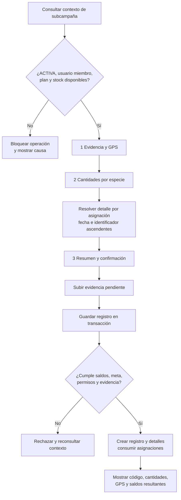

## 3.4. Fase de Construcción: implementación e integración de los módulos

> Parte del [Capítulo III](03_capitulo_marco_aplicativo.md). Las tablas y resultados del desarrollo original conservan el corte del 15 de septiembre de 2026; la sección 3.4.5.1 añade una revisión local del 29 de octubre. Las afirmaciones históricas y sus pruebas requieren actualización para una versión candidata.

### 3.4.1. Propósito, corte y correspondencia con RUP

Esta sección responde al tercer objetivo específico: **implementar en el sistema las funciones de Recolección, Vivero y Plantación necesarias para mantener vinculada la información del material vegetal durante su recorrido**. La fase de Construcción se organiza en cuatro iteraciones: CO-1 para Recolección, CO-2 para Vivero e integración M1→M2, CO-3 para Plantación e integración M2→M3 y CO-4 para la trazabilidad transversal y la versión candidata.

El corte documental del 15 de septiembre de 2026 se encuentra dentro de CO-2 según el cronograma rector. Sin embargo, existen implementaciones y verificaciones registradas durante julio para M2, M3 y su integración. Esas piezas constituyen una base técnica disponible, pero deben incorporarse de manera explícita al registro de cada iteración: objetivo, especificación, riesgo, tareas, cambio, pruebas, resultado y decisión de cierre. La fecha de un despliegue previo no sustituye esa evidencia metodológica.

**Tabla 3.21**

*Correspondencia entre fases, iteraciones, actividades, hitos y entregables al corte*

| Fase e iteración | Actividades principales | Hito de control | Entregables previstos | Evidencia disponible al corte | Estado metodológico |
|---|---|---|---|---|---|
| Inicio, IN-1 | delimitar alcance, actores, requisitos iniciales, riesgos y plan | LCO | Perfil, análisis inicial, mapa de actores, necesidades y plan | Perfil, análisis, actores, necesidades y planificación disponibles | evidencia disponible; falta revisión de iteración y cierre LCO |
| Elaboración, EL-1 | modelar dominio y datos, definir arquitectura, contratos, invariantes y especificaciones prioritarias | LCA | modelo, esquema, arquitectura, reglas, contratos y especificaciones | esquema, arquitectura, reglas y contratos M1→M2 y M2→M3 disponibles | evidencia disponible; falta resolver vacíos y cerrar LCA |
| Construcción, CO-1 | implementar y comprobar M1 Recolección | revisión CO-1 | incremento M1, checklist y evidencia de pruebas | requisitos, reglas, flujo, checklist, arquitectura observada y operación de `DESECHO` marcada como validada | periodo concluido; requiere auditoría y registro formal de cierre |
| Construcción, CO-2 | implementar Vivero e integración M1→M2 | revisión CO-2 | incremento M2, contrato integrado y matriz de pruebas | requisitos y contratos, eventos de Vivero, descarte pre-embolsado, arquitectura y pruebas backend disponibles | en curso; falta consolidar la matriz de evidencia de la iteración |
| Construcción, CO-3 | implementar Plantación e integración M2→M3 | revisión CO-3 | incremento M3, migraciones, flujos y pruebas integradas | campañas, subcampañas, asignación física, devolución y plantación inicial documentadas como implementadas; frontend y backend desplegados | planificada; evidencia técnica adelantada que debe revalidarse |
| Construcción, CO-4 | integrar trazabilidad transversal y preparar versión candidata | IOC | consulta integral, regresión, manual preliminar y versión candidata | relaciones y timelines parciales, arquitectura y contratos definidos | planificada; faltan consulta integral, regresión y cierre IOC |
| Transición, TR-1 | ejecutar pruebas de sistema, validación operativa, despliegue y aceptación | PR | resultados de validación, manuales, incidencias y acta de aceptación | matriz de verificación en 3.4.9 y escenarios de evaluación en 3.5 | planificada; ejecución y cierre PR pendientes |

*Nota.* Elaboración propia a partir de `metodologia_desarrollo.md`, `registro_avance_rup_sdd.md`, `TODO_PROYECTO_GRADO.md`, `ESTADO.md`, `ARCHITECTURE.md` y los planes operativos de los módulos, con corte al 15 de septiembre de 2026. “Evidencia disponible” no significa “verificado” ni “aceptado”.

### 3.4.2. Implementación de la arquitectura

La PWA organiza sus pantallas por funcionalidades de autenticación, recolecciones, vivero, plantación y catálogos. Los servicios del cliente preparan datos y consumen la API mediante JSON o `multipart/form-data`. El backend reúne los módulos en un único proceso NestJS y distribuye la lógica compleja entre controladores, casos de uso, políticas y funciones de base de datos. Las operaciones que conservan saldos se ejecutan en PostgreSQL para reducir el riesgo de escrituras parciales.

La evidencia sigue un patrón de carga previa en los flujos que la requieren. El cliente envía los archivos originales, el backend los registra como evidencia pendiente y devuelve sus identificadores, y la operación final vincula esos identificadores dentro de la transacción. Si la operación no se completa, la interfaz debe conservar los datos del formulario y limpiar la evidencia provisional según el contrato disponible.

### 3.4.3. Módulo General y Recolección

El Módulo General proporciona los catálogos compartidos. Los usuarios conservan uno de cuatro roles globales; las plantas mantienen identidad científica y nombre común operativo; las comunidades se resuelven mediante la estructura de divisiones administrativas; y toda coordenada reutilizable se registra en `UBICACION`. Los registros históricos conservan snapshots para que la inactivación o el cambio de un maestro no altere operaciones anteriores.

Recolección implementa un flujo de borrador, solicitud de validación, aprobación o rechazo. La ficha exige especie, tipo de material, cantidad, unidad, fecha, responsable, vivero, ubicación y evidencia. Las semillas pueden persistirse en `G` o `UNIDAD`; los esquejes solo en `UNIDAD` entera. Después de la validación, la ficha queda congelada y su saldo cambia únicamente mediante movimientos de consumo hacia Vivero o desecho.

La revisión arquitectónica confirma que existen pantallas para listado, alta, edición de borrador, evidencia, validación y detalle. No obstante, algunas secuencias de Recolección coordinan varias llamadas desde TypeScript y utilizan compensación en lugar de una sola función de base de datos. Además, `ESTADO.md` no contiene todavía una auditoría completa de M1. Por ello, este incremento no se presenta como aceptado: requiere contrastar la implementación real con `RF-REC-01` a `RF-REC-05`, ejecutar el checklist completo y registrar sus resultados.

### 3.4.4. Módulo Vivero e integración M1→M2

Vivero implementa el lote como agregado central. `INICIO` registra material en proceso y consume una cantidad de la recolección de origen. `EMBOLSADO` materializa el primer saldo vivo observado. `DESCARTE_PRE_EMBOLSADO` cierra un lote que no produjo plantas vivas. Después del embolsado se admiten adaptabilidad, merma, despacho manual, asignación física y devolución, con cierre automático cuando corresponde.

El descarte pre-embolsado se encuentra implementado en backend y frontend. La operación registra causa, cantidad total afectada y evidencia; mantiene nulo el saldo vivo y finaliza el lote con un motivo específico. En la interfaz, la acción solo aparece cuando el lote está activo, tiene `INICIO` y todavía no tiene `EMBOLSADO`. Si ya existen plantas vivas y se pierde todo el saldo, el hecho se registra como merma, no como descarte previo.

La interfaz separa el despacho manual de la asignación a subcampaña. El despacho ofrece `DONACION`, `VENTA` y `OTRO`; la asignación dispone de su propio formulario, exige evidencia y conserva la selección de campaña, subcampaña, propósito, cantidad y fecha. Esta separación fue implementada en el frontend mediante el cambio `562a97e` y superó las comprobaciones de lint y construcción registradas el 23 de julio de 2026.

### 3.4.5. Módulo Plantación e integración M2→M3

La implementación disponible permite crear y editar campañas, crear subcampañas, definir zona, meta, plan por especie, polígono y equipo, y activar una subcampaña aun cuando tenga cobertura de stock parcial o nula. La campaña no mantiene un estado ni una meta operativa propios; ambas lecturas se derivan de sus subcampañas. El coordinador se almacena como miembro contextual del equipo.

La integración física M2→M3 se implementó mediante las migraciones 051 a 057. La creación de una asignación descuenta el saldo del lote, crea stock para la subcampaña y registra eventos relacionados en ambos módulos. La devolución incrementa `cantidad_devuelta`, repone el saldo del lote y registra los hechos de retorno. La plantación consume asignaciones y no genera un segundo despacho en Vivero. Las migraciones 056 y 057, el backend y el frontend fueron reportados como desplegados en producción el 23 de julio de 2026.

El registro de plantación inicial está implementado como un flujo móvil de tres pasos: evidencia y GPS, cantidades por especie, y resumen y confirmación. Antes de abrir el formulario se consulta el contexto de la subcampaña, que incluye estado, permisos, equipo, plan y stock asignado. El operario introduce cantidades por especie; el cliente las distribuye entre asignaciones de la misma especie mediante un orden estable por fecha e identificador, y el backend conserva el detalle real.

**Figura 3.23. Flujo implementado para registrar una plantación inicial**



*Nota.* Elaboración propia a partir de `05_handoff_registro_plantacion_inicial.md`, el plan frontend de M3 y la migración `053_m3_registrar_plantacion_sin_despacho.sql`.

El flujo fue reportado con control de doble envío, limpieza de evidencias pendientes y comprobante de consumo. La verificación de interfaz del 8 de julio de 2026 no registró bloqueantes. Persisten vacíos de experiencia: no existe una vista agregada de asignaciones por subcampaña, el historial completo de M3 no está expuesto y la regla de GPS debe reconciliarse con el comportamiento real del backend.


#### 3.4.5.1. Actualización del registro participante

La revisión del 29 de octubre de 2026 identificó un recorrido participante posterior al flujo histórico de la Figura 3.23. La autoridad se verifica por subcampaña y el registro consume el stock asignado elegible; el avance por especie es orientativo y no reemplaza la comprobación de saldo. Los borradores pertenecen a la cuenta y al dispositivo. La secuencia describe el código local revisado, no una aceptación integral del flujo o un despliegue remoto.

**Diagrama de trabajo: secuencia del registro participante**

```mermaid
sequenceDiagram
    actor U as Persona autorizada
    participant PWA as Frontend
    participant API as Backend
    participant DB as PostgreSQL/PostGIS
    participant STO as Storage privado

    U->>PWA: Elegir subcampaña
    PWA->>API: Consultar capacidades
    API->>DB: Verificar cuenta y autoridad por ámbito
    DB-->>PWA: Subcampañas y acciones permitidas

    opt Consultar equipo
        PWA->>API: Solicitar miembros del ámbito
        API->>DB: Lectura autorizada por 087
        DB-->>PWA: Miembros y responsabilidades
    end

    U->>PWA: Iniciar captura
    PWA->>API: Consultar contexto de registro
    API->>DB: Leer plan, revisión y stock elegible
    DB-->>API: Avance inicial y pendiente por especie
    API-->>PWA: Contexto autorizado

    Note over PWA,DB: La meta orienta; el saldo elegible limita la cantidad

    PWA->>API: Preparar comando propio
    API->>DB: Guardar preparación
    U->>PWA: Añadir fotos y ubicación
    PWA->>API: Enviar fotografías
    API->>STO: Guardar original y derivada
    API->>DB: Marcar cargas disponibles

    U->>PWA: Confirmar cantidades, fecha y participantes
    PWA->>API: Enviar misma intención con comando_id
    API->>DB: Ejecutar RPC transaccional

    alt El comando ya tiene resultado terminal
        DB-->>API: Recuperar el mismo recibo
    else Nueva ejecución válida
        DB->>DB: Revalidar cuenta, permiso, ACTIVA y revisión
        DB->>DB: Validar fecha, GPS, fotos y saldo
        DB->>DB: Consumir asignaciones elegibles en orden LIFO
        DB->>DB: Guardar registro, detalles y snapshots
        DB->>DB: Vincular evidencia y recibo en la misma transacción
        DB-->>API: Resultado terminal
    end

    API-->>PWA: Confirmación o rechazo durable

    opt Respuesta perdida o inconclusa
        PWA->>API: Recuperar con misma clave y operación
        API->>DB: Consultar recibo del actor
        DB-->>PWA: Terminal o resultado aún no determinado
    end

    U->>PWA: Consultar Mis registros
    PWA->>API: Solicitar registros propios
    API->>DB: Verificar autoría o participación efectiva
    DB-->>PWA: Registros, especies y referencia de foto autorizada
```


*Nota.* Elaboración propia a partir de la revisión de backend `9eef958` y frontend `dd36c57` del 29 de octubre de 2026. La evidencia de un registro confirmado mediante backend local el 26 de octubre se conserva en [`QA_REGISTRO_GUARDADO_51.md`](../../../../pwa-r3foresta/docs/QA_REGISTRO_GUARDADO_51.md); no demuestra por sí sola los demás recorridos ni el despliegue remoto. La Figura 3.23 conserva el flujo documentado en septiembre y requiere actualización antes de la edición final.

### 3.4.6. Aplicación de SDD y asistencia de IA

Los documentos revisados cubren partes de la cadena SDD. Los archivos de requisitos expresan capacidades y validaciones; las reglas precisan invariantes; los flujos operativos organizan la experiencia; los contratos resuelven las fronteras; los ADR registran decisiones; los planes de frontend descomponen trabajo; las migraciones materializan operaciones; y `ESTADO.md` registra confirmaciones técnicas disponibles. Esta correspondencia todavía no está consolidada con identificadores estables de especificación, tarea, prueba, resultado y aceptación, por lo que no se presenta como una aplicación metodológica plenamente demostrada.

La asistencia de IA participó en análisis, contraste documental, planificación, implementación y redacción bajo revisión humana. Para cumplir plenamente la metodología, falta completar el registro por aporte material con fecha, herramienta y versión disponible, tarea, artefacto afectado, salida adoptada, modificada o rechazada, revisión humana, prueba y referencia al cambio. La existencia de archivos generados o revisados con IA no equivale por sí sola a esa trazabilidad de proceso.

El archivo `../../04_metodologia/registro_avance_rup_sdd.md` concentra el estado por iteración e hito, la cobertura actual de la cadena SDD y la plantilla de control de IA. Este registro permite incorporar evidencia a medida que se verifica, sin reconstruir retrospectivamente cierres o aceptaciones que no fueron documentados.

### 3.4.7. Control del alcance implementado

La versión técnica contiene o proyecta funciones posteriores al registro inicial: mortandad, reposición, fases de mantenimiento, vistas públicas, metadatos de carbono e integraciones blockchain. También existen pantallas de CO₂ y escaneo que funcionan como marcadores de posición. Estas capacidades no se incorporan a la matriz de cumplimiento del Proyecto de Grado porque el alcance académico concluye con el registro de la plantación.

El capítulo utiliza únicamente los componentes necesarios para demostrar procedencia, cantidades, responsables, ubicaciones, evidencia y destino registrado. Si una capacidad adicional interviene técnicamente en el mismo repositorio, debe permanecer desactivada o separada de los escenarios de aceptación, sin presentarse como aporte ni resultado del proyecto académico.

### 3.4.8. Resultado de la implementación

La implementación disponible materializa la ruta principal: una recolección puede originar un lote de vivero; el vivero distingue material en proceso de plantas vivas; una asignación transfiere físicamente plantas a una subcampaña; y una plantación consume el stock asignado conservando el lote y la especie de procedencia. Los eventos, snapshots y evidencias permiten mantener las relaciones necesarias para una reconstrucción posterior.

OBJ-03 no puede declararse cerrado en este corte. Falta demostrar formalmente el incremento completo de Recolección, implementar las variantes de ingreso externo comprometidas, resolver los riesgos P0 de identidad y reproducibilidad y completar la trazabilidad transversal de CO-4. La evidencia adelantada de M3 reduce trabajo de construcción, pero debe verificarse nuevamente dentro de la secuencia metodológica y con la versión candidata que se someta a aceptación.

### 3.4.9. Verificación de requerimientos e invariantes

#### 3.4.9.1. Propósito y enfoque

Esta sección responde al cuarto objetivo específico: **verificar que las funciones implementadas cumplan los requerimientos definidos y que los registros mantengan coherencia entre las cantidades y los movimientos del material vegetal**. La verificación acompaña cada incremento de Construcción y culmina durante Transición con pruebas de sistema y regresión sobre una versión candidata identificada.

Las pruebas deben relacionarse con requisitos e invariantes. El volumen de archivos o casos no constituye por sí mismo un resultado. Para cada comprobación se conservarán versión, datos, precondiciones, operación, resultado esperado, resultado observado, evidencia, defecto y decisión. Cuando una prueba escriba en servicios externos, se ejecutará en un entorno controlado.

#### 3.4.9.2. Evidencia técnica disponible

**Tabla 3.22**

*Evidencia de verificación disponible antes del cierre de OBJ-04*

| Evidencia | Resultado registrado | Alcance que respalda | Limitación para el cierre académico |
|---|---|---|---|
| auditoría de backend del 23 de julio de 2026 | 42 suites y 415 pruebas unitarias ejecutadas | reglas y servicios cubiertos por esas suites | requiere matriz que vincule cada resultado con requisito e invariante |
| pruebas de backend y base de datos del despliegue coordinado | unitarias y e2e de base de datos reportadas como correctas | integración física M2→M3, devolución y desactivación | no sustituye regresión sobre la versión candidata final |
| comprobaciones de frontend | lint y build correctos | tipado, compilación y reglas estáticas del frontend | no existen todavía pruebas unitarias, de componentes o e2e automatizadas en la PWA |
| QA del registro de plantación inicial | flujo móvil reportado sin bloqueantes el 8 de julio de 2026 | contexto, tres pasos, evidencia, GPS, cantidades y confirmación | falta anexar casos, datos y resultados observados a la matriz académica |
| migraciones 056 y 057 en producción | aplicación y despliegue confirmados | devolución física y desactivación atómica de campaña | no demuestra replay completo desde una base vacía |

*Nota.* Elaboración propia a partir de `ARCHITECTURE.md`, `ESTADO.md`, `03_tarea_frontend_separar_despacho_asignacion.md` y `05_handoff_registro_plantacion_inicial.md`. Los resultados corresponden a las fechas y versiones documentadas, no a una certificación general del producto.

#### 3.4.9.3. Matriz mínima de verificación

**Tabla 3.23**

*Casos prioritarios para verificar el recorrido y sus saldos*

| Caso | Requisito o invariante | Operación de prueba | Resultado esperado | Estado al corte |
|---|---|---|---|---|
| TC-01 | `RF-REC-04` | solicitar validación sin fotos o ubicación completa | rechazo sin cambiar a `PENDIENTE_VALIDACION` | pendiente de consolidar |
| TC-02 | INV-01 | consumir o desechar más del saldo de Recolección | rechazo y saldo sin cambios | pendiente de consolidar |
| TC-03 | INV-02 e INV-04 | forzar un fallo durante la creación del lote de Vivero | ausencia de lote, evento o movimiento parcial | prueba de contrato disponible; evidencia académica pendiente |
| TC-04 | INV-03 | iniciar un lote con semillas en gramos | saldo vivo nulo hasta registrar `EMBOLSADO` | pendiente de consolidar |
| TC-05 | `RF-VIV-02A` | descartar un lote antes y después de `EMBOLSADO` | aceptación solo antes del embolsado; después corresponde merma | reportado en unitarias y e2e; anexos pendientes |
| TC-06 | INV-05 | asignar 100 plantas y luego plantar 60 | el lote disminuye 100 al asignar; la asignación queda con 40; plantar no descuenta el lote otra vez | reportado como implementado; repetir en versión candidata |
| TC-07 | INV-06 | enviar dos consumos concurrentes sobre el mismo saldo asignado | solo se acepta la combinación que no exceda el disponible | e2e DB reportado; detalle pendiente |
| TC-08 | INV-07 | enviar total distinto de la suma de detalles | rechazo sin registro parcial | implementado en función; resultado pendiente de matriz |
| TC-09 | INV-08 | devolver más del saldo asignado | rechazo; asignación y lote permanecen sin cambios | implementación confirmada; evidencia de caso pendiente |
| TC-10 | INV-09 | cambiar el nombre maestro después de validar o crear un lote | los registros anteriores conservan sus snapshots | pendiente |
| TC-11 | INV-10 | recuperar evidencia desde cada etapa | cada archivo aparece vinculado con su hecho, no como adjunto aislado | pendiente de recorrido completo |
| TC-12 | INV-11 | registrar puntos interior, exterior y dentro de tolerancia | comportamiento conforme a la regla de GPS que se apruebe | bloqueado por discrepancia de especificación |
| TC-13 | RDI-02 | intentar operar con `x-auth-id` sin JWT válido | acceso rechazado | no conforme en la arquitectura actual |
| TC-14 | RDI-03 | reproducir la base desde cero con todas las migraciones | esquema, enums y funciones vigentes disponibles | no conforme hasta alinear migraciones |
| TC-15 | RDI-01 | ejecutar ingreso externo en Vivero y Plantación | procedencia y recorrido conservados sin crear un cuarto módulo | no implementado |

*Nota.* Elaboración propia a partir de la matriz de invariantes 3.19, `TODO_PROYECTO_GRADO.md`, los checklists de los módulos y los riesgos documentados en `ESTADO.md` y `ARCHITECTURE.md`. “Reportado” indica evidencia técnica previa que todavía debe incorporarse al expediente académico.

#### 3.4.9.4. Interpretación provisional

La evidencia disponible respalda que la integración física M2→M3 cuenta con mecanismos y pruebas técnicas ejecutadas. También muestra que la compilación del frontend y una parte importante de las pruebas del backend pasan en las versiones registradas. Estos resultados permiten planificar una regresión focalizada, pero no justifican declarar cumplido todo OBJ-04.

Cuatro condiciones impiden el cierre: el flujo de ingresos externos no está implementado, la autenticación permite todavía una ruta de identidad débil, el replay completo de migraciones presenta diferencias y la regla de GPS no coincide con el comportamiento desplegado. Además, las pruebas disponibles deben vincularse con identificadores estables y repetirse sobre la versión candidata de CO-4 o TR-1.

#### 3.4.9.5. Criterio de salida para OBJ-04

El objetivo podrá cerrarse cuando la matriz de pruebas identifique la versión evaluada, todos los casos críticos cuenten con resultados observados y evidencia, las no conformidades bloqueantes hayan sido corregidas o rechazadas para la liberación, y la regresión de los tres módulos confirme que las correcciones no rompieron los recorridos ya aprobados. El cierre deberá distinguir pruebas unitarias, funcionales, de integración, concurrencia, fallo y regresión.
