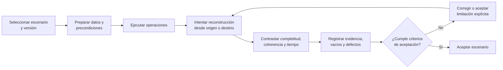

## 3.4. Fase de Transición: evaluación de la reconstrucción del recorrido

> Parte del [Capítulo III](03_capitulo_marco_aplicativo.md). Los escenarios y estados conservan el corte del 15 de septiembre de 2026 y deben contrastarse con la evidencia de ejecución antes de incorporar resultados o decisiones de aceptación.

### 3.4.1. Propósito y momento metodológico

Esta sección responde al quinto objetivo específico: **evaluar, mediante escenarios operativos representativos, en qué medida el sistema permite reconstruir, a partir de sus registros y evidencias, el recorrido del material vegetal**. La ejecución corresponde principalmente a la iteración TR-1, después de congelar la versión candidata y cerrar las no conformidades críticas de verificación.

En este corte se presenta el diseño de la evaluación, no resultados aún no observados. Cada escenario se seleccionará a partir de una variante real de R3Foresta y se identificará como operación real autorizada o como escenario controlado. La evaluación admitirá trazas completas, incompletas o incoherentes y registrará los vacíos sin completarlos mediante memoria o inferencias.

### 3.4.2. Escenarios representativos

**Tabla 3.15**

*Escenarios propuestos para evaluar la reconstrucción*

| Código | Escenario | Recorrido o riesgo que representa | Información que debe recuperarse | Condición previa |
|---|---|---|---|---|
| EVA-01 | ruta propia completa | recolección validada → lote de vivero → asignación → plantación | origen, especie, cantidades, unidades, eventos, responsables, ubicaciones, evidencia y destino | versión integrada M1→M2→M3 |
| EVA-02 | consumo parcial del origen | una recolección abastece más de un lote de vivero | saldo inicial, movimientos, lotes destino y saldo restante | contrato M1→M2 probado |
| EVA-03 | transformación observada y pérdida | material en proceso produce plantas vivas y registra merma o descarte | cantidad y unidad de entrada, resultado observado, pérdida, causa, evidencia y saldo | eventos de Vivero disponibles |
| EVA-04 | asignación y plantación parcial | un lote entrega plantas y la subcampaña consume solo una parte | saldo del lote antes y después, cantidad asignada, consumida y disponible, detalle de plantación | integración M2→M3 disponible |
| EVA-05 | devolución física | una subcampaña devuelve stock no consumido | asignación, cantidad devuelta, motivo, eventos M2/M3 y saldo repuesto | devolución implementada y probada |
| EVA-06 | ingreso externo en Vivero | material adquirido inicia su recorrido en M2 | proveedor o entidad de origen, especie, cantidad, unidad, fecha, responsable, evidencia y destino | flujo externo implementado |
| EVA-07 | ingreso externo directo en Plantación | material adquirido ingresa en M3 | procedencia disponible, cantidad recibida y plantada, responsable, ubicación y evidencia | flujo externo implementado |
| EVA-08 | reconstrucción inversa | partir de una plantación y recuperar todos sus antecedentes | subcampaña, asignaciones, lotes, recolecciones, eventos, cantidades y evidencias | consulta transversal de CO-4 |
| EVA-09 | intento de inconsistencia | consumo superior, operación concurrente o fallo inducido | rechazo, ausencia de efectos parciales y saldo conservado | pruebas críticas aprobadas |

*Nota.* Elaboración propia a partir de los objetivos específicos, `TODO_PROYECTO_GRADO.md`, las variantes identificadas en 3.1 y los contratos de integración. Los escenarios de ingreso externo permanecen condicionados a su especificación e implementación.

### 3.4.3. Instrumento y criterios de evaluación

Cada ejecución utilizará una ficha con los siguientes campos: código de escenario, tipo real o controlado, fecha, versión del sistema, participantes, precondiciones, datos de entrada, pasos realizados, resultado esperado, resultado observado, identificadores recuperados, fuentes consultadas, evidencias, defectos, tiempo de recuperación y decisión.

La reconstrucción se evaluará mediante tres criterios principales:

1. **Completitud:** proporción y descripción de los elementos previstos que pueden responderse con registros y evidencia contrastable.
2. **Coherencia:** correspondencia entre cantidades, unidades, eventos y relaciones, sin saldos negativos, dobles consumos o saltos no explicados.
3. **Recuperabilidad:** posibilidad de obtener la traza desde el punto de inicio definido, registrando el tiempo y los pasos requeridos bajo condiciones conocidas.

El tiempo no se interpretará de manera aislada. Una respuesta rápida pero incompleta no constituye una reconstrucción satisfactoria. Del mismo modo, una traza con muchos registros no será aceptable si las cantidades o relaciones se contradicen.

**Figura 3.22. Secuencia de evaluación de una traza**

*Nota.* Elaboración propia a partir de `metodologia_desarrollo.md`, la sección 2.6 del Marco teórico y conceptual y el plan de Transición de `TODO_PROYECTO_GRADO.md`.

### 3.4.4. Criterios de aceptación del producto integrado

El producto integrado deberá permitir reconstruir la ruta principal desde una recolección validada hasta una plantación sin consultar la memoria de las personas para completar los campos comprometidos. Las cantidades deberán ser explicables dentro de su unidad y etapa; las transformaciones observadas deberán aparecer como nuevos resultados registrados; y cada transferencia deberá identificar origen, destino, cantidad, responsable y fecha.

La evidencia deberá recuperarse junto con el hecho al que respalda. Su presencia no se interpretará como certificación de la realidad física. Si un dato requerido no fue registrado, la consulta deberá mostrar la ausencia y el escenario se calificará según el criterio acordado, sin completar la traza mediante supuestos.

La aceptación final utilizará los resultados de verificación y validación, los defectos residuales y los límites conocidos. No incluirá supervivencia, mantenimiento, captura de carbono, MRV, certificación, blockchain ni desempeño nacional, porque esas capacidades no forman parte del producto académico evaluado.

### 3.4.5. Estado de los resultados

Los resultados de OBJ-05 permanecen abiertos hasta ejecutar los escenarios sobre una versión identificada. El borrador no atribuye reducción de tiempo, mejora de exactitud ni completitud total. La versión final deberá informar cuántos escenarios se ejecutaron, cuáles fueron reales o controlados, qué elementos se recuperaron, qué inconsistencias aparecieron, cuánto tiempo requirió cada reconstrucción y qué decisión se tomó.

### 3.4.6. Síntesis del avance del Marco aplicativo

**Tabla 3.16**

*Correspondencia entre objetivos, productos y estado del capítulo*

| Objetivo | Producto principal presentado | Evidencia disponible | Estado al 15 de septiembre de 2026 |
|---|---|---|---|
| OBJ-01 Analizar | flujo actual, actores, soportes, ocho problemas y ocho necesidades | reunión, entrevista, observación, fotografías, dossier y documentación operativa | borrador desarrollado; pendiente revisión de la tutora |
| OBJ-02 Diseñar | recorrido, requisitos, modelo de dominio, estados, contratos, arquitectura e invariantes | módulos, contratos, ADR, esquema y arquitectura | borrador desarrollado; pendientes externos, GPS, identidad y migraciones |
| OBJ-03 Implementar | módulos y ruta principal M1→M2→M3 | implementación y despliegues documentados; migraciones 051–057; QA y builds | parcial; falta cierre formal de M1, ingresos externos y trazabilidad CO-4 |
| OBJ-04 Verificar | matriz de pruebas y evidencia técnica preliminar | unitarias backend, e2e DB, lint, build y QA de plantación | parcial; requiere regresión y expediente sobre versión candidata |
| OBJ-05 Evaluar | escenarios, instrumento y criterios de reconstrucción | diseño metodológico | pendiente de ejecución en Transición |

*Nota.* Elaboración propia a partir de las secciones 3.1 a 3.4, `ESTADO.md`, `TODO_PROYECTO_GRADO.md` y el cronograma rector.

El Marco aplicativo cuenta ahora con una línea argumental completa para revisión: parte de la práctica actual, convierte los hallazgos en un diseño, contrasta el diseño con la implementación disponible, identifica las pruebas necesarias y establece cómo se evaluará la reconstrucción. La versión conserva los resultados abiertos cuando la evidencia todavía no existe y muestra las diferencias que deben resolverse antes de declarar cumplidos los objetivos.

La siguiente actualización deberá incorporar las observaciones de la tutora, cerrar la especificación de ingresos externos, auditar M1, reconciliar GPS e identidad, y anexar la matriz de pruebas con resultados ejecutados. Después de CO-4 y TR-1 se sustituirán los estados provisionales por resultados observados, decisiones de aceptación y conclusiones vinculadas con cada objetivo.
