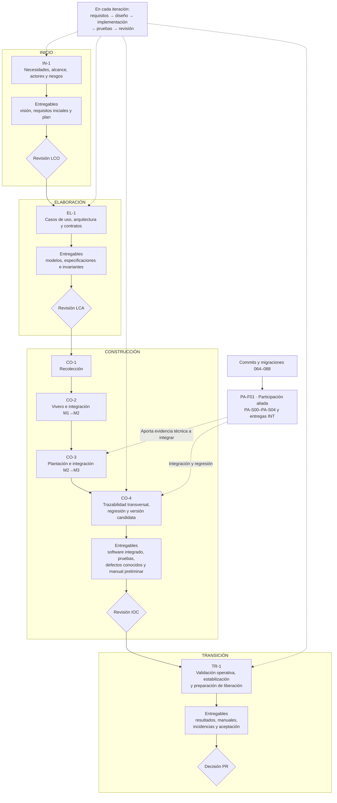

# CAPÍTULO III — MARCO APLICATIVO

El presente capítulo describe la aplicación de RUP adaptado en el desarrollo de R3Foresta para organizar y mantener vinculada la información del material vegetal desde su origen registrado hasta la plantación. El recorrido comprende los módulos de Recolección, Vivero y Plantación, apoyados por los datos maestros del Módulo General. El alcance académico concluye con el registro de la plantación; no comprende la medición, certificación ni comercialización de bonos de carbono.

La exposición se organiza en las cuatro fases de RUP. En **Inicio** se analiza la gestión actual y se delimitan necesidades, actores y alcance. En **Elaboración** se desarrollan requisitos, casos de uso, procesos, interacciones, modelos de datos y arquitectura. En **Construcción** se presentan los incrementos, su integración y la verificación de requisitos e invariantes. En **Transición** se plantea la evaluación operativa, la estabilización y la aceptación del producto integrado. Las disciplinas atraviesan las fases con distinta intensidad: por ejemplo, las pruebas acompañan la construcción y continúan durante la transición.

El capítulo conserva la relación con los cinco objetivos específicos: analizar la información, diseñar su organización, implementar las funciones, verificar su coherencia y evaluar la reconstrucción del recorrido. La evidencia técnica disponible se distingue de la verificación y de la aceptación. Los resultados que aún carecen de ejecución o decisión documentada permanecen abiertos.

El desarrollo original conserva principalmente el corte del 15 de septiembre de 2026; los diagramas de participación añadidos posteriormente se identifican con la revisión del 29 de octubre. Es necesario actualizar y contrastar el resto de las afirmaciones históricas con las versiones y evidencias correspondientes antes de presentar el capítulo como estado vigente.

El diagrama siguiente vincula fases, iteraciones, entregables y revisiones previstos para el proyecto. Las revisiones LCO, LCA, IOC y PR son puntos de decisión, no afirmaciones de cierre. Las migraciones y entregas técnicas aportan evidencia a las iteraciones, pero no constituyen iteraciones RUP adicionales.

**Diagrama de trabajo: aplicación de las fases de RUP**

*Nota.* Elaboración propia a partir del plan metodológico y la revisión de diagramas del 29 de octubre de 2026. El registro de avance y el tablero académico conservan los estados y evidencias por iteración. La secuencia es una organización del proceso; no certifica la ejecución ni la aceptación de cada hito.

| Sección | Fase | Contenido e iteraciones |
|---|---|---|
| [3.1. Inicio](03_1_fase_inicio.md) | Inicio | Contexto, actores, problemas, necesidades y alcance; IN-1 y revisión LCO. |
| [3.2. Elaboración](03_2_fase_elaboracion.md) | Elaboración | Requisitos, casos de uso, procesos, interacciones, modelos, arquitectura y riesgos; EL-1 y revisión LCA. |
| [3.3. Construcción](03_3_fase_construccion.md) | Construcción | Implementación, integración y verificación; CO-1 a CO-4 y revisión IOC. |
| [3.4. Transición](03_4_fase_transicion.md) | Transición | Escenarios de evaluación, criterios de aceptación y síntesis; TR-1 y decisión PR. |

Las tablas se mantienen en Markdown con número, título y nota para su posterior maquetación conforme a APA 7. Los diagramas de trabajo recientes requieren contraste y numeración final antes de incorporarse al documento universitario. El contenido original se conserva en el [archivo previo a la reorganización](archivo/03_capitulo_marco_aplicativo_antes_rup_2026-10-29.md).
