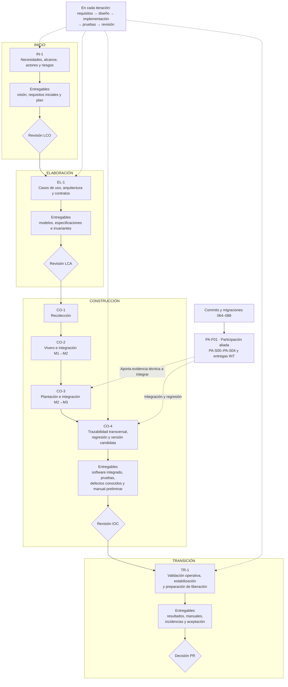

# CAPÍTULO III — MARCO APLICATIVO

El presente capítulo describe la aplicación de RUP adaptado en el desarrollo de R3Foresta para organizar y mantener vinculada la información del material vegetal desde su origen registrado hasta la plantación. El recorrido comprende los módulos de Recolección, Vivero y Plantación, apoyados por los datos maestros del Módulo General. El alcance académico concluye con el registro de la plantación; no comprende la medición, certificación ni comercialización de bonos de carbono.

El capítulo conserva la relación con los cinco objetivos específicos: analizar la información, diseñar su organización, implementar las funciones, verificar su coherencia y evaluar la reconstrucción del recorrido. La evidencia técnica se distingue de la verificación y de la aceptación; los resultados sin ejecución o decisión documentada permanecen abiertos.

La redacción original conserva principalmente el corte del 15 de septiembre de 2026. La consolidación de Inicio y las vistas de participación incorporadas posteriormente se identifican con la revisión del 29 de octubre. Los otros contenidos históricos requieren contraste con sus versiones y evidencias antes de presentarlos como estado vigente del producto.

## 3.1. Aplicación de RUP y prácticas SDD

### 3.1.1. Estrategia metodológica general

RUP adaptado organiza las decisiones del proyecto por fases, iteraciones, riesgos y productos. Las técnicas de entrevista, observación y análisis documental aportan información a las disciplinas de requisitos y análisis; no constituyen una metodología investigativa independiente. La aplicación conserva Inicio, Elaboración, Construcción y Transición y simplifica los artefactos según las necesidades del proyecto, conforme al Perfil y a la [metodología de desarrollo](../../04_metodologia/metodologia_desarrollo.md).

En Inicio se reúnen diagnóstico, visión, alcance, actores, requisitos iniciales, riesgos y plan. Elaboración justifica los modelos, contratos y arquitectura y detalla los casos de uso prioritarios. Construcción desarrolla e integra capacidades y comprueba requisitos e invariantes. Transición reúne la validación operativa, la estabilización y la aceptación de una versión identificada. Las disciplinas se solapan: el análisis puede refinarse después de Inicio y las pruebas acompañan la construcción, sin que cada actividad se convierta en una fase adicional.

Las etiquetas de iteración describen la organización académica adoptada el 25 de agosto de 2026. Las fechas reales de levantamiento, implementación y prueba se conservan por separado. Una actividad anterior puede aportar evidencia a un producto metodológico sin que ello pruebe la ejecución o el cierre de la iteración prevista.

### 3.1.2. Organización modular del sistema

El Perfil establece tres módulos funcionales asociados con las etapas del material vegetal. La documentación y la aplicación incluyen además el Módulo General como soporte transversal. Esta diferencia explica las cuatro áreas del repositorio sin añadir una cuarta etapa física ni modificar el alcance aprobado.

**Tabla 3.1**

*Etapas operativas y responsabilidades modulares*

| Área del sistema | Relación con el recorrido | Responsabilidad principal |
|---|---|---|
| Módulo General | transversal; no es una etapa física | mantener usuarios y referencias compartidas de viveros, plantas, territorios, organizaciones y evidencia |
| M1 Recolección | origen registrado | registrar y revisar la procedencia, el material, las cantidades y las evidencias de origen |
| M2 Vivero | recepción y manejo previo a la plantación | registrar material recibido, resultados observados, pérdidas, salidas y disponibilidad |
| M3 Plantación | destino y registro en campo | planificar actividades, relacionar plantas entregadas y registrar cantidades efectivamente plantadas |

*Nota.* Elaboración propia a partir del alcance del Perfil, el Capítulo I y los índices de General, Recolección, Vivero y Plantación. Los ingresos externos son variantes de Vivero o Plantación. Historial, trazabilidad, consultas y evidencias son capacidades transversales, no un cuarto módulo funcional.

### 3.1.3. Integración de SDD en las iteraciones

SDD se aplica como práctica de especificación dentro de RUP. Las necesidades se relacionan con requisitos y casos de uso; las especificaciones precisan el comportamiento y los criterios de aceptación; los planes distribuyen responsabilidades y decisiones técnicas; las tareas enlazan la implementación con las pruebas y sus resultados. La cadena adoptada es `necesidad → requisito → especificación → diseño → tarea → cambio → prueba → resultado → aceptación`.

En Inicio basta identificar y priorizar necesidades y requisitos, como muestra la matriz puente de la sección 3.2.6. Elaboración desarrolla las reglas, escenarios, contratos y criterios de las capacidades prioritarias; Construcción los refina cuando corresponde y vincula cada entrega con código y pruebas. Transición evalúa el producto integrado y registra aceptación y condiciones residuales. La visión, los riesgos y las revisiones de hitos conservan su finalidad transversal.

Los módulos existentes ya contienen requisitos y reglas que actúan como especificaciones de base. En los incrementos que utilizan carpetas SDD, `spec.md` define comportamiento, `plan.md` organiza responsabilidades y `tasks.md` desglosa trabajo. La [guía de specs](../../../specs/README.md) conserva esa relación y los identificadores existentes. Las entregas INT pueden agrupar tareas de varias specs; no equivalen a funcionalidades independientes ni se añaden como iteraciones RUP. La correspondencia académica se documenta con la fecha de cada artefacto y no convierte las specs de octubre en entregables de julio.

La IA puede asistir el análisis, la redacción, el código y las pruebas. La revisión humana conserva la responsabilidad sobre requisitos, decisiones y aceptación. Una salida generada o un documento creado no acredita por sí solo una aprobación ni un resultado de prueba.

### 3.1.4. Fases, iteraciones e hitos

La Tabla 3.2 presenta el calendario adoptado por el proyecto. Es una referencia de planificación; la ejecución acreditada y las decisiones de salida se consultan en el [registro de avance RUP y SDD](../../04_metodologia/registro_avance_rup_sdd.md) y el [tablero académico](../../02_planificacion/TODO_PROYECTO_GRADO.md). Sus cortes deben conservarse al interpretar los estados.

**Tabla 3.2**

*Plan de fases, iteraciones y productos principales de 2026*

| Fase e iteración | Periodo planificado | Producto principal | Revisión prevista |
|---|---|---|---|
| Inicio, IN-1 | 6–19 de julio | visión, alcance, actores, requisitos iniciales, riesgos y plan | LCO: objetivos del ciclo de vida |
| Elaboración, EL-1 | 20 de julio–16 de agosto | modelos, arquitectura base, contratos, invariantes y especificaciones prioritarias | LCA: arquitectura del ciclo de vida |
| Construcción, CO-1 | 17 de agosto–6 de septiembre | incremento de Recolección | revisión del incremento |
| Construcción, CO-2 | 7–27 de septiembre | incremento de Vivero e integración M1→M2 | revisión del incremento |
| Construcción, CO-3 | 28 de septiembre–18 de octubre | incremento de Plantación e integración M2→M3 | revisión del incremento |
| Construcción, CO-4 | 19 de octubre–1 de noviembre | trazabilidad transversal, regresión y versión candidata | IOC: capacidad operativa inicial |
| Transición, TR-1 | 2–15 de noviembre | validación operativa, estabilización, manuales y aceptación | PR: liberación del producto |

*Nota.* Elaboración propia a partir del cronograma del Perfil, la metodología y el registro de decisiones del 25 de agosto de 2026. Los periodos no prueban ejecución ni cierre. El registro del 15 de septiembre conserva pendientes LCO y LCA; la evaluación documental actual de Inicio se presenta en 3.2.10.

La Figura 3.1 relaciona fases, productos e hitos. Las migraciones y entregas aportan evidencia técnica a las iteraciones; su existencia no determina el cierre metodológico. Cada revisión debe identificar la versión y la evidencia examinadas, participantes, resultado, condiciones y riesgos residuales.

**Figura 3.1. Organización del proceso RUP y relación con la evidencia técnica**

*Nota.* Elaboración propia a partir del plan metodológico y la revisión de diagramas del 29 de octubre de 2026. La secuencia organiza el proceso y no certifica ejecución o aceptación. PA-F01 agrupa un incremento técnico de participación; sus entregas INT no sustituyen la evaluación de las iteraciones académicas.

El desarrollo del capítulo continúa en:

- [3.2. Fase de Inicio](03_1_fase_inicio.md): diagnóstico, visión, alcance, actores, requisitos iniciales, riesgos y evaluación documental de LCO.
- [3.3. Fase de Elaboración](03_2_fase_elaboracion.md): requisitos detallados, modelos, arquitectura y preparación de LCA.
- [3.4. Fase de Construcción](03_3_fase_construccion.md): implementación, integración, verificación y preparación de IOC.
- [3.5. Fase de Transición](03_4_fase_transicion.md): escenarios de validación, aceptación y decisión PR.

Los nombres físicos de los archivos se conservan; la numeración académica se expresa en sus encabezados. Las tablas y figuras mantienen título y nota para su maquetación conforme a APA 7. Los diagramas de trabajo posteriores al corte original conservan su fecha y requieren revisión antes de la entrega universitaria. Se mantienen el [capítulo previo a la reorganización](archivo/03_capitulo_marco_aplicativo_antes_rup_2026-10-29.md) y la [versión de Inicio anterior a estas correcciones](archivo/03_1_fase_inicio_antes_correcciones_2026-10-29.md).
