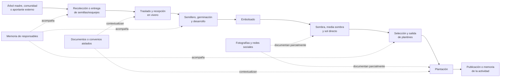

# CAPÍTULO III — MARCO APLICATIVO

El Marco aplicativo presenta la materialización del proceso de desarrollo descrito en el Capítulo I. Su organización mantiene la correspondencia con los cinco objetivos específicos: análisis de la gestión actual, diseño de la organización de la información, implementación e integración de los tres módulos, verificación de las funciones y evaluación de la capacidad de reconstrucción. La exposición distingue los hechos observados y las necesidades institucionales de las decisiones de diseño y de los resultados que se comprobarán posteriormente.

## 3.1. Análisis de la información y su gestión actual

### 3.1.1. Propósito y correspondencia con la metodología

Esta sección responde al primer objetivo específico: **analizar la información que se genera y cómo se gestiona actualmente en las actividades de Recolección, Vivero y Plantación de R3Foresta**. El resultado esperado es una caracterización de los procesos, actores, datos, soportes, dificultades y necesidades que proporcione una base verificable para el diseño de la sección 3.2.

El análisis se inició durante la fase de Inicio de RUP, iteración IN-1, mediante la delimitación del problema, los actores, el alcance y los riesgos iniciales. Se profundizó al comienzo de Elaboración, iteración EL-1, mediante una reunión de levantamiento realizada el 20 de julio de 2026, una entrevista semiestructurada y observación del vivero de Chasquipampa efectuadas el miércoles 22 de julio de 2026, y la revisión de documentación operativa. El 14 de septiembre de 2026 se incorporó un dossier documental asistido por inteligencia artificial para localizar y ordenar publicaciones públicas; este último se utiliza como contraste posterior y no modifica retroactivamente la situación descrita para el corte principal del 22 de julio.

La entrevista, la observación, el análisis documental y la revisión de registros se emplearon como técnicas de levantamiento dentro de RUP. No constituyen una metodología investigativa adicional. Su función fue recuperar necesidades, reconocer variantes, identificar riesgos y distinguir la práctica existente de las propuestas de expansión mencionadas por la organización.

**Tabla 3.1**

*Fuentes empleadas para analizar la gestión actual*

| Código | Fuente y fecha | Aporte al análisis | Limitación principal |
|---|---|---|---|
| FP-01 | Reunión de trabajo, 20 de julio de 2026 | Presentó las etapas inicialmente consideradas, la urgencia institucional y la información que se esperaba registrar | Combina práctica actual, propuesta de producto y aspiraciones comerciales |
| FP-02 | Entrevista a Hernán Lara, 22 de julio de 2026 | Describió los soportes utilizados, la procedencia del material, el trabajo en vivero, las plantaciones y la distribución funcional de responsabilidades | La transcripción automática contiene términos y cifras que deben interpretarse con cautela |
| FO-01 | Registro fotográfico de Chasquipampa, 22 de julio de 2026 | Permitió observar plantines en bolsas dentro de un ambiente protegido y en exposición directa al sol | Solo cubre Vivero; no registra recolección, despacho ni plantación definitiva |
| FD-01 | Dossier documental, corte al 14 de septiembre de 2026 | Organizó publicaciones públicas, actividades, cantidades declaradas y contradicciones que muestran la dispersión documental | Fue elaborado con asistencia de IA y no sustituye la revisión de las fuentes originales |
| DT-01 | Documentación operativa de los tres módulos | Permitió reconocer las familias de requisitos y reglas relacionadas con las necesidades halladas | Describe la solución especificada, no la práctica anterior a su adopción |

*Nota.* Elaboración propia. Las transcripciones FP-01 y FP-02 se conservan como fuentes primarias sin corregir. FD-01 se utiliza como índice de contraste; antes de emplear una afirmación pública como resultado definitivo deberá verificarse su fuente original.

Para interpretar las fuentes se utilizaron cinco categorías: práctica actual, necesidad, propuesta futura, decisión de alcance y dato pendiente de confirmación. Esta separación resultó necesaria porque en las reuniones aparecen, dentro de una misma explicación, actividades efectivamente realizadas, funciones que se deseaba incorporar a la aplicación y proyecciones relacionadas con carbono, blockchain o expansión territorial. Las dos últimas no se tratan como capacidades vigentes ni como compromisos del producto académico.

### 3.1.2. Contexto operativo seleccionado

R3Foresta trabaja con viveros, comunidades, juntas vecinales, instituciones educativas y otros aliados. Sin embargo, las actividades no se desarrollan con una estructura idéntica en todos los lugares. Para disponer de un contexto operativo concreto se seleccionó Chasquipampa como referencia principal. Según la confirmación del responsable del proyecto, este proceso es el utilizado por Hernán Lara, sirve para enseñar la secuencia a otras comunidades y será el escenario principal de las pruebas del sistema.

La selección no convierte a Chasquipampa en una muestra estadística ni permite atribuir automáticamente sus condiciones a todas las comunidades. Se utiliza como escenario operativo representativo porque reúne la secuencia de semillas, vivero y plantación, existe acceso para observar el trabajo y se dispone de antecedentes documentales y fotográficos. Cuando otro proyecto presente una variante —por ejemplo, ingreso de material donado, trabajo mediante convenio comunitario o recepción directa de plantas— la diferencia deberá registrarse sin forzarla dentro de una única secuencia.

El registro fotográfico del 22 de julio permite observar el componente de Vivero. En el ambiente protegido se encuentran plantines de diferentes tamaños agrupados en bolsas y recipientes. La imagen respalda la existencia de manejo por grupos y distintas condiciones de desarrollo, pero no permite determinar la especie, la cantidad exacta ni el origen de cada conjunto.

**Figura 3.1. Plantines en ambiente protegido del vivero de Chasquipampa**

*Nota.* Registro fotográfico propio del 22 de julio de 2026. La fecha y la ubicación fueron proporcionadas por el autor; el archivo no conserva esos datos en metadatos EXIF. La imagen respalda la observación del ambiente de vivero, pero no certifica especies, cantidades ni procedencias.

También se observó un espacio exterior con plantas embolsadas expuestas directamente al sol. La organización describió esta transición como parte del fortalecimiento previo a la salida del vivero. La condición heterogénea visible entre ejemplares muestra por qué un registro de entrada no basta para inferir la cantidad posterior de plantas disponibles: los resultados deben contarse y registrarse cuando se observan.

**Figura 3.2. Plantas embolsadas en exposición directa al sol**

*Nota.* Registro fotográfico propio del 22 de julio de 2026. La fotografía documenta una condición de manejo del vivero; no permite establecer por sí sola cuánto tiempo permaneció cada planta en esa etapa ni su aptitud para plantación.

### 3.1.3. Flujo operativo actual

El proceso general informado parte de la obtención de semillas o esquejes y continúa con su recepción y manejo en vivero, el embolsado de las plantas resultantes, su exposición progresiva a sombra, media sombra o sol directo y la selección de plantines para una plantación. La secuencia física produce información en distintos momentos, pero antes del sistema esa información no se conservaba en un historial integrado.

La práctica descrita no es completamente lineal. Un mismo origen puede alimentar más de un grupo del vivero; un vivero puede contener material de diferentes procedencias; y una plantación puede requerir plantas procedentes de varios grupos o viveros. También existe la posibilidad de incorporar material entregado por comunidades, colaboradores o donantes. Por tanto, el análisis no asume que cada semilla se convierte en una planta ni que cada plantación se abastece desde un único origen.

**Figura 3.3. Flujo actual y soportes de información identificados**

*Nota.* Elaboración propia a partir de FP-01, FP-02 y FO-01. Las líneas discontinuas representan soportes parciales; no existe todavía un identificador común que garantice la relación entre todos los registros.

#### 3.1.3.1. Recolección e ingreso de semillas o esquejes

La identificación de árboles madre se realiza considerando características observables como tamaño, condición general, fruto y hojas, además de la cercanía entre la procedencia y el lugar donde se espera utilizar el material. A partir de esos árboles pueden obtenerse semillas o esquejes. La organización considera relevantes el nombre común, el nombre científico, el tipo de material, la ubicación y la cantidad, expresada mediante conteo o peso según corresponda (FP-02).

La recolección no está asignada exclusivamente a un cargo. Puede efectuarla personal vinculado al vivero, una persona de la comunidad u otro colaborador. También puede existir entrega de material por un actor externo. En consecuencia, el primer responsable del recorrido no siempre es un empleado de R3Foresta y el sistema debe conservar, cuando esté disponible, quién recolectó o entregó el material y cuál fue su procedencia.

En la práctica anterior, una parte de esa información permanecía en la memoria de quienes participaron o acompañaba físicamente al material durante su traslado. No existía un registro uniforme que permitiera consultar el origen, la cantidad recibida, la fecha, el responsable y la evidencia como una sola unidad. Por ello, el ingreso al vivero se convierte en un punto de control decisivo: si el origen no se recupera en ese momento, la relación resulta difícil de reconstruir después.

#### 3.1.3.2. Manejo dentro del vivero

Al recibir el material, el personal del vivero puede pesarlo o contarlo y organizar su incorporación al proceso. Las semillas pasan al semillero y los esquejes siguen el tratamiento correspondiente. La germinación o el enraizamiento producen resultados observados, no una conversión automática de la cantidad inicial. Después se reconocen plantas que pueden embolsarse, grupos que sufren pérdidas y lotes que continúan su desarrollo.

El manejo incluye momentos descritos como germinación, embolsado, sombra, media sombra y sol directo. Las fotografías FO-01 documentan plantines en bolsas bajo protección y en un espacio con exposición solar. Sin embargo, no se observaron etiquetas o identificadores que permitieran relacionar visualmente cada grupo con un origen, una especie, una fecha de ingreso o una cantidad inicial. La organización física permite trabajar con el material, pero no constituye por sí sola un historial consultable.

La entrevista señala que la información más útil para la gestión comprende la cantidad que ingresó, la cantidad que produjo plantas, las plantas que permanecen vivas en el vivero y las pérdidas registradas durante el proceso. También resulta necesario conocer qué material se encuentra disponible para atender una plantación. Antes de la estructuración del sistema, estos valores no se mantenían de forma uniforme en Excel, cuadernos u otra base compartida; el estado del vivero se conocía principalmente mediante observación directa y memoria de los responsables (FP-02).

#### 3.1.3.3. Selección, salida y plantación

Cuando se requiere una actividad de arborización, forestación o reforestación, se define el lugar, la cantidad de plantas y las especies que se pretenden utilizar. Una plantación puede abastecerse con plantas procedentes de uno o varios viveros. Esto exige diferenciar la cantidad observada en el vivero, la cantidad comprometida para un destino, la cantidad entregada y la cantidad finalmente plantada.

R3Foresta informó que su producción es predominantemente propia. No obstante, durante la entrevista se reconocieron donaciones de plantas y se consideró necesario admitir una compra excepcional si una actividad futura no pudiera cubrirse con la producción disponible. Esta evolución de la respuesta muestra que la procedencia no debe reducirse a una regla absoluta de producción interna. El ingreso externo debe registrarse como una variante, sin convertirlo en un módulo independiente.

La información que con mayor frecuencia se difundía después de una plantación era la fecha, la cantidad y el lugar, acompañados de fotografías cuando las condiciones comunitarias permitían publicarlas. Facebook fue descrito como el repositorio público más antiguo y completo de la organización. Sin embargo, no todas las actividades fueron publicadas y una publicación aislada no siempre conserva la relación con la recolección, el lote del vivero, las pérdidas, los responsables o los movimientos que explican el resultado final.

**Tabla 3.2**

*Actividades, información y soportes identificados en el flujo actual*

| Etapa | Actividad | Información generada o necesaria | Soporte anterior predominante | Limitación observada |
|---|---|---|---|---|
| Recolección | Identificar árbol madre u origen | especie, características del árbol, ubicación | memoria, fotografía o referencia personal | el origen no siempre queda asociado con el material posterior |
| Recolección | Recoger o recibir material | tipo de material, cantidad, unidad, fecha, recolector o aportante | memoria y manejo físico | no existe una ficha uniforme para todas las entradas |
| Vivero | Recibir material | procedencia, cantidad y unidad recibidas, fecha, vivero y responsable | observación y coordinación directa | el ingreso puede perder su vínculo con la recolección |
| Vivero | Germinar o enraizar | fecha de inicio, material en proceso y resultado observado | memoria y observación | no puede explicarse de forma histórica la diferencia entre entrada y resultado |
| Vivero | Embolsar y desarrollar | plantas observadas, fecha, grupo y responsable | agrupación física y fotografías ocasionales | no se dispone de una identidad compartida para cada lote |
| Vivero | Registrar pérdidas y disponibilidad | cantidad perdida, causa y saldo utilizable | conteo eventual o conocimiento del responsable | no existe un saldo reconstruible mediante movimientos relacionados |
| Vivero→Plantación | Seleccionar y entregar | origen, cantidad, destino, fecha y responsables de entrega/recepción | coordinación directa, mensajes o documentos aislados | una plantación puede recibir de varios orígenes sin conciliación común |
| Plantación | Planificar y ejecutar | tipo de actividad, especies, cantidades, lugar, fecha, participantes y evidencia | coordinación operativa, fotografías y publicaciones | la publicación final no explica necesariamente la procedencia ni las diferencias de cantidad |

*Nota.* Elaboración propia a partir de FP-01, FP-02 y FO-01. La expresión “información generada o necesaria” no implica que todos esos datos se registraran de manera sistemática antes del proyecto.

### 3.1.4. Actores y distribución funcional de responsabilidades

La estructura actual se comprende mejor mediante funciones que mediante cargos rígidos. En proyectos comunitarios, una misma persona puede recolectar material, apoyar el vivero y participar en la plantación; a su vez, la dirección puede coordinar varias etapas. Durante las reuniones se propusieron niveles de vivero, plantación y zona, pero esa jerarquía se presentó como una necesidad de crecimiento y no como una estructura homogénea ya implantada.

**Tabla 3.3**

*Responsabilidades funcionales identificadas*

| Actor o función | Responsabilidades actuales identificadas | Información que produce o utiliza | Observación |
|---|---|---|---|
| Dirección o coordinación de R3Foresta | priorizar actividades, coordinar comunidades y viveros, definir destinos, supervisar plantaciones y comunicar resultados | necesidades, lugares, cantidades estimadas, participantes y publicaciones | concentra una parte importante de la memoria institucional |
| Recolector o aportante de material | identificar el origen, obtener o entregar semillas y esquejes | procedencia, especie declarada, ubicación, cantidad y fecha | puede pertenecer a R3Foresta, al vivero, a una comunidad o ser externo |
| Responsable de recepción y vivero | recibir, pesar o contar, organizar semillero, observar resultados, embolsar, cuidar y preparar plantas | cantidad recibida, resultado observado, etapa, pérdidas, disponibilidad y evidencia | la función existe aunque el cargo y el número de responsables varíen por vivero |
| Coordinador de plantación | definir o confirmar lugar, especies y cantidad; coordinar entrega y ejecución | planificación, destino, equipo, cantidad recibida y cantidad plantada | puede ser asumido por dirección o por un responsable local |
| Comunidad o aliado local | aportar trabajo, terreno, cuidado, producción o recepción según el convenio | participantes, material producido o recibido, destino y evidencia | la distribución de beneficios y plantas depende del acuerdo específico |
| Donante, proveedor o colaborador externo | entregar material vegetal cuando se presenta una incorporación externa | entidad de origen, material, cantidad, fecha y documento disponible | es una variante menos frecuente, pero debe conservarse para explicar la procedencia |
| Patrocinador u organización asociada | consultar resultados o respaldar una actividad | información agregada, ubicación, evidencia y avance | no necesariamente interviene en el registro operativo diario |

*Nota.* Elaboración propia a partir de FP-01, FP-02 y las aclaraciones proporcionadas por el autor del proyecto. La tabla caracteriza funciones y no constituye todavía el modelo de autorización del sistema.

El control formal del material comienza principalmente con su recepción en vivero, pero la trazabilidad exige capturar también el antecedente disponible. Por ello, no resulta adecuado identificar a una sola persona como “encargado de recolección” para todos los casos. La necesidad real es distinguir al actor que origina o entrega el material del responsable que lo recibe y registra.

Dentro del vivero se identifican funciones de recepción, manejo y seguimiento. En Chasquipampa estas actividades son coordinadas por R3Foresta y ejecutadas por las personas que atienden el espacio. Para la plantación, la coordinación puede permanecer en la dirección o delegarse a un responsable de la actividad. Los cargos de encargado zonal y los niveles jerárquicos comunitarios mencionados en la entrevista se tratarán como evolución organizativa; no se utilizarán para afirmar que todos los proyectos ya operan con esa estructura.

### 3.1.5. Gestión y calidad de la información disponible

El problema no consiste en una ausencia absoluta de información. Existen fotografías, publicaciones, nombres de lugares, cantidades declaradas y conocimiento acumulado por los responsables. La dificultad es que esos elementos no comparten una estructura que permita vincularlos y recuperarlos como un recorrido.

Facebook cumple una doble función: comunica públicamente las actividades y conserva una memoria cronológica parcial. Esta memoria permitió recuperar eventos pasados, pero presenta cuatro límites. Primero, no todas las comunidades autorizan la toma o publicación de imágenes. Segundo, los campos incluidos varían entre publicaciones. Tercero, las publicaciones no poseen un identificador común con los grupos del vivero o la recolección de origen. Cuarto, una cifra publicada no siempre puede distinguir entre meta, plantín entregado, árbol plantado, reposición o árbol observado posteriormente.

El dossier FD-01 refuerza esta conclusión. Su revisión localizó actividades cuantificables junto con cifras globales declaradas que no pueden reproducirse mediante un inventario público desagregado. También identificó referencias aparentemente contradictorias para Chasquipampa: una declaración de pérdida total y otros documentos con porcentajes de supervivencia. Estas diferencias no prueban que una fuente sea falsa; pueden corresponder a parcelas, fechas o cohortes distintas. Precisamente muestran que, sin identificadores, ubicación delimitada, fecha y relación entre eventos, no es posible conciliarlas de manera confiable.

La evidencia fotográfica presenta una limitación semejante. Las figuras 3.1 y 3.2 permiten reconocer plantas embolsadas y ambientes de manejo, pero no contienen etiquetas visibles suficientes para recuperar especie, lote, cantidad o procedencia. Una fotografía adquiere mayor valor informacional cuando se vincula con el evento al que respalda, su fecha, ubicación, responsable y unidad trazable. Aun así, respalda el registro y no certifica por sí sola la correspondencia absoluta con el mundo físico.

**Tabla 3.4**

*Problemas identificados en la gestión actual de la información*

| Código | Problema | Consecuencia operativa |
|---|---|---|
| HAL-01 | dispersión entre memoria, fotografías, redes, mensajes y documentos | reconstruir una actividad exige revisar varias fuentes y consultar a quienes participaron |
| HAL-02 | ausencia de una relación continua entre etapas | no puede recuperarse con seguridad qué origen alimentó un grupo del vivero o una plantación |
| HAL-03 | granularidad y terminología variables | pueden confundirse semillas, esquejes, plantines, plantas entregadas y árboles plantados |
| HAL-04 | responsabilidades no formalizadas de manera uniforme | no siempre queda claro quién originó, recibió, autorizó o ejecutó una operación |
| HAL-05 | cantidades sin movimientos y saldos relacionados | las diferencias por germinación, merma, salida o devolución no quedan explicadas históricamente |
| HAL-06 | evidencia separada del hecho que respalda | una imagen aislada no permite recuperar fecha, lugar, responsable, cantidad o procedencia |
| HAL-07 | publicaciones y cifras sin identificadores comunes | las cantidades agregadas o contradictorias no pueden conciliarse por proyecto, parcela o cohorte |
| HAL-08 | cobertura documental desigual | algunas actividades se publican con fotografías y otras permanecen únicamente en memoria o coordinación privada |

*Nota.* Elaboración propia. Los códigos se mantienen en la matriz de análisis del objetivo específico 1 para conservar su relación con las fuentes.

### 3.1.6. Necesidades y requisitos iniciales derivados

Los hallazgos permiten formular necesidades de información antes de decidir tablas, servicios o interfaces. El análisis requiere que cada etapa conserve datos propios y, al mismo tiempo, que los movimientos y resultados mantengan relaciones suficientes para reconstruir el recorrido. No se exige identificación individual de cada semilla o planta; el lote constituye la unidad operativa inicial más viable.

**Tabla 3.5**

*Reglas operativas y de alcance confirmadas durante el análisis*

| Código | Regla confirmada | Naturaleza |
|---|---|---|
| RAN-01 | el actor que origina o entrega material puede ser distinto del responsable que lo recibe en el vivero; ambos deben poder distinguirse | operación actual |
| RAN-02 | el flujo estándar de propagación utiliza semillas o esquejes; otros ingresos de plantas deben conservar su procedencia como variante externa | dominio y alcance |
| RAN-03 | las semillas pueden registrarse mediante conteo o peso según el caso, mientras las plantas vivas se observan y registran en unidades | dominio |
| RAN-04 | el sistema no debe inferir automáticamente cuántas plantas resultan de una cantidad inicial de semillas o esquejes | integridad de información |
| RAN-05 | la producción propia es la práctica predominante, pero una donación o adquisición excepcional no puede incorporarse sin registrar el origen disponible | operación y excepción |
| RAN-06 | una plantación puede recibir material de más de un lote o vivero; cada aporte debe conservar cantidad y procedencia | operación actual |
| RAN-07 | las operaciones relevantes deben identificar fecha, responsable, ubicación y evidencia cuando corresponda | trazabilidad |
| RAN-08 | los registros operativos deben ser realizados por personas autorizadas y vinculadas con R3Foresta o con la actividad; no se acepta un registro público irrestricto | control operativo acordado |
| RAN-09 | una fotografía respalda el registro con el que se relaciona, pero no certifica de forma independiente la realidad física declarada | límite probatorio |
| RAN-10 | el recorrido académico concluye con el registro de la plantación; el seguimiento posterior y la cuantificación de carbono permanecen fuera del alcance | alcance académico |

*Nota.* Elaboración propia a partir de FP-01, FP-02, el Perfil aprobado y las aclaraciones del autor. Estas reglas de análisis se vincularán en la sección 3.2 con las reglas de negocio canónicas de cada módulo.

**Tabla 3.6**

*Relación entre hallazgos, necesidades y requisitos iniciales*

| Necesidad | Requisito inicial derivado | Etapa o capacidad | Familias de especificaciones relacionadas |
|---|---|---|---|
| NEC-01 | registrar el origen disponible, el tipo de material, la especie, la cantidad, la unidad, la fecha, la ubicación y el actor de origen | Recolección e ingresos externos | `RF-REC-*` y datos maestros `RF-GEN-*` |
| NEC-02 | asignar una identidad estable al lote y conservarla o relacionarla cuando el material cambie de etapa | Integración transversal | contratos M1→M2 y M2→M3 |
| NEC-03 | separar la cantidad de material en proceso del resultado observado en plantas vivas | Vivero | `RF-VIV-01`, `RF-VIV-02` y reglas de unidades |
| NEC-04 | registrar pérdidas, salidas y devoluciones como hechos que expliquen el saldo | Vivero y Plantación | eventos `RF-VIV-*`, asignaciones y movimientos de M3 |
| NEC-05 | vincular fecha, responsable, ubicación y evidencia con cada operación relevante | Capacidad transversal | `RF-GEN-*` y evidencia de los tres módulos |
| NEC-06 | diferenciar al recolector o aportante, al receptor, al responsable de vivero y al coordinador de plantación | General y tres módulos | usuarios, roles, membresías y responsables por evento |
| NEC-07 | conservar la procedencia y cantidad del material entregado y efectivamente utilizado en una plantación | Vivero→Plantación | asignación, recepción y registro de plantación |
| NEC-08 | consultar el historial desde el origen registrado hasta el registro de la plantación | Trazabilidad transversal | historial, timeline y consulta extremo a extremo |

*Nota.* Elaboración propia. Las familias indicadas sirven como enlace con la documentación técnica existente; la sección 3.2 deberá presentar la organización concreta de la información, las relaciones y las invariantes seleccionadas.

Además de los requisitos funcionales, el análisis identificó condiciones transversales. El sistema debe conservar historial aun cuando un usuario, vivero o catálogo deje de estar activo; evitar que los cambios de nombres rompan la interpretación de registros anteriores; restringir las operaciones según responsabilidad; proteger credenciales y datos personales; y tratar fotografías, coordenadas y documentos según su autorización y finalidad. La autorización concedida para utilizar nombres, ubicaciones exactas y convenios en el documento académico no elimina la necesidad de controlar su publicación dentro del producto.

La organización expresó interés en calcular captura de dióxido de carbono, emitir certificados, incorporar blockchain y realizar seguimiento posterior. Esas necesidades pertenecen a una proyección institucional diferente. El sistema académico termina con el registro de la plantación; no calcula biomasa o CO₂ equivalente, no comprueba supervivencia posterior, no implementa MRV y no genera ni comercializa créditos. Mantener esa frontera evita convertir expectativas iniciales en requisitos no evaluables dentro del proyecto.

### 3.1.7. Resultado del análisis

El análisis muestra que R3Foresta genera información pertinente durante todo el recorrido: procedencia, especie, cantidad, unidad, fecha, responsables, ubicación, cambios observados en vivero, destino y fotografías. La debilidad principal no es la inexistencia de esos datos, sino su conservación fragmentada y la ausencia de relaciones que permitan explicar cómo un material registrado en una etapa se vincula con los resultados y movimientos posteriores.

Chasquipampa proporciona el contexto operativo principal para ordenar esta información. La observación fotográfica confirma el manejo de grupos de plantas embolsadas en ambientes protegidos y a sol directo. Las entrevistas permiten extender la descripción hacia la recolección y la plantación, mientras el dossier público muestra las dificultades de conciliar cantidades cuando los registros carecen de identificadores comunes. La cobertura probatoria no es uniforme: Vivero cuenta con observación directa; Recolección y Plantación se sustentan por ahora principalmente en declaraciones, publicaciones y documentación operativa.

Como resultado de OBJ-01 se definieron el flujo actual, sus actores funcionales, la información generada, los soportes empleados, ocho problemas de gestión y ocho necesidades que deberán responder las siguientes secciones. Estos productos permiten avanzar hacia el diseño sin asumir todavía que una base de datos, un evento o una interfaz concreta sea la solución. La sección 3.2 tomará estas necesidades para organizar la información, definir las relaciones del recorrido y establecer las invariantes con las que posteriormente se verificará la coherencia de cantidades y movimientos.
