# CAPÍTULO III — MARCO APLICATIVO

El Marco aplicativo organiza los productos y la evidencia técnica disponible de acuerdo con el proceso de desarrollo descrito en el Capítulo I. Su estructura mantiene la correspondencia con los cinco objetivos específicos: análisis de la gestión actual, diseño de la organización de la información, implementación e integración de los tres módulos, verificación de las funciones y evaluación de la capacidad de reconstrucción. La exposición distingue los hechos observados y las necesidades institucionales de las decisiones de diseño, los avances implementados, los resultados verificados y las aceptaciones todavía pendientes.

Las tablas del presente capítulo utilizan una estructura compatible con APA 7: número en una línea independiente, título en cursiva y nota inmediatamente debajo. La eliminación de líneas verticales y cuadriculado, la repetición de encabezados en tablas que continúen en otra página y el uso excepcional de orientación horizontal se resolverán durante la maquetación del documento final, sin alterar el contenido fuente en Markdown.

## 3.1. Análisis de la información y su gestión actual

### 3.1.1. Propósito y correspondencia con la metodología

Esta sección responde al primer objetivo específico: **analizar la información que se genera y cómo se gestiona actualmente en las actividades de Recolección, Vivero y Plantación de R3Foresta**. El resultado esperado es una caracterización de los procesos, actores, datos, soportes, dificultades y necesidades que proporcione una base contrastable para el diseño de la sección 3.2.

El análisis se inició durante la fase de Inicio de RUP, iteración IN-1, mediante la delimitación del problema, los actores, el alcance y los riesgos iniciales. Se profundizó al comienzo de Elaboración, iteración EL-1, mediante una reunión de levantamiento realizada el 20 de julio de 2026, una entrevista semiestructurada y observación del vivero de Chasquipampa efectuadas el miércoles 22 de julio de 2026, y la revisión de documentación operativa. El 14 de septiembre de 2026 se incorporó un dossier documental asistido por inteligencia artificial para localizar y ordenar publicaciones públicas; este último se utiliza como contraste posterior y no modifica retroactivamente la situación descrita para el corte principal del 22 de julio.

La entrevista, la observación, el análisis documental y la revisión de registros se emplearon como técnicas de levantamiento dentro de RUP. No constituyen una metodología investigativa adicional. Su función fue recuperar necesidades, reconocer variantes, identificar riesgos y distinguir la práctica existente de las propuestas de expansión mencionadas por la organización.

**Tabla 3.1**

*Fuentes empleadas para analizar la gestión actual*

| Código | Fuente y fecha | Aporte al análisis | Limitación principal |
|---|---|---|---|
| FP-01 | Reunión de trabajo, 20 de julio de 2026 | Presentó las etapas inicialmente consideradas, la urgencia institucional y la información que se esperaba registrar | Combina práctica actual, propuesta de producto y aspiraciones comerciales |
| FP-02 | Entrevista a Hernán Lara, 22 de julio de 2026 | Describió los soportes utilizados, la procedencia del material, el trabajo en vivero, las plantaciones y la distribución funcional de responsabilidades | La transcripción automática contiene términos y cifras que deben interpretarse con cautela |
| FO-01 | Registro fotográfico de Chasquipampa, 22 de julio de 2026 | Permitió observar plantines en bolsas dentro de un ambiente protegido y en exposición directa al sol | Solo cubre Vivero; no registra recolección, despacho ni plantación definitiva |
| FD-01 | Dossier documental, corte al 14 de septiembre de 2026 | Organizó publicaciones públicas, actividades, cantidades declaradas y contradicciones que muestran la dispersión documental | Fue elaborado con asistencia de IA y no sustituye la revisión de las fuentes originales |
| DT-01 | Documentación operativa de los tres módulos | Permitió reconocer las familias de requisitos y reglas relacionadas con las necesidades halladas | Describe la solución especificada, no la práctica anterior a su adopción |

*Nota.* Elaboración propia. Las transcripciones FP-01 y FP-02 se conservan como fuentes primarias sin corregir. FD-01 se utiliza como índice de contraste; antes de emplear una afirmación pública como resultado definitivo deberá verificarse su fuente original.

Para interpretar las fuentes se utilizaron cinco categorías: práctica actual, necesidad, propuesta futura, decisión de alcance y dato pendiente de confirmación. Esta separación resultó necesaria porque en las reuniones aparecen, dentro de una misma explicación, actividades efectivamente realizadas, funciones que se deseaba incorporar a la aplicación y proyecciones relacionadas con carbono, blockchain o expansión territorial. Las dos últimas no se tratan como capacidades vigentes ni como compromisos del producto académico.

### 3.1.2. Contexto operativo seleccionado

R3Foresta trabaja con viveros, comunidades, juntas vecinales, instituciones educativas y otros aliados. Sin embargo, las actividades no se desarrollan con una estructura idéntica en todos los lugares. Para disponer de un contexto operativo concreto se seleccionó Chasquipampa como referencia principal. Según la confirmación del responsable del proyecto, este proceso es el utilizado por Hernán Lara, sirve para enseñar la secuencia a otras comunidades y será el escenario principal de las pruebas del sistema.

La selección no convierte a Chasquipampa en una muestra estadística ni permite atribuir automáticamente sus condiciones a todas las comunidades. Se utiliza como escenario operativo representativo porque reúne la secuencia de semillas, vivero y plantación, existe acceso para observar el trabajo y se dispone de antecedentes documentales y fotográficos. Cuando otro proyecto presente una variante —por ejemplo, ingreso de material donado, trabajo mediante convenio comunitario o recepción directa de plantas— la diferencia deberá registrarse sin forzarla dentro de una única secuencia.

El registro fotográfico del 22 de julio permite observar el componente de Vivero. En el ambiente protegido se encuentran plantines de diferentes tamaños agrupados en bolsas y recipientes. La imagen respalda la existencia de manejo por grupos y distintas condiciones de desarrollo, pero no permite determinar la especie, la cantidad exacta ni el origen de cada conjunto.

**Figura 3.1. Plantines en ambiente protegido del vivero de Chasquipampa**


*Nota.* Registro fotográfico propio del 22 de julio de 2026. La fecha y la ubicación fueron proporcionadas por el autor; el archivo no conserva esos datos en metadatos EXIF. La imagen respalda la observación del ambiente de vivero, pero no certifica especies, cantidades ni procedencias.

También se observó un espacio exterior con plantas embolsadas expuestas directamente al sol. La organización describió esta transición como parte del fortalecimiento previo a la salida del vivero. La condición heterogénea visible entre ejemplares muestra por qué un registro de entrada no basta para inferir la cantidad posterior de plantas disponibles: los resultados deben contarse y registrarse cuando se observan.

**Figura 3.2. Plantas embolsadas en exposición directa al sol**


*Nota.* Registro fotográfico propio del 22 de julio de 2026. La fotografía documenta una condición de manejo del vivero; no permite establecer por sí sola cuánto tiempo permaneció cada planta en esa etapa ni su aptitud para plantación.

### 3.1.3. Flujo operativo actual

El proceso general informado parte de la obtención de semillas o esquejes y continúa con su recepción y manejo en vivero, el embolsado de las plantas resultantes, su exposición progresiva a sombra, media sombra o sol directo y la selección de plantines para una plantación. La secuencia física produce información en distintos momentos, pero antes del sistema esa información no se conservaba en un historial integrado.

La práctica descrita no es completamente lineal. Un mismo origen puede alimentar más de un grupo del vivero; un vivero puede contener material de diferentes procedencias; y una plantación puede requerir plantas procedentes de varios grupos o viveros. También existe la posibilidad de incorporar material entregado por comunidades, colaboradores o donantes. Por tanto, el análisis no asume que cada semilla se convierte en una planta ni que cada plantación se abastece desde un único origen.

**Figura 3.3. Flujo actual y soportes de información identificados**

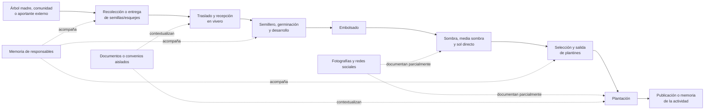

*Nota.* Elaboración propia a partir de FP-01, FP-02 y FO-01. Las líneas discontinuas representan soportes parciales; no existe todavía un identificador común que garantice la relación entre todos los registros.

#### 3.1.3.1. Recolección e ingreso de semillas o esquejes

La identificación de árboles madre se realiza considerando características observables como tamaño, condición general, fruto y hojas, además de la cercanía entre la procedencia y el lugar donde se espera utilizar el material. A partir de esos árboles pueden obtenerse semillas o esquejes. La organización considera relevantes el nombre común, el nombre científico, el tipo de material, la ubicación y la cantidad, expresada mediante conteo o peso según corresponda (FP-02).

La recolección no está asignada exclusivamente a un cargo. Puede efectuarla personal vinculado al vivero, una persona de la comunidad u otro colaborador. También puede existir entrega de material por un actor externo. En consecuencia, el primer responsable del recorrido no siempre es un empleado de R3Foresta y el sistema debe conservar, cuando esté disponible, quién recolectó o entregó el material y cuál fue su procedencia.

En la práctica anterior, una parte de esa información permanecía en la memoria de quienes participaron o acompañaba físicamente al material durante su traslado. No existía un registro uniforme que permitiera consultar el origen, la cantidad recibida, la fecha, el responsable y la evidencia como una sola unidad. Por ello, el ingreso al vivero se convierte en un punto de control decisivo: si el origen no se recupera en ese momento, la relación resulta difícil de reconstruir después.

#### 3.1.3.2. Manejo dentro del vivero

Al recibir el material, el personal del vivero puede pesarlo o contarlo y organizar su incorporación al proceso. Las semillas pasan al semillero y los esquejes siguen el tratamiento correspondiente. La germinación o el enraizamiento producen resultados observados, no una conversión automática de la cantidad inicial. Después se reconocen plantas que pueden embolsarse, grupos que sufren pérdidas y lotes que continúan su desarrollo.

El manejo incluye momentos descritos como germinación, embolsado, sombra, media sombra y sol directo. Las fotografías FO-01 documentan plantines en bolsas bajo protección y en un espacio con exposición solar. Sin embargo, no se observaron etiquetas o identificadores que permitieran relacionar visualmente cada grupo con un origen, una especie, una fecha de ingreso o una cantidad inicial. La organización física permite trabajar con el material, pero no constituye por sí sola un historial consultable.

La entrevista señala que la información más útil para la gestión comprende la cantidad que ingresó, la cantidad que produjo plantas, las plantas que permanecen vivas en el vivero y las pérdidas registradas durante el proceso. También resulta necesario conocer qué material se encuentra disponible para atender una plantación. Antes de la estructuración del sistema, estos valores no se mantenían de forma uniforme en Excel, cuadernos u otra base compartida; el estado del vivero se conocía principalmente mediante observación directa y memoria de los responsables (FP-02).

#### 3.1.3.3. Selección, salida y plantación

Cuando se requiere una actividad de arborización, forestación o reforestación, se define el lugar, la cantidad de plantas y las especies que se pretenden utilizar. Una plantación puede abastecerse con plantas procedentes de uno o varios viveros. Esto exige diferenciar la cantidad observada en el vivero, la cantidad comprometida para un destino, la cantidad entregada y la cantidad finalmente plantada.

R3Foresta informó que su producción es predominantemente propia. No obstante, durante la entrevista se reconocieron donaciones de plantas y se consideró necesario admitir una compra excepcional si una actividad futura no pudiera cubrirse con la producción disponible. Esta evolución de la respuesta muestra que la procedencia no debe reducirse a una regla absoluta de producción interna. El ingreso externo debe registrarse como una variante, sin convertirlo en un módulo independiente.

La información que con mayor frecuencia se difundía después de una plantación era la fecha, la cantidad y el lugar, acompañados de fotografías cuando las condiciones comunitarias permitían publicarlas. Facebook fue descrito como el repositorio público más antiguo y completo de la organización. Sin embargo, no todas las actividades fueron publicadas y una publicación aislada no siempre conserva la relación con la recolección, el lote del vivero, las pérdidas, los responsables o los movimientos que explican el resultado final.

**Tabla 3.2**

*Actividades, información y soportes identificados en el flujo actual*

| Etapa | Actividad | Información generada o necesaria | Soporte anterior predominante | Limitación observada |
|---|---|---|---|---|
| Recolección | Identificar árbol madre u origen | especie, características del árbol, ubicación | memoria, fotografía o referencia personal | el origen no siempre queda asociado con el material posterior |
| Recolección | Recoger o recibir material | tipo de material, cantidad, unidad, fecha, recolector o aportante | memoria y manejo físico | no existe una ficha uniforme para todas las entradas |
| Vivero | Recibir material | procedencia, cantidad y unidad recibidas, fecha, vivero y responsable | observación y coordinación directa | el ingreso puede perder su vínculo con la recolección |
| Vivero | Germinar o enraizar | fecha de inicio, material en proceso y resultado observado | memoria y observación | no puede explicarse de forma histórica la diferencia entre entrada y resultado |
| Vivero | Embolsar y desarrollar | plantas observadas, fecha, grupo y responsable | agrupación física y fotografías ocasionales | no se dispone de una identidad compartida para cada lote |
| Vivero | Registrar pérdidas y disponibilidad | cantidad perdida, causa y saldo utilizable | conteo eventual o conocimiento del responsable | no existe un saldo reconstruible mediante movimientos relacionados |
| Vivero→Plantación | Seleccionar y entregar | origen, cantidad, destino, fecha y responsables de entrega/recepción | coordinación directa, mensajes o documentos aislados | una plantación puede recibir de varios orígenes sin conciliación común |
| Plantación | Planificar y ejecutar | tipo de actividad, especies, cantidades, lugar, fecha, participantes y evidencia | coordinación operativa, fotografías y publicaciones | la publicación final no explica necesariamente la procedencia ni las diferencias de cantidad |

*Nota.* Elaboración propia a partir de FP-01, FP-02 y FO-01. La expresión “información generada o necesaria” no implica que todos esos datos se registraran de manera sistemática antes del proyecto.

### 3.1.4. Actores y distribución funcional de responsabilidades

La estructura actual se comprende mejor mediante funciones que mediante cargos rígidos. En proyectos comunitarios, una misma persona puede recolectar material, apoyar el vivero y participar en la plantación; a su vez, la dirección puede coordinar varias etapas. Durante las reuniones se propusieron niveles de vivero, plantación y zona, pero esa jerarquía se presentó como una necesidad de crecimiento y no como una estructura homogénea ya implantada.

**Tabla 3.3**

*Responsabilidades funcionales identificadas*

| Actor o función | Responsabilidades actuales identificadas | Información que produce o utiliza | Observación |
|---|---|---|---|
| Dirección o coordinación de R3Foresta | priorizar actividades, coordinar comunidades y viveros, definir destinos, supervisar plantaciones y comunicar resultados | necesidades, lugares, cantidades estimadas, participantes y publicaciones | concentra una parte importante de la memoria institucional |
| Recolector o aportante de material | identificar el origen, obtener o entregar semillas y esquejes | procedencia, especie declarada, ubicación, cantidad y fecha | puede pertenecer a R3Foresta, al vivero, a una comunidad o ser externo |
| Responsable de recepción y vivero | recibir, pesar o contar, organizar semillero, observar resultados, embolsar, cuidar y preparar plantas | cantidad recibida, resultado observado, etapa, pérdidas, disponibilidad y evidencia | la función existe aunque el cargo y el número de responsables varíen por vivero |
| Coordinador de plantación | definir o confirmar lugar, especies y cantidad; coordinar entrega y ejecución | planificación, destino, equipo, cantidad recibida y cantidad plantada | puede ser asumido por dirección o por un responsable local |
| Comunidad o aliado local | aportar trabajo, terreno, cuidado, producción o recepción según el convenio | participantes, material producido o recibido, destino y evidencia | la distribución de beneficios y plantas depende del acuerdo específico |
| Donante, proveedor o colaborador externo | entregar material vegetal cuando se presenta una incorporación externa | entidad de origen, material, cantidad, fecha y documento disponible | es una variante menos frecuente, pero debe conservarse para explicar la procedencia |
| Patrocinador u organización asociada | consultar resultados o respaldar una actividad | información agregada, ubicación, evidencia y avance | no necesariamente interviene en el registro operativo diario |

*Nota.* Elaboración propia a partir de FP-01, FP-02 y las aclaraciones proporcionadas por el autor del proyecto. La tabla caracteriza funciones y no constituye todavía el modelo de autorización del sistema.

El control formal del material comienza principalmente con su recepción en vivero, pero la trazabilidad exige capturar también el antecedente disponible. Por ello, no resulta adecuado identificar a una sola persona como “encargado de recolección” para todos los casos. La necesidad real es distinguir al actor que origina o entrega el material del responsable que lo recibe y registra.

Dentro del vivero se identifican funciones de recepción, manejo y seguimiento. En Chasquipampa estas actividades son coordinadas por R3Foresta y ejecutadas por las personas que atienden el espacio. Para la plantación, la coordinación puede permanecer en la dirección o delegarse a un responsable de la actividad. Los cargos de encargado zonal y los niveles jerárquicos comunitarios mencionados en la entrevista se tratarán como evolución organizativa; no se utilizarán para afirmar que todos los proyectos ya operan con esa estructura.

### 3.1.5. Gestión y calidad de la información disponible

El problema no consiste en una ausencia absoluta de información. Existen fotografías, publicaciones, nombres de lugares, cantidades declaradas y conocimiento acumulado por los responsables. La dificultad es que esos elementos no comparten una estructura que permita vincularlos y recuperarlos como un recorrido.

Facebook cumple una doble función: comunica públicamente las actividades y conserva una memoria cronológica parcial. Esta memoria permitió recuperar eventos pasados, pero presenta cuatro límites. Primero, no todas las comunidades autorizan la toma o publicación de imágenes. Segundo, los campos incluidos varían entre publicaciones. Tercero, las publicaciones no poseen un identificador común con los grupos del vivero o la recolección de origen. Cuarto, una cifra publicada no siempre puede distinguir entre meta, plantín entregado, árbol plantado, reposición o árbol observado posteriormente.

El dossier FD-01 refuerza esta conclusión. Su revisión localizó actividades cuantificables junto con cifras globales declaradas que no pueden reproducirse mediante un inventario público desagregado. También identificó referencias aparentemente contradictorias para Chasquipampa: una declaración de pérdida total y otros documentos con porcentajes de supervivencia. Estas diferencias no prueban que una fuente sea falsa; pueden corresponder a parcelas, fechas o cohortes distintas. Precisamente muestran que, sin identificadores, ubicación delimitada, fecha y relación entre eventos, no es posible conciliarlas de manera confiable.

La evidencia fotográfica presenta una limitación semejante. Las figuras 3.1 y 3.2 permiten reconocer plantas embolsadas y ambientes de manejo, pero no contienen etiquetas visibles suficientes para recuperar especie, lote, cantidad o procedencia. Una fotografía adquiere mayor valor informacional cuando se vincula con el evento al que respalda, su fecha, ubicación, responsable y unidad trazable. Aun así, respalda el registro y no certifica por sí sola la correspondencia absoluta con el mundo físico.

**Tabla 3.4**

*Problemas identificados en la gestión actual de la información*

| Código | Problema | Consecuencia operativa |
|---|---|---|
| HAL-01 | dispersión entre memoria, fotografías, redes, mensajes y documentos | reconstruir una actividad exige revisar varias fuentes y consultar a quienes participaron |
| HAL-02 | ausencia de una relación continua entre etapas | no puede recuperarse con seguridad qué origen alimentó un grupo del vivero o una plantación |
| HAL-03 | granularidad y terminología variables | pueden confundirse semillas, esquejes, plantines, plantas entregadas y árboles plantados |
| HAL-04 | responsabilidades no formalizadas de manera uniforme | no siempre queda claro quién originó, recibió, autorizó o ejecutó una operación |
| HAL-05 | cantidades sin movimientos y saldos relacionados | las diferencias por germinación, merma, salida o devolución no quedan explicadas históricamente |
| HAL-06 | evidencia separada del hecho que respalda | una imagen aislada no permite recuperar fecha, lugar, responsable, cantidad o procedencia |
| HAL-07 | publicaciones y cifras sin identificadores comunes | las cantidades agregadas o contradictorias no pueden conciliarse por proyecto, parcela o cohorte |
| HAL-08 | cobertura documental desigual | algunas actividades se publican con fotografías y otras permanecen únicamente en memoria o coordinación privada |

*Nota.* Elaboración propia. Los códigos se mantienen en la matriz de análisis del objetivo específico 1 para conservar su relación con las fuentes.

### 3.1.6. Necesidades y requisitos iniciales derivados

Los hallazgos permiten formular necesidades de información antes de decidir tablas, servicios o interfaces. El análisis requiere que cada etapa conserve datos propios y, al mismo tiempo, que los movimientos y resultados mantengan relaciones suficientes para reconstruir el recorrido. No se exige identificación individual de cada semilla o planta; el lote constituye la unidad operativa inicial más viable.

**Tabla 3.5**

*Reglas operativas y de alcance confirmadas durante el análisis*

| Código | Regla confirmada | Naturaleza |
|---|---|---|
| RAN-01 | el actor que origina o entrega material puede ser distinto del responsable que lo recibe en el vivero; ambos deben poder distinguirse | operación actual |
| RAN-02 | el flujo estándar de propagación utiliza semillas o esquejes; otros ingresos de plantas deben conservar su procedencia como variante externa | dominio y alcance |
| RAN-03 | las semillas pueden registrarse mediante conteo o peso según el caso, mientras las plantas vivas se observan y registran en unidades | dominio |
| RAN-04 | el sistema no debe inferir automáticamente cuántas plantas resultan de una cantidad inicial de semillas o esquejes | integridad de información |
| RAN-05 | la producción propia es la práctica predominante, pero una donación o adquisición excepcional no puede incorporarse sin registrar el origen disponible | operación y excepción |
| RAN-06 | una plantación puede recibir material de más de un lote o vivero; cada aporte debe conservar cantidad y procedencia | operación actual |
| RAN-07 | las operaciones relevantes deben identificar fecha, responsable, ubicación y evidencia cuando corresponda | trazabilidad |
| RAN-08 | los registros operativos deben ser realizados por personas autorizadas y vinculadas con R3Foresta o con la actividad; no se acepta un registro público irrestricto | control operativo acordado |
| RAN-09 | una fotografía respalda el registro con el que se relaciona, pero no certifica de forma independiente la realidad física declarada | límite probatorio |
| RAN-10 | el recorrido académico concluye con el registro de la plantación; el seguimiento posterior y la cuantificación de carbono permanecen fuera del alcance | alcance académico |

*Nota.* Elaboración propia a partir de FP-01, FP-02, el Perfil aprobado y las aclaraciones del autor. La relación detallada entre estas reglas de análisis y las reglas de negocio canónicas permanece pendiente de consolidación en la matriz principal de trazabilidad.

**Tabla 3.6**

*Relación entre hallazgos, necesidades y requisitos iniciales*

| Necesidad | Requisito inicial derivado | Etapa o capacidad | Familias de especificaciones relacionadas |
|---|---|---|---|
| NEC-01 | registrar el origen disponible, el tipo de material, la especie, la cantidad, la unidad, la fecha, la ubicación y el actor de origen | Recolección e ingresos externos | `RF-REC-*` y datos maestros `RF-GEN-*` |
| NEC-02 | asignar una identidad estable al lote y conservarla o relacionarla cuando el material cambie de etapa | Integración transversal | contratos M1→M2 y M2→M3 |
| NEC-03 | separar la cantidad de material en proceso del resultado observado en plantas vivas | Vivero | `RF-VIV-01`, `RF-VIV-02` y reglas de unidades |
| NEC-04 | registrar pérdidas, salidas y devoluciones como hechos que expliquen el saldo | Vivero y Plantación | eventos `RF-VIV-*`, asignaciones y movimientos de M3 |
| NEC-05 | vincular fecha, responsable, ubicación y evidencia con cada operación relevante | Capacidad transversal | `RF-GEN-*` y evidencia de los tres módulos |
| NEC-06 | diferenciar al recolector o aportante, al receptor, al responsable de vivero y al coordinador de plantación | General y tres módulos | usuarios, roles, membresías y responsables por evento |
| NEC-07 | conservar la procedencia y cantidad del material entregado y efectivamente utilizado en una plantación | Vivero→Plantación | asignación, recepción y registro de plantación |
| NEC-08 | consultar el historial desde el origen registrado hasta el registro de la plantación | Trazabilidad transversal | historial, timeline y consulta extremo a extremo |

*Nota.* Elaboración propia. Las familias indicadas sirven como enlace con la documentación técnica existente; la sección 3.2 deberá presentar la organización concreta de la información, las relaciones y las invariantes seleccionadas.

Además de los requisitos funcionales, el análisis identificó condiciones transversales. El sistema debe conservar historial aun cuando un usuario, vivero o catálogo deje de estar activo; evitar que los cambios de nombres rompan la interpretación de registros anteriores; restringir las operaciones según responsabilidad; proteger credenciales y datos personales; y tratar fotografías, coordenadas y documentos según su autorización y finalidad. La autorización concedida para utilizar nombres, ubicaciones exactas y convenios en el documento académico no elimina la necesidad de controlar su publicación dentro del producto.

La organización expresó interés en calcular captura de dióxido de carbono, emitir certificados, incorporar blockchain y realizar seguimiento posterior. Esas necesidades pertenecen a una proyección institucional diferente. El sistema académico termina con el registro de la plantación; no calcula biomasa o CO₂ equivalente, no comprueba supervivencia posterior, no implementa MRV y no genera ni comercializa créditos. Mantener esa frontera evita convertir expectativas iniciales en requisitos no evaluables dentro del proyecto.

### 3.1.7. Resultado del análisis

El análisis muestra que R3Foresta genera información pertinente durante todo el recorrido: procedencia, especie, cantidad, unidad, fecha, responsables, ubicación, cambios observados en vivero, destino y fotografías. La debilidad principal no es la inexistencia de esos datos, sino su conservación fragmentada y la ausencia de relaciones que permitan explicar cómo un material registrado en una etapa se vincula con los resultados y movimientos posteriores.

Chasquipampa proporciona el contexto operativo principal para ordenar esta información. La observación fotográfica confirma el manejo de grupos de plantas embolsadas en ambientes protegidos y a sol directo. Las entrevistas permiten extender la descripción hacia la recolección y la plantación, mientras el dossier público muestra las dificultades de conciliar cantidades cuando los registros carecen de identificadores comunes. La cobertura probatoria no es uniforme: Vivero cuenta con observación directa; Recolección y Plantación se sustentan por ahora principalmente en declaraciones, publicaciones y documentación operativa.

Como resultado de OBJ-01 se definieron el flujo actual, sus actores funcionales, la información generada, los soportes empleados, ocho problemas de gestión y ocho necesidades que deberán responder las siguientes secciones. Estos productos permiten avanzar hacia el diseño sin asumir todavía que una base de datos, un evento o una interfaz concreta sea la solución. La sección 3.2 tomará estas necesidades para organizar la información, definir las relaciones del recorrido y establecer las invariantes con las que posteriormente se verificará la coherencia de cantidades y movimientos.

## 3.2. Diseño de la organización de la información

### 3.2.1. Propósito y correspondencia con la metodología

Esta sección responde al segundo objetivo específico: **diseñar la organización de la información y las relaciones necesarias para reconstruir el recorrido registrado del material vegetal desde su origen registrado hasta el registro de su plantación**. El diseño se desarrolló en la fase de Elaboración, iteración EL-1, a partir de las necesidades identificadas en 3.1, los requisitos y reglas de cada módulo, los contratos de integración, el esquema de datos y las decisiones arquitectónicas disponibles.

La aplicación de RUP exigió tratar primero los riesgos que podían romper el recorrido completo: identidad del material, diferencia entre transferencia y transformación, conservación de cantidades dentro de cada unidad y etapa, atomicidad de los intercambios, evidencia asociada y recuperación del historial. La documentación disponible sigue parcialmente el protocolo SDD: existen necesidades, requisitos, reglas, decisiones de diseño, planes, cambios y pruebas, pero todavía falta consolidar los identificadores `SPEC-*`, `TASK-*`, `TEST-*` y las decisiones de aceptación. La solución se organizó como módulos que comparten datos maestros y contratos explícitos, y no como tres formularios aislados.

Para hacer verificable la relación entre los artefactos, la exposición sigue el orden **requerimientos → casos de uso → procesos → interacciones → modelo de datos → implementación**. La Tabla 3.7 ubica cada producto en esa secuencia; no convierte el orden de presentación en una afirmación de que todos los productos estén implementados o aceptados.

**Tabla 3.7**

*Productos de diseño elaborados para el objetivo específico 2*

| Orden y producto | Pregunta que responde | Fuente principal | Uso posterior |
|---|---|---|---|
| 1. Requerimientos y reglas (3.2.3) | ¿Qué debe registrar, impedir o conservar cada módulo? | `RF-GEN-*`, `RF-REC-*`, `RF-VIV-*` y `RF-PLA-*` | especificaciones y criterios de aceptación |
| 2. Casos de uso (3.2.4–3.2.5) | ¿Quién interactúa con qué capacidad y bajo qué responsabilidad? | requisitos, reglas y actores | diseño de pantallas, permisos y escenarios |
| 3. Procesos (3.2.6) | ¿Qué estados, decisiones y cambios de cantidad explican el flujo? | flujos operativos y reglas de los módulos | implementación, pruebas y reconstrucción |
| 4. Interacciones (3.2.7) | ¿Cómo se transfieren cantidades sin dejar estados parciales? | contratos M1→M2 y M2→M3 | operaciones atómicas y pruebas de integración |
| 5. Modelo de datos (3.2.8) | ¿Qué entidades, relaciones y restricciones sostienen el recorrido? | esquema canónico de base de datos y ADR | migraciones, consultas y contraste físico |
| 6. Implementación e integración (3.3) | ¿Qué parte de ese diseño está materializada y cuál requiere cierre? | arquitectura, cambios, migraciones, pruebas y estado técnico | verificación, despliegue y aceptación |
| Transversal. Invariantes, arquitectura y riesgos (3.2.9–3.2.11) | ¿Qué propiedades, componentes y vacíos condicionan el diseño? | lineamientos, contratos, esquema y arquitectura | plan de verificación y control de riesgos |

*Nota.* Elaboración propia a partir de `base_perfil_proyecto_grado.md`, `metodologia_desarrollo.md`, los documentos canónicos de los módulos 00 a 03, los contratos de integración y `ARCHITECTURE.md`.

### 3.2.2. Recorrido registrado y límites del diseño

El recorrido del material vegetal se definió como una secuencia observable de origen, ingresos, procesos o cambios, movimientos y destino, acompañada por las cantidades, unidades, responsables, fechas, ubicaciones y evidencias que correspondan. La ruta principal comienza con una recolección registrada, continúa con el ingreso y manejo en Vivero y concluye con la asignación y el registro de la plantación. El Perfil también admite el ingreso de material adquirido externamente en Vivero o Plantación, siempre que se conserve la procedencia disponible.

El Módulo General proporciona usuarios, roles, plantas, viveros, territorios, ubicaciones, organizaciones y evidencia. No constituye un cuarto módulo operativo, porque no representa una etapa del recorrido. La trazabilidad, el historial y las consultas también son capacidades transversales; se alimentan de los hechos registrados por Recolección, Vivero y Plantación.

**Figura 3.4. Recorrido diseñado y variantes de ingreso**

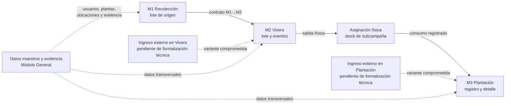

*Nota.* Elaboración propia a partir del alcance del Perfil, `NEC-01` a `NEC-08` y los contratos M1→M2 y M2→M3. Las líneas discontinuas representan variantes incluidas en el alcance académico cuya estructura técnica todavía debe cerrarse; no representan funciones ya implementadas.

El modelo técnico vigente desarrolla con mayor detalle la ruta principal M1→M2→M3. En cambio, el esquema canónico todavía exige que cada lote de vivero tenga una recolección de origen y que cada plantación consuma una asignación procedente de Vivero. Por ello, los ingresos externos no pueden declararse resueltos. Antes de cerrar Elaboración deben definirse sus entidades o relaciones, campos obligatorios, reglas de cantidad, evidencia, permisos y pruebas, sin crear un módulo adicional.

**Figura 3.5. Genealogía del material vegetal en la ruta principal**

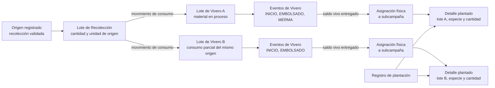

*Nota.* Elaboración propia a partir de los contratos M1→M2 y M2→M3. La figura muestra cómo un origen puede dividirse en varios lotes y reunirse de nuevo en una plantación sin perder la relación entre origen, transformaciones observadas, asignaciones y cantidades plantadas. No representa todavía una consulta transversal aceptada; esa comprobación corresponde a CO-4 y TR-1.

### 3.2.3. Requisitos y capacidades del sistema

Los requisitos se organizaron por responsabilidad funcional. El Módulo General conserva una sola fuente viva para los datos maestros. Recolección registra y valida el lote de origen. Vivero representa el material en proceso, observa el nacimiento de plantas vivas y explica sus cambios de saldo. Plantación planifica la subcampaña, recibe plantas mediante una asignación física y registra el consumo efectivo de ese stock en campo.

**Tabla 3.8**

*Capacidades de diseño seleccionadas para el recorrido académico*

| Código | Capacidad | Actor principal | Requisitos relacionados | Resultado esperado |
|---|---|---|---|---|
| CU-01 | administrar datos maestros | ADMIN | `RF-GEN-01` a `RF-GEN-07` | usuarios, viveros, plantas, ubicaciones, comunidades, organizaciones y tipos de evidencia disponibles |
| CU-02 | registrar y completar una recolección | GENERAL | `RF-REC-01` a `RF-REC-03` | lote de origen en borrador con cantidad, unidad, ubicación, responsable y evidencia |
| CU-03 | revisar una recolección | VALIDADOR | `RF-REC-04` | aprobación o rechazo con historial y snapshots congelados al validar |
| CU-04 | afectar el saldo de Recolección | GENERAL o ADMIN según la operación | `RF-REC-05` | consumo hacia Vivero o desecho sin saldo negativo |
| CU-05 | iniciar un lote de vivero | GENERAL autorizado | `RF-VIV-01` y contrato M1→M2 | lote, evento `INICIO` y movimiento de origen creados de manera coherente |
| CU-06 | registrar el resultado observado en Vivero | GENERAL autorizado | `RF-VIV-02` y `RF-VIV-02A` | plantas vivas registradas en `EMBOLSADO` o cierre pre-embolsado con causa |
| CU-07 | registrar movimientos de Vivero | GENERAL autorizado | `RF-VIV-03` a `RF-VIV-09` | mermas, adaptabilidad, despachos, evidencia, saldos y cierre explicables |
| CU-08 | planificar campaña y subcampaña | ADMIN | `RF-PLA-01`, `RF-PLA-02`, `RF-PLA-03` y `RF-PLA-18` | unidad operativa con zona, equipo, polígono, meta y plan por especie |
| CU-09 | asignar plantas a una subcampaña | ADMIN o coordinador de la subcampaña | `RF-PLA-04` y `RF-VIV-11` | salida física del Vivero y stock disponible en la subcampaña |
| CU-10 | devolver plantas no consumidas | ADMIN o coordinador de la subcampaña | `RF-PLA-05` y `RF-VIV-12` | disminución del stock asignado y retorno al saldo del lote de origen |
| CU-11 | registrar una plantación inicial | miembro operativo de la subcampaña | `RF-PLA-06` y `RF-PLA-13` | registro con GPS, evidencia y detalle de consumo por asignación, lote y especie |
| CU-12 | reconstruir un recorrido | usuario autorizado según la vista | `RF-VIV-07`, `RF-PLA-14` y `NEC-08` | recuperación de origen, eventos, cantidades, responsables, ubicación, evidencia y destino |

*Nota.* Elaboración propia a partir de los archivos de requerimientos y reglas de negocio de los módulos General, Recolección, Vivero y Plantación. La selección se limita al recorrido que concluye con el registro de la plantación; mantenimiento, mortandad, reposición, carbono y blockchain no forman parte del resultado académico evaluable.

### 3.2.4. Casos de uso: vista general

Los roles globales permanecen limitados a `ADMIN`, `GENERAL`, `VALIDADOR` y `VOLUNTARIO`. La coordinación y la operación de una subcampaña no se añadieron como roles globales: se representan mediante una membresía contextual en el equipo de la subcampaña. Esta decisión permite que una misma persona participe con distintas responsabilidades en subcampañas diferentes sin alterar su autorización general en la plataforma.

**Figura 3.6. Actores y casos de uso principales del alcance académico**

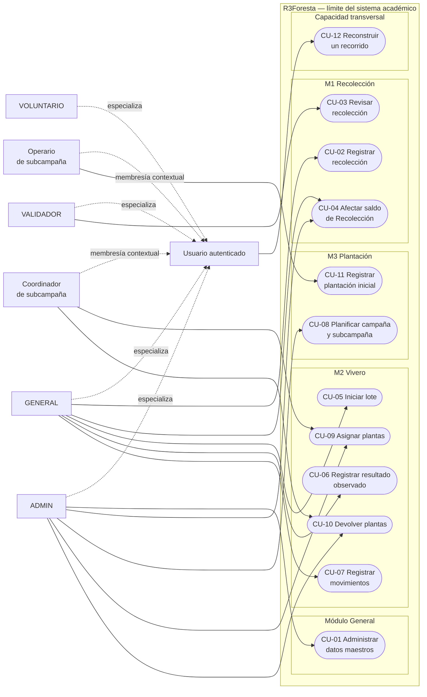

*Nota.* Elaboración propia a partir de la Tabla 3.8. El rectángulo exterior expresa el límite del sistema académico; las líneas continuas son asociaciones actor–caso de uso y las discontinuas representan especialización del actor o membresía contextual, no permisos por sí mismas. La figura no sustituye la matriz detallada de autorización.

### 3.2.5. Casos de uso específicos y relaciones incluidas o extendidas

La Figura 3.6 ofrece la vista general. Las tres figuras siguientes descomponen los casos de uso que cambian el recorrido del material. En ellas, una flecha etiquetada como include representa un comportamiento obligatorio reutilizado por el caso base; una flecha etiquetada como extend representa una alternativa condicionada. Esta notación expresa el diseño y las reglas aplicables; no sustituye una prueba de implementación.

**Figura 3.7. Casos de uso específicos de Recolección**

~~~mermaid
flowchart LR
  GEN[GENERAL]
  VAL[VALIDADOR]

  subgraph M1[M1 Recolección — límite del sistema]
    R1([Registrar o editar<br/>recolección])
    R2([Capturar datos de origen,<br/>cantidad, unidad y ubicación])
    R3([Adjuntar evidencia])
    R4([Solicitar validación])
    R5([Revisar recolección])
    R6([Congelar snapshots<br/>y aprobar])
    R7([Rechazar con observaciones])
    R8([Afectar saldo])
    R9([Validar ficha<br/>y evidencia])
    R10([Validar estado, unidad<br/>y saldo disponible])
  end

  GEN --> R1
  GEN --> R4
  GEN --> R8
  VAL --> R5
  R1 -. include .-> R2
  R1 -. include .-> R3
  R5 -. include .-> R9
  R6 -. extend: ficha válida .-> R5
  R7 -. extend: ficha incompleta .-> R5
  R8 -. include .-> R10
~~~

*Nota.* Elaboración propia a partir de RF-REC-01 a RF-REC-05 y las reglas de Recolección. La aprobación y el rechazo son resultados alternativos de la revisión; el consumo hacia Vivero se detalla como interacción en la Figura 3.16.

**Figura 3.8. Casos de uso específicos de Vivero**

~~~mermaid
flowchart LR
  GEN[GENERAL autorizado]

  subgraph M2[M2 Vivero — límite del sistema]
    V1([Iniciar lote desde<br/>Recolección])
    V2([Validar origen, unidad<br/>y saldo disponible])
    V3([Crear lote, evento INICIO<br/>y consumo atómico])
    V4([Registrar resultado<br/>observado])
    V5([Registrar EMBOLSADO])
    V6([Registrar descarte<br/>pre-embolsado])
    V7([Registrar movimiento<br/>de Vivero])
    V8([Registrar adaptabilidad,<br/>merma o despacho manual])
    V9([Asignar plantas a<br/>subcampaña])
    V10([Devolver plantas no<br/>consumidas])
  end

  GEN --> V1
  GEN --> V4
  GEN --> V7
  GEN --> V9
  GEN --> V10
  V1 -. include .-> V2
  V1 -. include .-> V3
  V5 -. extend: se observan plantas vivas .-> V4
  V6 -. extend: no hay plantas vivas .-> V4
  V7 -. include .-> V8
  V9 -. include .-> V7
  V10 -. include .-> V7
~~~

*Nota.* Elaboración propia a partir de RF-VIV-01 a RF-VIV-12 y las reglas del módulo Vivero. La recepción de material externo no aparece porque su especificación e implementación siguen pendientes; asignación y devolución se describen como interacción M2→M3 en la Figura 3.17.

**Figura 3.9. Casos de uso específicos de Plantación**

~~~mermaid
flowchart LR
  ADM[ADMIN]
  COO[Coordinador de subcampaña]
  OPE[Operario de subcampaña]

  subgraph M3[M3 Plantación — límite del sistema]
    P1([Planificar campaña<br/>y subcampaña])
    P2([Definir zona, equipo,<br/>polígono y meta por especie])
    P3([Activar subcampaña])
    P4([Asignar stock físico<br/>desde Vivero])
    P5([Validar lote y saldo<br/>de Vivero])
    P6([Registrar plantación<br/>inicial])
    P7([Validar contexto, permisos,<br/>meta y stock asignado])
    P8([Capturar evidencia y GPS])
    P9([Evaluar punto respecto<br/>del polígono])
    P10([Consumir asignaciones<br/>y crear detalles])
    P11([Registrar devolución<br/>a Vivero])
    P12([Advertir o bloquear<br/>resultado espacial])
  end

  ADM --> P1
  ADM --> P3
  ADM --> P4
  COO --> P4
  COO --> P11
  OPE --> P6
  P1 -. include .-> P2
  P3 -. include .-> P2
  P4 -. include .-> P5
  P6 -. include .-> P7
  P6 -. include .-> P8
  P6 -. include .-> P9
  P6 -. include .-> P10
  P12 -. extend: punto fuera de tolerancia .-> P9
~~~

*Nota.* Elaboración propia a partir de RF-PLA-01 a RF-PLA-06, RF-PLA-13, RF-PLA-18 y las reglas de Plantación. La extensión espacial representa el punto de decisión cuya conducta definitiva permanece abierta en RDI-04; no afirma que el bloqueo esté implementado. El ingreso externo directo tampoco se representa como capacidad disponible.

### 3.2.6. Procesos: estados, eventos y cambios de cantidad

El diseño separa el estado actual de los hechos que lo produjeron. Las tablas principales permiten consultar el estado operativo sin reconstruir toda la historia en cada lectura; los movimientos, eventos e historiales se agregan sin editar el pasado. Este modelo híbrido exige que la actualización del estado materializado y la inserción del hecho correspondiente formen parte de una misma operación coherente.

En Recolección se distinguen el estado de calidad del registro y el estado operativo del saldo. La validación congela la ficha, pero el lote de origen continúa abierto mientras conserve cantidad disponible.

**Figura 3.10. Estados de Recolección y saldo operativo**

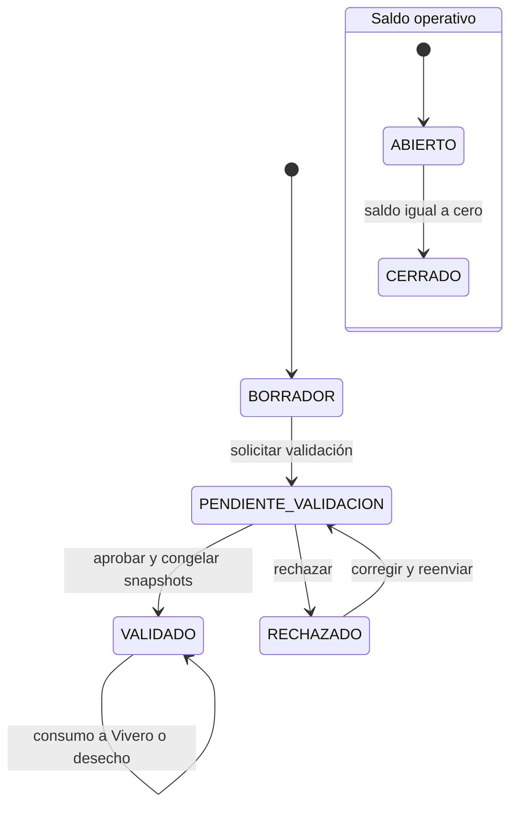

*Nota.* Elaboración propia a partir de `RF-REC-01` a `RF-REC-05` y `RN-REC-08` a `RN-REC-24A`. `ABIERTO` y `CERRADO` se derivan del saldo y no reemplazan los estados de validación.

En Vivero, `INICIO` registra material en proceso y no crea saldo vivo. `EMBOLSADO` registra una cantidad nueva observada en unidades. Si el material no llega a producir plantas vivas, `DESCARTE_PRE_EMBOLSADO` cierra el lote sin inventar un saldo. Después del embolsado, las mermas, los despachos, las asignaciones y las devoluciones explican los cambios del saldo físico.

**Figura 3.11. Hitos y movimientos del lote de vivero**

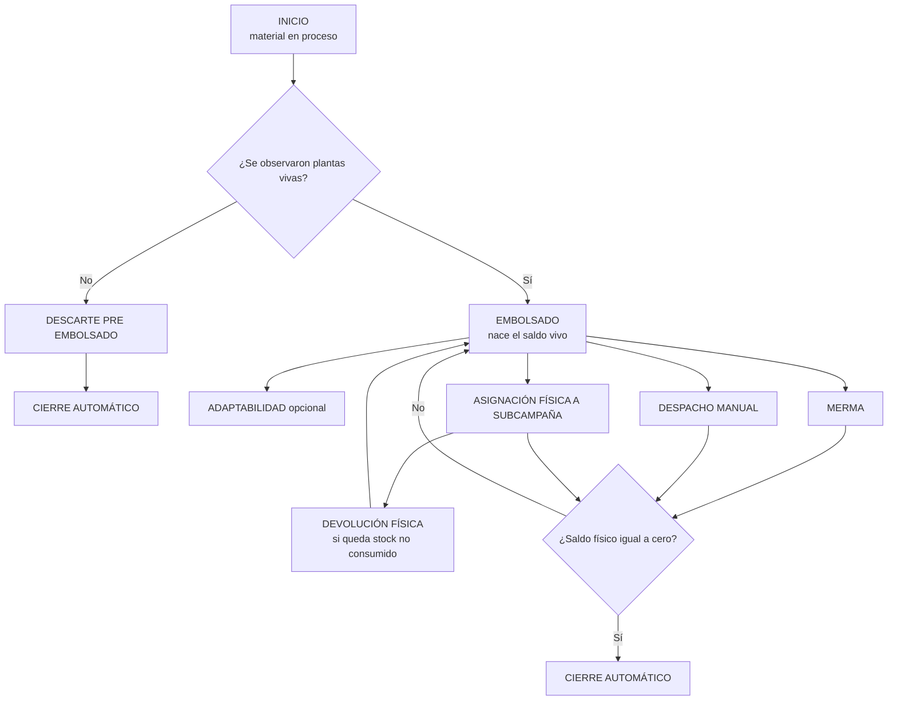

*Nota.* Elaboración propia a partir de `02_flujo_operativo_vivero_core.md` y el contrato M2→M3. La devolución constituye la excepción integrada que puede aumentar el saldo del lote porque representa un retorno físico; no corrige ni reescribe un evento anterior.

En Plantación, `CAMPANIA` funciona como contenedor estratégico y su estado se obtiene de sus subcampañas. `SUBCAMPANIA` concentra la operación, el equipo, el polígono y la meta por especie. Para el recorrido académico son relevantes su planificación, activación, recepción de stock y registro de la plantación. Los estados posteriores y los flujos de mantenimiento existentes en la documentación técnica no forman parte de la evaluación comprometida.

**Figura 3.12. Estados operativos de la subcampaña pertinentes al recorrido**

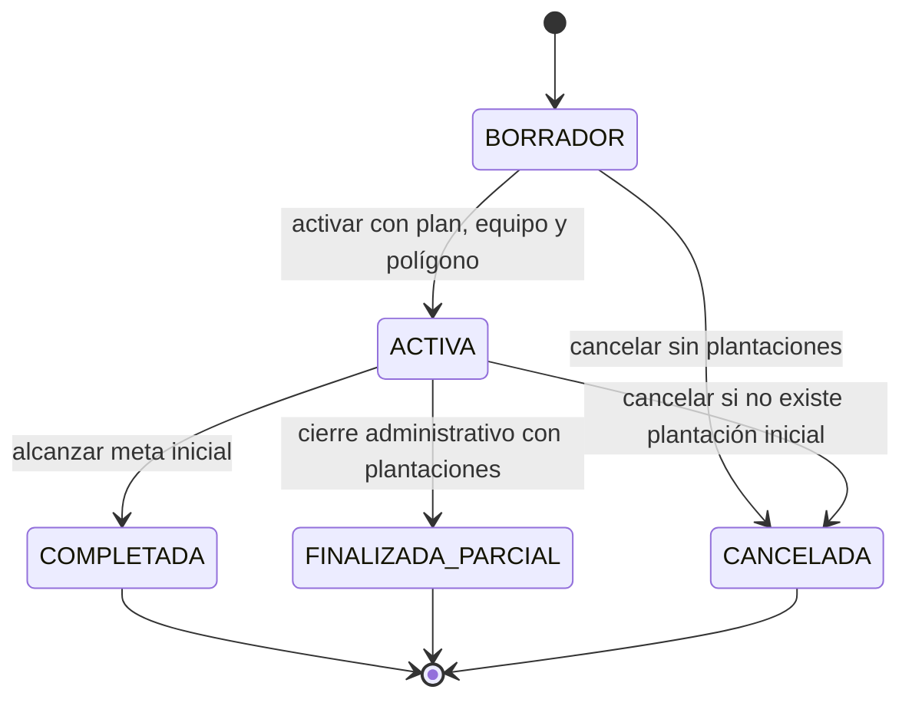

*Nota.* Elaboración propia a partir de `RN-PLA-06` a `RN-PLA-12` y `RN-PLA-37`. La figura se limita al estado operativo y no representa la fase técnica de mantenimiento, que se encuentra fuera del recorrido académico evaluado.

#### 3.2.6.1. Diagramas de actividad de los flujos operativos

Los diagramas siguientes muestran el comportamiento que debe contrastarse con los flujos reales y la implementación. Incluyen decisiones, rechazos y cierres que afectan la continuidad del recorrido. No sustituyen los casos de prueba ni prueban por sí mismos que cada alternativa esté implementada.

**Figura 3.13. Actividad de Recolección**

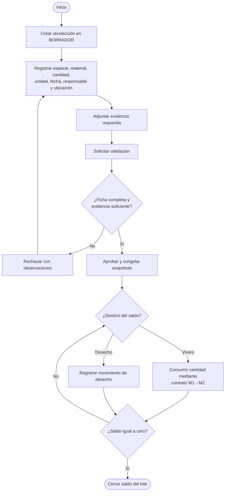

*Nota.* Elaboración propia a partir de `RF-REC-01` a `RF-REC-05` y del contrato M1→M2. La cantidad solo puede salir de una recolección validada y no puede exceder el saldo disponible.

**Figura 3.14. Actividad de Vivero**

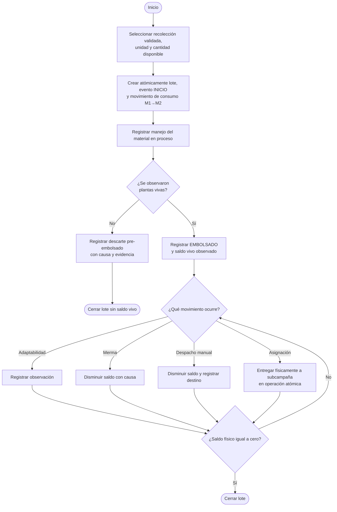

*Nota.* Elaboración propia a partir de `02_flujo_operativo_vivero_core.md` y los contratos de integración. El flujo externo comprometido para Vivero permanece pendiente de especificación e implementación y, por ello, no se presenta como una actividad disponible.

**Figura 3.15. Actividad de Plantación**

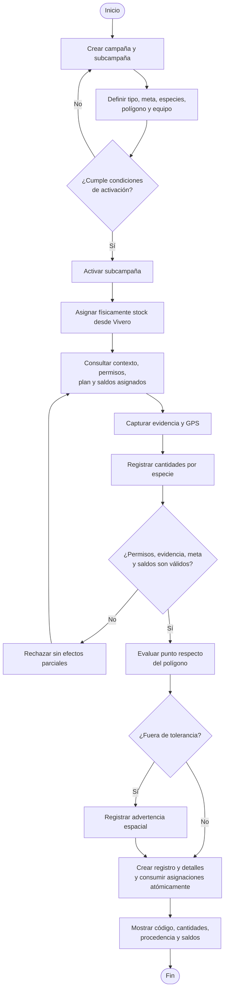

*Nota.* Elaboración propia a partir de los procesos de Plantación, el contrato M2→M3 y el flujo de registro inicial. Al corte, un punto fuera de tolerancia se guarda con advertencia en la implementación, mientras la regla escrita prevé bloqueo; la actividad deberá actualizarse cuando se cierre RDI-04. El ingreso externo directo permanece pendiente y no se representa como implementado.

### 3.2.7. Interacciones: contratos entre módulos

#### 3.2.7.1. Contrato entre Recolección y Vivero

El contrato M1→M2 se activa cuando Vivero inicia un lote desde una recolección validada, abierta y con saldo suficiente. El lote de Vivero selecciona su vivero operativo, hereda los snapshots oficiales de la recolección y registra evidencia propia del evento `INICIO`. Un origen puede abastecer varios lotes, pero cada lote de vivero conserva una sola recolección de procedencia.

La creación del lote, el evento `INICIO` y el movimiento `CONSUMO_A_VIVERO` forman una sola operación de negocio. El diseño exige que se completen juntos o que ninguno quede persistido. Además, mantiene las siguientes igualdades dentro de la unidad canónica de la recolección:

```text
abs(delta del movimiento CONSUMO_A_VIVERO)
= cantidad_inicial_en_proceso del lote de vivero
= cantidad_afectada del evento INICIO

unidad del movimiento
= unidad inicial del lote
= unidad del evento INICIO
```

**Figura 3.16. Secuencia diseñada para el contrato M1→M2**

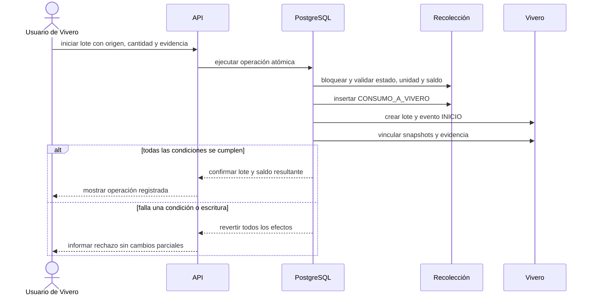

*Nota.* Elaboración propia a partir de `01_contrato_recoleccion_a_vivero.md`, `RN-REC-23` y `RN-REC-24A`.

El contrato no convierte gramos de semillas en unidades de plantas. La cantidad transferida en `INICIO` conserva la unidad del origen. El dato de plantas vivas aparece después, cuando el responsable registra el resultado observado en `EMBOLSADO`.

#### 3.2.7.2. Contrato entre Vivero y Plantación

El contrato M2→M3 adopta una asignación física, no una reserva lógica. Al asignar plantas, la cantidad sale del vivero, reduce el saldo físico del lote y queda disponible en la subcampaña. Cuando se registra la plantación, el sistema consume la asignación y conserva el detalle por lote y especie, pero no descuenta nuevamente el saldo del vivero.

La identidad del stock asignado se expresa como:

```text
saldo_asignado_disponible
= cantidad_asignada
- cantidad_consumida
- cantidad_devuelta
- cantidad_mermada
```

Para el alcance académico, `cantidad_mermada` se conserva en el modelo, pero la merma de plantas entregadas y aún no plantadas no integra el flujo evaluable. La devolución sí forma parte del contrato porque explica el retorno físico de una cantidad no consumida.

**Figura 3.17. Asignación física y consumo en Plantación**

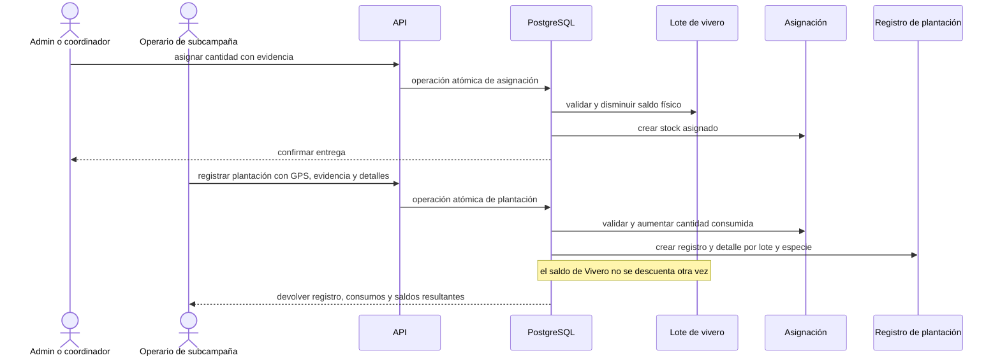

*Nota.* Elaboración propia a partir de `02_contrato_vivero_a_plantacion.md`, las reglas `RN-VIV-47` a `RN-VIV-61` y `RF-PLA-04` a `RF-PLA-06`.

La distinción evita una doble salida. El evento de Vivero se produce al entregar físicamente las plantas y utiliza el origen `ASIGNACION_SUBCAMPANIA`. El registro posterior de plantación incrementa `cantidad_consumida` en la asignación. El origen histórico `AUTOMATICO_PLANTACION` no debe emplearse en nuevas operaciones.

### 3.2.8. Modelo de datos: conceptual, lógico y físico

El modelo adopta el lote como unidad trazable principal. Una recolección constituye el lote de origen; un lote de vivero conserva un único origen y reúne el material que atraviesa los hitos de Vivero; una asignación física identifica la cantidad entregada desde un lote a una subcampaña; y el detalle de plantación conserva qué parte de cada asignación fue efectivamente utilizada.

Los datos maestros continúan como fuentes vivas para nuevas operaciones. En los hitos definidos por cada módulo se congelan snapshots de nombres, especie, procedencia y responsables. Así, un cambio posterior en el catálogo no reescribe la interpretación de un registro validado o ejecutado.

#### 3.2.8.1. Modelo conceptual

**Figura 3.18. Modelo conceptual de clases del recorrido principal**

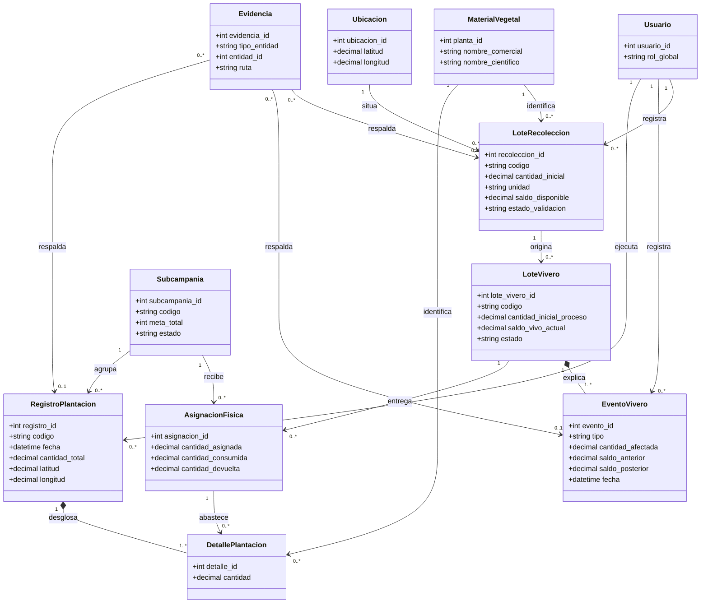

*Nota.* Elaboración propia a partir de `database/00_database_schema.md` y los documentos de dominio. El diagrama explica responsabilidades y relaciones de negocio; no representa todas las tablas, claves ni restricciones. La coordenada del registro de plantación se modela como dato propio del hecho y la evidencia se asocia conceptualmente con el hecho que respalda.

#### 3.2.8.2. Modelo lógico

**Figura 3.19. Modelo entidad-relación lógico de la base de datos académica**

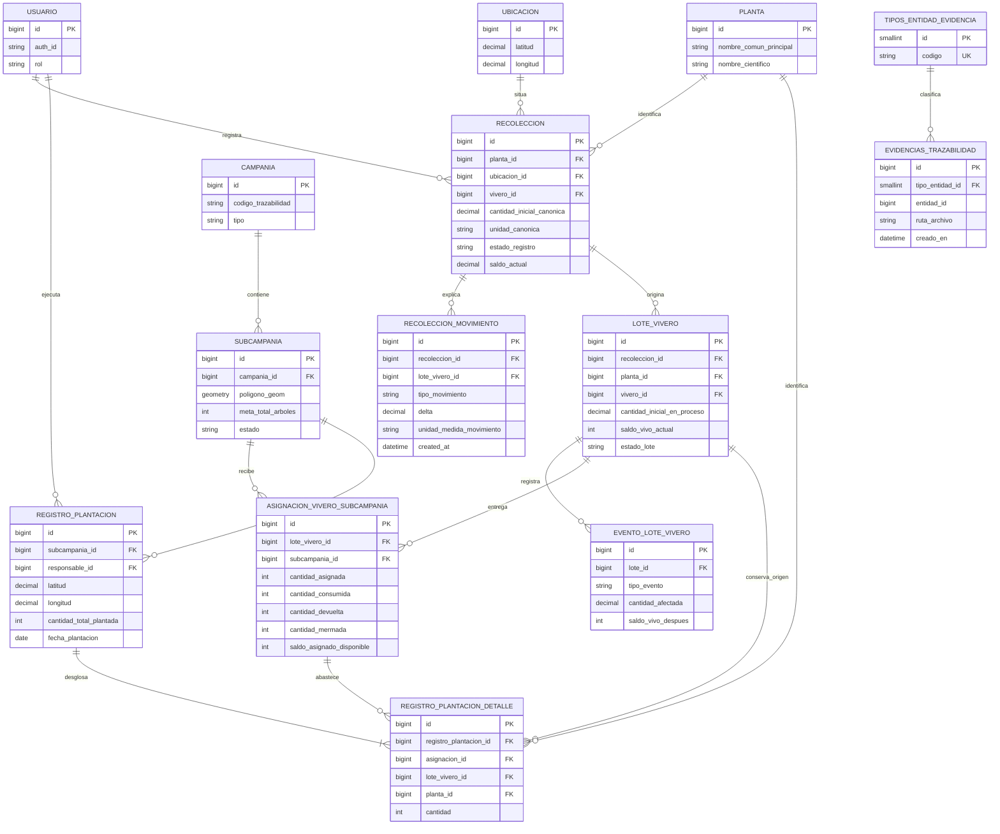

*Nota.* Elaboración propia a partir de `database/00_database_schema.md`. La figura presenta la estructura lógica del núcleo académico y omite catálogos e historiales auxiliares. `EVIDENCIAS_TRAZABILIDAD` usa una asociación polimórfica mediante `tipo_entidad_id` y `entidad_id`; por tanto, sus vínculos con Recolección, eventos de Vivero y Plantación se validan según el tipo de entidad y no mediante una única clave foránea física.

#### 3.2.8.3. Modelo físico y contraste con la base de datos documentada

El modelo físico conserva los nombres de tablas, claves y campos relevantes declarados en el esquema canónico. La Tabla 3.9 permite contrastar el modelo conceptual y lógico con esa estructura. No equivale a afirmar que una instancia de producción ya contiene todas las migraciones: el riesgo RDI-03 mantiene pendiente el replay limpio y la comparación contra la base aplicada.

**Tabla 3.9**

*Correspondencia del modelo físico documentado para el recorrido académico*

| Componente físico documentado | Claves y campos de trazabilidad | Relación o restricción relevante | Estado del contraste |
|---|---|---|---|
| RECOLECCION | id; planta_id, ubicacion_id y vivero_id; cantidad_inicial_canonica, unidad_canonica, saldo_actual y snapshots | origen único de cada LOTE_VIVERO; el saldo se explica por RECOLECCION_MOVIMIENTO | documentado; contraste de replay pendiente |
| RECOLECCION_MOVIMIENTO | id; recoleccion_id, lote_vivero_id, tipo_movimiento, delta y unidad_medida_movimiento | CONSUMO_A_VIVERO relaciona el origen con el lote sin convertir su unidad | documentado; operación y prueba deben contrastarse con la RPC vigente |
| LOTE_VIVERO y EVENTO_LOTE_VIVERO | recoleccion_id, planta_id, vivero_id, saldo_vivo_actual; lote_id, tipo_evento, cantidad_afectada y saldos antes/después | un lote tiene un único origen y conserva eventos append-only; lote_id es el nombre físico de la FK del evento | documentado; algunos enlaces físicos auxiliares siguen sujetos a alineación de migraciones |
| CAMPANIA, SUBCAMPANIA, SUBCAMPANIA_META_ESPECIE y SUBCAMPANIA_EQUIPO | campania_id, zona_id, poligono_geom, meta_total_arboles y membresías | la campaña agrupa subcampañas; la meta y el equipo pertenecen a la subcampaña | documentado; los estados y totales agregados se derivan según el esquema |
| ASIGNACION_VIVERO_SUBCAMPANIA | lote_vivero_id, subcampania_id, cantidades asignada, consumida, devuelta, mermada y saldo derivado | representa la salida física del lote y evita descontarlo de nuevo al plantar | documentado; requiere revalidación integrada M2→M3 |
| REGISTRO_PLANTACION y REGISTRO_PLANTACION_DETALLE | subcampania_id, responsable_id, latitud, longitud y cantidad_total_plantada; asignacion_id, lote_vivero_id, planta_id y cantidad | cada detalle debe coincidir con la asignación y conserva lote y especie de procedencia | documentado; la conducta GPS mantiene la discrepancia RDI-04 |
| TIPOS_ENTIDAD_EVIDENCIA y EVIDENCIAS_TRAZABILIDAD | tipo_entidad_id, entidad_id, ruta_archivo y metadata | asociación polimórfica para evidencia vinculada con el hecho respaldado | documentado; el vínculo se valida por tipo, no por una FK única |

*Nota.* Elaboración propia a partir de `database/00_database_schema.md`, ADR-VIV-01 a ADR-VIV-12, ADR-PLA-01 y ADR-PLA-02. Durante la maquetación se recomienda orientación horizontal solo si la tabla no resulta legible en orientación vertical; se repetirá su encabezado si continúa en otra página.

Las subsecciones 3.2.9 a 3.2.12 forman un bloque transversal de control del diseño. Explican las propiedades, la arquitectura, los riesgos y el resultado que condicionan los seis productos ya presentados; no añaden una etapa entre el modelo de datos y la implementación, que continúa en la sección 3.3.

### 3.2.9. Invariantes, mecanismos y pruebas previstas

Las invariantes se formularon antes de seleccionar o describir los mecanismos. En la implementación vigente, las operaciones que afectan varias entidades utilizan principalmente funciones transaccionales de PostgreSQL, restricciones, bloqueos y columnas derivadas. La verificación no se limitará a comprobar que estos mecanismos existen; deberá provocar los casos normales, límites, concurrentes y fallidos que permitan observar la propiedad.

**Tabla 3.10**

*Matriz de propiedades, mecanismos y comprobación prevista*

| Código | Propiedad | Mecanismo diseñado o implementado | Comprobación prevista |
|---|---|---|---|
| INV-01 | el saldo de Recolección no puede ser negativo | movimientos append-only, validación de saldo y operación transaccional | intentar consumir y desechar más de lo disponible |
| INV-02 | la transferencia M1→M2 conserva cantidad y unidad | contrato estricto entre movimiento, lote y `INICIO` | comparar las tres cantidades y unidades después de un consumo parcial y total |
| INV-03 | no existe conversión automática de masa a plantas | `INICIO` conserva `G` o `UNIDAD`; `EMBOLSADO` registra un resultado observado en `UNIDAD` | iniciar con gramos y comprobar que el saldo vivo permanezca nulo hasta embolsar |
| INV-04 | los eventos críticos no dejan estados parciales | función transaccional y reversión ante error | inducir un fallo antes de completar la escritura y comprobar ausencia de efectos parciales |
| INV-05 | una asignación física descuenta una sola vez el lote | operación de asignación y consumo separado en M3 | asignar y plantar; comprobar que el lote disminuya al asignar y no al plantar |
| INV-06 | el consumo no supera el stock asignado | saldo derivado, bloqueo de asignaciones y validación por detalle | intentar consumir una cantidad superior y ejecutar solicitudes competidoras |
| INV-07 | el detalle explica el total plantado | igualdad entre suma de detalles y total del registro | alterar o enviar un desglose inconsistente y comprobar el rechazo |
| INV-08 | una devolución no supera el stock sin consumir | validación del saldo asignado y actualización atómica de asignación y lote | devolver el saldo exacto y luego intentar una devolución adicional |
| INV-09 | los cambios de catálogos no reescriben la historia | snapshots congelados en validación, creación o activación | cambiar un nombre maestro y recuperar un registro anterior |
| INV-10 | la evidencia queda vinculada con el hecho correcto | entidad común de evidencias y validación del vínculo en la operación | consultar recolección, evento de vivero y plantación con sus archivos asociados |
| INV-11 | el GPS de plantación puede evaluarse respecto del polígono | función PostGIS y registro de resultado y distancia | probar puntos interior, límite, tolerancia y exterior según la regla que se cierre |

*Nota.* Elaboración propia a partir de los principios de trazabilidad del Perfil, los contratos de integración, `database/00_database_schema.md` y `ARCHITECTURE.md`. La columna de comprobación define pruebas pendientes o parciales; no anticipa conformidad.

### 3.2.10. Arquitectura de la solución

La versión observada utiliza una arquitectura distribuida de tres capas. El cliente es una aplicación web progresiva organizada por funcionalidades y construida con React, TypeScript y Vite. El backend es un monolito modular REST basado en NestJS. La persistencia utiliza PostgreSQL y PostGIS administrados en Supabase, mientras Supabase Storage conserva las evidencias.

Esta arquitectura mantiene las reglas complejas fuera del navegador. La PWA guía la captura y previene errores evidentes; la API valida la forma, la identidad, los permisos y la elegibilidad; las funciones y restricciones de PostgreSQL protegen relaciones, saldos, unicidad y atomicidad. PostGIS actúa como autoridad para calcular la relación espacial entre el punto de plantación y el polígono de la subcampaña.

**Figura 3.20. Componentes incluidos en la arquitectura académica**

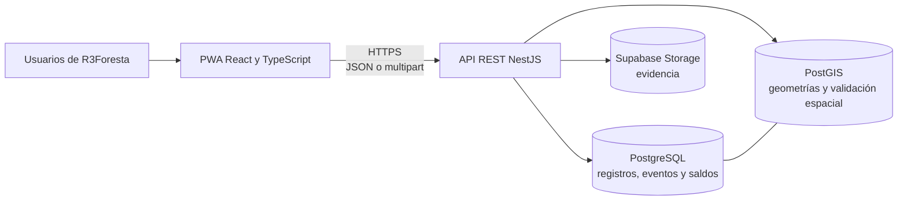

*Nota.* Elaboración propia a partir de `ARCHITECTURE.md`, revisión del 23 de julio de 2026. La figura excluye integraciones históricas de blockchain e IPFS porque no participan en los objetivos, la verificación ni la evaluación del Proyecto de Grado.

El uso de un monolito modular reduce la complejidad de despliegue y permite mantener límites funcionales sin introducir microservicios. El modelo de datos es híbrido: conserva el estado actual para la operación diaria y, en paralelo, los eventos necesarios para explicar cómo se obtuvo. La PWA es instalable, pero no debe describirse como una solución sin conexión completa; el service worker actual no implementa cola de comandos, sincronización diferida ni resolución de conflictos.

### 3.2.11. Riesgos y vacíos que condicionan el cierre del diseño

La revisión conjunta de requisitos, esquema, arquitectura y estado de implementación identificó diferencias que deben tratarse como trabajo pendiente. Ocultarlas produciría un diseño aparentemente completo, pero no verificable contra la versión real.

**Tabla 3.11**

*Riesgos y decisiones pendientes del diseño*

| Código | Riesgo o diferencia | Efecto sobre el proyecto | Tratamiento requerido |
|---|---|---|---|
| RDI-01 | los ingresos externos de material están comprometidos por el Perfil, pero no cuentan con un flujo técnico completo | impide cerrar OBJ-02 y OBJ-03 para todas las variantes | especificar la recepción externa dentro de Vivero y Plantación, con procedencia, cantidades, evidencia y pruebas |
| RDI-02 | la mayoría de los endpoints todavía confía en `x-auth-id` sin validación global del JWT | permite suplantación si la API se expone a clientes no confiables | unificar identidad, proteger endpoints y eliminar la sesión de registro simulada antes de la liberación |
| RDI-03 | el replay de migraciones no reconstruye por completo `TIPO_PLANTA` ni el enum vivo de destinos de Vivero | la base académica no es reproducible desde cero | crear migraciones idempotentes de alineación y probar instalación limpia y actualización |
| RDI-04 | la regla escrita de GPS bloquea el punto fuera de tolerancia, pero la implementación vigente lo guarda como advertencia | especificación, backend y prueba esperan resultados distintos | decidir el comportamiento y sincronizar regla, contexto, interfaz y pruebas |
| RDI-05 | el despacho manual no aplica todavía toda la matriz canónica de campos para `DONACION` | contrato escrito y contrato HTTP no coinciden | alinear DTO, función, documentación y pruebas |
| RDI-06 | no existe idempotencia completa para comandos de saldo y eventos | un reintento de red puede duplicar una operación | incorporar una clave durable o un mecanismo equivalente y probar reintentos |
| RDI-07 | el estado de implementación de M1 no está cerrado en `ESTADO.md` con el mismo nivel de detalle que M2 y M3 | dificulta demostrar el incremento CO-1 | auditar backend, frontend, base de datos y pruebas de M1 y registrar el cierre de la iteración |
| RDI-08 | la documentación técnica incluye mantenimiento, reposición, carbono, blockchain y vistas públicas fuera del recorrido académico | puede ampliar indebidamente el objeto evaluado | excluir esas capacidades de la matriz de cumplimiento y tratarlas solo como evolución o componente histórico |

*Nota.* Elaboración propia a partir de `ESTADO.md`, `ARCHITECTURE.md`, el plan del Capítulo II y la comparación entre el Perfil y la documentación técnica canónica, con corte al 14 de septiembre de 2026.

### 3.2.12. Resultado del diseño

El diseño estableció una cadena informacional que relaciona el lote de origen, el lote de vivero, sus eventos, la asignación física y el registro de plantación. La solución conserva estados operativos para consulta y hechos históricos para explicación; utiliza snapshots para impedir cambios retroactivos; separa el material en proceso de las plantas vivas observadas; y define contratos atómicos en los dos puntos donde una cantidad cambia de módulo.

El producto más relevante de OBJ-02 es la relación entre procedencia, cantidades y eventos. En M1→M2, el consumo del origen, el lote y `INICIO` comparten cantidad y unidad. En M2→M3, la asignación descuenta físicamente el lote y la plantación consume el stock de la subcampaña sin un segundo descuento. Estas decisiones proporcionan propiedades concretas para la implementación y la verificación.

El objetivo todavía requiere cerrar los ingresos externos, la regla de GPS, la identidad y la reproducibilidad de migraciones. El diseño se considera suficiente como borrador para revisión académica, pero no debe declararse cerrado hasta resolver esas diferencias y actualizar los artefactos afectados.

## 3.3. Implementación e integración de los módulos

### 3.3.1. Propósito, corte y correspondencia con RUP

Esta sección responde al tercer objetivo específico: **implementar en el sistema las funciones de Recolección, Vivero y Plantación necesarias para mantener vinculada la información del material vegetal durante su recorrido**. La fase de Construcción se organiza en cuatro iteraciones: CO-1 para Recolección, CO-2 para Vivero e integración M1→M2, CO-3 para Plantación e integración M2→M3 y CO-4 para la trazabilidad transversal y la versión candidata.

El corte documental del 15 de septiembre de 2026 se encuentra dentro de CO-2 según el cronograma rector. Sin embargo, existen implementaciones y verificaciones registradas durante julio para M2, M3 y su integración. Esas piezas constituyen una base técnica disponible, pero deben incorporarse de manera explícita al registro de cada iteración: objetivo, especificación, riesgo, tareas, cambio, pruebas, resultado y decisión de cierre. La fecha de un despliegue previo no sustituye esa evidencia metodológica.

**Tabla 3.12**

*Correspondencia entre fases, iteraciones, actividades, hitos y entregables al corte*

| Fase e iteración | Actividades principales | Hito de control | Entregables previstos | Evidencia disponible al corte | Estado metodológico |
|---|---|---|---|---|---|
| Inicio, IN-1 | delimitar alcance, actores, requisitos iniciales, riesgos y plan | LCO | Perfil, análisis inicial, mapa de actores, necesidades y plan | Perfil, análisis, actores, necesidades y planificación disponibles | evidencia disponible; falta revisión de iteración y cierre LCO |
| Elaboración, EL-1 | modelar dominio y datos, definir arquitectura, contratos, invariantes y especificaciones prioritarias | LCA | modelo, esquema, arquitectura, reglas, contratos y especificaciones | esquema, arquitectura, reglas y contratos M1→M2 y M2→M3 disponibles | evidencia disponible; falta resolver vacíos y cerrar LCA |
| Construcción, CO-1 | implementar y comprobar M1 Recolección | revisión CO-1 | incremento M1, checklist y evidencia de pruebas | requisitos, reglas, flujo, checklist, arquitectura observada y operación de `DESECHO` marcada como validada | periodo concluido; requiere auditoría y registro formal de cierre |
| Construcción, CO-2 | implementar Vivero e integración M1→M2 | revisión CO-2 | incremento M2, contrato integrado y matriz de pruebas | requisitos y contratos, eventos de Vivero, descarte pre-embolsado, arquitectura y pruebas backend disponibles | en curso; falta consolidar la matriz de evidencia de la iteración |
| Construcción, CO-3 | implementar Plantación e integración M2→M3 | revisión CO-3 | incremento M3, migraciones, flujos y pruebas integradas | campañas, subcampañas, asignación física, devolución y plantación inicial documentadas como implementadas; frontend y backend desplegados | planificada; evidencia técnica adelantada que debe revalidarse |
| Construcción, CO-4 | integrar trazabilidad transversal y preparar versión candidata | IOC | consulta integral, regresión, manual preliminar y versión candidata | relaciones y timelines parciales, arquitectura y contratos definidos | planificada; faltan consulta integral, regresión y cierre IOC |
| Transición, TR-1 | ejecutar pruebas de sistema, validación operativa, despliegue y aceptación | PR | resultados de validación, manuales, incidencias y acta de aceptación | escenarios, instrumento y criterios definidos en 3.4 y 3.5 | planificada; ejecución y cierre PR pendientes |

*Nota.* Elaboración propia a partir de `metodologia_desarrollo.md`, `registro_avance_rup_sdd.md`, `TODO_PROYECTO_GRADO.md`, `ESTADO.md`, `ARCHITECTURE.md` y los planes operativos de los módulos, con corte al 15 de septiembre de 2026. “Evidencia disponible” no significa “verificado” ni “aceptado”.

### 3.3.2. Implementación de la arquitectura

La PWA organiza sus pantallas por funcionalidades de autenticación, recolecciones, vivero, plantación y catálogos. Los servicios del cliente preparan datos y consumen la API mediante JSON o `multipart/form-data`. El backend reúne los módulos en un único proceso NestJS y distribuye la lógica compleja entre controladores, casos de uso, políticas y funciones de base de datos. Las operaciones que conservan saldos se ejecutan en PostgreSQL para reducir el riesgo de escrituras parciales.

La evidencia sigue un patrón de carga previa en los flujos que la requieren. El cliente envía los archivos originales, el backend los registra como evidencia pendiente y devuelve sus identificadores, y la operación final vincula esos identificadores dentro de la transacción. Si la operación no se completa, la interfaz debe conservar los datos del formulario y limpiar la evidencia provisional según el contrato disponible.

### 3.3.3. Módulo General y Recolección

El Módulo General proporciona los catálogos compartidos. Los usuarios conservan uno de cuatro roles globales; las plantas mantienen identidad científica y nombre común operativo; las comunidades se resuelven mediante la estructura de divisiones administrativas; y toda coordenada reutilizable se registra en `UBICACION`. Los registros históricos conservan snapshots para que la inactivación o el cambio de un maestro no altere operaciones anteriores.

Recolección implementa un flujo de borrador, solicitud de validación, aprobación o rechazo. La ficha exige especie, tipo de material, cantidad, unidad, fecha, responsable, vivero, ubicación y evidencia. Las semillas pueden persistirse en `G` o `UNIDAD`; los esquejes solo en `UNIDAD` entera. Después de la validación, la ficha queda congelada y su saldo cambia únicamente mediante movimientos de consumo hacia Vivero o desecho.

La revisión arquitectónica confirma que existen pantallas para listado, alta, edición de borrador, evidencia, validación y detalle. No obstante, algunas secuencias de Recolección coordinan varias llamadas desde TypeScript y utilizan compensación en lugar de una sola función de base de datos. Además, `ESTADO.md` no contiene todavía una auditoría completa de M1. Por ello, este incremento no se presenta como aceptado: requiere contrastar la implementación real con `RF-REC-01` a `RF-REC-05`, ejecutar el checklist completo y registrar sus resultados.

### 3.3.4. Módulo Vivero e integración M1→M2

Vivero implementa el lote como agregado central. `INICIO` registra material en proceso y consume una cantidad de la recolección de origen. `EMBOLSADO` materializa el primer saldo vivo observado. `DESCARTE_PRE_EMBOLSADO` cierra un lote que no produjo plantas vivas. Después del embolsado se admiten adaptabilidad, merma, despacho manual, asignación física y devolución, con cierre automático cuando corresponde.

El descarte pre-embolsado se encuentra implementado en backend y frontend. La operación registra causa, cantidad total afectada y evidencia; mantiene nulo el saldo vivo y finaliza el lote con un motivo específico. En la interfaz, la acción solo aparece cuando el lote está activo, tiene `INICIO` y todavía no tiene `EMBOLSADO`. Si ya existen plantas vivas y se pierde todo el saldo, el hecho se registra como merma, no como descarte previo.

La interfaz separa el despacho manual de la asignación a subcampaña. El despacho ofrece `DONACION`, `VENTA` y `OTRO`; la asignación dispone de su propio formulario, exige evidencia y conserva la selección de campaña, subcampaña, propósito, cantidad y fecha. Esta separación fue implementada en el frontend mediante el cambio `562a97e` y superó las comprobaciones de lint y construcción registradas el 23 de julio de 2026.

### 3.3.5. Módulo Plantación e integración M2→M3

La implementación disponible permite crear y editar campañas, crear subcampañas, definir zona, meta, plan por especie, polígono y equipo, y activar una subcampaña aun cuando tenga cobertura de stock parcial o nula. La campaña no mantiene un estado ni una meta operativa propios; ambas lecturas se derivan de sus subcampañas. El coordinador se almacena como miembro contextual del equipo.

La integración física M2→M3 se implementó mediante las migraciones 051 a 057. La creación de una asignación descuenta el saldo del lote, crea stock para la subcampaña y registra eventos relacionados en ambos módulos. La devolución incrementa `cantidad_devuelta`, repone el saldo del lote y registra los hechos de retorno. La plantación consume asignaciones y no genera un segundo despacho en Vivero. Las migraciones 056 y 057, el backend y el frontend fueron reportados como desplegados en producción el 23 de julio de 2026.

El registro de plantación inicial está implementado como un flujo móvil de tres pasos: evidencia y GPS, cantidades por especie, y resumen y confirmación. Antes de abrir el formulario se consulta el contexto de la subcampaña, que incluye estado, permisos, equipo, plan y stock asignado. El operario introduce cantidades por especie; el cliente las distribuye entre asignaciones de la misma especie mediante un orden estable por fecha e identificador, y el backend conserva el detalle real.

**Figura 3.21. Flujo implementado para registrar una plantación inicial**

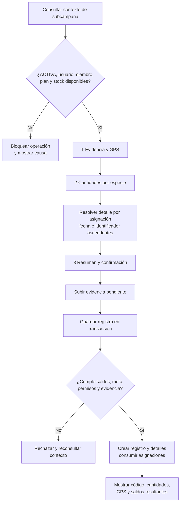

*Nota.* Elaboración propia a partir de `05_handoff_registro_plantacion_inicial.md`, el plan frontend de M3 y la migración `053_m3_registrar_plantacion_sin_despacho.sql`.

El flujo fue reportado con control de doble envío, limpieza de evidencias pendientes y comprobante de consumo. La verificación de interfaz del 8 de julio de 2026 no registró bloqueantes. Persisten vacíos de experiencia: no existe una vista agregada de asignaciones por subcampaña, el historial completo de M3 no está expuesto y la regla de GPS debe reconciliarse con el comportamiento real del backend.

### 3.3.6. Aplicación de SDD y asistencia de IA

Los documentos revisados cubren partes de la cadena SDD. Los archivos de requisitos expresan capacidades y validaciones; las reglas precisan invariantes; los flujos operativos organizan la experiencia; los contratos resuelven las fronteras; los ADR registran decisiones; los planes de frontend descomponen trabajo; las migraciones materializan operaciones; y `ESTADO.md` registra confirmaciones técnicas disponibles. Esta correspondencia todavía no está consolidada con identificadores estables de especificación, tarea, prueba, resultado y aceptación, por lo que no se presenta como una aplicación metodológica plenamente demostrada.

La asistencia de IA participó en análisis, contraste documental, planificación, implementación y redacción bajo revisión humana. Para cumplir plenamente la metodología, falta completar el registro por aporte material con fecha, herramienta y versión disponible, tarea, artefacto afectado, salida adoptada, modificada o rechazada, revisión humana, prueba y referencia al cambio. La existencia de archivos generados o revisados con IA no equivale por sí sola a esa trazabilidad de proceso.

El archivo `../../04_metodologia/registro_avance_rup_sdd.md` concentra el estado por iteración e hito, la cobertura actual de la cadena SDD y la plantilla de control de IA. Este registro permite incorporar evidencia a medida que se verifica, sin reconstruir retrospectivamente cierres o aceptaciones que no fueron documentados.

### 3.3.7. Control del alcance implementado

La versión técnica contiene o proyecta funciones posteriores al registro inicial: mortandad, reposición, fases de mantenimiento, vistas públicas, metadatos de carbono e integraciones blockchain. También existen pantallas de CO₂ y escaneo que funcionan como marcadores de posición. Estas capacidades no se incorporan a la matriz de cumplimiento del Proyecto de Grado porque el alcance académico concluye con el registro de la plantación.

El capítulo utiliza únicamente los componentes necesarios para demostrar procedencia, cantidades, responsables, ubicaciones, evidencia y destino registrado. Si una capacidad adicional interviene técnicamente en el mismo repositorio, debe permanecer desactivada o separada de los escenarios de aceptación, sin presentarse como aporte ni resultado del proyecto académico.

### 3.3.8. Resultado de la implementación

La implementación disponible materializa la ruta principal: una recolección puede originar un lote de vivero; el vivero distingue material en proceso de plantas vivas; una asignación transfiere físicamente plantas a una subcampaña; y una plantación consume el stock asignado conservando el lote y la especie de procedencia. Los eventos, snapshots y evidencias permiten mantener las relaciones necesarias para una reconstrucción posterior.

OBJ-03 no puede declararse cerrado en este corte. Falta demostrar formalmente el incremento completo de Recolección, implementar las variantes de ingreso externo comprometidas, resolver los riesgos P0 de identidad y reproducibilidad y completar la trazabilidad transversal de CO-4. La evidencia adelantada de M3 reduce trabajo de construcción, pero debe verificarse nuevamente dentro de la secuencia metodológica y con la versión candidata que se someta a aceptación.

## 3.4. Verificación de requerimientos e invariantes

### 3.4.1. Propósito y enfoque

Esta sección responde al cuarto objetivo específico: **verificar que las funciones implementadas cumplan los requerimientos definidos y que los registros mantengan coherencia entre las cantidades y los movimientos del material vegetal**. La verificación acompaña cada incremento de Construcción y culmina durante Transición con pruebas de sistema y regresión sobre una versión candidata identificada.

Las pruebas deben relacionarse con requisitos e invariantes. El volumen de archivos o casos no constituye por sí mismo un resultado. Para cada comprobación se conservarán versión, datos, precondiciones, operación, resultado esperado, resultado observado, evidencia, defecto y decisión. Cuando una prueba escriba en servicios externos, se ejecutará en un entorno controlado.

### 3.4.2. Evidencia técnica disponible

**Tabla 3.13**

*Evidencia de verificación disponible antes del cierre de OBJ-04*

| Evidencia | Resultado registrado | Alcance que respalda | Limitación para el cierre académico |
|---|---|---|---|
| auditoría de backend del 23 de julio de 2026 | 42 suites y 415 pruebas unitarias ejecutadas | reglas y servicios cubiertos por esas suites | requiere matriz que vincule cada resultado con requisito e invariante |
| pruebas de backend y base de datos del despliegue coordinado | unitarias y e2e de base de datos reportadas como correctas | integración física M2→M3, devolución y desactivación | no sustituye regresión sobre la versión candidata final |
| comprobaciones de frontend | lint y build correctos | tipado, compilación y reglas estáticas del frontend | no existen todavía pruebas unitarias, de componentes o e2e automatizadas en la PWA |
| QA del registro de plantación inicial | flujo móvil reportado sin bloqueantes el 8 de julio de 2026 | contexto, tres pasos, evidencia, GPS, cantidades y confirmación | falta anexar casos, datos y resultados observados a la matriz académica |
| migraciones 056 y 057 en producción | aplicación y despliegue confirmados | devolución física y desactivación atómica de campaña | no demuestra replay completo desde una base vacía |

*Nota.* Elaboración propia a partir de `ARCHITECTURE.md`, `ESTADO.md`, `03_tarea_frontend_separar_despacho_asignacion.md` y `05_handoff_registro_plantacion_inicial.md`. Los resultados corresponden a las fechas y versiones documentadas, no a una certificación general del producto.

### 3.4.3. Matriz mínima de verificación

**Tabla 3.14**

*Casos prioritarios para verificar el recorrido y sus saldos*

| Caso | Requisito o invariante | Operación de prueba | Resultado esperado | Estado al corte |
|---|---|---|---|---|
| TC-01 | `RF-REC-04` | solicitar validación sin fotos o ubicación completa | rechazo sin cambiar a `PENDIENTE_VALIDACION` | pendiente de consolidar |
| TC-02 | INV-01 | consumir o desechar más del saldo de Recolección | rechazo y saldo sin cambios | pendiente de consolidar |
| TC-03 | INV-02 e INV-04 | forzar un fallo durante la creación del lote de Vivero | ausencia de lote, evento o movimiento parcial | prueba de contrato disponible; evidencia académica pendiente |
| TC-04 | INV-03 | iniciar un lote con semillas en gramos | saldo vivo nulo hasta registrar `EMBOLSADO` | pendiente de consolidar |
| TC-05 | `RF-VIV-02A` | descartar un lote antes y después de `EMBOLSADO` | aceptación solo antes del embolsado; después corresponde merma | reportado en unitarias y e2e; anexos pendientes |
| TC-06 | INV-05 | asignar 100 plantas y luego plantar 60 | el lote disminuye 100 al asignar; la asignación queda con 40; plantar no descuenta el lote otra vez | reportado como implementado; repetir en versión candidata |
| TC-07 | INV-06 | enviar dos consumos concurrentes sobre el mismo saldo asignado | solo se acepta la combinación que no exceda el disponible | e2e DB reportado; detalle pendiente |
| TC-08 | INV-07 | enviar total distinto de la suma de detalles | rechazo sin registro parcial | implementado en función; resultado pendiente de matriz |
| TC-09 | INV-08 | devolver más del saldo asignado | rechazo; asignación y lote permanecen sin cambios | implementación confirmada; evidencia de caso pendiente |
| TC-10 | INV-09 | cambiar el nombre maestro después de validar o crear un lote | los registros anteriores conservan sus snapshots | pendiente |
| TC-11 | INV-10 | recuperar evidencia desde cada etapa | cada archivo aparece vinculado con su hecho, no como adjunto aislado | pendiente de recorrido completo |
| TC-12 | INV-11 | registrar puntos interior, exterior y dentro de tolerancia | comportamiento conforme a la regla de GPS que se apruebe | bloqueado por discrepancia de especificación |
| TC-13 | RDI-02 | intentar operar con `x-auth-id` sin JWT válido | acceso rechazado | no conforme en la arquitectura actual |
| TC-14 | RDI-03 | reproducir la base desde cero con todas las migraciones | esquema, enums y funciones vigentes disponibles | no conforme hasta alinear migraciones |
| TC-15 | RDI-01 | ejecutar ingreso externo en Vivero y Plantación | procedencia y recorrido conservados sin crear un cuarto módulo | no implementado |

*Nota.* Elaboración propia a partir de la matriz de invariantes 3.10, `TODO_PROYECTO_GRADO.md`, los checklists de los módulos y los riesgos documentados en `ESTADO.md` y `ARCHITECTURE.md`. “Reportado” indica evidencia técnica previa que todavía debe incorporarse al expediente académico.

### 3.4.4. Interpretación provisional

La evidencia disponible respalda que la integración física M2→M3 cuenta con mecanismos y pruebas técnicas ejecutadas. También muestra que la compilación del frontend y una parte importante de las pruebas del backend pasan en las versiones registradas. Estos resultados permiten planificar una regresión focalizada, pero no justifican declarar cumplido todo OBJ-04.

Cuatro condiciones impiden el cierre: el flujo de ingresos externos no está implementado, la autenticación permite todavía una ruta de identidad débil, el replay completo de migraciones presenta diferencias y la regla de GPS no coincide con el comportamiento desplegado. Además, las pruebas disponibles deben vincularse con identificadores estables y repetirse sobre la versión candidata de CO-4 o TR-1.

### 3.4.5. Criterio de salida para OBJ-04

El objetivo podrá cerrarse cuando la matriz de pruebas identifique la versión evaluada, todos los casos críticos cuenten con resultados observados y evidencia, las no conformidades bloqueantes hayan sido corregidas o rechazadas para la liberación, y la regresión de los tres módulos confirme que las correcciones no rompieron los recorridos ya aprobados. El cierre deberá distinguir pruebas unitarias, funcionales, de integración, concurrencia, fallo y regresión.

## 3.5. Evaluación de la reconstrucción del recorrido

### 3.5.1. Propósito y momento metodológico

Esta sección responde al quinto objetivo específico: **evaluar, mediante escenarios operativos representativos, en qué medida el sistema permite reconstruir, a partir de sus registros y evidencias, el recorrido del material vegetal**. La ejecución corresponde principalmente a la iteración TR-1, después de congelar la versión candidata y cerrar las no conformidades críticas de verificación.

En este corte se presenta el diseño de la evaluación, no resultados aún no observados. Cada escenario se seleccionará a partir de una variante real de R3Foresta y se identificará como operación real autorizada o como escenario controlado. La evaluación admitirá trazas completas, incompletas o incoherentes y registrará los vacíos sin completarlos mediante memoria o inferencias.

### 3.5.2. Escenarios representativos

**Tabla 3.15**

*Escenarios propuestos para evaluar la reconstrucción*

| Código | Escenario | Recorrido o riesgo que representa | Información que debe recuperarse | Condición previa |
|---|---|---|---|---|
| EVA-01 | ruta propia completa | recolección validada → lote de vivero → asignación → plantación | origen, especie, cantidades, unidades, eventos, responsables, ubicaciones, evidencia y destino | versión integrada M1→M2→M3 |
| EVA-02 | consumo parcial del origen | una recolección abastece más de un lote de vivero | saldo inicial, movimientos, lotes destino y saldo restante | contrato M1→M2 probado |
| EVA-03 | transformación observada y pérdida | material en proceso produce plantas vivas y registra merma o descarte | cantidad y unidad de entrada, resultado observado, pérdida, causa, evidencia y saldo | eventos de Vivero disponibles |
| EVA-04 | asignación y plantación parcial | un lote entrega plantas y la subcampaña consume solo una parte | saldo del lote antes y después, cantidad asignada, consumida y disponible, detalle de plantación | integración M2→M3 disponible |
| EVA-05 | devolución física | una subcampaña devuelve stock no consumido | asignación, cantidad devuelta, motivo, eventos M2/M3 y saldo repuesto | devolución implementada y probada |
| EVA-06 | ingreso externo en Vivero | material adquirido inicia su recorrido en M2 | proveedor o entidad de origen, especie, cantidad, unidad, fecha, responsable, evidencia y destino | flujo externo implementado |
| EVA-07 | ingreso externo directo en Plantación | material adquirido ingresa en M3 | procedencia disponible, cantidad recibida y plantada, responsable, ubicación y evidencia | flujo externo implementado |
| EVA-08 | reconstrucción inversa | partir de una plantación y recuperar todos sus antecedentes | subcampaña, asignaciones, lotes, recolecciones, eventos, cantidades y evidencias | consulta transversal de CO-4 |
| EVA-09 | intento de inconsistencia | consumo superior, operación concurrente o fallo inducido | rechazo, ausencia de efectos parciales y saldo conservado | pruebas críticas aprobadas |

*Nota.* Elaboración propia a partir de los objetivos específicos, `TODO_PROYECTO_GRADO.md`, las variantes identificadas en 3.1 y los contratos de integración. Los escenarios de ingreso externo permanecen condicionados a su especificación e implementación.

### 3.5.3. Instrumento y criterios de evaluación

Cada ejecución utilizará una ficha con los siguientes campos: código de escenario, tipo real o controlado, fecha, versión del sistema, participantes, precondiciones, datos de entrada, pasos realizados, resultado esperado, resultado observado, identificadores recuperados, fuentes consultadas, evidencias, defectos, tiempo de recuperación y decisión.

La reconstrucción se evaluará mediante tres criterios principales:

1. **Completitud:** proporción y descripción de los elementos previstos que pueden responderse con registros y evidencia contrastable.
2. **Coherencia:** correspondencia entre cantidades, unidades, eventos y relaciones, sin saldos negativos, dobles consumos o saltos no explicados.
3. **Recuperabilidad:** posibilidad de obtener la traza desde el punto de inicio definido, registrando el tiempo y los pasos requeridos bajo condiciones conocidas.

El tiempo no se interpretará de manera aislada. Una respuesta rápida pero incompleta no constituye una reconstrucción satisfactoria. Del mismo modo, una traza con muchos registros no será aceptable si las cantidades o relaciones se contradicen.

**Figura 3.22. Secuencia de evaluación de una traza**

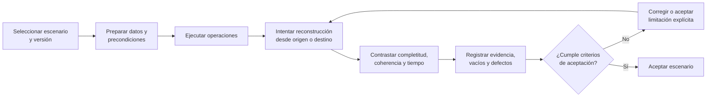

*Nota.* Elaboración propia a partir de `metodologia_desarrollo.md`, la sección 2.6 del Marco teórico y conceptual y el plan de Transición de `TODO_PROYECTO_GRADO.md`.

### 3.5.4. Criterios de aceptación del producto integrado

El producto integrado deberá permitir reconstruir la ruta principal desde una recolección validada hasta una plantación sin consultar la memoria de las personas para completar los campos comprometidos. Las cantidades deberán ser explicables dentro de su unidad y etapa; las transformaciones observadas deberán aparecer como nuevos resultados registrados; y cada transferencia deberá identificar origen, destino, cantidad, responsable y fecha.

La evidencia deberá recuperarse junto con el hecho al que respalda. Su presencia no se interpretará como certificación de la realidad física. Si un dato requerido no fue registrado, la consulta deberá mostrar la ausencia y el escenario se calificará según el criterio acordado, sin completar la traza mediante supuestos.

La aceptación final utilizará los resultados de verificación y validación, los defectos residuales y los límites conocidos. No incluirá supervivencia, mantenimiento, captura de carbono, MRV, certificación, blockchain ni desempeño nacional, porque esas capacidades no forman parte del producto académico evaluado.

### 3.5.5. Estado de los resultados

Los resultados de OBJ-05 permanecen abiertos hasta ejecutar los escenarios sobre una versión identificada. El borrador no atribuye reducción de tiempo, mejora de exactitud ni completitud total. La versión final deberá informar cuántos escenarios se ejecutaron, cuáles fueron reales o controlados, qué elementos se recuperaron, qué inconsistencias aparecieron, cuánto tiempo requirió cada reconstrucción y qué decisión se tomó.

## 3.6. Síntesis del avance del Marco aplicativo

**Tabla 3.16**

*Correspondencia entre objetivos, productos y estado del capítulo*

| Objetivo | Producto principal presentado | Evidencia disponible | Estado al 15 de septiembre de 2026 |
|---|---|---|---|
| OBJ-01 Analizar | flujo actual, actores, soportes, ocho problemas y ocho necesidades | reunión, entrevista, observación, fotografías, dossier y documentación operativa | borrador desarrollado; pendiente revisión de la tutora |
| OBJ-02 Diseñar | recorrido, requisitos, modelo de dominio, estados, contratos, arquitectura e invariantes | módulos, contratos, ADR, esquema y arquitectura | borrador desarrollado; pendientes externos, GPS, identidad y migraciones |
| OBJ-03 Implementar | módulos y ruta principal M1→M2→M3 | implementación y despliegues documentados; migraciones 051–057; QA y builds | parcial; falta cierre formal de M1, ingresos externos y trazabilidad CO-4 |
| OBJ-04 Verificar | matriz de pruebas y evidencia técnica preliminar | unitarias backend, e2e DB, lint, build y QA de plantación | parcial; requiere regresión y expediente sobre versión candidata |
| OBJ-05 Evaluar | escenarios, instrumento y criterios de reconstrucción | diseño metodológico | pendiente de ejecución en Transición |

*Nota.* Elaboración propia a partir de las secciones 3.1 a 3.5, `ESTADO.md`, `TODO_PROYECTO_GRADO.md` y el cronograma rector.

El Marco aplicativo cuenta ahora con una línea argumental completa para revisión: parte de la práctica actual, convierte los hallazgos en un diseño, contrasta el diseño con la implementación disponible, identifica las pruebas necesarias y establece cómo se evaluará la reconstrucción. La versión conserva los resultados abiertos cuando la evidencia todavía no existe y muestra las diferencias que deben resolverse antes de declarar cumplidos los objetivos.

La siguiente actualización deberá incorporar las observaciones de la tutora, cerrar la especificación de ingresos externos, auditar M1, reconciliar GPS e identidad, y anexar la matriz de pruebas con resultados ejecutados. Después de CO-4 y TR-1 se sustituirán los estados provisionales por resultados observados, decisiones de aceptación y conclusiones vinculadas con cada objetivo.
