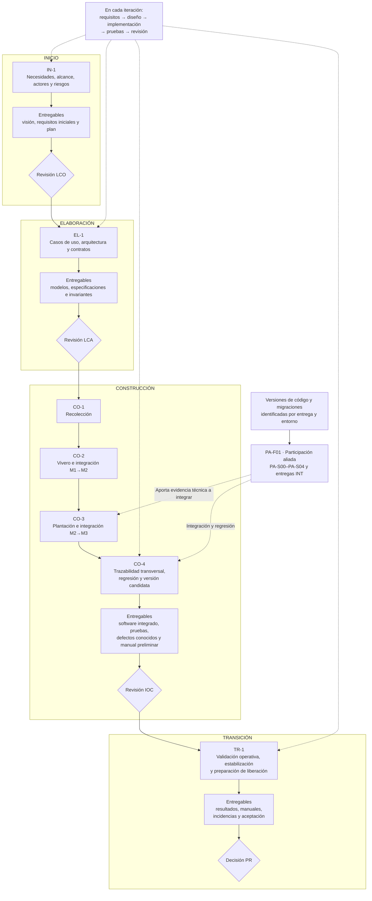

# CAPÍTULO III — MARCO APLICATIVO

Para maquetar las figuras en hojas carta verticales, usar las [láminas por figura](figuras/paginas/README.md). Los bloques Mermaid conservan la fuente completa; los diagramas extensos continúan en paneles legibles.

El presente capítulo documenta el desarrollo de R3Foresta mediante RUP adaptado. El sistema organizó y mantuvo vinculada la información del material vegetal desde su origen registrado hasta la plantación mediante los módulos de Recolección, Vivero y Plantación, apoyados por los datos maestros del Módulo General. El alcance académico concluyó con el registro de la plantación y conservó fuera de la evaluación la medición, certificación y comercialización de bonos de carbono.

El capítulo conserva la relación con los cinco objetivos específicos: analizar la información, diseñar su organización, implementar las funciones, verificar su coherencia y evaluar la reconstrucción del recorrido. La evidencia técnica se distingue de la verificación y de la aceptación; los resultados sin ejecución o decisión documentada permanecen abiertos.

La edición del 4 de noviembre de 2026 integró Inicio, Elaboración, Construcción y Transición en una exposición retrospectiva del sistema desarrollado, conforme a la instrucción del autor. La actualización del 16 de noviembre incorpora los refinamientos aprobados y la evidencia disponible a esa fecha, sin alterar los cortes históricos ni anticipar hitos pendientes. Los informes de implementación y pruebas conservaron sus fechas, versiones y entornos. La síntesis de la sección 3.5.6 relacionó los productos con cada objetivo y delimitó lo demostrado por la evidencia disponible. La [versión anterior a este cierre de redacción](../../../archivo/documentacion-grado/proyecto_grado/cierre-capitulo-iii-2026-11-04/README.md) conserva los estados históricos sustituidos.

## Organización del capítulo y aplicación de RUP adaptado

### Estrategia metodológica general

RUP adaptado organiza las decisiones del proyecto por fases, iteraciones, riesgos y productos. Las técnicas de entrevista, observación y análisis documental aportan información a las disciplinas de requisitos y análisis; no constituyen una metodología investigativa independiente. La aplicación conserva Inicio, Elaboración, Construcción y Transición y selecciona los artefactos según su utilidad y riesgo. La directriz del 3 de noviembre, registrada en el [tablero académico, sección 1.1](../../02_planificacion/TODO_PROYECTO_GRADO.md#11-actualización-documental-a-rup), rige esta revisión del capítulo. El Perfil y la [metodología de desarrollo](../../04_metodologia/metodologia_desarrollo.md) conservan sus versiones y decisiones anteriores; su actualización integral sigue pendiente en ese tablero.

La exposición se organiza en cinco apartados de resultados: **3.1. Análisis de requerimientos**, **3.2. Análisis y diseño del sistema**, **3.3. Implementación por iteraciones RUP**, **3.4. Verificación y pruebas** y **3.5. Validación y aceptación**. Esta organización editorial conserva las cuatro fases de RUP; la verificación es una disciplina transversal, con resultados técnicos reunidos en 3.4.

| Fase RUP | Apartados y productos relacionados |
|---|---|
| Inicio | 3.1: levantamiento, necesidades, requisitos, reglas, actores, casos de uso y revisión LCO |
| Elaboración | 3.2: arquitectura, trazabilidad, modelos de datos, diccionario, integridad y revisión LCA |
| Construcción | 3.3: incrementos CO-1–CO-4 e integración; 3.4: pruebas, resultados y balance IOC |
| Transición | 3.5: escenarios operativos, criterios de aceptación, observaciones y decisión PR |

Inicio reunió diagnóstico, visión, alcance, actores, requisitos iniciales, riesgos y plan. Elaboración justificó los modelos, contratos y arquitectura y detalló los casos de uso prioritarios. Construcción desarrolló e integró capacidades y examinó requisitos e invariantes. Transición organizó la evaluación de la reconstrucción, la estabilización y las condiciones de entrega y aceptación. Las disciplinas se solaparon: el análisis se refinó después de Inicio y las pruebas acompañaron la construcción, sin que cada actividad se convirtiera en una fase adicional.

Las etiquetas de iteración describen la organización académica adoptada el 25 de agosto de 2026. Las fechas reales de levantamiento, implementación y prueba se conservan por separado. Una actividad anterior puede aportar evidencia a un producto metodológico sin que ello pruebe la ejecución o el cierre de la iteración prevista.

### Organización modular del sistema

El Perfil establece tres módulos funcionales asociados con las etapas del material vegetal. La documentación y la aplicación incluyen además el Módulo General como soporte transversal. Esta diferencia explica las cuatro áreas del repositorio sin añadir una cuarta etapa física ni modificar el alcance aprobado.

**Tabla 3.1**

*Etapas operativas y responsabilidades modulares*

| Área del sistema | Relación con el recorrido | Responsabilidad principal |
|---|---|---|
| Módulo General | transversal; no es una etapa física | mantener usuarios y referencias compartidas de viveros, plantas, territorios, organizaciones y evidencia |
| M1 Recolección | origen registrado | registrar y revisar la procedencia, el material, las cantidades y las evidencias de origen |
| M2 Vivero | recepción y manejo previo a la plantación | registrar material recibido, resultados observados, pérdidas, salidas y disponibilidad |
| M3 Plantación | destino y registro en campo | planificar actividades, relacionar plantas entregadas y registrar cantidades efectivamente plantadas |

*Nota.* Elaboración propia a partir del alcance del Perfil, el Capítulo I y los índices de General, Recolección, Vivero y Plantación. Los ingresos externos son variantes de Vivero o Plantación. Historial, trazabilidad, consultas y evidencias son capacidades transversales, no un cuarto módulo funcional.

### Artefactos, trazabilidad y asistencia de IA

Las disciplinas de RUP relacionan las necesidades con requisitos y casos de uso, las decisiones de diseño con los cambios de implementación y estos con pruebas, resultados y revisiones. La relación `necesidad → requisito → diseño → cambio → prueba → resultado → aceptación` permite localizar la evidencia y reconocer vacíos. Los artefactos necesarios para documentarla se seleccionan según el riesgo y la decisión que deben sustentar, aprovechando los identificadores y documentos existentes.

En Inicio basta identificar y priorizar necesidades y requisitos, como muestra la matriz puente de la sección 3.1.6. Elaboración desarrolla las reglas, escenarios, contratos y criterios de las capacidades prioritarias; Construcción los refina cuando corresponde y vincula cada entrega con código y pruebas. Transición evalúa el producto integrado y registra aceptación y condiciones residuales. La visión, los riesgos y las revisiones de hitos conservan su finalidad transversal.

Los documentos de requisitos de los [módulos](../../../README.md#fuentes-de-dominio) aportan comportamiento, reglas y criterios de aceptación; los contratos y ADR sustentan las fronteras y decisiones del diseño. Los planes y las tareas disponibles permiten relacionar el trabajo con sus cambios y comprobaciones. Las entregas INT agrupan trabajo técnico y aportan evidencia a las iteraciones académicas según su alcance y fecha. La correspondencia se documenta con la fecha real de cada artefacto, conservando la distinción entre los productos de julio y los refinamientos posteriores.

La IA puede asistir el análisis, la redacción, el código y las pruebas. La revisión humana conserva la responsabilidad sobre requisitos, decisiones y aceptación. Una salida generada o un documento creado no acredita por sí solo una aprobación ni un resultado de prueba.

### Fases, iteraciones e hitos

La Tabla 3.2 presenta el calendario adoptado por el proyecto. Es una referencia de planificación; la ejecución acreditada y las decisiones de salida se consultan en el [registro de avance metodológico](../../04_metodologia/registro_avance_rup_sdd.md) y el [tablero académico](../../02_planificacion/TODO_PROYECTO_GRADO.md). Sus cortes deben conservarse al interpretar los estados; la actualización integral de las formulaciones metodológicas anteriores del registro permanece en la sección 1.1 del tablero.

**Tabla 3.2**

*Plan de fases, iteraciones y productos principales de 2026*

| Fase e iteración | Periodo planificado | Producto principal | Revisión prevista |
|---|---|---|---|
| Inicio, IN-1 | 6–19 de julio | visión, alcance, actores, requisitos iniciales, riesgos y plan | LCO: objetivos del ciclo de vida |
| Elaboración, EL-1 | 20 de julio–16 de agosto | modelos, arquitectura base, contratos, invariantes y especificaciones prioritarias | LCA: arquitectura del ciclo de vida |
| Construcción, CO-1 | 17 de agosto–6 de septiembre | incremento de Recolección | revisión del incremento |
| Construcción, CO-2 | 7–27 de septiembre | incremento de Vivero e integración M1→M2 | revisión del incremento |
| Construcción, CO-3 | 28 de septiembre–18 de octubre | incremento de Plantación e integración M2→M3 | revisión del incremento |
| Construcción, CO-4 | 19 de octubre–1 de noviembre | trazabilidad transversal, regresión y versión candidata | IOC: capacidad operativa inicial |
| Transición, TR-1 | 2–15 de noviembre | validación operativa, estabilización, manuales y aceptación | PR: liberación del producto |

*Nota.* Elaboración propia a partir del cronograma del Perfil, la metodología y el registro de decisiones del 25 de agosto de 2026. Los periodos no prueban ejecución ni cierre. El registro del 15 de septiembre conserva su estado histórico; el autor confirmó Inicio/LCO terminado y, posteriormente, el texto de Elaboración concluido el 4 de noviembre. Las decisiones actuales se registran en 3.1.10 y 3.2.12; los balances de Construcción y Transición se presentan en 3.4.5 y 3.5.4.

La Figura 3.1 relaciona fases, productos e hitos. Las migraciones y entregas aportan evidencia técnica a las iteraciones; su existencia no determina el cierre metodológico. Cada revisión debe identificar la versión y la evidencia examinadas, participantes, resultado, condiciones y riesgos residuales.

**Figura 3.1. Organización del proceso RUP y relación con la evidencia técnica**

<!-- diagrama: 03_capitulo_marco_aplicativo-01 -->

*Nota.* Elaboración propia a partir del plan metodológico y la revisión de diagramas del 29 de octubre de 2026. La secuencia organiza el proceso y no certifica ejecución o aceptación. PA-F01 agrupa un incremento técnico de participación; sus entregas INT no sustituyen la evaluación de las iteraciones académicas.

El desarrollo del capítulo continúa en:

- [3.1. Análisis de requerimientos](03_1_fase_inicio.md): levantamiento, necesidades, requerimientos funcionales y no funcionales, reglas de negocio, actores y casos de uso.
- [3.2. Análisis y diseño del sistema](03_2_fase_elaboracion.md): arquitectura, trazabilidad, modelos conceptual, lógico y físico, diccionario de datos y reglas de integridad.
- [3.3. Implementación por iteraciones RUP](03_3_fase_construccion.md): incrementos de Recolección, Vivero, Plantación e integración transversal.
- [3.4. Verificación y pruebas](03_verificacion_pruebas.md): cumplimiento de requisitos, integración y coherencia de los registros, con resultados por versión y entorno.
- [3.5. Validación y aceptación](03_4_fase_transicion.md): escenarios operativos, criterios de aceptación, condiciones de entrega y resultados por objetivo.

Los nombres físicos de los archivos se conservaron y la numeración académica se expresó en sus encabezados. Las tablas y figuras mantuvieron título y nota para su maquetación conforme a APA 7; el [catálogo de diagramas](figuras/README.md) reunió sus fuentes actualizadas. La revisión universitaria y la maquetación conservaron su control en el tablero académico. Las [versiones históricas](../../../archivo/documentacion-grado/proyecto_grado/README.md) mantuvieron accesibles los textos y estados anteriores.
