> Copia histórica conservada antes de la actualización del 14 de octubre de 2026. Las fuentes mantienen sus fechas originales; los enlaces relativos se ajustaron al traslado. Consultar los [diagramas vigentes](../../diagramas/README.md) y el [tablero de ejecución](../../implementacion/README.md).

# Diagramas y dependencias de PA-F01

**Actualizados:** 12 de octubre de 2026. **Estado:** cinco fuentes Mermaid y SVG regenerados localmente, sin Figma; apoyo de Elaboración, no aprobación de contratos, implementación ni salida a campo.

**Alcance actualizado:** consulta pública sin sesión y experiencia reducida separada de gestión interna; ADMIN global registra en ACTIVA sin membresía contextual adicional; ubicación manual confirmada; fecha en el segundo paso; recuperación del mismo intento y correcciones acotadas. Ver [PA-S00](../../00-experiencia-participante/spec.md), [diseño compartido](../diseno-tecnico-compartido.md) y [acuerdo de correcciones](../revision-correcciones-2026-10-12.md). Modelo conceptual, no ER ni aprobación de tablas nuevas. Ubicación de observaciones aprobada posteriormente al final del paso 2, con resumen condicional en el tercero; el usuario descarta el 12 de octubre el aviso adicional de publicación.

Para continuar la implementación, empezar por el [tablero vigente](../../implementacion/README.md). [PA-D05 y el análisis de dependencias](DEPENDENCIAS.md) conservan el mapa técnico del 12 de octubre. Distingue base reutilizable, adaptación pendiente y condiciones de preparación del piloto, con lectura estática de backend/PWA locales.

| ID | Vista | Qué permite entender | Fuente editable | Render |
|---|---|---|---|---|
| `PA-D01` | Contexto y límite | Actores, permisos, stock M2→M3 y alcance del piloto. | [Mermaid](PA-D01-contexto-limite.mmd) | [SVG](svg/PA-D01-contexto-limite.svg) |
| `PA-D02` | Casos de uso | Quién registra, gestiona acceso, consulta y corrige. | [Mermaid](PA-D02-casos-uso.mmd) | [SVG](svg/PA-D02-casos-uso.svg) |
| `PA-D03` | Actividades | Tres pasos, guardado/consumo atómicos, rechazo y resultado incierto. | [Mermaid](PA-D03-actividades-registro.mmd) | [SVG](svg/PA-D03-actividades-registro.svg) |
| `PA-D04` | Modelo conceptual | Persona, permiso, stock, registro/evidencia y afiliación/crédito separados. | [Mermaid](PA-D04-modelo-conceptual.mmd) | [SVG](svg/PA-D04-modelo-conceptual.svg) |
| `PA-D05` | Dependencias | Qué reutilizar, adaptar y verificar antes del piloto. | [Mermaid](PA-D05-dependencias-implementacion.mmd) | [SVG](svg/PA-D05-dependencias-implementacion.svg) |

## PA-D05 — Qué debe estar preparado


Usuarios y datos operativos existen como base. Sesión verificada en servidor (sin documento de identidad), nuevos permisos, orden de retiro/guardado, idempotencia y contratos necesitan trabajo específico. Consulta, gestión de acceso y corrección excepcional son condiciones del piloto aunque no sean pasos obligatorios de cada registro.

## PA-D01 — Contexto y límite


Stock de subcampaña entregado antes de plantar. Corrección excepcional dentro de preparación del piloto, con mecanismo/efectos pendientes; no hay aprobación del administrador antes de cada guardado. Afiliación y financiación no habilitan permisos.

## PA-D02 — Casos de uso


Plantador y administrador contextual registran; ADMIN global también puede hacerlo directamente en ACTIVA. El administrador gestiona plantadores de su ámbito según PA-S03; R3Foresta designa/cambia/retira administradores y protege al último. Ambos administradores corrigen cantidades/participantes solo en ACTIVA; observaciones sigue central. Cantidades exige ausencia de bajas y reposiciones, sin cambiar especies; aumento por diferencia, reducción con error y disponibilidad física confirmados. Cero sigue fuera del ajuste simple. La decisión posterior del 12 permite reversión de duplicados y eliminación lógica de registros erróneos; estos casos nuevos aún no se representan en los SVG de esta regeneración, consultar PA-S04 y su acta. Participantes conserva responsable original y no altera stock ni permisos. Todo con historial y autoridad verificada. Consulta pública no expone stock/contactos/perfiles completos/EXIF. Retiro conserva lectura propia autorizada. Vista simplificada de producto, no permisos desplegados ni UML exhaustivo.

## PA-D03 — Actividades de registro



Conserva tres pasos del handoff. Registro, detalles, evidencias y consumo se confirman en una transacción. Cargar contexto, abrir formulario y subir fotos no reservan permiso. La autorización se ordena con el retiro: una operación autorizada antes del retiro termina normalmente, aunque puede fallar por otras validaciones. El mecanismo está pendiente.

GPS exterior permitido con evaluación/advertencia; captura fallida o permiso denegado admite coordenadas manuales válidas y punto confirmado. Fallo técnico confirmado del evaluador del servidor: conservar formulario y reintentar sin guardar/consumir. Fecha «Hoy» editable en el segundo paso; participantes opcionales registrados/habilitados en el ámbito, responsable fijo y resumen/confirmación al final del tercero. Revalidar estado, permisos, participantes y saldo; conservar borrador permitido, sin ajustes automáticos. Contratos y mecanismos aún deben verificarse.

Resultado incierto puede ser guardado cuya respuesta se perdió. Recuperar o reintentar el mismo envío sin duplicar está aprobado en comportamiento; clave/endpoint y retención siguen pendientes. La flecha de recuperación representa comprobación o reintento conforme al contrato, no reenvío automático infinito. No es modo offline completo. Abandonar antes de enviar no crea registro; limpiar fotos pendientes según contrato. Tras resultado incierto, resolver intento antes de asumir fotos libres o enviar uno nuevo.

## PA-D04 — Modelo conceptual



Mapa de conceptos, no ER físico ni tablas nuevas. Permiso por persona/subcampaña; registro con una subcampaña y un responsable real. Detalles conservan cantidades por asignación/lote/especie. Organizaciones de campaña y afiliaciones personales son relaciones distintas y no multiplican plantaciones. Financiación/crédito sigue fuera de esta definición. Correcciones conservan original/actor/historial; ajuste trazable de consumo no modifica entrega ni vivero. La distribución/reversión física por asignación sigue en diseño.

## Lectura y mantenimiento

- Fuentes de esta regeneración: [revisión humana del 11/12](../revision-humana-2026-10-11.md) y [correcciones del 12](../revision-correcciones-2026-10-12.md). Los renders representan acuerdos; no los aprueban ni prueban ejecución.
- Flecha continua: relación/acción descrita. En PA-D05: dependencia necesaria, no orden rígido de diseño; entradas convergentes se necesitan juntas.
- Flecha punteada: contexto, alcance posterior o mecanismo/atribución por definir. Leer su etiqueta.
- Azul: ámbito/base reutilizable, no «verificado en producción». Ámbar y `PENDIENTE`: adaptación/alineación/mecanismo sin cerrar. Verde: resultado esperado sujeto a verificación.
- Cuatro vistas conceptuales previstas más PA-D05 para dependencias. No inventan infraestructura, APIs ni esquema de permisos.
- Editar `.mmd` y regenerar SVG; ambos deben representar el mismo contenido.

Configuración de los renders: [mermaid-config.json](mermaid-config.json). Con Mermaid CLI disponible, desde la raíz del repo:

```sh
mmdc -i specs/plantacion/participacion-aliada/diagramas/PA-D05-dependencias-implementacion.mmd -o specs/plantacion/participacion-aliada/diagramas/svg/PA-D05-dependencias-implementacion.svg -c specs/plantacion/participacion-aliada/diagramas/mermaid-config.json -b white
```

Fuentes: [LCO](../../../../../03-plantacion-module/06-LCO_registro_plantacion_organizacion.md), [ADR-PLA-03](../../../../../decisiones/02_decisiones_plantacion.md), [handoff](../../../../../03-plantacion-module/05_handoff_registro_plantacion_inicial.md), [contrato M2→M3](../../../../../90-contratos-integracion/02_contrato_vivero_a_plantacion.md) y [migración 053](../../../../../database/migrations/053_m3_registrar_plantacion_sin_despacho.sql). Evidencia y límites en [DEPENDENCIAS.md](DEPENDENCIAS.md).
