# Diagramas y dependencias de PA-F01

**Actualizados:** 9 de octubre de 2026. **Estado:** apoyo de Elaboración para revisión; no aprueba specs ni acredita implementación.

**Nota de alcance del 10 de octubre:** las specs incorporaron [PA-S00 — cuenta nueva y experiencia participante](../00-experiencia-participante/spec.md) y el [diseño por capas y datos](../diseno-tecnico-compartido.md). Estos renders no se regeneraron en esa organización documental: falta reflejar entrada sin permisos, separación de experiencia interna y contratos de audiencia; las tablas candidatas aún no constituyen un ER aprobado. Usar las specs para esos detalles y alinear `.mmd`/SVG juntos tras revisar las decisiones. El boceto también propone fecha/observaciones en el segundo paso para reutilizar la UI actual.

Para responder **«qué debemos tener antes de implementar»**, empezar por [PA-D05 y el análisis de dependencias](DEPENDENCIAS.md). Distingue base reutilizable, adaptación pendiente y condiciones de preparación del piloto, con lectura estática de backend/PWA locales.

| ID | Vista | Qué permite entender | Fuente editable | Render |
|---|---|---|---|---|
| `PA-D01` | Contexto y límite | Actores, permisos, stock M2→M3 y alcance del piloto. | [Mermaid](PA-D01-contexto-limite.mmd) | [SVG](svg/PA-D01-contexto-limite.svg) |
| `PA-D02` | Casos de uso | Quién registra, gestiona acceso, consulta y corrige. | [Mermaid](PA-D02-casos-uso.mmd) | [SVG](svg/PA-D02-casos-uso.svg) |
| `PA-D03` | Actividades | Tres pasos, guardado/consumo atómicos, rechazo y resultado incierto. | [Mermaid](PA-D03-actividades-registro.mmd) | [SVG](svg/PA-D03-actividades-registro.svg) |
| `PA-D04` | Modelo conceptual | Persona, permiso, stock, registro/evidencia y afiliación/crédito separados. | [Mermaid](PA-D04-modelo-conceptual.mmd) | [SVG](svg/PA-D04-modelo-conceptual.svg) |
| `PA-D05` | Dependencias | Qué reutilizar, adaptar y verificar antes del piloto. | [Mermaid](PA-D05-dependencias-implementacion.mmd) | [SVG](svg/PA-D05-dependencias-implementacion.svg) |

## PA-D05 — Qué debe estar preparado



Usuarios y datos operativos existen como base. Identidad verificada, nuevos permisos, orden de retiro/guardado, idempotencia y alineación de reglas necesitan trabajo específico. Consulta, gestión de acceso y corrección excepcional son condiciones del piloto aunque no sean pasos obligatorios de cada registro.

## PA-D01 — Contexto y límite



Stock de subcampaña entregado antes de plantar. Corrección excepcional dentro de preparación del piloto, con mecanismo/efectos pendientes; no hay aprobación del administrador antes de cada guardado. Afiliación y financiación no habilitan permisos.

## PA-D02 — Casos de uso



Plantador y administrador contextual registran. El administrador incorpora/retira plantadores en su ámbito; R3Foresta designa/cambia/retira administradores y realiza corrección excepcional. Consulta común es una experiencia, no un tercer rol. Retiro conserva lectura propia sin equipo/stock. Las aristas muestran facultades de producto, no permisos desplegados. Es una vista simplificada, no UML exhaustivo.

## PA-D03 — Actividades de registro



Conserva tres pasos del handoff. Registro, detalles, evidencias y consumo se confirman en una transacción. Cargar contexto, abrir formulario y subir fotos no reservan permiso. La autorización se ordena con el retiro: una operación autorizada antes del retiro termina normalmente, aunque puede fallar por otras validaciones. El mecanismo está pendiente.

GPS fuera del polígono conserva bandera/distancia y advertencia según handoff/SQL local; no evaluable bloquea. Alinear RN-PLA-32. Metas/cierre documentados según ADR-PLA-04 y 060/061 locales; confirmar versión aplicada sin asumir despliegue. Ver [hallazgos de reglas](DEPENDENCIAS.md#pa-dep-04--gps-por-alinear).

Resultado incierto puede ser guardado cuya respuesta se perdió. Recuperación/reintento idempotente está pendiente; no se declara una clave/endpoint implementados. Abandonar antes de enviar no crea registro; limpiar fotos pendientes según contrato. Tras resultado incierto, resolver intento antes de asumir fotos libres o enviar uno nuevo.

## PA-D04 — Modelo conceptual



Mapa de conceptos, no ER físico ni tablas nuevas. Permiso por persona/subcampaña; registro con una subcampaña y un responsable real. Detalles conservan cantidades por asignación/lote/especie. Plantación grupal no se multiplica por corresponsables/afiliaciones. Afiliación y financiación son distintas; no inferir crédito desde afiliaciones actuales. Efectos de corrección se precisan aparte, sin devolución automática de stock.

## Lectura y mantenimiento

- Revisión humana del 11 de octubre: [consulta pública sin sesión y paso a registro autenticado](../revision-humana-2026-10-11.md) deben reflejarse en la próxima alineación de actores/entrada. GPS exterior/manual está confirmado y RN-PLA-32 alineada para registro inicial; las menciones anteriores de «alinear RN-PLA-32» describen el corte histórico del render. No se regeneraron dibujos ni se consideran aprobados por actualizar las specs.
- Flecha continua: relación/acción descrita. En PA-D05: dependencia necesaria, no orden rígido de diseño; entradas convergentes se necesitan juntas.
- Flecha punteada: contexto, alcance posterior o mecanismo/atribución por definir. Leer su etiqueta.
- Azul: ámbito/base reutilizable, no «verificado en producción». Ámbar y `PENDIENTE`: adaptación/alineación/mecanismo sin cerrar. Verde: resultado esperado sujeto a verificación.
- Cuatro vistas conceptuales previstas más PA-D05 para dependencias. No inventan infraestructura, APIs ni esquema de permisos.
- Editar `.mmd` y regenerar SVG; ambos deben representar el mismo contenido.

Configuración de los renders: [mermaid-config.json](mermaid-config.json). Con Mermaid CLI disponible, desde la raíz del repo:

```sh
mmdc -i specs/plantacion/participacion-aliada/diagramas/PA-D05-dependencias-implementacion.mmd -o specs/plantacion/participacion-aliada/diagramas/svg/PA-D05-dependencias-implementacion.svg -c specs/plantacion/participacion-aliada/diagramas/mermaid-config.json -b white
```

Fuentes: [LCO](../../../../03-plantacion-module/06-LCO_registro_plantacion_organizacion.md), [ADR-PLA-03](../../../../decisiones/02_decisiones_plantacion.md), [handoff](../../../../03-plantacion-module/05_handoff_registro_plantacion_inicial.md), [contrato M2→M3](../../../../90-contratos-integracion/02_contrato_vivero_a_plantacion.md) y [migración 053](../../../../database/migrations/053_m3_registrar_plantacion_sin_despacho.sql). Evidencia y límites en [DEPENDENCIAS.md](DEPENDENCIAS.md).
